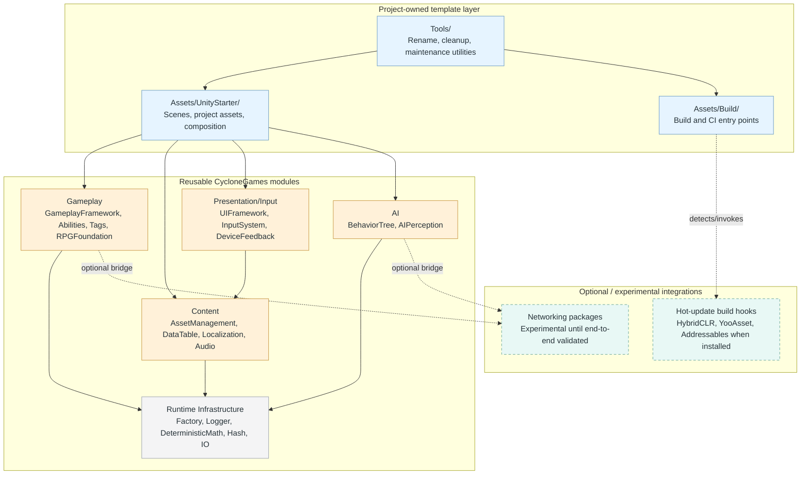

%20│%20UIFramework%20│%20HotUpdate%20Ready%20(HybridCLR)%20│%20CI/CD%20Ready&descAlign=50&descAlignY=58&descSize=16&fontAlignY=30&fontSize=72>)

A modular Unity project with a reusable framework layer, organised after Unreal Engine's gameplay model. `GameplayFramework` follows the `Actor`, `Pawn`, `Controller` and `GameMode` split; `GameplayAbilities` and `GameplayTags` provide the ability and tag primitives those contracts build on.

The repository targets medium and large Unity projects that keep one codebase for years. What that gives a project:

- Each module is a separate UPM package with its own assembly definition, so a project references only what it uses and unused modules never enter the compile or the build.
- Logic that can stay engine-free does, so it runs in EditMode tests, headless processes and CLI tools.
- Module boundaries are held by tests (engine seam, package graph), not only by convention.
- Build pipeline, analyzers and maintenance tools live in the repository and version together with the code.

[English](README.md) | [简体中文](README.SCH.md)

> [!NOTE]
> If you find this project helpful, please consider giving it a star ⭐ Thank you!


[](https://deepwiki.com/MaiKuraki/UnityStarter)

## Table of Contents

- [Table of Contents](#table-of-contents)
- [How to use this repository](#how-to-use-this-repository)
- [What Is Inside](#what-is-inside)
- [Architecture Principles](#architecture-principles)
  - [Project Ownership Model](#project-ownership-model)
- [Repository Layout](#repository-layout)
- [Module Map](#module-map)
  - [Gameplay](#gameplay)
  - [AI](#ai)
  - [Data, Assets And Content](#data-assets-and-content)
  - [Runtime Infrastructure](#runtime-infrastructure)
  - [Build, Tools And Quality](#build-tools-and-quality)
- [Networking Status](#networking-status)
- [Build, CI/CD And Project Tooling](#build-cicd-and-project-tooling)
  - [Build is project-owned infrastructure](#build-is-project-owned-infrastructure)
  - [Tools for derived projects](#tools-for-derived-projects)
- [Getting Started](#getting-started)
  - [Requirements](#requirements)
  - [First Run](#first-run)
  - [Using Individual Modules](#using-individual-modules)
- [Technology Stack](#technology-stack)
- [Documentation](#documentation)
- [Validation Status](#validation-status)
- [Related Projects](#related-projects)

## How to use this repository

UnityStarter provides the structure a project needs before gameplay code exists: asset ownership, separated gameplay architecture, data-driven content, module boundaries, build automation, analyzers and maintenance tools.

Use the repository in two ways:

- **As a project template**: open `UnityStarter/` in Unity, rename it with the bundled tools, and let the project-owned `Assets/Build/` layer evolve with your game.
- **As a package (UPM)** (recommended): move out folders under `CycloneGames` and add them from Package Manager. Packages are independent, so a project imports only the ones it references; each declares its own dependencies.

## What Is Inside

UnityStarter combines a reusable `CycloneGames` framework layer, a Unity project template, a project-owned Build/CI module, standalone maintenance tools, bilingual documentation, and validation-oriented analyzer support.

The [Module Map](#module-map) is the primary index for gameplay, content, UI/input, AI, runtime infrastructure, build tooling, and experimental networking packages.

| Item | Detail |
| --- | --- |
| Unity project root | `UnityStarter/` |
| Unity version source | `UnityStarter/ProjectSettings/ProjectVersion.txt` |
| CycloneGames module folders | `UnityStarter/Assets/ThirdParty/CycloneGames/` |
| Assembly definitions | Package and project assembly boundaries are declared by `.asmdef` files under `UnityStarter/Assets/`. |
| Analyzer rules | 20+ implemented `CycloneGames.Analyzers` rules, staged project-wide by `Assets/Default.ruleset` (Unity auto-applies a root-level ruleset with this exact name) |
| Standalone tools | Go tools with Windows executables under `Tools/Executable/Windows/` |

## Architecture Principles

- **Pure C# first where it matters**: core contracts avoid leaking `UnityEngine` types when logic should remain testable in CLI, EditMode, headless simulation, or future adapters.
- **Unity as the integration layer**: `MonoBehaviour`, `ScriptableObject`, editor tools, scene bindings, and assets bridge into runtime systems without owning complex domain rules.
- **Optional integrations stay isolated**: DI containers, tween engines, scene navigation, serializers, transports, and hot-update backends live behind dedicated integration assemblies.
- **Performance is a design constraint**: hot paths aim for zero-GC or low-GC behavior, predictable ownership, reusable buffers, and explicit lifecycle cleanup.
- **Build is project-owned**: `Assets/Build/` is expected to travel with derived projects and change with product requirements.
- **Docs are part of the API**: long-lived modules are expected to maintain `README.md` and `README.SCH.md` together.

### Project Ownership Model

This diagram is a repository ownership and module responsibility map, not a runtime dependency graph. It shows which parts are expected to evolve with a derived game, which parts are reusable framework modules, and which parts are optional or experimental integrations.



## Repository Layout

```text
<repo-root>/
  README.md / README.SCH.md              # Root bilingual overview
  Docs/                                  # Cross-module guides
  Tools/                                 # Standalone maintenance utilities
  UnityStarter/                          # Unity project root
    Analyzers/CycloneGames.Analyzers/    # Roslyn analyzer project
    Assets/Build/                        # Project-owned Build/CI module
    Assets/ThirdParty/CycloneGames/      # Reusable CycloneGames framework modules
    Assets/UnityStarter/                 # Template project scenes and game-side assets
    Packages/                            # Unity package manifest and lock file
    ProjectSettings/                     # Unity settings, including version source
```

## Module Map

Recommended first pass: `GameplayFramework`, `AssetManagement`, `GameplayAbilities`, `GameplayTags`, `DataTable`, and `Build`.

### Gameplay

| Module | Role | Docs |
| --- | --- | --- |
| **GameplayFramework** | Actor/Pawn/Controller/GameMode structure, gameplay lifecycle, camera flow, and scene-flow foundation. | [README](UnityStarter/Assets/ThirdParty/CycloneGames/CycloneGames.GameplayFramework/README.md) |
| **GameplayFramework.AssetManagement** | Resolves `WorldSettings` references through AssetManagement with explicit handle ownership. | [README](UnityStarter/Assets/ThirdParty/CycloneGames/CycloneGames.GameplayFramework.AssetManagement/README.md) |
| **GameplayFramework.Factory** | Actor creation and release through the Factory lifetime model. | [README](UnityStarter/Assets/ThirdParty/CycloneGames/CycloneGames.GameplayFramework.Factory/README.md) |
| **GameplayFramework.GameplayAbilities** | Exposes ability systems from framework actors and initialises actor information. | [README](UnityStarter/Assets/ThirdParty/CycloneGames/CycloneGames.GameplayFramework.GameplayAbilities/README.md) |
| **GameplayFramework.GameplayTags** | Resolves and modifies tag containers attached to framework actors. | [README](UnityStarter/Assets/ThirdParty/CycloneGames/CycloneGames.GameplayFramework.GameplayTags/README.md) |
| **GameplayAbilities** | GAS-style data-driven ability, attribute, effect, cost, cooldown, and cue system with an explicit authority/replica role and authoritative `AuthorityOnly` execution boundary. The optional Networking integration provides authority-activation protocol building blocks. | [README](UnityStarter/Assets/ThirdParty/CycloneGames/CycloneGames.GameplayAbilities/README.md) |
| **Choreography** | Engine-free action presentation scheduling for animation, audio, VFX, gameplay-event markers, and preload coordination. | [Folder](UnityStarter/Assets/ThirdParty/CycloneGames/CycloneGames.Choreography/) |
| **GameplayTags** | Hierarchical tags, generated constants, query helpers, editor tooling, and integration points. | [README](UnityStarter/Assets/ThirdParty/CycloneGames/CycloneGames.GameplayTags/README.md) |
| **RPGFoundation** | RPG movement and interaction foundations that can integrate with other gameplay packages. | [README](UnityStarter/Assets/ThirdParty/CycloneGames/CycloneGames.RPGFoundation/README.md) |
| **RPGFoundation.Interaction.GameplayFramework** | Framework actor binding for RPG interaction. | [README](UnityStarter/Assets/ThirdParty/CycloneGames/CycloneGames.RPGFoundation.Interaction.GameplayFramework/README.md) |
| **RPGFoundation.Interaction.DeterministicMath** | Fixed-point authority integration for RPG interaction. | [README](UnityStarter/Assets/ThirdParty/CycloneGames/CycloneGames.RPGFoundation.Interaction.DeterministicMath/README.md) |
| **RPGFoundation.Interaction.DeterministicMath.GameplayFramework** | Framework actor bridge for deterministic interaction authority state. | [README](UnityStarter/Assets/ThirdParty/CycloneGames/CycloneGames.RPGFoundation.Interaction.DeterministicMath.GameplayFramework/README.md) |
| **UIFramework** | Window management, UI flow, presentation patterns, and asset-backed UI loading that delegates handle ownership and eviction decisions to `AssetManagement`'s segmented-LRU (SLRU) cache. | [README](UnityStarter/Assets/ThirdParty/CycloneGames/CycloneGames.UIFramework/README.md) |
| **UIFramework.Localization** | Binds Localization to UI windows, with an optional TextMeshPro slice for per-locale layout snapshots. | [README](UnityStarter/Assets/ThirdParty/CycloneGames/CycloneGames.UIFramework.Localization/README.md) |
| **Foundation2D** | 2D foundation package and samples for derived projects. | [Folder](UnityStarter/Assets/ThirdParty/CycloneGames/CycloneGames.Foundation2D/) |

### AI

| Module | Role | Docs |
| --- | --- | --- |
| **BehaviorTree** | Behavior tree runtime, graph editor, tests, and a data-oriented Burst path for homogeneous agents. | [README](UnityStarter/Assets/ThirdParty/CycloneGames/CycloneGames.BehaviorTree/README.md) |
| **BehaviorTree.Spatial** | Optional bridge that publishes nearest-neighbour results into blackboard slots. | [README](UnityStarter/Assets/ThirdParty/CycloneGames/CycloneGames.BehaviorTree.Spatial/README.md) |
| **BehaviorTree.Perception** | Optional bridge that publishes a sensor's nearest target to the blackboard, with a multi-sensor aggregator. | [README](UnityStarter/Assets/ThirdParty/CycloneGames/CycloneGames.BehaviorTree.Perception/README.md) |
| **BehaviorTree.EnvQuery** | Optional bridge that runs an environment query and publishes the best candidate. | [README](UnityStarter/Assets/ThirdParty/CycloneGames/CycloneGames.BehaviorTree.EnvQuery/README.md) |
| **AIPerception** | Jobs and Burst based perception: sensors, memory, transition events, team attitudes. | [README](UnityStarter/Assets/ThirdParty/CycloneGames/CycloneGames.AIPerception/README.md) |
| **AIEnvQuery** | Candidate generation and weighted scoring for position choice. Engine-free core. | [README](UnityStarter/Assets/ThirdParty/CycloneGames/CycloneGames.AIEnvQuery/README.md) |
| **AIResources** | Claim table for resources that admit one owner at a time, with priority preemption and lease expiry. | [README](UnityStarter/Assets/ThirdParty/CycloneGames/CycloneGames.AIResources/README.md) |

### Data, Assets And Content

| Module | Role | Docs |
| --- | --- | --- |
| **AssetManagement** | Interface-first asset loading abstraction with bounded segmented-LRU (SLRU) caching, `CacheRetention` policies/scheduler, provider abstraction, diagnostics, and async loading flows. | [README](UnityStarter/Assets/ThirdParty/CycloneGames/CycloneGames.AssetManagement/README.md) |
| **AtlasPipeline** | Sprite import and SpriteAtlas V2 generation with incremental indexing and build-time validation. | [README](UnityStarter/Assets/ThirdParty/CycloneGames/CycloneGames.AtlasPipeline/README.md) |
| **DataTable** | Designer-facing data pipeline with optional Luban, MessagePack, and asset-management bridges. | [README](UnityStarter/Assets/ThirdParty/CycloneGames/CycloneGames.DataTable/README.md) |
| **GameplayTags.DataTable** | DataTable integration for GameplayTags authoring and loading. | [README](UnityStarter/Assets/ThirdParty/CycloneGames/CycloneGames.GameplayTags.DataTable/README.md) |
| **Choreography.AssetManagement** | Optional Choreography resource provider bridge for `CycloneGames.AssetManagement`. | [Folder](UnityStarter/Assets/ThirdParty/CycloneGames/CycloneGames.Choreography.AssetManagement/) |
| **Choreography.CycloneAudio** | Optional Choreography audio provider bridge for `CycloneGames.Audio`. | [Folder](UnityStarter/Assets/ThirdParty/CycloneGames/CycloneGames.Choreography.CycloneAudio/) |
| **Localization** | Validated locale fallback, partitioned text/assets, transactional catalogs, and editor translation workflows. | [README](UnityStarter/Assets/ThirdParty/CycloneGames/CycloneGames.Localization/README.md) |
| **Audio** | Audio management layer with async loading, runtime ownership, and platform-aware policies. | [README](UnityStarter/Assets/ThirdParty/CycloneGames/CycloneGames.Audio/README.md) |
| **Audio.Localization** | Keeps the audio voice locale in step with the Localization locale. | [README](UnityStarter/Assets/ThirdParty/CycloneGames/CycloneGames.Audio.Localization/README.md) |
| **FontAssets** | CJK, Latin, symbol, and number font assets. | [Folder](UnityStarter/Assets/ThirdParty/CycloneGames/CycloneGames.FontAssets/) |

### Runtime Infrastructure

| Module | Role | Docs |
| --- | --- | --- |
| **Factory** | Factory and object pooling module with DI-friendly use and ECS/DOD variants. | [README](UnityStarter/Assets/ThirdParty/CycloneGames/CycloneGames.Factory/README.md) |
| **Logging** | Unity-free logging contracts, channels, severity, process-writer routing, and a safe null writer. | [README](UnityStarter/Assets/ThirdParty/CycloneGames/CycloneGames.Logging/README.md) |
| **Logging Pipeline** | Unity-free bounded processing, filtering, sinks, file output, statistics, and deterministic shutdown. | [README](UnityStarter/Assets/ThirdParty/CycloneGames/CycloneGames.Logging.Pipeline/README.md) |
| **Logging Unity** | Optional Unity lifecycle, settings, Console sink, Editor tooling, and build integration for the logging pipeline. | [README](UnityStarter/Assets/ThirdParty/CycloneGames/CycloneGames.Logging.Unity/README.md) |
| **DeterministicMath** | Fixed-point deterministic math for replay, simulation, and lockstep-friendly systems. | [README](UnityStarter/Assets/ThirdParty/CycloneGames/CycloneGames.DeterministicMath/README.md) |
| **Hash** | Deterministic hashing primitives for manifests, protocol checks, IDs, and consistency. | [README](UnityStarter/Assets/ThirdParty/CycloneGames/CycloneGames.Hash/README.md) |
| **IO** | Managed file and path utilities for Unity-aware foundation modules. | [README](UnityStarter/Assets/ThirdParty/CycloneGames/CycloneGames.IO/README.md) |
| **Persistence** | Unity-free, bounded, versioned single-record orchestration with strict Record V1 integrity checks and serializer/storage-neutral contracts. | [README](UnityStarter/Assets/ThirdParty/CycloneGames/CycloneGames.Persistence/README.md) |
| **Persistence.SystemIO** | Optional System.IO storage and Unity `persistentDataPath` composition, with bounded reads and atomic commit behavior. | [README](UnityStarter/Assets/ThirdParty/CycloneGames/CycloneGames.Persistence.SystemIO/README.md) |
| **Persistence.VYaml** | Optional generated-resolver VYaml codec for readable UTF-8 persistence payloads. | [README](UnityStarter/Assets/ThirdParty/CycloneGames/CycloneGames.Persistence.VYaml/README.md) |
| **Persistence.MessagePack** | Optional assembly-gated MessagePack codec source; inactive until its pinned binary, analyzer, and Unity bridge are installed. | [README](UnityStarter/Assets/ThirdParty/CycloneGames/CycloneGames.Persistence.MessagePack/README.md) |
| **InputSystem** | Validated YAML input authoring with prioritized mapping contexts, per-player device ownership, local multiplayer, binding profiles, Editor tooling, and opt-in integrations. | [README](UnityStarter/Assets/ThirdParty/CycloneGames/CycloneGames.InputSystem/README.md) |
| **InputSystem.AssetManagement** | Optional physical package-loading bridge between InputSystem, AssetManagement, and VContainer. | [README](UnityStarter/Assets/ThirdParty/CycloneGames/CycloneGames.InputSystem.AssetManagement/README.md) |
| **DeviceFeedback** | Haptics, vibration, rumble, and device-light feedback abstractions. | [README](UnityStarter/Assets/ThirdParty/CycloneGames/CycloneGames.DeviceFeedback/README.md) |
| **Settings** | Unity-free cloned settings state with defaults, validation, forward migration, isolated snapshots, and typed post-commit notifications. | [README](UnityStarter/Assets/ThirdParty/CycloneGames/CycloneGames.Settings/README.md) |
| **Settings.Persistence** | Optional integration that composes Settings state and migration with one Persistence Store without coupling either Core. | [README](UnityStarter/Assets/ThirdParty/CycloneGames/CycloneGames.Settings.Persistence/README.md) |
| **Utility** | Common Unity utility components and helpers. | [Folder](UnityStarter/Assets/ThirdParty/CycloneGames/CycloneGames.Utility/) |
| **Cheat** | Build-gated internal cheat command system with VitalRouter integration. | [README](UnityStarter/Assets/ThirdParty/CycloneGames/CycloneGames.Cheat/README.md) |
| **EventBus** | Zero-allocation event bus with pooled subscription handles, a bounded cross-thread ring, and optional R3, UniTask, VitalRouter and Logging adapters. | [README](UnityStarter/Assets/ThirdParty/CycloneGames/CycloneGames.EventBus/README.md) |
| **Scheduling** | Bounded cooperative work scheduling with lane priority, soft frame budgets, fault isolation and deterministic shutdown. | [README](UnityStarter/Assets/ThirdParty/CycloneGames/CycloneGames.Scheduling/README.md) |
| **Spatial** | Uniform spatial hash grid for broad-phase queries, with handle lifetime, structure-of-arrays storage and a single-writer thread model. | [README](UnityStarter/Assets/ThirdParty/CycloneGames/CycloneGames.Spatial/README.md) |

### Build, Tools And Quality

| Area | Role | Docs |
| --- | --- | --- |
| **Build** | Project-owned player build pipeline, version info, optional hot-update hooks, and CI-facing methods. | [README](UnityStarter/Assets/Build/README.md) |
| **Tools** | Go tools for project rename, package trimming, cleanup, file trees, and asset processing. | [README](Tools/README.md) |
| **Analyzers** | Unity-focused Roslyn analyzer rules for performance, safety, async, and conventions. The project-wide severity policy lives in `Assets/Default.ruleset`. | [README](UnityStarter/Analyzers/CycloneGames.Analyzers/README.md) |

## Networking Status

The networking layer is an experimental foundation. Production adoption requires end-to-end validation with the selected transport, serializer, authority model, reconnect flow, platform target, and gameplay replication policy.

| Module | Role | Status |
| --- | --- | --- |
| **Networking** | Transport-neutral contracts, message catalogs, protocol manifests, sessions, replication, security, serializers, adapters, and diagnostics. | Experimental. [README](UnityStarter/Assets/ThirdParty/CycloneGames/CycloneGames.Networking/README.md) |
| **GameplayFramework.Networking** | Session bridge, actor migration serialization, authority roles, and observer resolution. | Experimental. [README](UnityStarter/Assets/ThirdParty/CycloneGames/CycloneGames.GameplayFramework.Networking/README.md) |
| **GameplayAbilities.Networking** | Command, prediction, state replication, cue and endpoint contracts for GameplayAbilities. | Experimental. [README](UnityStarter/Assets/ThirdParty/CycloneGames/CycloneGames.GameplayAbilities.Networking/README.md) |
| **AIPerception.Networking** | Perception event, snapshot, memory, authority, and host-migration contracts. | Experimental. [README](UnityStarter/Assets/ThirdParty/CycloneGames/CycloneGames.AIPerception.Networking/README.md) |
| **BehaviorTree.Networking** | Behavior tree replication profiles, authority helpers, snapshots, and blackboard deltas. | Experimental. [README](UnityStarter/Assets/ThirdParty/CycloneGames/CycloneGames.BehaviorTree.Networking/README.md) |
| **RPGFoundation.Movement.Networking** | Movement input, snapshot, correction, teleport, authority transfer, validation, history, and reconciliation contracts. | Experimental. [README](UnityStarter/Assets/ThirdParty/CycloneGames/CycloneGames.RPGFoundation.Movement.Networking/README.md) |
| **RPGFoundation.Interaction.Networking** | Interaction DTOs, vector conversion, authority validation bridge, and message catalog registration. | Experimental. [README](UnityStarter/Assets/ThirdParty/CycloneGames/CycloneGames.RPGFoundation.Interaction.Networking/README.md) |
| **RPGFoundation.Projectile.Networking** | Projectile protocol metadata, DTOs, validation helpers, prediction reconciliation, snapshot history, and authority bridge contracts. | Experimental. [README](UnityStarter/Assets/ThirdParty/CycloneGames/CycloneGames.RPGFoundation.Projectile.Networking/README.md) |

## Build, CI/CD And Project Tooling

### Build is project-owned infrastructure

`UnityStarter/Assets/Build/` is project-owned infrastructure. Product projects can adjust scenes, version prefixes, output layout, hot-update assembly lists, platform signing, and release rules there.

When a developer derives a new game from UnityStarter and runs `rename_project`, the Build layer remains part of the new project and should continue to be maintained there.

The Build module includes:

- `BuildData` ScriptableObject configuration.
- Git or Perforce revision metadata through `Build.VersionControl.Editor`; batch-mode and release builds require one, while only an interactive Development build may use the explicit `LocalDevelopment` fallback.
- Editor menu items and command-line player build entry points.
- Optional integrations for HybridCLR, Obfuz, YooAsset 3, and Addressables; missing packages do not break the core build assembly.
- Cheat define control for internal builds.
- A single CI entry point: `Build.Pipeline.Editor.BuildEntryPoints.RunCommandLine`.

Minimal command shape:

```bash
Unity -batchmode -quit -projectPath UnityStarter \
  -executeMethod Build.Pipeline.Editor.BuildEntryPoints.RunCommandLine \
  -buildTarget Win64 \
  -pipelineProfile Assets/UnityStarter/Editor/Build/BuildData.asset \
  -pipelineOutput Build/Windows/Release/UnityStarter.exe \
  -pipelineClean
```

The [Build README](UnityStarter/Assets/Build/README.md) includes deeper configuration notes, hot-update workflows, and CI examples.

### Tools for derived projects

The `Tools/` directory contains standalone Go utilities:

| Tool | Purpose |
| --- | --- |
| `rename_project` | Rename a derived UnityStarter project safely and repeatedly. |
| `remove_unity_packages` | Remove unnecessary packages from `manifest.json`. |
| `unity_project_full_clean` | Clean Unity caches, generated projects, and build artifacts. |
| `audio_volume_normalizer` | Normalize audio loudness with category-aware targets. |
| `texture_channel_packer` | Pack texture channels for mask maps and similar workflows. |
| `unity_video_webm_converter` | Convert videos to Unity-friendly VP8 WebM. |
| `generate_file_tree` | Generate Markdown directory trees for documentation. |

See [Tools README](Tools/README.md) for usage details.

## Getting Started

### Requirements

- The Unity version recorded in `UnityStarter/ProjectSettings/ProjectVersion.txt`.
- Git or Perforce is required for automatic version metadata in batch-mode and release builds; only an interactive Development build may use deterministic `LocalDevelopment` fallback metadata.

### First Run

```bash
git clone https://github.com/MaiKuraki/UnityStarter.git
```

1. Open `UnityStarter/` in Unity Hub.
2. Open `UnityStarter/Assets/UnityStarter/Scenes/Scene_Launch.unity`.
3. Read [GameplayFramework](UnityStarter/Assets/ThirdParty/CycloneGames/CycloneGames.GameplayFramework/README.md) to understand the high-level architecture.
4. Read [Build](UnityStarter/Assets/Build/README.md) before changing build settings or CI methods.
5. If you are creating a new project from this template, run `Tools/Executable/Windows/rename_project.exe` and review [Tools README](Tools/README.md).

### Using Individual Modules

Copy a module folder from `UnityStarter/Assets/ThirdParty/CycloneGames/` into your project, then inspect its `package.json`, `.asmdef` files, README, dependencies, and optional `Integrations/` folders. There is no all-or-nothing import: a project takes the packages it calls and the packages those declare as dependencies. Some modules are self-contained; others depend on shared CycloneGames packages or Unity packages.

## Technology Stack

Versions should be checked in `UnityStarter/Packages/manifest.json`, `UnityStarter/Packages/packages-lock.json`, and `UnityStarter/Packages/nuget-packages/InstalledPackages/`.

| Area | Examples |
| --- | --- |
| Async and reactive | `com.cysharp.unitask`, `com.cysharp.r3`, NuGet `R3` |
| Routing and data | `jp.hadashikick.vitalrouter.unity`, `jp.hadashikick.vyaml`, NuGet `VitalRouter`, NuGet `VYaml` |
| Unity performance stack | Burst, Collections, Mathematics, Profiling Core, Memory Profiler, Profile Analyzer |
| Unity gameplay stack | Input System, Cinemachine, URP, TextMeshPro, UGUI, Splines |
| UI and debug helpers | SoftMask, UIEffect, CompositeCanvasRenderer, UnityDebugSheet, InGameDebugConsole, uPalette |
| Build and analysis | Scriptable Build Pipeline, NuGetForUnity, Roslyn packages for CycloneGames analyzers |
| Optional integrations | VContainer, PrimeTween, Navigathena, Luban, MessagePack, HybridCLR, YooAsset, Addressables, Obfuz, Mirror, Mirage |

## Documentation

| Location | Purpose |
| --- | --- |
| `UnityStarter/Assets/ThirdParty/CycloneGames/*/README.md` | Module-level documentation for long-lived packages. |
| [`UnityStarter/Assets/Build/README.md`](UnityStarter/Assets/Build/README.md) | Build pipeline, hot update, optional packages, and CI. |
| [`UnityStarter/Analyzers/CycloneGames.Analyzers/README.md`](UnityStarter/Analyzers/CycloneGames.Analyzers/README.md) | Analyzer rules, build instructions, and activation guidance. |
| [`Tools/README.md`](Tools/README.md) | Standalone project maintenance tools. |
| [`Docs/AudioBestPractices/AudioBestPractices.md`](Docs/AudioBestPractices/AudioBestPractices.md) | Audio import and runtime audio guidance. |
| [DeepWiki](https://deepwiki.com/MaiKuraki/UnityStarter) | Generated codebase overview. |

## Validation Status

Validation runs through Unity and the test runner in the project.

- Open `UnityStarter/` and confirm the Console has no errors after import.
- Run the EditMode suites of the modules you changed. The full suite is available through Test Runner, or in batch mode:

```bash
Unity -batchmode -nographics -projectPath UnityStarter -runTests   -testPlatform EditMode -testFilter CycloneGames -testResults results.xml -logFile test.log
```

- Two guard suites protect repository-wide invariants and should stay green:
  - `CoreSeamGuardTests` checks that engine-free Core assemblies stay free of Unity types, disk IO and host compilation symbols.
  - `PackageReferenceGuardTests` checks that every cross-package assembly reference is either declared in `package.json` or gated by a capability symbol.
- Build the analyzers with `dotnet build UnityStarter/Analyzers/CycloneGames.Analyzers/CycloneGames.Analyzers.csproj -c Release`.
- Use `Build > Pipeline > Print Selected Profile` before changing BuildData or CI settings.
- Networking modules remain experimental; production use needs end-to-end validation against the chosen transport, serializer and authority model.

## Related Projects

- **[Rhythm Pulse](https://github.com/MaiKuraki/RhythmPulse)** - Rhythm game mechanics collection
- **[Unity GAS Sample](https://github.com/MaiKuraki/UnityGameplayAbilitySystemSample)** - GAS demonstration project

---

**License**: [MIT](LICENSE)
