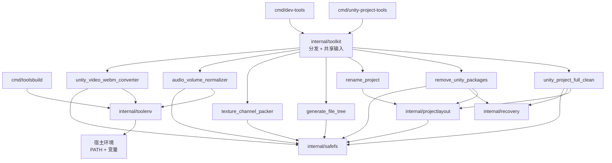

# 仓库工具集

两个跨平台 Go 可执行文件在进程内承载全部仓库工具，无需解释器、包管理器或运行时下载。FFmpeg 等外部程序从宿主环境解析，绝不内置。

<p align="left"><br> <a href="README.md">English</a> | 简体中文</p>

---

## 1. 这套工具解决什么问题

Unity 项目会同时积累可再生状态（导入缓存、IDE 文件、临时构建数据）与不可恢复的源码。删错目录、把清理作用于错误的项目、或在编码中途覆盖媒体产物，代价都很高。

设计在任何工具触碰文件之前先回答四个问题：

1. **作用于哪个项目？** 项目根解析是显式且可审计的，绝不会在多个候选之间静默挑选。
2. **哪些路径属于哪一类别？** 用一份可配置的结构契约描述 Unity 的文件结构，而不是把路径字面量散落到每个工具里。
3. **有哪些外部程序可用？** 可执行文件来自环境变量或 `PATH`；缺失时诊断信息会明确指出需要设置的变量。
4. **宿主允许做什么？** 首次写入之前，先测量或校验路径长度、保留名、大小写敏感性、Unicode 归一化、文件占用与写权限。

所有破坏性操作都是事务式的：先暂存、再校验身份、必要时可回滚。每个命令返回可移植的退出码。

```text
0  成功          1  失败          2  用法错误          130  被信号取消
```

---

## 2. 快速开始

```bash
# 列出命令
unity-project-tools --list
dev-tools --list

# 只读预览清理，不写入任何内容
unity-project-tools unity_project_full_clean --project ./MyProject --dry-run --ci

# 非交互执行清理
unity-project-tools unity_project_full_clean --project ./MyProject --ci

# 生成目录树
dev-tools generate_file_tree --ci --target ./MyProject/Assets --depth 3 -o tree.md
```

第一个词选择命令，其余参数原样转发。`<binary> --help` 输出命令列表，`<binary> <command> --help` 输出该命令的参数说明。

### 最小安全流程

| 步骤 | 命令 | 作用 |
| --- | --- | --- |
| 1 | `unity-project-tools unity_project_full_clean --project <root> --dry-run --ci` | 只读计划，不创建也不写入任何文件。 |
| 2 | 检查打印出的清单与项目根来源。 | 确认目标是预期项目。 |
| 3 | `unity-project-tools unity_project_full_clean --project <root> --ci` | 通过带日志的隔离区执行清理。 |

在 Windows 上双击可执行文件会显示编号菜单。破坏性命令要求输入 `CLEAN`；菜单与命令共用同一个输入读取器，已输入的行不会丢失。

---

## 3. 架构



每个工具包都是独立的：只依赖共享契约与标准库，不导入其它工具，也不依赖其它工具写下的状态。从二进制中移除某个命令，或从模块中删除某个工具包，其余命令仍能编译并运行。

| 包 | 职责 |
| --- | --- |
| `internal/toolkit` | 命令注册表、分发、退出码、唯一共享输入读取器、TTY 感知暂停 |
| `internal/projectlayout` | Unity 文件结构契约及可选的项目级覆盖 |
| `internal/projectroot` | 项目根发现、来源记录、歧义检测 |
| `internal/recovery` | 区分进行中的构建事务与已完成记录 |
| `internal/toolenv` | 外部可执行文件解析与有界子进程执行 |
| `internal/safefs` | 宿主文件系统事实、路径策略、占用检测、原子发布 |
| `internal/term` | 进度与暂停行为的终端检测 |
| `internal/logging` | stderr 上的结构化诊断 |

---

## 4. 共享契约

### 4.1 项目结构布局

Unity 的结构标记用于识别项目根。工具需要的其余内容全部是可移植相对路径，集中在一份 `Layout` 文档中。契约里没有任何项目名、盘符或机器路径。

| 分组 | 默认条目 | 使用者 |
| --- | --- | --- |
| `markers` | `Assets`、`ProjectSettings` | 项目根发现 |
| `projectVersionFile`、`manifestFile`、`packagesLockFile` | Unity 元数据文件 | 严格校验 |
| `cacheRoots` | `.vs`、`.utmp`、`obj`、`Logs`、`Library` | 清理 |
| `publicationRoots` | `Build`、`Bundles`、`HybridCLRData`、`yoo`、`HotUpdateAssetsPreUpload` | 所有权感知清理 |
| `durableRoots` | `.buildpipeline`、`Temp/BuildPipeline/Workspace` | 永不删除 |
| `transactionsDir`、`workspaceDir`、`quarantineDir`、`leaseFile`、`leaseMetadataFile` | 构建工作区状态 | 清理、包移除 |
| `ownerSuffix`、`ownerMarkerNames` | 所有权旁车文件 | 出版物校验 |
| `identityRegistry`、`renameStateFile`、`renameBackupDir`、`renameLockDir` | 可选改名输入 | 改名 |

项目可以在根目录放置 `Tools/project-layout.json` 覆盖任意字段，也可以通过 `--layout <path>` 指定。覆盖项是合并到默认值之上的，因此只需声明不同之处。每个条目都会被校验：必须相对、不含父级穿越、使用可移植字符、符合宿主的组件长度限制，且可变状态必须位于受保护根之内。

```json
{
  "cacheRoots": ["Library", "Logs", "obj", ".vs", "Intermediates"],
  "publicationRoots": ["Artifacts", "Bundles"]
}
```

上例新增一个缓存根并收窄出版物根，其余字段保持默认。未知成员、重复文档与尾随数据一律拒绝。

### 4.2 外部可执行文件

`internal/toolenv` 按以下顺序解析可执行文件：

1. 以工具名命名的覆盖环境变量（`ffmpeg` → `FFMPEG`，`ffprobe` → `FFPROBE`，`go` → `GO`）。取值可以是通过 `PATH` 解析的裸名称，也可以是完整路径。
2. 按工具名在 `PATH` 中查找。

不内置任何二进制，也不嵌入默认安装目录。工具缺失时，错误信息会同时指出 `PATH` 要求与可设置的覆盖变量。

```bash
# 使用机器现有的程序
export PATH="/opt/media/bin:$PATH"

# 或把某个工具指向固定版本
export FFMPEG="/opt/media/bin/ffmpeg-7.1"
```

所有子进程都经过同一个执行器，它提供：

- 有界生命周期（`--ffmpeg-timeout`、`--timeout`）；
- `Cmd.WaitDelay`，因此包装脚本或持有继承管道的孙进程不会在取消后把工作线程卡死；
- Unix 上的进程组终止；
- 有界的 stderr 捕获，长编码日志同时保留开头与结尾；
- 明确区分*无法启动*、*非零退出*、*超时*与*已取消*。

因此 FFmpeg 缺失会被报告为启动失败，而不会伪装成"没有视频流"或"无法检测峰值音量"。

### 4.3 宿主文件系统规则

`internal/safefs` 在工具写入之前测量或强制以下行为：

| 关注点 | 行为 |
| --- | --- |
| 大小写敏感性 | 写入同一名称的两种拼写并比较文件身份来实测；路径比较使用实测结果，不按操作系统猜测。 |
| Unicode 归一化 | 用组合与分解两种拼写实测；能识别会归一化名称的卷（macOS 常见）。 |
| 路径长度 | Windows 的 `MAX_PATH` 通过 `\\?\` 扩展前缀绕过，上限为扩展路径限制；Unix 使用 `PATH_MAX`。 |
| 保留名 | 拒绝 Windows 设备名（`CON`、`NUL`、`COM1`…）以及以空格或点结尾的名称。 |
| 非法字符 | 按组件拒绝平台特定的字符集与控制字符。 |
| 写权限 | 事务开始之前用一次性探针文件证明目录可写。 |
| 文件占用 | Windows 检测拒绝共享的已打开句柄；Unix 使用非阻塞建议锁。被占用目标给出可操作提示并可重试。 |
| 挂载边界 | Linux 优先使用挂载 ID，旧内核回退到设备号；macOS 比较设备号；Windows 校验卷并拒绝重解析点。 |
| 发布 | `PublishReplace` 与 `PublishNoReplace` 先写完整暂存文件、确认目标状态、原子移动，再同步父目录。 |

### 4.4 构建事务恢复

构建管线会把已完成的日志、临时目录与空闲锁文件留在磁盘上。它们是持久状态，不是半成品操作的证据。`internal/recovery` 只在以下情况阻断变更：

- 事务文档声明了进行中阶段，例如 `Applying`、`Claimed`、`InProgress`；或
- 锁文件当前被存活进程持有。

终态阶段（`Published`、`Adopted`、`Completed`、`RolledBack`…）与无法分类的信封文件只作为诊断信息上报。希望未知记录也阻断时，使用 `--strict-recovery`。

被中断的清理在日志可校验时会自动恢复；`--resolve-stale-quarantine` 仍作为显式入口保留。一次中断不会让工具永久不可用。

---

## 5. 项目根发现

操作 Unity 项目的命令按以下顺序解析项目根：

1. `--project <path>` —— 严格校验，绝不回退。
2. 当前工作目录本身。
3. 当前工作目录的一级子目录。
4. 当前工作目录的祖先目录。
5. 可执行文件所在目录的祖先及其子目录。

包含**多个**项目的目录绝不会被隐式解析：命令以 `AmbiguousRootsError` 退出并列出全部候选，要求使用 `--project`。格式有误的兄弟项目不会掩盖健康项目，它会被列为被拒绝的候选。

破坏性的非交互运行只允许作用于显式 `--project`，或本身即为项目根的工作目录。推断出的根可用于预览和交互式会话——后者会打印解析出的根并要求输入确认。

```bash
# 无歧义，脚本推荐用法
unity-project-tools unity_project_full_clean --project ./MyProject --ci

# 在项目根内部运行
cd ./MyProject
unity-project-tools unity_project_full_clean --ci
```

---

## 6. 命令参考

### 6.1 `unity-project-tools`

#### `unity_project_full_clean`

删除可再生缓存；在明确要求时，也删除已被证明由构建管线拥有的出版物树。

| 参数 | 含义 |
| --- | --- |
| `--project <path>` | 显式项目根。 |
| `--layout <path>` | 结构覆盖文档。 |
| `--ci` | 非交互，无需输入确认。 |
| `--dry-run` | 只读预览，不创建文件。 |
| `--include-build-outputs` | 同时删除已校验的构建所有出版物。 |
| `--resolve-stale-quarantine` | 显式完成被中断的清理。 |
| `--strict-recovery` | 把无法分类的事务记录也视为阻断项。 |
| `--max-entries <n>` | 单个清理目标的条目预算。 |
| `--max-depth <n>` | 单个清理目标的深度预算。 |

行为说明：

- `cacheRoots` 中的缓存按实测的卷大小写行为匹配，因此 `obj` 与 `Obj` 都会清理。
- `Temp` 保留构建工作区，其余子项被移除。
- 没有可验证所有权标记的出版物树会报告为跳过，绝不删除；存在但格式损坏的标记会失败关闭。
- `durableRoots` 永不删除，预览中会报告其占用。
- 删除前先把每个目标移入带日志的隔离区，再通过绑定的目录句柄移除；任何失败都会恢复已声明的路径。
- 数 GB 的 `Library` 由有界工作池删除并定期报告进度；项目之间检查取消信号。
- 缓存目录天然是活跃的：编辑器、导入器、索引器或杀毒软件可能在扫描期间写入 `Logs`、`Library`、`Temp/Burst`。因此目录大小与时间戳不作为身份判据；身份是文件系统对象本身及其类型，并在删除前与路径包含关系一起复核。隔离区移动遇到共享冲突会有限重试；若持续被占用，会给出可操作的提示。

```bash
unity-project-tools unity_project_full_clean --project ./MyProject --dry-run --ci
unity-project-tools unity_project_full_clean --project ./MyProject --ci --include-build-outputs
```

#### `remove_unity_packages`

从 `Packages/manifest.json` 移除显式授权的包。

| 参数 | 含义 |
| --- | --- |
| `--allow-package <id>` | 授权一个包，可重复。 |
| `--allow-referenced-package <id>` | 授权一个被引用包，可重复。 |
| `--profile <path>` | 严格的 JSON 移除策略。 |
| `--apply` | 提交审阅过的移除。 |
| `--dry-run` | 只读预览。 |
| `--project`、`--layout` | 项目根与结构覆盖。 |
| `--resolve-stale-transaction` | 完成被中断的暂存证据。 |
| `--allow-lock-regeneration` | 备份并移除锁文件，让 Unity 重新解析包。 |
| `--strict-recovery` | 把无法分类的事务记录也视为阻断项。 |

不带 `--apply` 时只做预览。提交使用暂存的清单、强制备份与回滚闭包，每一步都会重新校验变更证据。

```bash
unity-project-tools remove_unity_packages --project ./MyProject \
  --allow-package com.example.package --dry-run
unity-project-tools remove_unity_packages --project ./MyProject \
  --allow-package com.example.package --apply
```

#### `rename_project`

事务化地重命名 Unity 项目：项目设置、程序集定义、状态文件与主项目文件夹。

| 参数 | 含义 |
| --- | --- |
| `--project`、`--layout` | 项目根与结构覆盖。 |
| `--dry-run` | 打印完整计划但不写入。 |
| `--company`、`--product`、`--project-name`、`--app-id` | 非交互取值。 |
| `--yes` | 脚本运行时跳过最终确认。 |

`identityRegistry` 是可选的。缺失时跳过依赖它的目标，其余改名照常进行，因此工具可用于任意 Unity 项目。文件读取有字节上限，路径比较使用实测的大小写行为。非终端运行且未提供显式取值时返回用法错误，而不是静默地什么都不做。

```bash
unity-project-tools rename_project --project ./MyProject --dry-run
unity-project-tools rename_project --project ./MyProject \
  --company "Example" --product "Example Game" --project-name ExampleGame --yes
```

### 6.2 `dev-tools`

#### `generate_file_tree`

为任意目录生成 Markdown 目录树。

| 参数 | 含义 |
| --- | --- |
| `--ci` | 非交互。 |
| `--target <dir>` | 扫描目录。 |
| `--depth <n>` | 最大深度，`0` 为不限。 |
| `--ext`、`--ignore` | 扩展名过滤与额外忽略项。 |
| `--no-default-ignore` | 不使用内置忽略列表。 |
| `--dirs-only`、`--show-size`、`--show-count` | 只显示目录、包含文件大小、报告隐藏项数量。 |
| `--profile`、`-o`、`-i` | 配置档、输出文件、交互模式。 |

输出先暂存再原子发布。输入流关闭会取消交互式运行；目录读取错误会上报并影响退出码。

```bash
dev-tools generate_file_tree --ci --target ./Assets --depth 3 -o tree.md
```

#### `texture_channel_packer`

把灰度源图打包进 RGBA 通道。

| 参数 | 含义 |
| --- | --- |
| `-r`、`-g`、`-b`、`-a` | 各通道源图。 |
| `-o` | 输出 PNG。 |
| `-size <WxH>` | 输出尺寸。 |
| `-preset`、`-ci`、`--dry-run` | 预设与运行模式。 |

输出尺寸有硬上限（16384 × 16384），分配前做溢出检查。源图通过有界的图像配置读取解码，输出先暂存再原子发布。

#### `audio_volume_normalizer`

按类别对 WAV 与 OGG 文件做响度归一化。

| 参数 | 含义 |
| --- | --- |
| `--ci` | 非交互，必须提供 `--input`。 |
| `--input <dir>` | 源目录。 |
| `--format wav\|ogg` | 输出格式。 |
| `--jobs <n>` | 并行工作数，限制为 `1..64`。 |
| `--mono` | 输出单声道。 |
| `--ffmpeg-timeout <duration>` | 单次编码超时。 |

每个文件都通过共享执行器分析与编码。开工前检测输出冲突。编码器先写同目录的部分文件，成功后原子发布。

#### `unity_video_webm_converter`

把视频转换为适合 Unity 的 WebM。

| 参数 | 含义 |
| --- | --- |
| `--ci`、`--input`、`--output` | 非交互的源与目标。 |
| `--preset 1\|2\|3` | 编码预设。 |
| `--overwrite` | 允许替换已有输出。 |
| `--alpha` | 保留透明通道。 |
| `--jobs <n>`、`--ffmpeg-timeout <duration>` | 并发数与单次编码超时。 |

任意预设生成的输出都会从后续输入扫描中排除，切换预设不会重复编码先前的结果。进度条只在交互式终端绘制，管道输出保持干净。

### 6.3 `toolsbuild`

生成各平台发布包。

| 参数 | 含义 |
| --- | --- |
| `--targets <csv>` | GOOS/GOARCH 列表，按 `go tool dist list` 校验。 |
| `--output <dir>` | 输出根目录。 |
| `--module-root <dir>` | 模块根覆盖，也可用 `TOOLS_MODULE_ROOT` 设置。 |
| `--verify` | 构建后运行当前平台的各二进制。 |
| `--list` | 输出支持的平台后退出。 |
| `--timeout <duration>` | 单次构建超时。 |

```bash
go run ./cmd/toolsbuild --targets windows/amd64,linux/arm64 --output ./bundle
toolsbuild --module-root /path/to/Scripts --targets "$(go env GOOS)/$(go env GOARCH)" --verify
```

该二进制可 relocate：`--module-root` 或 `TOOLS_MODULE_ROOT` 让它能在任意目录运行，Go 工具链本身也从宿主环境解析。

---

## 7. 环境变量

| 变量 | 用途 |
| --- | --- |
| `FFMPEG` | 覆盖音频与视频工具使用的可执行文件。 |
| `FFPROBE` | 覆盖媒体探测使用的可执行文件。 |
| `GO` | 覆盖 `toolsbuild` 使用的 Go 工具链。 |
| `TOOLS_MODULE_ROOT` | 为 relocate 后的 `toolsbuild` 指定 Go 模块位置。 |
| `TOOLS_DELETION_WORKERS` | 清理删除 worker 的全局并发上限（`1..64`，默认 `8`）。高吞吐存储可调高，目录元数据竞争明显时调低。 |
| `TOOLS_NO_PAUSE` | 设为 `1` 时禁用 Windows 运行结束暂停。 |

取值可以是通过 `PATH` 解析的裸名称，也可以是完整路径。空值会被忽略。

---

## 8. 平台说明

| 平台 | 注意事项 |
| --- | --- |
| Windows | 长绝对路径通过 `\\?\` 扩展前缀绕过 `MAX_PATH`，UNC 路径使用 UNC 扩展形式。拒绝保留设备名、备用数据流以及以点或空格结尾的名称。共享冲突表示其它进程持有文件——请关闭编辑器、资源管理器、杀毒软件或播放器。授权替换前会清除只读属性。 |
| Linux | 挂载身份优先使用 `STATX_MNT_ID`，旧内核回退到设备号。`renameat2(RENAME_NOREPLACE)` 提供不覆盖发布；不支持该标志的文件系统回退到存在性检查。建议锁是协作式的。 |
| macOS | 大小写敏感性与 Unicode 归一化都实测而非假设，因为不同 APFS 卷表现不同。`RenamexNp(RENAME_EXCL)` 提供不覆盖发布。 |
| 其它 Unix | build tag 可编译，但不覆盖操作会明确报告该平台原语不可用。 |

终端检测控制进度条与运行结束暂停。管道、重定向、脚本与 CI 都不会暂停。可用 `--no-pause` 或 `TOOLS_NO_PAUSE=1` 显式关闭。

---

## 9. 构建、组合与扩展

### 从源码构建

```bash
cd Tools/Scripts
go build -mod=readonly -trimpath -buildvcs=false -o unity-project-tools ./cmd/unity-project-tools
go build -mod=readonly -trimpath -buildvcs=false -o dev-tools ./cmd/dev-tools
go build -mod=readonly -trimpath -buildvcs=false -o toolsbuild ./cmd/toolsbuild
```

模块声明了最低 Go 版本，因为破坏性工具使用 `os.Root` 与 `Cmd.WaitDelay`。更高版本的工具链可直接构建。

### 新增一个工具

1. 新建一个包，提供 `func Run(arguments []string) int`。
2. 只导入需要的共享契约，在本包内解析参数。
3. 在 `cmd/*/main.go` 的命令表中注册。
4. 在同一个包内补充测试。

任何工具都无需了解其它工具。命令表只是数据，因此二进制可以用任意命令子集构建。

```go
commands := []toolkit.Command{
    {Name: "my_tool", Summary: "Describe the tool.", Run: mytool.Run},
}
```

### 解析外部程序

```go
binary, err := toolenv.MustResolve("my-program")
if err != nil {
    return toolkit.ExitFailure
}
outcome, err := toolenv.Run(ctx, toolenv.Invocation{
    Binary: binary, Args: []string{"--flag"}, Timeout: 2 * time.Minute,
})
if err != nil {
    logging.Error(toolenv.FormatFailure(err, outcome))
    return toolkit.ExitFailure
}
```

### 安全地发布文件

```go
stage, _ := os.CreateTemp(directory, ".output.partial-*")
// 写入并同步暂存文件，然后关闭
if err := safefs.PublishReplace(stage.Name(), outputPath); err != nil {
    return err
}
```

---

## 10. 验证

```bash
cd Tools/Scripts
go build ./...
go vet ./...
gofmt -l .
go test -count=1 ./...
go run ./cmd/toolsbuild --targets "$(go env GOOS)/$(go env GOARCH)" --verify
```

测试覆盖结构合并与校验、事务状态分类、存活锁检测、外部程序解析、取消、有界诊断、宿主路径策略、原子发布、项目根发现与多项目歧义。端到端运行覆盖不同语料规模、随机种子、目录深度、名称拼写、参数组合、并发调用与被中断的清理。

结构化诊断以 `slog` 文本行输出到 stderr，包含 `cmd`、`level` 与键值对；面向用户的提示、进度与摘要输出到 stdout。
