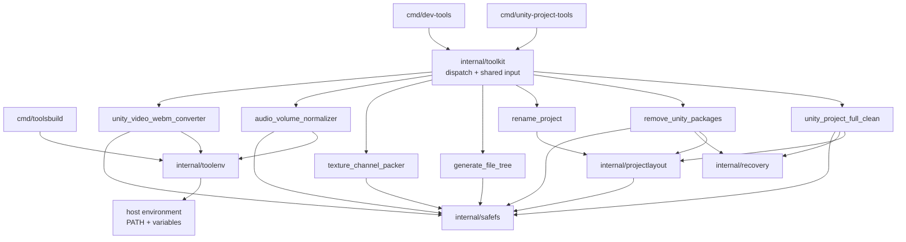

# Repository Tools

Two cross-platform Go executables carry every repository tool in-process. They
need no interpreter, no package manager and no runtime downloads. External
programs such as FFmpeg are resolved from the host environment, never bundled.

<p align="left"><br> English | <a href="README.SCH.md">简体中文</a></p>

---

## 1. What these tools solve

A Unity project accumulates regenerable state (import caches, IDE files,
temporary build data) alongside irreplaceable source. Deleting the wrong
directory, running a cleanup against the wrong project, or overwriting a media
artifact halfway through an encode are all expensive mistakes.

The design answers four questions before any tool touches a file:

1. **Which project?** Root discovery is explicit, auditable, and never silently
   chooses between several candidates.
2. **Which paths belong to which category?** A single configurable layout
   contract describes Unity's structure instead of scattering path literals
   through every tool.
3. **Which external programs exist?** Executables come from environment
   variables or `PATH`; a missing tool produces a diagnostic that names the
   variable to set.
4. **What is the host allowed to do?** Path length, reserved names, case
   sensitivity, Unicode normalization, file occupancy and write permission are
   measured or validated before the first write.

Every destructive operation is transactional: it stages work, verifies
identity, and can roll back. Every command returns a portable exit code.

```text
0  success          1  failure          2  usage error          130  cancelled
```

---

## 2. Quick start

```bash
# List commands
unity-project-tools --list
dev-tools --list

# Preview a cleanup without writing anything
unity-project-tools unity_project_full_clean --project ./MyProject --dry-run --ci

# Apply a cleanup non-interactively
unity-project-tools unity_project_full_clean --project ./MyProject --ci

# Generate a directory tree
dev-tools generate_file_tree --ci --target ./MyProject/Assets --depth 3 -o tree.md
```

The first token selects a command; all remaining arguments are forwarded to it.
`<binary> --help` prints the command list and `<binary> <command> --help`
prints command-specific flags.

### Minimal safe workflow

| Step | Command | Effect |
| --- | --- | --- |
| 1 | `unity-project-tools unity_project_full_clean --project <root> --dry-run --ci` | Read-only plan. No file is created or written. |
| 2 | Review the printed inventory and the resolved root source. | Confirm the target is the intended project. |
| 3 | `unity-project-tools unity_project_full_clean --project <root> --ci` | Performs the cleanup through a journaled quarantine. |

Interactive runs started by double-clicking a Windows binary show a numbered
menu. A destructive command asks you to type `CLEAN`; the menu and the command
share one input reader, so typed lines are never lost.

---

## 3. Architecture



Each tool package is independent. It depends only on the shared contracts and
the standard library; no tool imports another tool, and no tool relies on state
written by a different tool. Removing a command from a binary, or deleting one
tool package from the module, leaves every other command compiling and running.

| Package | Responsibility |
| --- | --- |
| `internal/toolkit` | Command registry, dispatch, exit codes, one shared input reader, TTY-aware pause |
| `internal/projectlayout` | The Unity file-structure contract and its optional per-project override |
| `internal/projectroot` | Root discovery, origin tracking, ambiguity detection |
| `internal/recovery` | Distinguishing active build transactions from completed records |
| `internal/toolenv` | External executable resolution and bounded subprocess execution |
| `internal/safefs` | Host filesystem facts, path policy, occupancy, atomic publishing |
| `internal/term` | Terminal detection for progress and pause behaviour |
| `internal/logging` | Structured diagnostics on stderr |

---

## 4. Shared contracts

### 4.1 Project layout

Unity's structure markers identify a project root. Everything else a tool needs
is a portable relative path collected in one `Layout` document. No project name,
drive letter or machine path is part of the contract.

| Group | Default entries | Used by |
| --- | --- | --- |
| `markers` | `Assets`, `ProjectSettings` | root discovery |
| `projectVersionFile`, `manifestFile`, `packagesLockFile` | Unity metadata files | strict validation |
| `cacheRoots` | `.vs`, `.utmp`, `obj`, `Logs`, `Library` | cleanup |
| `publicationRoots` | `Build`, `Bundles`, `HybridCLRData`, `yoo`, `HotUpdateAssetsPreUpload` | ownership-aware cleanup |
| `durableRoots` | `.buildpipeline`, `Temp/BuildPipeline/Workspace` | never deleted |
| `transactionsDir`, `workspaceDir`, `quarantineDir`, `leaseFile`, `leaseMetadataFile` | build workspace state | cleanup, package removal |
| `ownerSuffix`, `ownerMarkerNames` | ownership sidecars | publication verification |
| `identityRegistry`, `renameStateFile`, `renameBackupDir`, `renameLockDir` | optional rename inputs | rename |

A project can override any field by placing a JSON document at
`Tools/project-layout.json` in its root, or a command can pass
`--layout <path>`. Overrides are merged onto the defaults, so a project declares
only what differs. Every entry is validated: it must be relative, contain no
parent traversal, use portable characters, fit the host's component limit, and
keep mutable state inside a durable root.

```json
{
  "cacheRoots": ["Library", "Logs", "obj", ".vs", "Intermediates"],
  "publicationRoots": ["Artifacts", "Bundles"]
}
```

This adds one cache root and narrows the publication roots while keeping all
other defaults intact. Unknown members, duplicate documents and trailing data
are rejected.

### 4.2 External executables

`internal/toolenv` resolves an executable in this order:

1. An override environment variable named after the tool (`ffmpeg` → `FFMPEG`,
   `ffprobe` → `FFPROBE`, `go` → `GO`). The value may be a bare name resolved
   through `PATH`, or a full path.
2. `PATH` lookup for the tool name.

There is no bundled binary and no embedded installation directory. If a tool is
missing, the error names both the `PATH` requirement and the override variable.

```bash
# Use whatever the machine provides
export PATH="/opt/media/bin:$PATH"

# Or point one tool at a pinned build
export FFMPEG="/opt/media/bin/ffmpeg-7.1"
```

Every subprocess goes through one runner that provides:

- a bounded lifetime (`--ffmpeg-timeout`, `--timeout`);
- `Cmd.WaitDelay`, so a wrapper script or a descendant holding an inherited pipe
  cannot wedge a worker after cancellation;
- process-group termination on Unix;
- bounded stderr capture that keeps both the beginning and the end of a long
  encoder log;
- a deterministic distinction between *could not start*, *exited non-zero*,
  *timed out* and *cancelled*.

A missing FFmpeg is therefore reported as a startup failure, never disguised as
"no video stream" or "could not detect peak volume".

### 4.3 Host filesystem rules

`internal/safefs` measures or enforces the host's behaviour before a tool
writes:

| Concern | Behaviour |
| --- | --- |
| Case sensitivity | Probed by writing two spellings of one name and comparing file identity. Path comparisons use the measured result, not an OS guess. |
| Unicode normalization | Probed with composed and decomposed spellings; volumes that normalize names (common on macOS) are detected. |
| Path length | Windows `MAX_PATH` is bypassed with the `\\?\` extended prefix for absolute paths, up to the extended limit; Unix uses `PATH_MAX`. |
| Reserved names | Windows device names (`CON`, `NUL`, `COM1`…) and trailing spaces or dots are rejected. |
| Illegal characters | Platform-specific character sets and control characters are rejected per component. |
| Write permission | A disposable probe file proves the directory is writable before a transaction begins. |
| File occupancy | Windows detects an open handle that denies sharing; Unix uses a non-blocking advisory lock. Occupied targets produce an actionable message and can be retried. |
| Mount boundaries | Linux uses mount IDs when available and falls back to device identity on older kernels; macOS compares device numbers; Windows checks the volume and rejects reparse points. |
| Publishing | `PublishReplace` and `PublishNoReplace` stage a complete file, prove the target state, move atomically, and sync the parent directory. |

### 4.4 Build transaction recovery

A build pipeline keeps completed journals, scratch folders and idle lock files
on disk. Those are durable state, not evidence of a half-finished operation.
`internal/recovery` blocks a mutation only when:

- a transaction document declares an active phase such as `Applying`,
  `Claimed` or `InProgress`; or
- a lock file is currently held by a live process.

Terminal phases (`Published`, `Adopted`, `Completed`, `RolledBack`…) and
unclassified envelopes are reported as diagnostics. Use `--strict-recovery`
when an unknown record should also block the run.

An interrupted cleanup is recovered automatically when its journal can be
validated; `--resolve-stale-quarantine` remains available as an explicit entry
point. A single interruption does not make a tool permanently unusable.

---

## 5. Project root discovery

Commands that operate on a Unity project resolve the root in this order:

1. `--project <path>` — validated strictly, never falls back.
2. The working directory itself.
3. Immediate subdirectories of the working directory.
4. Ancestors of the working directory.
5. Ancestors of the executable's directory and their subdirectories.

A directory holding **more than one** project is never resolved implicitly: the
command exits with `AmbiguousRootsError` and lists every candidate, asking for
`--project`. A malformed sibling does not hide a healthy project; it is listed
as a rejected candidate.

Destructive, non-interactive runs are permitted only against an explicit
`--project` or a working directory that is itself the project root. Inferred
roots are allowed for previews and for interactive sessions, which print the
resolved root and require a typed confirmation.

```bash
# Unambiguous and recommended for scripts
unity-project-tools unity_project_full_clean --project ./MyProject --ci

# From inside the project root
cd ./MyProject
unity-project-tools unity_project_full_clean --ci
```

---

## 6. Command reference

### 6.1 `unity-project-tools`

#### `unity_project_full_clean`

Deletes regenerable caches and, when requested, publication trees proven to be
owned by the build pipeline.

| Flag | Meaning |
| --- | --- |
| `--project <path>` | Explicit project root. |
| `--layout <path>` | Layout override document. |
| `--ci` | Non-interactive; no typed confirmation. |
| `--dry-run` | Read-only preview. Creates no files. |
| `--include-build-outputs` | Also delete verified build-owned publications. |
| `--resolve-stale-quarantine` | Complete an interrupted cleanup explicitly. |
| `--strict-recovery` | Treat unclassified transaction records as blocking. |
| `--max-entries <n>` | Entry budget for each individual cleanup target. |
| `--max-depth <n>` | Depth budget for each individual cleanup target. |

Behaviour:

- Caches listed in `cacheRoots` are matched using the measured case behaviour of
  the volume, so `obj` and `Obj` are both cleaned.
- `Temp` keeps the build workspace; other children are removed.
- Publication trees without a verifiable ownership marker are reported as
  skipped and never deleted. A present but malformed marker fails closed.
- `durableRoots` are never deleted; their footprint is reported in the preview.
- Deletion moves each target into a journaled quarantine first, then removes it
  through a bound directory handle. On any failure the claims are restored.
- A multi-gigabyte `Library` is removed with a bounded worker pool and periodic
  progress reporting; cancellation is checked between items.

```bash
unity-project-tools unity_project_full_clean --project ./MyProject --dry-run --ci
unity-project-tools unity_project_full_clean --project ./MyProject --ci --include-build-outputs
```

#### `remove_unity_packages`

Removes explicitly authorized packages from `Packages/manifest.json`.

| Flag | Meaning |
| --- | --- |
| `--allow-package <id>` | Authorize one package; repeatable. |
| `--allow-referenced-package <id>` | Authorize a referenced package; repeatable. |
| `--profile <path>` | Strict JSON removal policy. |
| `--apply` | Commit the reviewed removal. |
| `--dry-run` | Read-only preview. |
| `--project`, `--layout` | Root and structure override. |
| `--resolve-stale-transaction` | Complete interrupted staged evidence. |
| `--allow-lock-regeneration` | Back up and remove the lock file so Unity resolves packages again. |
| `--strict-recovery` | Treat unclassified transaction records as blocking. |

Without `--apply` the command only previews. The commit uses a staged manifest,
a mandatory backup and a rollback closure; every step revalidates mutation
evidence.

```bash
unity-project-tools remove_unity_packages --project ./MyProject \
  --allow-package com.example.package --dry-run
unity-project-tools remove_unity_packages --project ./MyProject \
  --allow-package com.example.package --apply
```

#### `rename_project`

Renames a Unity project transactionally: project settings, assembly
definitions, state files and the main project folder.

| Flag | Meaning |
| --- | --- |
| `--project`, `--layout` | Root and structure override. |
| `--dry-run` | Print the complete plan without writing. |
| `--company`, `--product`, `--project-name`, `--app-id` | Non-interactive values. |
| `--yes` | Skip the final confirmation in scripted runs. |

`identityRegistry` is optional. When absent, targets that depend on it are
skipped and the rest of the rename proceeds, so the tool works on any Unity
project. File reads are bounded, and path comparisons use measured case
behaviour. A non-terminal run without explicit values returns a usage error
instead of silently doing nothing.

```bash
unity-project-tools rename_project --project ./MyProject --dry-run
unity-project-tools rename_project --project ./MyProject \
  --company "Example" --product "Example Game" --project-name ExampleGame --yes
```

### 6.2 `dev-tools`

#### `generate_file_tree`

Generates a Markdown directory tree for any directory.

| Flag | Meaning |
| --- | --- |
| `--ci` | Non-interactive. |
| `--target <dir>` | Directory to scan. |
| `--depth <n>` | Maximum depth; `0` is unlimited. |
| `--ext`, `--ignore` | Extension filter and additional ignored names. |
| `--no-default-ignore` | Start without the built-in ignore list. |
| `--dirs-only`, `--show-size`, `--show-count` | Show only directories, include file sizes, report hidden item counts. |
| `--profile`, `-o`, `-i` | Profile, output file, interactive mode. |

Output is staged and published atomically. A closed input stream cancels an
interactive run; directory read errors are reported and affect the exit code.

```bash
dev-tools generate_file_tree --ci --target ./Assets --depth 3 -o tree.md
```

#### `texture_channel_packer`

Packs grayscale sources into RGBA channels.

| Flag | Meaning |
| --- | --- |
| `-r`, `-g`, `-b`, `-a` | Per-channel source images. |
| `-o` | Output PNG. |
| `-size <WxH>` | Output size. |
| `-preset`, `-ci`, `--dry-run` | Preset and run modes. |

Output dimensions are bounded (16384 × 16384) with overflow-checked
allocation. Sources are decoded with a bounded image configuration read; output
is staged and published atomically.

#### `audio_volume_normalizer`

Category-aware loudness normalization for WAV and OGG files.

| Flag | Meaning |
| --- | --- |
| `--ci` | Non-interactive; requires `--input`. |
| `--input <dir>` | Source directory. |
| `--format wav\|ogg` | Output format. |
| `--jobs <n>` | Parallel workers, clamped to `1..64`. |
| `--mono` | Produce a single-channel output. |
| `--ffmpeg-timeout <duration>` | Per-encode timeout. |

Each file is analysed and encoded through the shared runner. Output collisions
are detected before work begins. Every encoder writes to a same-directory
partial file that is published atomically on success.

#### `unity_video_webm_converter`

Converts videos to Unity-friendly WebM.

| Flag | Meaning |
| --- | --- |
| `--ci`, `--input`, `--output` | Non-interactive source and destination. |
| `--preset 1\|2\|3` | Encoding preset. |
| `--overwrite` | Allow replacement of existing outputs. |
| `--alpha` | Preserve an alpha channel. |
| `--jobs <n>`, `--ffmpeg-timeout <duration>` | Concurrency and per-encode timeout. |

Generated outputs from any preset are excluded from later input scans, so
switching presets never re-encodes an earlier result. Progress is drawn only on
interactive terminals; piped output stays clean.

### 6.3 `toolsbuild`

Produces platform bundles.

| Flag | Meaning |
| --- | --- |
| `--targets <csv>` | GOOS/GOARCH list, validated against `go tool dist list`. |
| `--output <dir>` | Output root. |
| `--module-root <dir>` | Module root override; also settable with `TOOLS_MODULE_ROOT`. |
| `--verify` | Run each current-platform binary after building. |
| `--list` | Print supported targets and exit. |
| `--timeout <duration>` | Per-build timeout. |

```bash
go run ./cmd/toolsbuild --targets windows/amd64,linux/arm64 --output ./bundle
toolsbuild --module-root /path/to/Scripts --targets "$(go env GOOS)/$(go env GOARCH)" --verify
```

The binary is relocatable: `--module-root` or `TOOLS_MODULE_ROOT` lets it run
from any directory, and the Go toolchain itself is resolved through the host
environment.

---

## 7. Environment variables

| Variable | Purpose |
| --- | --- |
| `FFMPEG` | Override executable for audio and video tools. |
| `FFPROBE` | Override executable for media probing. |
| `GO` | Override Go toolchain used by `toolsbuild`. |
| `TOOLS_MODULE_ROOT` | Locate the Go module for a relocated `toolsbuild`. |
| `TOOLS_DELETION_WORKERS` | Global cap on concurrent cleanup deletion workers (`1..64`, default `8`). Raise it for high-throughput storage, lower it when directory metadata contention is visible. |
| `TOOLS_NO_PAUSE` | Set to `1` to disable the Windows post-run pause. |

A value may be a bare name resolved through `PATH` or a full path. Empty values
are ignored.

---

## 8. Platform notes

| Platform | Considerations |
| --- | --- |
| Windows | `MAX_PATH` is bypassed with the `\\?\` prefix for long absolute paths; UNC paths use the UNC extended form. Reserved device names, alternate data streams and trailing dots or spaces are rejected. A sharing violation means another process holds the file — close the editor, explorer, antivirus or media player. Read-only attributes are cleared before an authorized replacement. |
| Linux | Mount identity uses `STATX_MNT_ID` where available and falls back to device identity on older kernels. `renameat2(RENAME_NOREPLACE)` provides no-replace publishing; filesystems without that flag fall back to an existence check. Advisory locks are cooperative. |
| macOS | Case sensitivity and Unicode normalization are measured rather than assumed, because APFS volumes differ. `RenamexNp(RENAME_EXCL)` provides no-replace publishing. |
| Other Unix | Build tags compile, but no-replace operations report that the platform primitive is unavailable. |

Terminal detection controls progress bars and the post-run pause. Pipes,
redirections, shells and CI never pause. Use `--no-pause` or
`TOOLS_NO_PAUSE=1` to opt out explicitly.

---

## 9. Building, composing and extending

### Build from source

```bash
cd Tools/Scripts
go build -mod=readonly -trimpath -buildvcs=false -o unity-project-tools ./cmd/unity-project-tools
go build -mod=readonly -trimpath -buildvcs=false -o dev-tools ./cmd/dev-tools
go build -mod=readonly -trimpath -buildvcs=false -o toolsbuild ./cmd/toolsbuild
```

The module declares a minimum Go version because the destructive tools use
`os.Root` and `Cmd.WaitDelay`. A newer toolchain builds it directly.

### Add a tool

1. Create a package with `func Run(arguments []string) int`.
2. Import only the shared contracts you need; parse flags locally.
3. Register the command in a `cmd/*/main.go` command table.
4. Add tests in the same package.

No tool needs to know about any other tool. A command table is just data, so a
binary can be built with any subset of commands.

```go
commands := []toolkit.Command{
    {Name: "my_tool", Summary: "Describe the tool.", Run: mytool.Run},
}
```

### Resolve an external program

```go
binary, err := toolenv.MustResolve("my-program")
if err != nil {
    return toolkit.ExitFailure
}
outcome, err := toolenv.Run(ctx, toolenv.Invocation{
    Binary: binary, Args: []string{"--flag"}, Timeout: 2 * time.Minute,
})
if err != nil {
    logging.Error(toolenv.FormatFailure(err, outcome))
    return toolkit.ExitFailure
}
```

### Publish a file safely

```go
stage, _ := os.CreateTemp(directory, ".output.partial-*")
// write and sync the stage, then close it
if err := safefs.PublishReplace(stage.Name(), outputPath); err != nil {
    return err
}
```

---

## 10. Verification

```bash
cd Tools/Scripts
go build ./...
go vet ./...
gofmt -l .
go test -count=1 ./...
go run ./cmd/toolsbuild --targets "$(go env GOOS)/$(go env GOARCH)" --verify
```

The test suite covers layout merging and validation, transaction state
classification, held-lock detection, external process resolution, cancellation,
bounded diagnostics, host path policy, atomic publishing, root discovery and
multi-project ambiguity. End-to-end runs exercise varying corpus sizes, seeds,
directory depths, name spellings, parameter combinations, concurrent invocations
and interrupted cleanups.

Structured diagnostics go to stderr as `slog` text lines with `cmd`, `level`
and key/value pairs; user-facing prompts, progress and summaries go to stdout.
