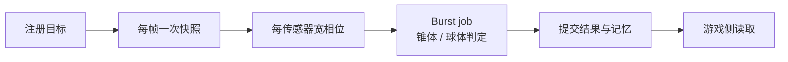

# CycloneGames.AIPerception

面向 Unity agent 的感知模块：注册可被察觉的目标，用 Burst job 一次性为多个观察者求值，并在读取结果时不产生分配。

- [解决什么问题](#解决什么问题)
- [工作原理](#工作原理)
- [快速开始](#快速开始)
- [教程](#教程)
- [参数与代价](#参数与代价)
- [性能与内存](#性能与内存)
- [调试](#调试)
- [API 速查](#api-速查)

## 解决什么问题

三个问题，都不需要改动你的玩法代码：

| 问题 | 机制 |
| --- | --- |
| 这个 agent 现在能察觉那个目标吗？ | 视觉 / 听觉 / 接近，按传感器分别求值 |
| 它刚察觉到了什么、什么时候？ | 结果携带距离、位置、时间戳与记忆标记 |
| 它被什么打到了？ | 一次性刺激，每个关心的监听者各消费一次 |

模块不负责潜行修正、威胁评分、掩体判断与行为选择。这些是感知的消费者，留在外面才能让数据模型保持小。

## 工作原理



两条不变量让 Burst 路径成立：

1. 快照每帧在主线程写一次，之后在 job 读取期间不再变动。
2. 结果与记忆只在 job 完成后、由主线程更新。

## 快速开始

### 1. 添加管理器

新建空对象并添加 `PerceptionManagerComponent`。没有它什么都不会运行：`AIPerceptionComponent` 会记录错误并保持未初始化，而不是隐式创建一个驱动器。

| 字段 | 含义 |
| --- | --- |
| Maximum Perceptibles | 预先保留的容量；填过大会立刻占用内存 |
| Spatial Cell Size | 宽相位格子边长；按实测调整，不要凭直觉 |
| Use Deferred Job Completion | 在 `LateUpdate` 而不是 `Update` 完成 job |
| LOD Reference / LOD Levels | 可选的按距离降频 |

### 2. 标记可被察觉的对象

给每个能被察觉的对象添加 `PerceptibleComponent`。

```csharp
PerceptibleComponent target = GetComponent<PerceptibleComponent>();
target.SetTypeId(PerceptibleTypes.Enemy);   // 稳定的项目自定义编号
target.SetDetectionRadius(1.25f);           // 扩大有效距离；0 表示一个点
```

`Is Sound Source` 只影响听觉，且表达的是持续发声体而非事件。`LOS Point` 可覆盖用于遮挡射线的原点。

### 3. 配置感知

给观察者添加 `AIPerceptionComponent` 并按需启用。每种感知各自拥有距离、间隔、记忆与容量，因此廉价的接近感知可以 5 Hz 运行，而视觉保持 20 Hz。

开启 `Use Line of Sight` 后，锥体内的每个候选都要付出一次 `Physics.Raycast`。`Max LOS Checks` 限制每次更新的次数，传感器会跨帧轮转游标，因此预算不会让同一批目标永远检测不到。

### 4. 读取结果

```csharp
using CycloneGames.AIPerception.Runtime;
using UnityEngine;

public sealed class ChaseNearestSightTarget : MonoBehaviour
{
    private AIPerceptionComponent _perception;

    private void Awake() => _perception = GetComponent<AIPerceptionComponent>();

    private void Update()
    {
        if (!_perception.HasSightDetection)
        {
            return;
        }

        IPerceptible closest = _perception.GetClosestSightTarget();
        if (closest != null)
        {
            transform.position = Vector3.MoveTowards(transform.position, closest.Position, 2f * Time.deltaTime);
        }
    }
}
```

结果按距离排序，索引 `0` 永远是最近的。目标离开后仍会留在结果集中直到记忆过期，此时 `IsFromMemory == true`；当"记忆中的位置"不能被当作实时目击时，用它区分。

### 5. 确认接线正确

- 选中组件时，Scene 视图会绘制锥体与检测连线；
- 目标进入范围后，Inspector 的 Scene Diagnostics 区块显示数量；
- `SensorManager.GetMemoryStats()` 的感知体数与传感器数不为 0。

数量一直为 0 时，按顺序检查：有没有管理器、目标是否 `Is Detectable`、类型过滤、阵营掩码。

## 教程

### 按类型过滤

给每类目标一个稳定编号，让感知忽略其余目标。

```csharp
config.FilterByType = true;
config.TargetTypeId = PerceptibleTypes.Player;
```

过滤在 job 内完成，被拒绝的目标除了宽相位之外没有其它开销。

### 把世界分成阵营

队伍身份是可选的：实现 `IPerceptionTeamProvider`（`PerceptibleComponent` 已实现）。

```csharp
// 一次性策略。
manager.SetSameTeamFriendly();
manager.SetTeamAttitude(Team.Blue, Team.Red, PerceptionTeamAttitude.Hostile);

// 每个感知单独设置。
sightConfig.ObserverTeamId = Team.Blue;
sightConfig.Affiliation = PerceptionAffiliation.Enemies;
```

`AIPerceptionComponent` 会把自己的 `Observer Team` 写入它创建的每个感知，因此组件上只需设置一次。

态度表是有向的：`A -> B` 与 `B -> A` 是两个独立格子，这正是单向敌意需要的。用 `Tools > CycloneGames > AI Perception > Team Matrix` 可视化编辑；同样的数据也可以存进 `PerceptionTeamAttitudeAsset`（关系列表 + 默认策略，两阵营只序列化一行）。

`Affiliation = All` 的传感器完全跳过查表。

### 上报伤害

伤害是事件而非快照查询。上报一次，每个伤害感知各消费一次。

```csharp
manager.ReportStimulus(attackerHandle, hitPoint, damageAmount);
```

管理器会打上时钟与单调序号，因此同一帧内多个感知看到的顺序一致。环形缓冲保留 256 条；落后的感知会漏掉最旧的事件，而不是让内存增长。传感器创建之前上报的刺激不会补播。

### 用你自己的时钟驱动

```csharp
var clock = new DelegatePerceptionClock(() => matchTime.Seconds);
var manager = new SensorManager(registry, 4096, clock);
```

`ManualPerceptionClock` 适合固定步长循环与测试。时钟是纯读者：感知不会推进它。运行期更换时钟会使老化基线失效，换完需要重建传感器。

### 不用 MonoBehaviour 构建

```csharp
var registry = new PerceptibleRegistry(initialCapacity: 1024, maximumCapacity: 8192, cellSize: 20f);
var manager = new SensorManager(registry, 256);
var sensor = new ProximitySensor(transform, ProximitySensorConfig.Default, manager);

PerceptibleHandle handle = registry.Register(perceptible);
registry.RebuildData();
sensor.UpdateSensor(0f);
```

按相反顺序释放：传感器 → 管理器 → 注册表。

## 参数与代价

| 设置 | 代价 |
| --- | --- |
| Half Angle、Max Distance | 视锥越大，宽相位返回的候选越多 |
| Use Line of Sight | 每个候选一次射线，受 Max LOS Checks 限制 |
| Update Interval | 降频节省 job 时间；记忆仍按时钟老化 |
| Memory Duration | 记忆越长，目标离开后结果驻留越久 |
| Maximum Results | 每传感器预分配；溢出会丢弃最远的结果 |
| Spatial Cell Size | 太小则格子数量暴涨，太大退化为线性扫描 |

## 性能与内存

- 无论多少传感器，每帧只做一次快照，成本随注册的感知体数量增长。
- 每个传感器对候选跑一个 job。候选数低于 `InlineExecutionThreshold` 时改为内联执行，比调度更便宜。
- 结果、记忆与候选存储都是原生内存，按 `Capacity` 一次性分配。
- 第一次更新之后不再产生托管分配。会分配的实现会在配置阶段被拒绝，而不是每帧报错。

用 `SensorManager.GetMemoryStats()` 观测：候选峰值、结果容量、淘汰次数与每个传感器的单次工作量。

## 调试

| 工具 | 显示 |
| --- | --- |
| Scene gizmo | 锥体、半径、检测连线；可固定某个组件使其在未选中时仍可见 |
| Inspector Scene Diagnostics | 非运行状态下的实时计数 |
| Inspector Runtime Diagnostics | 运行状态下的各感知计数、状态与内存 |
| Team Matrix 窗口 | 整张态度表，带悬停读数与撤销 |

常见症状：

| 症状 | 可能原因 |
| --- | --- |
| 完全检测不到 | 没有管理器、目标不可检测、类型过滤、阵营掩码 |
| 有检测但位置不动 | 结果是记忆条目（`IsFromMemory`） |
| 所有目标都被检测 | `Affiliation = All` 且未设类型过滤 |
| 运行时编辑器卡顿 | 候选过多时的 LOS 射线，调低 Max LOS Checks |

## API 速查

```csharp
// 注册表
PerceptibleHandle Registry.Register(IPerceptible perceptible);
bool Registry.Unregister(PerceptibleHandle handle);
void Registry.RebuildData();

// 管理器
long Manager.ReportStimulus(PerceptibleHandle instigator, float3 position, float strength,
                            PerceptionStimulusKind kind = PerceptionStimulusKind.Damage);
void Manager.SetTeamAttitude(int observerTeam, int targetTeam, PerceptionTeamAttitude attitude);
void Manager.SetSameTeamFriendly();
void Manager.CopyTeamAttitudes(NativeArray<byte> source);
AIPerceptionMemoryStats Manager.GetMemoryStats();

// 观察者
bool Perception.HasSightDetection;
int Perception.SightDetectedCount;
IPerceptible Perception.GetClosestSightTarget();
void Perception.GetAllSightDetections(ref NativeList<DetectionResult> results);
```
