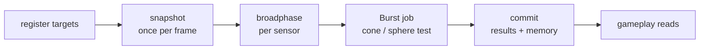

# CycloneGames.AIPerception

Perception for Unity agents: register what can be noticed, evaluate it for many observers at once in Burst jobs, and read the result without allocating.

- [What it is for](#what-it-is-for)
- [What it provides](#what-it-provides)
- [Why this design](#why-this-design)
- [How it works](#how-it-works)
- [Getting started](#getting-started)
- [Tutorials](#tutorials)
- [Parameters and their cost](#parameters)
- [Performance and memory](#performance)
- [Debugging](#debugging)
- [API reference](#api)

## <a id="what-it-is-for"></a>What it is for

Three questions, answered without touching your gameplay code:

| Question | Mechanism |
| --- | --- |
| Can this agent notice that target right now? | sight / hearing / proximity, evaluated per sensor |
| What did it just notice, and when? | results with distance, position, timestamp and memory flag |
| What did it get hit by? | one-shot stimuli delivered to every interested listener once |

It does not model stealth modifiers, threat scoring, cover, or behaviour selection. Those consume perception; keeping them outside is what lets the data model stay small.

## <a id="what-it-provides"></a>What it provides

- Sight, hearing, proximity and damage sensors, all evaluating the same registered target set.
- Results ordered by distance, with position, timestamp and an `IsFromMemory` flag.
- Per-sensor memory that ages on a clock you supply, so a target that left stays known for a configured duration.
- Transition events for consumers that react instead of poll: acquisition and loss are raised once per change, on the owner thread.
- Team attitudes from an asset, with per-sensor affiliation filters.
- Scene gizmos, live counts and a team matrix window for debugging.
- A manual clock, so perception can run on a server tick instead of `Update`.

It does not provide pathfinding, threat scoring, cover selection or behaviour decisions. Those read perception and live in gameplay code.

## <a id="why-this-design"></a>Why this design

Perception can be built in several ways. The choice starts to matter once agent count grows.

| Approach | How it works | Where it breaks |
| --- | --- | --- |
| Per-agent `Physics.OverlapSphere` | Each agent queries the physics scene every frame | Cost scales with agents × colliders; results vary with physics state |
| Per-agent raycasts against a target list | Each agent tests its own list | Duplicate work when many agents look at the same targets; hard to bound per frame |
| One registry plus a batch job | Targets register once, a snapshot is taken per frame, sensors evaluate in jobs, results commit on the owner thread | Needs a frame boundary and an owner-thread commit step |

This package takes the third path. Registration is explicit, the snapshot is read-only while jobs run, and results commit once per frame. That is what makes the cost predictable and the output repeatable for a given snapshot.

The trade is real: perception cannot be queried from arbitrary threads, and every perceptible must register. In exchange, the frame cost is one snapshot plus one job per sensor, no matter how many agents read the result.

### Why the registry keeps its own grid

The registry holds perceptibles in a dense array and rebuilds an internal `SpatialGrid` from it once per update. `CycloneGames.Spatial` is not used here, and the reason is the shape of the work rather than the size of the code.

| Reason | Detail |
| --- | --- |
| Data shape | The registry already owns a dense `PerceptibleData[]` and rebuilds from it every update. `SpatialHashGrid` keeps handles and applies incremental inserts, updates and removals. |
| Delivery | Sensor jobs read candidates from a `NativeList<int>`. `CycloneGames.Spatial` is managed only and exposes no native path. |
| Ordering | Candidates are ordered by cell key and a tie-breaker, so one snapshot always yields the same order. A nearest-neighbour index orders by distance instead. |

Reusing the shared index would mean either copying the dense array into it every frame or pushing per-perceptible handles through updates. Both cost more than the rebuild they replace, and the first one also adds a copy before every job.

The grid is internal to the registry. It is not a public API and not a second broadphase for gameplay code; `CycloneGames.Spatial` remains the index projects use for their own queries.

If the shared index ever gains a job-compatible path, this decision should be revisited with measurements of both layouts, not by symmetry.

## <a id="how-it-works"></a>How it works



Two invariants make the Burst path possible:

1. The snapshot is written once per frame on the owner thread and never mutated while jobs read it.
2. Results and memory are only updated on the owner thread, after job completion.

## <a id="getting-started"></a>Getting started

### 1. Add a manager

Create an empty object and add `PerceptionManagerComponent`. Nothing runs without it; `AIPerceptionComponent` logs an error and stays uninitialized instead of creating a hidden driver.

| Field | Meaning |
| --- | --- |
| Maximum Perceptibles | capacity reserved up front; an oversized value costs memory immediately |
| Spatial Cell Size | broadphase cell edge; tune from profiling, not from intuition |
| Use Deferred Job Completion | finish jobs in `LateUpdate` instead of `Update` |
| LOD Reference / LOD Levels | optional distance-based update throttling |

### 2. Mark what can be detected

Add `PerceptibleComponent` to every object that can be noticed.

```csharp
PerceptibleComponent target = GetComponent<PerceptibleComponent>();
target.SetTypeId(PerceptibleTypes.Enemy);   // stable, project-owned number
target.SetDetectionRadius(1.25f);           // extends effective range; 0 means a point
```

`Is Sound Source` only matters for hearing, and hears continuous emitters rather than events. `LOS Point` overrides the transform origin used for occlusion rays.

### 3. Configure a sense

Add `AIPerceptionComponent` to the observer and enable the senses you need. Every sense owns its own range, interval, memory and capacity, so a cheap proximity sense can run at 5 Hz while sight runs at 20 Hz.

If `Use Line of Sight` is on, each candidate inside the cone costs one `Physics.Raycast`. `Max LOS Checks` bounds that per update and the sensor rotates its cursor across frames, so a budget never starves the same targets forever.

### 4. Read results

```csharp
using CycloneGames.AIPerception.Runtime;
using UnityEngine;

public sealed class ChaseNearestSightTarget : MonoBehaviour
{
    private AIPerceptionComponent _perception;

    private void Awake() => _perception = GetComponent<AIPerceptionComponent>();

    private void Update()
    {
        if (!_perception.HasSightDetection)
        {
            return;
        }

        IPerceptible closest = _perception.GetClosestSightTarget();
        if (closest != null)
        {
            transform.position = Vector3.MoveTowards(transform.position, closest.Position, 2f * Time.deltaTime);
        }
    }
}
```

Results are ordered by distance, so index `0` is always the nearest. A target that left stays in the set until its memory expires, with `IsFromMemory == true`; check it when a remembered position must not be treated as a live sighting.

### 5. Confirm it works

- the Scene view draws the sensor cone and detection links for the selected component;
- the Inspector's Scene Diagnostics block shows a count once a target is in range;
- `SensorManager.GetMemoryStats()` reports non-zero perceptibles and sensors.

If the count stays at zero, check in this order: manager present, target `Is Detectable`, type filter, affiliation mask.

## <a id="tutorials"></a>Tutorials

### Filter by type

Give each kind of target a stable number and let a sense ignore everything else.

```csharp
config.FilterByType = true;
config.TargetTypeId = PerceptibleTypes.Player;
```

The filter runs inside the job, so rejected targets cost nothing beyond the broadphase.

### Split the world into teams

Team identity is optional: implement `IPerceptionTeamProvider` (or use `PerceptibleComponent`, which already does).

```csharp
// One-time policy.
manager.SetSameTeamFriendly();
manager.SetTeamAttitude(Team.Blue, Team.Red, PerceptionTeamAttitude.Hostile);

// Per sense.
sightConfig.ObserverTeamId = Team.Blue;
sightConfig.Affiliation = PerceptionAffiliation.Enemies;
```

`AIPerceptionComponent` stamps its own `Observer Team` into every sense it creates, so a component only needs the value once.

The table is directional: `A -> B` and `B -> A` are separate cells, which is what one-sided aggression needs. `Tools > CycloneGames > AI Perception > Team Matrix` edits it visually; the same data can be stored in a `PerceptionTeamAttitudeAsset` (relation list plus a default policy, so two factions serialize as one row).

A sensor with `Affiliation = All` skips the lookup entirely.

### Report damage

Damage is an event, not a snapshot query. Report it once; every damage sensor consumes it once.

```csharp
manager.ReportStimulus(attackerHandle, hitPoint, damageAmount);
```

The manager stamps the clock and a monotonic sequence, so two sensors observing the same frame agree on order.

Sequence semantics:

- starts at 1 (`0` means "no stimulus") and increases by one per report, never reused;
- **per manager**, not global - two managers each count from 1, so sequences from different managers are not comparable;
- the ring holds 256 events, so only `[latest - 255, latest]` is resident; `TryGetStimulus` returns false outside that window;
- a sensor that falls behind misses the oldest event rather than growing memory, and stimuli reported before a sensor exists are never replayed.

A `long` counter at 1 000 reports per second would take about 292 million years to wrap, so overflow is not a practical concern.

### React when a target appears or disappears

Polling `HasSightDetection` is fine for one consumer. When several systems need the same change, each of them would re-scan the result list every frame. A listener receives the transition once instead.

```csharp
public sealed class AlertOnSight : MonoBehaviour, IPerceptionEventListener
{
    [SerializeField] private AIPerceptionComponent _perception;

    private void Start() => _perception.AddListener(this);
    private void OnDisable() => _perception.RemoveListener(this);

    public void OnPerceptionEvent(in PerceptionEvent transition)
    {
        if (transition.SensorType != SensorType.Sight ||
            transition.Kind != PerceptionEventKind.Acquired)
        {
            return;
        }

        // React to the new target here.
    }
}
```

| Kind | When it fires |
| --- | --- |
| `Acquired` | The handle entered the sensor's result set for the first time. |
| `Lost` | The handle left it: memory expired, visibility faded out, capacity evicted it, or the sense keeps no memory and the target left on that update. |

Register after the manager exists, for example in `Start` or from your composition root; `OnEnable` can run before the component has resolved its manager.

Rules that keep the path allocation-free and predictable:

- Events are raised on the perception owner thread, synchronously, while `SensorManager.Update` runs.
- With no listener registered, the sensors skip transition work entirely.
- A listener must not add or remove listeners from inside the callback. The manager throws instead of skipping silently.
- Custom sensors can push transitions with `SensorManager.PublishEvent` and skip the built-in memory.

### Drive perception from your own clock

```csharp
var clock = new DelegatePerceptionClock(() => matchTime.Seconds);
var manager = new SensorManager(registry, 4096, clock);
```

`ManualPerceptionClock` suits fixed-step loops and tests. The clock is a pure reader: perception never advances it. Swapping clocks at runtime invalidates the aging baseline, so recreate sensors after a swap.

### Build without MonoBehaviours

```csharp
var registry = new PerceptibleRegistry(initialCapacity: 1024, maximumCapacity: 8192, cellSize: 20f);
var manager = new SensorManager(registry, 256);
var sensor = new ProximitySensor(transform, ProximitySensorConfig.Default, manager);

PerceptibleHandle handle = registry.Register(perceptible);
registry.RebuildData();
sensor.UpdateSensor(0f);
```

Dispose in reverse order: sensors, then manager, then registry.

## <a id="parameters"></a>Parameters and their cost

| Setting | Trades |
| --- | --- |
| Half Angle, Max Distance | broader cone means more candidates from the broadphase |
| Use Line of Sight | one raycast per candidate, bounded by Max LOS Checks |
| Update Interval | lower frequency saves job time; memory still ages by the clock |
| Memory Duration | longer memory keeps results in the set after the target leaves |
| Maximum Results | preallocated per sensor; overflow drops the farthest results |
| Spatial Cell Size | too small multiplies cells, too large degrades to a linear scan |

## <a id="performance"></a>Performance and memory

- One snapshot per frame regardless of sensor count; cost scales with registered perceptibles.
- Each sensor runs one job over its candidates. Below `InlineExecutionThreshold` candidates the query runs inline, which is cheaper than scheduling.
- Results, memory and candidate storage are native and sized once from `Capacity`.
- No managed allocation after the first update. Anything that would allocate is rejected at configuration time rather than per frame.

Measure with `SensorManager.GetMemoryStats()`: peak candidate count, result capacity, eviction count and per-update workload per sensor.

## <a id="debugging"></a>Debugging

| Tool | Shows |
| --- | --- |
| Scene gizmos | cone, radius, detection links; pin a component to keep it visible while unselected |
| Inspector Scene Diagnostics | live counts while not playing |
| Inspector Runtime Diagnostics | per-sense counts, status and memory in play mode |
| Team Matrix window | the whole attitude table, with hover readout and undo |

Common symptoms:

| Symptom | Likely cause |
| --- | --- |
| No detections at all | no manager, target not detectable, type filter, or affiliation mask |
| Detections but stale positions | results are memory entries (`IsFromMemory`) |
| Every target detected | `Affiliation = All` and no type filter |
| Editor hitches while playing | LOS checks over many candidates; lower Max LOS Checks |

## <a id="api"></a>API reference

```csharp
// Registry
PerceptibleHandle Registry.Register(IPerceptible perceptible);
bool Registry.Unregister(PerceptibleHandle handle);
void Registry.RebuildData();

// Manager
long Manager.ReportStimulus(PerceptibleHandle instigator, float3 position, float strength,
                            PerceptionStimulusKind kind = PerceptionStimulusKind.Damage);
void Manager.SetTeamAttitude(int observerTeam, int targetTeam, PerceptionTeamAttitude attitude);
void Manager.SetSameTeamFriendly();
void Manager.CopyTeamAttitudes(NativeArray<byte> source);
AIPerceptionMemoryStats Manager.GetMemoryStats();

// Transitions
void Manager.AddListener(IPerceptionEventListener listener);
void Manager.RemoveListener(IPerceptionEventListener listener);
void Manager.PublishEvent(in PerceptionEvent transition);

// Observer
bool Perception.HasSightDetection;
int Perception.SightDetectedCount;
IPerceptible Perception.GetClosestSightTarget();
void Perception.GetAllSightDetections(ref NativeList<DetectionResult> results);
```
