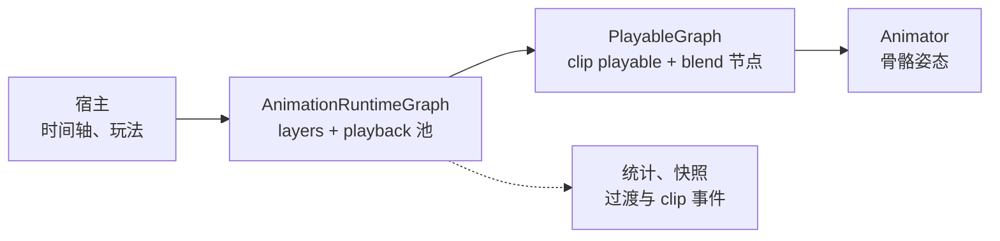

# CycloneGames.AnimationRuntime

[English](README.md) | 简体中文

Unity Playables 的底层姿态运行时。

## 概述

`CycloneGames.AnimationRuntime` 是 Unity Playables 图下面的姿态层。它拥有一个 `PlayableGraph`，接收 clip 请求，把计算出的骨骼姿态写回 Animator。

角色能力变多之后，AnimatorController 会变得难以维护。状态、过渡、Any State 规则和参数都挤在一个资产里，审查和合并都困难，也没有干净的办法做测试。这个运行时把 Controller 从姿态路径里移除。宿主指定 clip、Layer、时间和权重，运行时负责采样和混合。编排仍然放在时间轴或玩法代码里。



运行时支持固定 Layer、AvatarMask、additive、池化的 clip playback、权重 Fade、归一化 ExitTime、clip 事件派发和 RootMotion 转发。clip 时间可以由宿主给，也可以由 tick 时钟推进。计数器和每个 playback 的快照用于诊断。

时间轴、蒙太奇分段、状态机和音频/VFX 路由不属于这个模块。

## 图拓扑

```
AnimationPlayableOutput
  └─ AnimationLayerMixerPlayable          每层一个输入，可配 mask 与 additive
       └─ AnimationMixerPlayable          playback 槽位 + 一个外部源槽位
            ├─ AnimationClipPlayable × N
            └─ 外部 Playable              LinearBlendNode 或 DirectionalBlendNode
```

Layer 上限为 8，每层 playback 槽位上限为 8。Playback 是占用一个槽位的一次 clip 播放：Slot 是存储位置，playback channel 把会竞争的播放分到一组，clip channel 让多个播放并存。`SetLayerSource` 与 `ClearLayerSource` 只连接或断开预留的源槽位，不改变 mixer 输入数量。一个 Animator 只支持一个输出，`AnimationRuntimeRegistry` 会拒绝同一 Animator 上的第二个 graph。

## 时间策略

策略在构造期选定，之后不变。`External` 由宿主拥有 clip 时间；`TickDriven` 由运行时用 tick 时间推进 clip。两种模式下，`AnimationTick.Delta` 都用来推进 fade 和 exit 计时。

时间轴、回放、编辑器拖拽用 External。`BeginClip` 与 `UpdateClip` 携带绝对本地秒数。

```csharp
using CycloneGames.AnimationRuntime;
using CycloneGames.AnimationRuntime.Core;
using UnityEngine;

public sealed class ExternalAnimationDriver : MonoBehaviour
{
    [SerializeField] private Animator _animator;
    [SerializeField] private AnimationClip _clip;

    private AnimationRuntimeGraph _graph;
    private long _step;

    private void Awake()
    {
        _graph = new AnimationRuntimeGraph(_animator, new[] { AnimationLayerDescriptor.Default });
        _graph.BeginClip(new AnimationClipRequest(1, 0, 0, _clip, 0d, 1f));
    }

    private void Update()
    {
        double localTime = Time.timeAsDouble % _clip.length;
        _graph.UpdateClip(new AnimationClipRequest(1, 0, 0, _clip, localTime, 1f));

        _step = _step == long.MaxValue ? 0L : _step + 1L;
        _graph.Commit(new AnimationTick(
            Time.timeAsDouble,
            _step,
            AnimationTimeSource.Update,
            false,
            Time.deltaTime));
    }

    private void OnDestroy()
    {
        _graph?.Dispose();
        _graph = null;
    }
}
```

没有时间轴的 actor 用 TickDriven。`LocalTime` 是起始偏移，`Speed` 与 `Loop` 描述时钟如何走。

```csharp
_graph = new AnimationRuntimeGraph(
    _animator,
    new[] { AnimationLayerDescriptor.Default },
    diagnostics: null,
    timePolicy: AnimationTimePolicy.TickDriven);

_graph.BeginClip(new AnimationClipRequest(
    instanceId: 1,
    playbackChannel: 0,
    layer: 0,
    clip: _clip,
    localTime: 0d,
    weight: 1f,
    holdLastFrame: false,
    clipChannel: 0,
    speed: 1.25f,
    loop: AnimationLoopMode.Loop));

_step = _step == long.MaxValue ? 0L : _step + 1L;
_graph.Commit(new AnimationTick(Time.timeAsDouble, _step, AnimationTimeSource.LateUpdate, false, Time.deltaTime));
```

暂停或禁用一段时间后调用 `RebaseTickClocks()`。`AnimationRuntimeBehaviour` 会在 `OnEnable` 里做这件事。

## Layer 与 Profile

Layer 是 mixer 的一个输入，可配 `AvatarMask`、additive 标记和权重。graph 读 descriptor，不读 `ScriptableObject`，运行时测试不需要资产。

```csharp
[SerializeField] private AnimationLayerProfile _profile;

AnimationLayerDescriptor[] descriptors = _profile != null
    ? _profile.ToDescriptors()
    : new[] { AnimationLayerDescriptor.Default };

var graph = new AnimationRuntimeGraph(_animator, descriptors);
```

Layer 权重是相对值，由顶层 mixer 归一化。Layer 内 playback 权重也是相对值，由 layer mixer 归一化。profile 里权重 0 表示"未设置"，投影为 1；运行时要静音一个 Layer，用 `SetLayerWeight(0)`。

容量是预算。超出容量的请求会增加 `DroppedPlaybacks`，开发构建里报一次警告。

## Blend

`LinearBlendNode` 把一个参数映射到多个阈值。`DirectionalBlendNode` 把方向与幅度映射到多个角度。两者在 graph 内自建 mixer，通过 `SetLayerSource` 接入。

```csharp
LinearBlendNode gait = LinearBlendNode.Create(
    graph.PlayableGraph,
    new[] { idle, walk, run },
    new[] { 0f, 0.5f, 1f },
    BlendTimeMode.Normalized);

graph.SetLayerSource(0, gait.Playable);

gait.SetParameter(speed01);
gait.SetTime(phase01);
```

`BlendTimeMode.Normalized` 让每个子 clip 采样同一相位，长度不同时脚不会滑。`Absolute` 让每个子 clip 采样同一秒数。零权重子节点在八次更新后断开，计数在 `SetTime` 与 `Apply` 两条路径都会推进。

## Fade 与 ExitTime

`AnimationFade` 让一个 playback 从当前权重过渡到目标权重。

```csharp
graph.BeginClip(request, new AnimationFade(0.2f, 1f, AnimationFadeEasing.SmoothStep));
graph.FadePlayback(key, new AnimationFade(0.15f, 0f));
graph.EndClip(key, new AnimationFade(0.1f, 0f));

graph.TransitionCompleted += (handle, reason) =>
{
    if (reason == AnimationTransitionReason.FadeCompleted)
    {
        // 复用槽位，或开始下一个 clip。
    }
};
```

新 playback 带 fade 时从 0 开始。同 key 替换时从当前权重开始。时长为 0 立即应用目标，不发完成事件。fade 激活期间由它拥有权重；`UpdateClip` 的权重修改会被忽略，开发构建提示一次。`EndClip` 带 fade 时，斜坡完成后的下一次 commit 释放槽位。`StopAll` 和 `Dispose` 取消 fade，不发事件。

`AnimationExitTime` 是 clip 上的归一化时间点，通过 `TransitionCompleted` 以 `ExitTime` 报告，不会停止 playback。

```csharp
graph.SetExitTime(key, new AnimationExitTime(0.5f, AnimationExitMode.Once));
```

`Once` 首次越过目标时触发，回退到目标之前会重新武装。`EveryLoop` 每次越过目标都触发，包括循环绕回。

## Clip 事件

clip 事件来自 `AnimationClip.events`。首次使用某个 clip 时转换成排序数组并缓存，事件交给 graph 上的单一 sink。

```csharp
public sealed class FootstepSink : IAnimationClipEventSink
{
    public void OnClipEvent(in AnimationPlaybackHandle handle, in AnimationClipEvent clipEvent)
    {
        if (clipEvent.FunctionName == "Footstep")
        {
            PlayFootstep(clipEvent.StringParameter);
        }
    }
}

graph.SetClipEventSink(new FootstepSink());
```

扫描区间是半开的 `(previous, current]`。首次 commit 用 `[0, current]`，所以 0 处的标记会触发。循环绕回拆成 `(previous, 1]` 与 `[0, current]`。回退 seek 抑制事件。跨越超过一个 clip 时，该次 commit 里每个标记各触发一次。

一次 commit 内的顺序是 clip 事件、exit time、fade 完成。时间轴接管事件时设 `DispatchClipEvents = false`。派发开启且 `Animator.fireEvents` 为 true 时，Unity 会再触发一次同一个标记，构图阶段会报一次。

## RootMotion

一个 Playable 输出只产生一个 root delta，所以 RootMotion 在绑定层决定。`RootMotionOwnership.External` 把 `Animator.deltaPosition` 留给移动组件。`Backend` 把过滤后的 delta 通过 `RootMotionApplied` 转发。`Disabled` 忽略。

```csharp
behaviour.RootMotionApplied += (delta, rotation) => controller.ApplyRootMotion(delta, rotation);
```

`Backend` 要求 Animator 与 `AnimationRuntimeBehaviour` 在同一个 GameObject。子物体 Animator 会被检测并以错误拒绝。`IsRootMotionActive` 表示转发是否生效。

## 生命周期

```csharp
// 池化 actor 换模型。冲突时返回 false，当前绑定保持不变。
if (behaviour.TryRebind(newAnimator))
{
    // 旧 graph 的 handle 已失效。
}

// 结束 playback，销毁 graph，释放 Animator 归属。
graph.Dispose();
```

同一 Animator 上的第二个 graph 会抛异常，消息含 Animator 名。Rebind 到已被占用的 Animator 返回 false。构造期间异常会释放归属。播放中 clip 被销毁时，开发看门狗终止 playback，并报告 instance 与 channel。缺少 Animator 时组件自动禁用，找到后 `Initialize` 会重新启用。

`Animator` 字段为空且组件下面有多个 Animator 时，使用层级顺序里的第一个。Editor 和开发构建会记录一条警告；发布构建仍走单次查找。角色有多套 rig 时，显式赋值。

## 诊断

```csharp
AnimationRuntimeStats stats = graph.GetStats();
// ActivePlaybacks, PeakPlaybacks, DroppedPlaybacks, RecreatedPlayables, ReusedPlayables,
// Commits, Evaluations, NativeWrites, TimePolicy.

var buffer = new AnimationPlaybackSnapshot[8];
int count = graph.CopyPlaybackSnapshots(0, buffer);
```

`IAnimationDiagnostics` 控制消息是否格式化。`LoggingAnimationDiagnostics` 适配 `CycloneGames.Logging`。Inspector 每秒刷新四次，读的是同一套快照 API。

## 扩展

宿主在播放前解析 clip 引用，运行时不加载资产。

```csharp
public sealed class ProjectClipResolver : IAnimationClipResolver
{
    public bool TryResolve(in AnimationClipReference reference, out AnimationClip clip)
    {
        return _map.TryGetValue(reference.Location, out clip);
    }
}
```

自定义 blend 节点必须位于同一个 `PlayableGraph`，通过 `SetLayerSource` 接入。Layer 只有一个源槽位，节点自己管理子节点。
