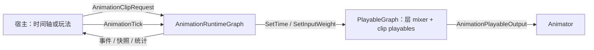
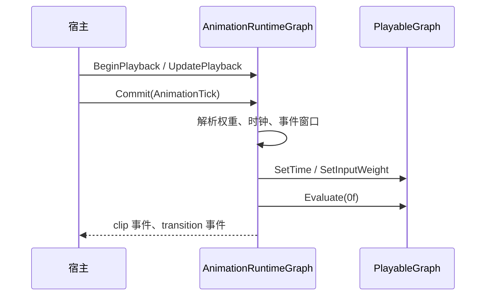
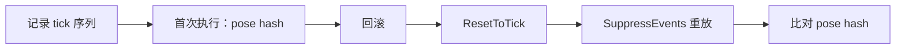
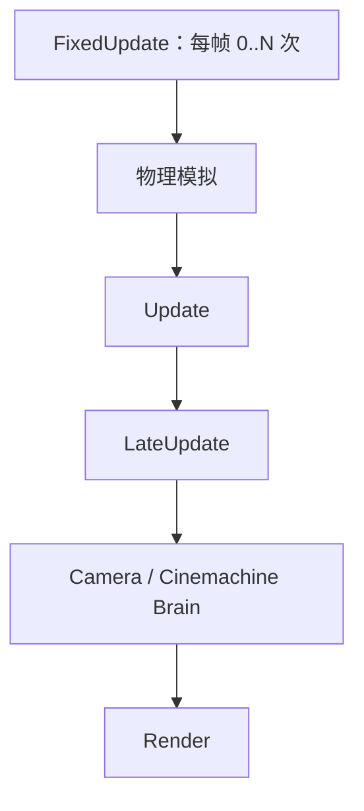
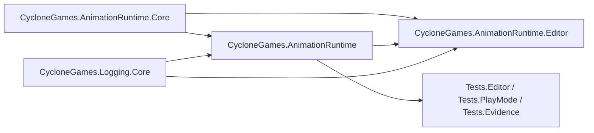

# CycloneGames.AnimationRuntime

[English](README.md) | 简体中文

| | |
| --- | --- |
| 包 | `com.cyclone-games.animation-runtime` |
| Unity | 2022.3 或更高 |
| 依赖 | `com.cyclone-games.logging` |
| 程序集 | `CycloneGames.AnimationRuntime.Core`（`noEngineReferences: true`）、`.Runtime`、`.Editor` |

## 1. 范围

本包通过一个 `PlayableGraph` 把 clip 请求映射为骨骼姿势，负责层、playback 槽位、权重、fade、exit time、clip 事件与 root motion 转发。

序列编排、状态机、Montage 分段、音频/VFX 路由与资源加载由宿主负责。

## 2. 架构



```text
AnimationPlayableOutput
  └─ AnimationLayerMixerPlayable        每层一个输入，可带 AvatarMask 与 additive 标志
       └─ AnimationMixerPlayable        playback 槽位 + 一个预留的外部源槽位
            ├─ AnimationClipPlayable × N
            └─ Playable                宿主自有的 blend 节点或 AnimationScriptPlayable
```

拓扑在构造期固定。层数上限为 8，每层 playback 容量上限为 8。一个 Animator 只支持一个输出，`AnimationRuntimeRegistry` 会拒绝同一 Animator 上的第二个 graph。预留源槽位通过 `SetLayerSource` 连接、通过 `ClearLayerSource` 释放，输入数量不会变化。

## 3. 快速上手

```csharp
using CycloneGames.AnimationRuntime;
using CycloneGames.AnimationRuntime.Core;
using UnityEngine;

public sealed class PoseDriver : MonoBehaviour
{
    [SerializeField] private Animator _animator;
    [SerializeField] private AnimationClip _clip;

    private AnimationRuntimeGraph _graph;
    private long _step;

    private void Awake()
    {
        _graph = new AnimationRuntimeGraph(_animator, new[] { AnimationLayerDescriptor.Default });
        _graph.BeginPlayback(new AnimationClipRequest(1, 0, 0, _clip, 0d, 1f));
    }

    private void Update()
    {
        double localTime = Time.timeAsDouble % _clip.length;
        _graph.UpdatePlayback(new AnimationClipRequest(1, 0, 0, _clip, localTime, 1f));

        _step = _step == long.MaxValue ? 0L : _step + 1L;
        _graph.Commit(new AnimationTick(Time.timeAsDouble, _step, AnimationTimeSource.Update));
    }

    private void OnDestroy()
    {
        _graph?.Dispose();
        _graph = null;
    }
}
```

`AnimationRuntimeBehaviour` 以 `MonoBehaviour` 形式提供同样的流程，commit 相位可序列化配置。

## 4. 时间模型

`AnimationTick` 是唯一的时间载体。

| 字段 | 类型 | 含义 |
| --- | --- | --- |
| `ClipTime` | `double` | 绝对时钟；`TickDriven` 下折叠为 clip-local 秒数。 |
| `TransitionTime` | `double` | 权重 ramp、层 fade 与 exit 计时的绝对时钟。 |
| `StepIndex` | `long` | 单调步号；重复步号使 `Commit` 成为空操作。 |
| `Source` | `AnimationTimeSource` | tick 来源，用于诊断。 |
| `IsBackward` | `bool` | 宿主时钟向后移动。 |
| `SuppressEvents` | `bool` | 推进姿势与权重但不派发事件。 |



两个构造函数：

```csharp
// 便捷形式：TransitionTime = ClipTime。
new AnimationTick(clipTime, stepIndex, AnimationTimeSource.Update);

// 分离时钟，用于重放或独立的过渡权威。
new AnimationTick(clipTime, transitionTime, stepIndex, AnimationTimeSource.Replay,
    isBackward: false, suppressEvents: true);
```

| 策略 | clip-local 时间来源 |
| --- | --- |
| `External` | 每次 `BeginPlayback` / `UpdatePlayback` 的 `AnimationClipRequest.LocalTime`。 |
| `TickDriven` | `ClipTime * Speed + StartLocalTime`，按 `AnimationLoopMode` 折叠。 |

```csharp
_graph = new AnimationRuntimeGraph(
    _animator,
    new[] { AnimationLayerDescriptor.Default },
    timePolicy: AnimationTimePolicy.TickDriven);

_graph.BeginPlayback(new AnimationClipRequest(
    instanceId: 1, playbackChannel: 0, layer: 0, clip: _clip,
    localTime: 0d, weight: 1f, speed: 1.25f, loop: AnimationLoopMode.Loop));

_graph.Commit(new AnimationTick(Time.timeAsDouble, step, AnimationTimeSource.LateUpdate));
```

非有限 tick 时钟被钳制为 0。有限时钟与有限 speed 相乘仍可能溢出；`AnimationClockMath` 拒绝该步，graph 保持上一个有限姿势。

## 5. 层

```csharp
[SerializeField] private AnimationLayerProfile _profile;

AnimationLayerDescriptor[] descriptors = _profile != null
    ? _profile.ToDescriptors()
    : new[] { AnimationLayerDescriptor.Default };

var graph = new AnimationRuntimeGraph(_animator, descriptors);
```

Descriptor 携带 `AvatarMask`、`Additive`、`Weight`、`Capacity`、`ApplyFootIK` 与 `ApplyPlayableIK`。层权重由顶层 mixer 归一化，playback 权重在层内归一化。Profile 权重为 0 表示未设置，投影为 1；`SetLayerWeight(0)` 用于运行时静音。

```csharp
graph.SetLayerWeight(0, 0.8f);
graph.SetLayerWeight(0, 1f, new AnimationFade(0.25f, 1f, transitionTime));
```

超出容量的请求会累加 `DroppedPlaybacks`，并在开发构建中报告一次警告。

## 6. Playback

| 字段 | 含义 |
| --- | --- |
| `InstanceId` | 所有者标识。 |
| `PlaybackChannel` | 竞争组；不同 channel 的 playback 互不竞争。 |
| `ClipChannel` | 同一 key 下重叠变体的子通道。 |
| `Layer` | 层索引。 |
| `LocalTime` | `External` 下为绝对 clip-local 秒数，`TickDriven` 下为起始偏移。 |
| `Weight` | 请求权重。 |
| `Speed`、`Loop` | `TickDriven` 的折叠参数。 |
| `HoldLastFrame` | 把姿势固定在 clip 末尾。 |

```csharp
AnimationPlaybackHandle handle = graph.BeginPlayback(
    new AnimationClipRequest(1, 0, 0, _clip, 0d, 1f));

graph.UpdatePlayback(new AnimationClipRequest(1, 0, 0, _clip, 0.4d, 1f));
graph.SeekPlayback(new AnimationPlaybackKey(1, 0, 0), 0.2d);
bool alive = graph.IsPlaybackAlive(handle);

graph.EndPlayback(new AnimationPlaybackKey(1, 0, 0));
```

对已有 key 再次 `BeginPlayback` 会原位替换 playback。槽位复用会递增 32 位 generation，旧句柄无法通过 `IsPlaybackAlive`。`BeginPlayback`、`UpdatePlayback`、`EndPlayback` 只标记状态，native 写入发生在 `Commit`。

## 7. Blend

```csharp
LinearBlendNode gait = LinearBlendNode.Create(
    graph.PlayableGraph,
    new[] { idle, walk, run },
    new[] { 0f, 0.5f, 1f },
    BlendTimeMode.Normalized);
graph.SetLayerSource(0, gait.Playable);
gait.SetParameter(speed01);
gait.SetTime(phase01);
graph.SetLayerSourceWeight(0, 0.9f);
```

`BlendTimeMode.Normalized` 让每个子节点采样同一相位，`Absolute` 采样相同秒数。`DirectionalBlendNode` 接收角度（度）与可选的中心索引。

## 8. Fade、exit time 与 clip 事件

```csharp
graph.BeginPlayback(request, new AnimationFade(0.2f, 1f, transitionTime, AnimationFadeEasing.SmoothStep));
graph.FadePlayback(key, new AnimationFade(0.15f, 0f, transitionTime));
graph.EndPlayback(key, new AnimationFade(0.1f, 0f, transitionTime));

graph.SetExitTime(key, new AnimationExitTime(0.5f, AnimationExitMode.Once));

graph.TransitionCompleted += (handle, reason) =>
{
    if (reason == AnimationTransitionReason.FadeCompleted) { /* next clip */ }
};
```

`AnimationFade.AbsoluteStartTime` 是必填参数。进度为 `(TransitionTime - AbsoluteStartTime) / Duration`，因此 fade 是 tick 时钟的纯函数。`AnimationExitMode.Once` 在首次穿越时触发；`EveryCrossing` 在循环回绕与 ping-pong 反向段也会触发。

```csharp
public sealed class FootstepSink : IAnimationClipEventSink
{
    public void OnClipEvent(in AnimationPlaybackHandle handle, in AnimationClipEvent clipEvent)
    {
        if (clipEvent.FunctionName == "Footstep") { /* play audio */ }
    }
}

graph.SetClipEventSink(new FootstepSink());
```

Clip 事件来自 `AnimationClip.events`，首次使用时转换为排序数组。扫描区间为半开 `(previous, current]`，首次 commit 使用 `[0, current]`。循环回绕拆为 `(previous, 1]` 与 `[0, current]`。向后跳转抑制事件。单次 commit 内的派发顺序为 clip 事件、exit time、fade 完成。

| 预算 | 默认值 | 作用 |
| --- | --- | --- |
| `MaxSweepLegs` | 64 | 单次事件或 exit-time 扫描可走的段数上限。 |
| `MaxPendingClipEventsPerCommit` | 4096 | 单次 commit 派发的 marker 上限；溢出累加 `DroppedClipEvents`。 |
| `InitialClipEventQueueCapacity` | 32 | 队列首次分配大小。 |
| `SteadyClipEventQueueCapacity` | 512 | 排空后保留的容量。 |

宿主自行派发事件时设置 `DispatchClipEvents = false`。开启派发且 `Animator.fireEvents` 为真时，Unity 会再次触发同一 marker；graph 构造时报告一次。

## 9. 确定性与回滚



```csharp
// 从干净状态开始重放；playback 与 playable 保留。
graph.ResetToTick(new AnimationTick(t0, t0, 0L, AnimationTimeSource.Replay));

for (int step = 0; step < recorded.Length; step++)
{
    graph.UpdatePlayback(recorded[step].Request);
    graph.Commit(new AnimationTick(
        recorded[step].ClipTime, recorded[step].TransitionTime, step,
        AnimationTimeSource.Replay, false, suppressEvents: true));
}

ulong hash = graph.ComputePoseHash();
```

`ResetToTick` 清除过渡锚点、exit 游标、事件窗口与排队事件。`SuppressEvents` 的 commit 仍推进姿势与权重，但不派发任何事件。`ComputePoseHash` 返回 live 层与 playback 状态的 FNV-1a 哈希，零分配。动画状态不进入 gameplay 快照；宿主快照输入并重新求值姿势。

## 10. 帧生命周期与渲染顺序

### 10.1 已文档化的顺序



来源：Unity 手册「Event function execution order」（2022.3 与 Unity 6）。`FixedUpdate` 与物理模拟先于 `Update`，`Update` 先于 `LateUpdate`，`LateUpdate` 先于渲染。`OnAnimatorMove` 与 `OnAnimatorIK` 在内部动画更新阶段执行。手册未指定该阶段相对 `LateUpdate` 的位置。`Animator.updateMode` 决定动画更新所属相位。

| 阶段 | 工作内容 | 本包 |
| --- | --- | --- |
| `FixedUpdate` | 物理步玩法，每帧 0..N 次 | 相位为 `FixedUpdate` 时每步一次 `Commit` |
| 物理模拟 | Rigidbody / CharacterController 解算 | 不写 transform；宿主消费 root delta |
| `Update` | 逐帧玩法 | 相位为 `Update` 时 `Commit` |
| 内部动画更新（手册未指定相对位置） | Animator、`OnAnimatorMove`、`OnAnimatorIK` | 转发 root delta 与 IK pass |
| `LateUpdate` | 相机、最终脚本写入 | 相位为 `LateUpdate` 时 `Commit` |
| Camera / Brain | Cinemachine follow 与 aim | 宿主配置 |
| Render | 显示已采样的姿势 | 消费方 |

### 10.2 Commit 相位与姿势年龄

| `AnimationCommitPhase` | 需要的 `Animator.updateMode` | commit 次数 | 消费方 | 姿势年龄 |
| --- | --- | --- | --- | --- |
| `Update` | `Normal` | 每帧一次 | `LateUpdate` 中的相机 | 0 帧 |
| `LateUpdate` | `Normal` | 每帧一次 | 本组件之后的相机 | Brain 确实在之后运行时为 0 帧 |
| `FixedUpdate` | `AnimatePhysics` | 每个物理步一次 | `LateUpdate` 中的相机 | 0–1 个物理步，需要插值 |

组件使用 `[DefaultExecutionOrder(-100)]`。`FixedUpdate` 模式下每个物理步恰好 commit 一次，commit-rate LOD 与可见性跳过会被忽略并在开发构建中报告。某帧没有物理步时，不 commit、不产生 root delta。某帧有两个或更多物理步时，每步各 commit 一次，宿主必须累加 delta 而不是覆盖。`StepIndex` 抑制同一相位内的重复 commit。

开发构建中，相位与 `Animator.updateMode` 不一致时 `Initialize` 报告错误。

### 10.3 FK、IK 与 root motion

| 特性 | 执行位置 | 结果 |
| --- | --- | --- |
| FK：clip 采样与层混合 | `Commit` 内的 `PlayableGraph.Evaluate(0f)` | 在 commit 相位解算，不在内部动画更新阶段 |
| 通过 `AnimationScriptPlayable` 的 IK | `Commit` 内的图求值 | 相位明确；用 `SetLayerSource` 接入 |
| 通过 `OnAnimatorIK` 的 IK | Unity 内部动画更新 | 转发给 `IAnimationIKPass`；相对 `LateUpdate` 的位置不是契约 |
| root motion | `OnAnimatorMove`，内部动画更新阶段 | `Backend` 转发一次 `Animator.deltaPosition` 与 `deltaRotation` |

| `RootMotionOwnership` | 行为 |
| --- | --- |
| `External` | `Animator.deltaPosition` 交给移动组件。 |
| `Backend` | `OnAnimatorMove` 通过 `RootMotionApplied` 转发过滤后的 delta。 |
| `Disabled` | 忽略 root motion。 |

```csharp
behaviour.RootMotionApplied += (delta, rotation) => controller.ApplyRootMotion(delta, rotation);
behaviour.SetIKPass(new CharacterIKPass());   // 转发 OnAnimatorIK(int layerIndex)
```

`Backend` 要求 Animator 与组件在同一 GameObject。运行时不写角色 `Transform`。`FixedUpdate` 模式下 root delta 必须在物理步内消费；在 `Update` 或 `LateUpdate` 消费会破坏固定步长比例，导致位移错误。

### 10.4 相机与物理规则

1. `CinemachineBrain.UpdateMethod` 与模型一致：`FixedUpdate` commit 用 `FixedUpdate`，`Update` 或 `LateUpdate` commit 用 `LateUpdate`。`SmartUpdate` 需要在目标配置上验证其选择。
2. `FixedUpdate` 模式启用 `Rigidbody.interpolation`；Brain 使用 `FixedUpdate` 而不开插值会产生台阶式抖动。
3. 相机跟随 root transform，不跟随骨骼。commit 之前读骨骼会拿到上一拍的姿势。
4. 开启插值时不要用 `Rigidbody.position` 驱动相机；那是原始物理位置，不是渲染位置。
5. 玩法 hitbox 从物理步内求值的事件生成；渲染期的 clip 事件查询的是过期的物理场景。
6. 只由一个移动组件消费 root motion。同一 Animator 上两个 `OnAnimatorMove` 处理器会把 delta 应用两次。

### 10.5 保证与验证

| 本包保证 | 宿主职责 |
| --- | --- |
| 每个选定相位一次 commit，`FixedUpdate` 下每个物理步一次 | `Animator.updateMode` 与 commit 相位一致 |
| `StepIndex` 抑制重复 commit | `CinemachineBrain.UpdateMethod` 与模型一致 |
| 初始化时断言 `Animator.updateMode`；`FixedUpdate` 拒绝 rate LOD | Rigidbody 插值、相机顺序与执行顺序 |
| 不写 `Transform`；root delta 只转发一次 | 多物理步时累加 delta |
| `PhaseOrderMask` 在开发构建中记录出现过的相位 | 在目标设备上核实内部动画更新的位置 |

`PhaseOrderMask` 是当前渲染帧内出现过的相位位掩码。宿主可在目标设备上把掩码与配置的模型比对。非开发构建中该掩码为 0。

```csharp
int mask = behaviour.PhaseOrderMask;
bool sawPhysicsCommit = (mask & (int)AnimationRuntimePhase.FixedUpdate) != 0
    && (mask & (int)AnimationRuntimePhase.Commit) != 0;
bool sawIKPass = (mask & (int)AnimationRuntimePhase.AnimatorIK) != 0;
```

`AnimationRuntimePhase` 包含 `Update`、`LateUpdate`、`FixedUpdate`、`Commit`、`AnimatorMove`、`AnimatorIK`。

## 11. Unity 特性覆盖面

| 特性 | API |
| --- | --- |
| 层 mixer、mask、additive 层 | 固定拓扑，`AnimationLayerDescriptor` |
| 池化 clip playable | `AnimationClipPlayable`，ping-pong 槽位缓存 |
| 脚部 IK / Playable IK | `AnimationClipPlayable.SetApplyFootIK`、`SetApplyPlayableIK` |
| 手动求值 | `DirectorUpdateMode.Manual`、`Evaluate(0f)` |
| Animation C# Jobs | `CreateJobPlayable<TJob>` |
| IK pass | `IAnimationIKPass`、`OnAnimatorIK` |
| 层权重 ramp | `SetLayerWeight(int, float, in AnimationFade)` |
| 宿主源槽位 | `SetLayerSource`、`SetLayerSourceWeight`、`ClearLayerSource` |

```csharp
using UnityEngine.Animations;

public struct LookAtJob : IAnimationJob
{
    public void ProcessRootMotion(AnimationStream stream) { }
    public void ProcessAnimation(AnimationStream stream) { }
}

AnimationScriptPlayable job = graph.CreateJobPlayable(new LookAtJob(), 1);
graph.SetLayerSource(0, job);
```

job 数据与节点生命周期由宿主拥有，在 `ClearLayerSource` 之前自行释放。`IAnimationJob` 的签名以当前 Unity 版本为准。

## 12. 诊断

```csharp
AnimationRuntimeStats stats = graph.GetStats();
// ActivePlaybacks, PeakPlaybacks, LayerCount, PlayableCount, DroppedPlaybacks,
// RecreatedPlayables, ReusedPlayables, Commits, Evaluations, NativeWrites, TimePolicy.

var buffer = new AnimationPlaybackSnapshot[8];
int count = graph.CopyPlaybackSnapshots(0, buffer);

long droppedTotal = graph.DroppedClipEvents;
long droppedOnLayer0 = graph.GetDroppedClipEvents(0);
```

`IAnimationDiagnostics` 控制消息格式化，`LoggingAnimationDiagnostics` 适配 `CycloneGames.Logging`。Inspector 每秒刷新四次，读取同一套快照 API，显示层权重、逐 playback 状态、pose hash、丢弃的 marker 与相位掩码。

## 13. 性能契约

`Commit` 通过每层 8 位占用掩码只遍历活跃 slot，成本与活跃 playback 数成正比。派发队列在首个 marker 之前为空，单次 commit 有上限，排空后收缩。transition 事件按 `(layer, slot)` 索引，每种 reason 占一个 bit。

`Playback` 为 64 字节。native 写入有 epsilon 门控，无脏数据时跳过 graph 求值，稳态 `Commit` 零分配。所有预算集中在 `AnimationRuntimeLimits` 的 `static readonly` 字段。

`AnimationRuntimeBehaviour` 的 `UpdateRateHz` 与 `PauseWhenInvisible` 为大规模人群跳过 commit。每个 actor 仍各自持有一个 `PlayableGraph` 与 Animator 绑定。

## 14. 扩展点

| 接缝 | 契约 |
| --- | --- |
| `IAnimationClipResolver` | 播放前把 `AnimationClipReference.Location` 解析为 clip。 |
| `IAnimationDiagnostics` | 门控并转发诊断消息。 |
| `IAnimationClipEventSink` | 接收 clip marker，每个 graph 一个。 |
| `IAnimationIKPass` | 接收 Unity IK pass。 |
| `SetLayerSource` | 接入同一 `PlayableGraph` 内宿主自有的 `Playable`。 |

`PlayableGraph` 对外暴露用于创建宿主节点，拓扑视为只读。

## 15. 构建与测试



Core 程序集无引擎引用、无依赖；Runtime 与 Editor 引用 `CycloneGames.Logging.Core`。测试使用 NUnit 与 `optionalUnityReferences: ["TestAssemblies"]`。

| 命令 | 用途 |
| --- | --- |
| `dotnet build UnityCompileCheck.csproj -c Release` | 用 Unity 2022.3 托管 DLL 编译 Core、Runtime 与 Editor。 |
| `dotnet build UnityTestsCompileCheck.csproj -c Release` | 同时编译测试程序集。 |
| `dotnet test CycloneGames.Analyzers.Tests -c Release` | 运行 analyzer 规则。 |
| `dotnet bin/Release/net8.0/AnimationRuntimeAudit_fixed.dll` | 运行引擎无关验证程序。 |
