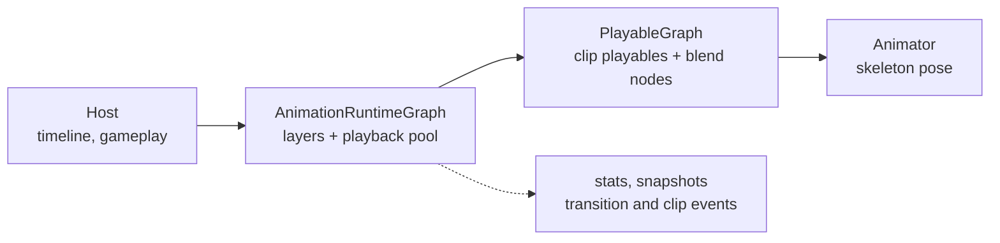

# CycloneGames.AnimationRuntime

[English | 简体中文](README.SCH.md)

A low-level pose runtime for Unity Playables.

## Overview

`CycloneGames.AnimationRuntime` is the pose layer under a Unity Playables graph. It owns one `PlayableGraph`, accepts clip requests, and writes the resulting skeleton pose to an Animator.

An AnimatorController gets hard to maintain once a character gains many abilities. States, transitions, Any State rules and parameters all live in one asset. That asset is hard to review and merge, and there is no clean way to test it. This runtime removes the controller from the pose path. The host asks for a clip on a layer at a given time and weight; the runtime samples and mixes it. Sequencing stays in a timeline or in gameplay code.



The runtime supports fixed layers with AvatarMask and additive blending, pooled clip playbacks, weight fades, normalized exit times, clip-event dispatch and RootMotion forwarding. Clip time can come from the host or from a tick clock. Counters and per-playback snapshots are available for diagnostics.

Timelines, montage sections, state machines and audio/VFX routing are not part of the module.

## Graph topology

```
AnimationPlayableOutput
  └─ AnimationLayerMixerPlayable          one input per layer, optional mask and additive
       └─ AnimationMixerPlayable          playback slots plus one external source slot
            ├─ AnimationClipPlayable × N
            └─ external Playable          LinearBlendNode or DirectionalBlendNode
```

Layer count is capped at 8 and each layer at 8 playback slots. A playback is one active clip in a slot: a slot is storage, a playback channel groups competing playbacks, and a clip channel lets them coexist. `SetLayerSource` and `ClearLayerSource` connect or disconnect the reserved source slot; they do not change the mixer input count. One Animator supports one output, and `AnimationRuntimeRegistry` rejects a second graph on the same Animator.

## Time policies

The policy is chosen at construction and does not change. `External` lets the host own clip time; `TickDriven` lets the runtime advance clips from tick times. `AnimationTick.Delta` advances fades and exit timers in both modes.

External time is the right choice for a timeline, replay or editor scrub. `BeginClip` and `UpdateClip` carry absolute local seconds.

```csharp
using CycloneGames.AnimationRuntime;
using CycloneGames.AnimationRuntime.Core;
using UnityEngine;

public sealed class ExternalAnimationDriver : MonoBehaviour
{
    [SerializeField] private Animator _animator;
    [SerializeField] private AnimationClip _clip;

    private AnimationRuntimeGraph _graph;
    private long _step;

    private void Awake()
    {
        _graph = new AnimationRuntimeGraph(_animator, new[] { AnimationLayerDescriptor.Default });
        _graph.BeginClip(new AnimationClipRequest(1, 0, 0, _clip, 0d, 1f));
    }

    private void Update()
    {
        double localTime = Time.timeAsDouble % _clip.length;
        _graph.UpdateClip(new AnimationClipRequest(1, 0, 0, _clip, localTime, 1f));

        _step = _step == long.MaxValue ? 0L : _step + 1L;
        _graph.Commit(new AnimationTick(
            Time.timeAsDouble,
            _step,
            AnimationTimeSource.Update,
            false,
            Time.deltaTime));
    }

    private void OnDestroy()
    {
        _graph?.Dispose();
        _graph = null;
    }
}
```

TickDriven is the right choice for an actor without a timeline. `LocalTime` becomes the start offset, and `Speed` and `Loop` describe how the clock moves.

```csharp
_graph = new AnimationRuntimeGraph(
    _animator,
    new[] { AnimationLayerDescriptor.Default },
    diagnostics: null,
    timePolicy: AnimationTimePolicy.TickDriven);

_graph.BeginClip(new AnimationClipRequest(
    instanceId: 1,
    playbackChannel: 0,
    layer: 0,
    clip: _clip,
    localTime: 0d,
    weight: 1f,
    holdLastFrame: false,
    clipChannel: 0,
    speed: 1.25f,
    loop: AnimationLoopMode.Loop));

_step = _step == long.MaxValue ? 0L : _step + 1L;
_graph.Commit(new AnimationTick(Time.timeAsDouble, _step, AnimationTimeSource.LateUpdate, false, Time.deltaTime));
```

Call `RebaseTickClocks()` after a pause or a disabled interval. `AnimationRuntimeBehaviour` does this in `OnEnable`.

## Layers and profiles

A layer is one mixer input with an optional `AvatarMask`, an additive flag and a weight. The graph reads descriptors, not the `ScriptableObject`, so runtime tests do not need assets.

```csharp
[SerializeField] private AnimationLayerProfile _profile;

AnimationLayerDescriptor[] descriptors = _profile != null
    ? _profile.ToDescriptors()
    : new[] { AnimationLayerDescriptor.Default };

var graph = new AnimationRuntimeGraph(_animator, descriptors);
```

Layer weights are relative and normalized by the top mixer. Playback weights are relative inside a layer and normalized by the layer mixer. A profile weight of 0 means "unset" and projects to 1; `SetLayerWeight(0)` is the runtime mute.

Capacity is a budget. A request beyond capacity increments `DroppedPlaybacks` and reports a warning in development builds.

## Blending

`LinearBlendNode` maps one parameter across thresholds. `DirectionalBlendNode` maps direction and magnitude across angles. Both own a mixer inside the graph and connect through `SetLayerSource`.

```csharp
LinearBlendNode gait = LinearBlendNode.Create(
    graph.PlayableGraph,
    new[] { idle, walk, run },
    new[] { 0f, 0.5f, 1f },
    BlendTimeMode.Normalized);

graph.SetLayerSource(0, gait.Playable);

gait.SetParameter(speed01);
gait.SetTime(phase01);
```

`BlendTimeMode.Normalized` samples each child at the same phase, which keeps feet aligned when clips have different lengths. `Absolute` samples the same seconds in every child. Zero-weight children are disconnected after eight updates, and the counter advances on both `SetTime` and `Apply`.

## Fades and exit time

`AnimationFade` ramps one playback from its current weight to a target.

```csharp
graph.BeginClip(request, new AnimationFade(0.2f, 1f, AnimationFadeEasing.SmoothStep));
graph.FadePlayback(key, new AnimationFade(0.15f, 0f));
graph.EndClip(key, new AnimationFade(0.1f, 0f));

graph.TransitionCompleted += (handle, reason) =>
{
    if (reason == AnimationTransitionReason.FadeCompleted)
    {
        // Reuse the slot or start the next clip.
    }
};
```

A new playback with a fade starts at 0. Replacing the same key starts from the current weight. A zero duration applies the target immediately and raises no completion event. While a fade is active it owns the weight; `UpdateClip` weight changes are ignored and reported once in development builds. `EndClip` with a fade releases the slot on the commit after the ramp completes. `StopAll` and `Dispose` cancel fades without events.

`AnimationExitTime` is a normalized point on the clip. It reports through `TransitionCompleted` with `ExitTime` and does not stop the playback.

```csharp
graph.SetExitTime(key, new AnimationExitTime(0.5f, AnimationExitMode.Once));
```

`Once` fires on the first crossing and re-arms after a backward seek before the target. `EveryLoop` fires on every crossing, including loop wraps.

## Clip events

Clip events come from `AnimationClip.events`. The first use of a clip converts them to a sorted array and caches it. Events go to one sink per graph.

```csharp
public sealed class FootstepSink : IAnimationClipEventSink
{
    public void OnClipEvent(in AnimationPlaybackHandle handle, in AnimationClipEvent clipEvent)
    {
        if (clipEvent.FunctionName == "Footstep")
        {
            PlayFootstep(clipEvent.StringParameter);
        }
    }
}

graph.SetClipEventSink(new FootstepSink());
```

The sweep is half-open: `(previous, current]`. The first commit uses `[0, current]`, so a marker at time 0 fires. A loop wrap splits into `(previous, 1]` and `[0, current]`. Backward seeks suppress events. A jump larger than the clip fires every marker once in that commit.

The order inside a commit is clip events, then exit time, then fade completion. Set `DispatchClipEvents = false` when a timeline owns event dispatch. When dispatch is on and `Animator.fireEvents` is true, Unity fires the same marker again; graph construction reports this once.

## RootMotion

A Playable output produces one root delta, so RootMotion is a binding-level decision. `RootMotionOwnership.External` leaves `Animator.deltaPosition` to a movement component. `Backend` forwards a filtered delta through `RootMotionApplied`. `Disabled` ignores it.

```csharp
behaviour.RootMotionApplied += (delta, rotation) => controller.ApplyRootMotion(delta, rotation);
```

`Backend` requires the Animator on the same GameObject as `AnimationRuntimeBehaviour`. A child Animator is detected and rejected with an error. `IsRootMotionActive` reports whether forwarding is active.

## Lifecycle

```csharp
// Pooled actor swap. Returns false and leaves the current binding intact on conflict.
if (behaviour.TryRebind(newAnimator))
{
    // Handles from the previous graph are invalid.
}

// Ends playbacks, destroys the graph and releases the Animator claim.
graph.Dispose();
```

A second graph on one Animator throws with the Animator name. A rebind to an owned Animator returns false. An exception during construction releases the claim. A clip destroyed while playing is caught by the development watchdog, which terminates the playback and reports instance and channel. A missing Animator disables the component; `Initialize` re-enables it once one is found.

If the Animator field is empty and several Animators exist below the component, the first in hierarchy order is used. Editor and development builds log a warning; release builds keep the single-search path. Assign the field explicitly when a character has more than one rig.

## Diagnostics

```csharp
AnimationRuntimeStats stats = graph.GetStats();
// ActivePlaybacks, PeakPlaybacks, DroppedPlaybacks, RecreatedPlayables, ReusedPlayables,
// Commits, Evaluations, NativeWrites, TimePolicy.

var buffer = new AnimationPlaybackSnapshot[8];
int count = graph.CopyPlaybackSnapshots(0, buffer);
```

`IAnimationDiagnostics` gates message formatting. `LoggingAnimationDiagnostics` adapts it to `CycloneGames.Logging`. The inspector refreshes four times per second and reads the same snapshot API.

## Extending

A host resolves clip references before playback. The runtime never loads assets.

```csharp
public sealed class ProjectClipResolver : IAnimationClipResolver
{
    public bool TryResolve(in AnimationClipReference reference, out AnimationClip clip)
    {
        return _map.TryGetValue(reference.Location, out clip);
    }
}
```

A custom blend node must live in the same `PlayableGraph` and connect through `SetLayerSource`. The layer keeps one source slot; the node owns its children.
