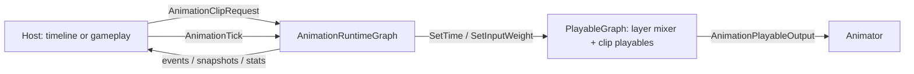
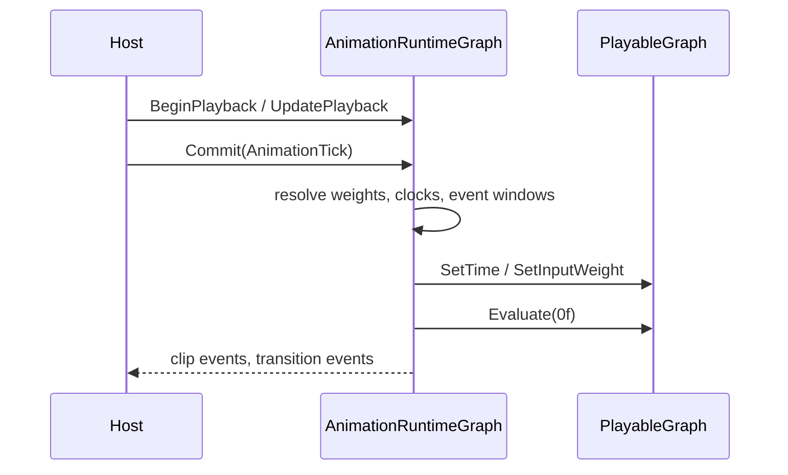
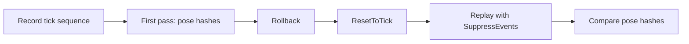
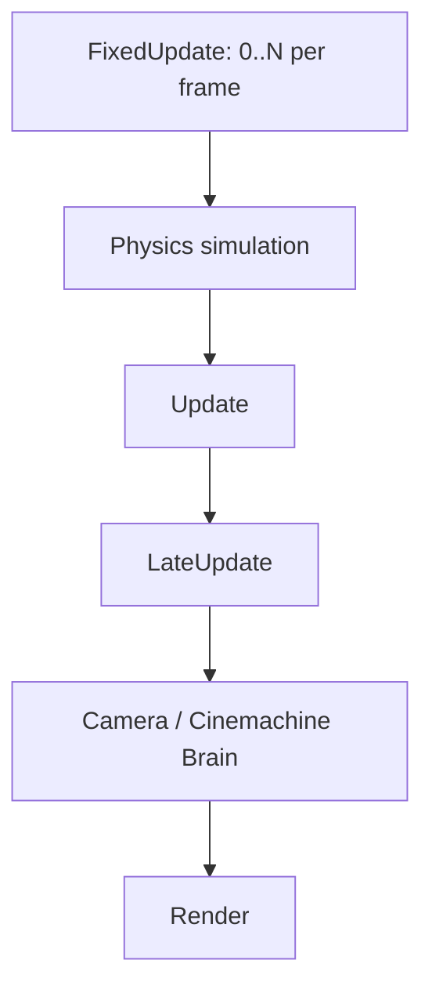
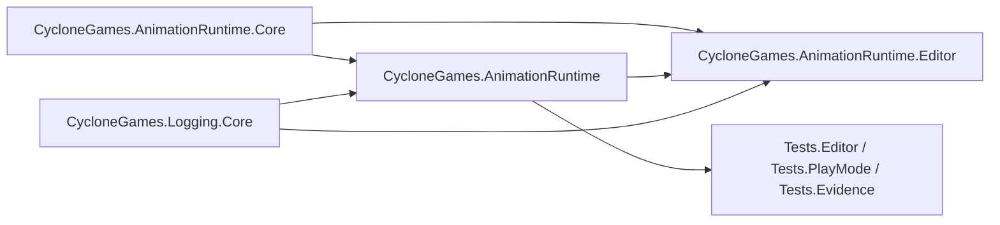

# CycloneGames.AnimationRuntime

[English | 简体中文](README.SCH.md)

| | |
| --- | --- |
| Package | `com.cyclone-games.animation-runtime` |
| Unity | 2022.3 or newer |
| Dependencies | `com.cyclone-games.logging` |
| Assemblies | `CycloneGames.AnimationRuntime.Core` (`noEngineReferences: true`), `.Runtime`, `.Editor` |

## 1. Scope

The package maps clip requests to a skeleton pose through one `PlayableGraph`. It owns layers, playback slots, weights, fades, exit times, clip events and root-motion forwarding.

Sequencing, state machines, montage sections, audio/VFX routing and asset loading belong to the host.

## 2. Architecture



```text
AnimationPlayableOutput
  └─ AnimationLayerMixerPlayable        one input per layer, optional AvatarMask, additive flag
       └─ AnimationMixerPlayable        playback slots + one reserved external source slot
            ├─ AnimationClipPlayable × N
            └─ Playable                host-owned blend node or AnimationScriptPlayable
```

Topology is fixed at construction. Layer count and per-layer playback capacity are capped at 8. One Animator supports one output; `AnimationRuntimeRegistry` rejects a second graph on the same Animator. The reserved source slot is connected through `SetLayerSource` and released through `ClearLayerSource`; input counts never change.

## 3. Getting started

```csharp
using CycloneGames.AnimationRuntime;
using CycloneGames.AnimationRuntime.Core;
using UnityEngine;

public sealed class PoseDriver : MonoBehaviour
{
    [SerializeField] private Animator _animator;
    [SerializeField] private AnimationClip _clip;

    private AnimationRuntimeGraph _graph;
    private long _step;

    private void Awake()
    {
        _graph = new AnimationRuntimeGraph(_animator, new[] { AnimationLayerDescriptor.Default });
        _graph.BeginPlayback(new AnimationClipRequest(1, 0, 0, _clip, 0d, 1f));
    }

    private void Update()
    {
        double localTime = Time.timeAsDouble % _clip.length;
        _graph.UpdatePlayback(new AnimationClipRequest(1, 0, 0, _clip, localTime, 1f));

        _step = _step == long.MaxValue ? 0L : _step + 1L;
        _graph.Commit(new AnimationTick(Time.timeAsDouble, _step, AnimationTimeSource.Update));
    }

    private void OnDestroy()
    {
        _graph?.Dispose();
        _graph = null;
    }
}
```

`AnimationRuntimeBehaviour` provides the same flow as a `MonoBehaviour` with a serialized commit phase.

## 4. Time model

`AnimationTick` is the only time carrier.

| Field | Type | Meaning |
| --- | --- | --- |
| `ClipTime` | `double` | Absolute clock folded into clip-local seconds under `TickDriven`. |
| `TransitionTime` | `double` | Absolute clock for weight ramps, layer fades and exit timing. |
| `StepIndex` | `long` | Monotonic step; a repeated index makes `Commit` a no-op. |
| `Source` | `AnimationTimeSource` | Origin of the tick, for diagnostics. |
| `IsBackward` | `bool` | The host clock moved backwards. |
| `SuppressEvents` | `bool` | Advance pose and weights without dispatching events. |



Two constructors:

```csharp
// Convenience: TransitionTime = ClipTime.
new AnimationTick(clipTime, stepIndex, AnimationTimeSource.Update);

// Separate clocks, for replay or a distinct transition authority.
new AnimationTick(clipTime, transitionTime, stepIndex, AnimationTimeSource.Replay,
    isBackward: false, suppressEvents: true);
```

| Policy | Clip-local time source |
| --- | --- |
| `External` | `AnimationClipRequest.LocalTime` on every `BeginPlayback` / `UpdatePlayback`. |
| `TickDriven` | `ClipTime * Speed + StartLocalTime`, folded through `AnimationLoopMode`. |

```csharp
_graph = new AnimationRuntimeGraph(
    _animator,
    new[] { AnimationLayerDescriptor.Default },
    timePolicy: AnimationTimePolicy.TickDriven);

_graph.BeginPlayback(new AnimationClipRequest(
    instanceId: 1, playbackChannel: 0, layer: 0, clip: _clip,
    localTime: 0d, weight: 1f, speed: 1.25f, loop: AnimationLoopMode.Loop));

_graph.Commit(new AnimationTick(Time.timeAsDouble, step, AnimationTimeSource.LateUpdate));
```

Non-finite tick clocks are clamped to zero. A finite clock multiplied by a finite speed can overflow; `AnimationClockMath` rejects the step and the graph holds the last finite pose.

## 5. Layers

```csharp
[SerializeField] private AnimationLayerProfile _profile;

AnimationLayerDescriptor[] descriptors = _profile != null
    ? _profile.ToDescriptors()
    : new[] { AnimationLayerDescriptor.Default };

var graph = new AnimationRuntimeGraph(_animator, descriptors);
```

A descriptor carries `AvatarMask`, `Additive`, `Weight`, `Capacity`, `ApplyFootIK` and `ApplyPlayableIK`. Layer weights are normalized by the top mixer; playback weights are normalized inside each layer. A profile weight of 0 means unset and projects to 1. `SetLayerWeight(0)` mutes a layer.

```csharp
graph.SetLayerWeight(0, 0.8f);
graph.SetLayerWeight(0, 1f, new AnimationFade(0.25f, 1f, transitionTime));
```

A request beyond capacity increments `DroppedPlaybacks` and reports a warning in development builds.

## 6. Playbacks

| Field | Meaning |
| --- | --- |
| `InstanceId` | Owner identity. |
| `PlaybackChannel` | Competition group; playbacks in different channels do not compete. |
| `ClipChannel` | Sub-channel for overlapping variants on the same key. |
| `Layer` | Layer index. |
| `LocalTime` | Absolute clip-local seconds (`External`) or start offset (`TickDriven`). |
| `Weight` | Requested weight. |
| `Speed`, `Loop` | Folding parameters for `TickDriven`. |
| `HoldLastFrame` | Pins the pose at clip end. |

```csharp
AnimationPlaybackHandle handle = graph.BeginPlayback(
    new AnimationClipRequest(1, 0, 0, _clip, 0d, 1f));

graph.UpdatePlayback(new AnimationClipRequest(1, 0, 0, _clip, 0.4d, 1f));
graph.SeekPlayback(new AnimationPlaybackKey(1, 0, 0), 0.2d);
bool alive = graph.IsPlaybackAlive(handle);

graph.EndPlayback(new AnimationPlaybackKey(1, 0, 0));
```

Re-beginning an existing key replaces the playback in place. Slot reuse increments a 32-bit generation; handles from a previous occupant fail `IsPlaybackAlive`. `BeginPlayback`, `UpdatePlayback` and `EndPlayback` only mark state; native work happens at `Commit`.

## 7. Blending

```csharp
LinearBlendNode gait = LinearBlendNode.Create(
    graph.PlayableGraph,
    new[] { idle, walk, run },
    new[] { 0f, 0.5f, 1f },
    BlendTimeMode.Normalized);
graph.SetLayerSource(0, gait.Playable);
gait.SetParameter(speed01);
gait.SetTime(phase01);
graph.SetLayerSourceWeight(0, 0.9f);
```

`BlendTimeMode.Normalized` samples each child at the same phase. `Absolute` samples the same seconds in every child. `DirectionalBlendNode` takes angles in degrees and an optional center index.

## 8. Fades, exit time and clip events

```csharp
graph.BeginPlayback(request, new AnimationFade(0.2f, 1f, transitionTime, AnimationFadeEasing.SmoothStep));
graph.FadePlayback(key, new AnimationFade(0.15f, 0f, transitionTime));
graph.EndPlayback(key, new AnimationFade(0.1f, 0f, transitionTime));

graph.SetExitTime(key, new AnimationExitTime(0.5f, AnimationExitMode.Once));

graph.TransitionCompleted += (handle, reason) =>
{
    if (reason == AnimationTransitionReason.FadeCompleted) { /* next clip */ }
};
```

`AnimationFade.AbsoluteStartTime` is a required argument. Progress is `(TransitionTime - AbsoluteStartTime) / Duration`, so a fade is a pure function of the tick clock. `AnimationExitMode.Once` fires on the first crossing; `EveryCrossing` also fires on loop wraps and ping-pong reverse legs.

```csharp
public sealed class FootstepSink : IAnimationClipEventSink
{
    public void OnClipEvent(in AnimationPlaybackHandle handle, in AnimationClipEvent clipEvent)
    {
        if (clipEvent.FunctionName == "Footstep") { /* play audio */ }
    }
}

graph.SetClipEventSink(new FootstepSink());
```

Clip events come from `AnimationClip.events`, converted once to a sorted array. The sweep is half-open `(previous, current]`; the first commit uses `[0, current]`. A loop wrap splits into `(previous, 1]` and `[0, current]`. Backward seeks suppress events. Dispatch order inside a commit is clip events, exit time, fade completion.

| Budget | Default | Effect |
| --- | --- | --- |
| `MaxSweepLegs` | 64 | Bound on the legs one event or exit-time sweep may walk. |
| `MaxPendingClipEventsPerCommit` | 4096 | Markers dispatched per commit; overflow increments `DroppedClipEvents`. |
| `InitialClipEventQueueCapacity` | 32 | First queue allocation. |
| `SteadyClipEventQueueCapacity` | 512 | Capacity retained after a drain. |

Set `DispatchClipEvents = false` when the host owns event dispatch. With dispatch on and `Animator.fireEvents` enabled, Unity fires the same marker twice; graph construction reports this once.

## 9. Determinism and rollback



```csharp
// Start a replay from a clean state; playbacks and playables stay alive.
graph.ResetToTick(new AnimationTick(t0, t0, 0L, AnimationTimeSource.Replay));

for (int step = 0; step < recorded.Length; step++)
{
    graph.UpdatePlayback(recorded[step].Request);
    graph.Commit(new AnimationTick(
        recorded[step].ClipTime, recorded[step].TransitionTime, step,
        AnimationTimeSource.Replay, false, suppressEvents: true));
}

ulong hash = graph.ComputePoseHash();
```

`ResetToTick` clears transition anchors, exit cursors, event windows and queued events. `SuppressEvents` commits still advance pose and weights but dispatch nothing. `ComputePoseHash` returns an FNV-1a hash of live layer and playback state without allocating. Animation state is not stored in gameplay snapshots; the host snapshots inputs and re-evaluates poses.

## 10. Frame lifecycle and rendering order

### 10.1 Documented order



Source: Unity manual, "Event function execution order" (2022.3 and Unity 6). `FixedUpdate` and physics simulation precede `Update`; `Update` precedes `LateUpdate`; `LateUpdate` precedes rendering. `OnAnimatorMove` and `OnAnimatorIK` run during the internal animation update. The manual does not specify that node's position relative to `LateUpdate`. `Animator.updateMode` selects the phase of the animation update.

| Stage | Work | This package |
| --- | --- | --- |
| `FixedUpdate` | physics-step gameplay, 0..N per frame | `Commit` once per step when phase is `FixedUpdate` |
| Physics simulation | Rigidbody / CharacterController resolution | no transform writes; host consumes the root delta |
| `Update` | per-frame gameplay | `Commit` when phase is `Update` |
| Internal animation update (position not specified by the manual) | Animator, `OnAnimatorMove`, `OnAnimatorIK` | forwards root delta and IK pass |
| `LateUpdate` | cameras, final script writes | `Commit` when phase is `LateUpdate` |
| Camera / Brain | Cinemachine follow and aim | host configuration |
| Render | displays the sampled pose | consumer |

### 10.2 Commit phase and pose age

| `AnimationCommitPhase` | Required `Animator.updateMode` | Commit count | Consumer | Pose age |
| --- | --- | --- | --- | --- |
| `Update` | `Normal` | once per frame | camera in `LateUpdate` | 0 frames |
| `LateUpdate` | `Normal` | once per frame | camera after this component | 0 frames if the Brain runs after |
| `FixedUpdate` | `AnimatePhysics` | once per physics step | camera in `LateUpdate` | 0-1 fixed step; interpolation required |

The component runs at `[DefaultExecutionOrder(-100)]`. In `FixedUpdate` mode every physics step commits once, commit-rate LOD and visibility skipping are ignored and reported in development builds. A frame with zero fixed steps produces no commit and no root delta. A frame with two or more fixed steps produces one commit per step; the host sums the deltas instead of overwriting them. `StepIndex` suppresses a duplicate commit within the same phase.

`Initialize` reports an error in development builds when the phase disagrees with `Animator.updateMode`.

### 10.3 FK, IK and root motion

| Feature | Runs at | Consequence |
| --- | --- | --- |
| FK: clip sampling and layer mixing | `PlayableGraph.Evaluate(0f)` inside `Commit` | resolved at the commit phase, not at the internal animation update |
| IK through `AnimationScriptPlayable` | graph evaluation inside `Commit` | phase is explicit; attach with `SetLayerSource` |
| IK through `OnAnimatorIK` | Unity internal animation update | forwarded to `IAnimationIKPass`; relative position to `LateUpdate` is not a contract |
| Root motion | `OnAnimatorMove`, internal animation update | `Backend` forwards `Animator.deltaPosition` and `deltaRotation` once |

| `RootMotionOwnership` | Behaviour |
| --- | --- |
| `External` | `Animator.deltaPosition` is left to a movement component. |
| `Backend` | `OnAnimatorMove` forwards a filtered delta through `RootMotionApplied`. |
| `Disabled` | Root motion is ignored. |

```csharp
behaviour.RootMotionApplied += (delta, rotation) => controller.ApplyRootMotion(delta, rotation);
behaviour.SetIKPass(new CharacterIKPass());   // forwards OnAnimatorIK(int layerIndex)
```

`Backend` requires the Animator on the same GameObject. The runtime never writes the character `Transform`. In `FixedUpdate` mode the root delta must be consumed inside the physics step; consuming it in `Update` or `LateUpdate` breaks the fixed-delta ratio and the displacement becomes wrong.

### 10.4 Camera and physics rules

1. `CinemachineBrain.UpdateMethod` matches the model: `FixedUpdate` for `FixedUpdate` commits, `LateUpdate` for `Update` or `LateUpdate` commits. `SmartUpdate` needs verification on the target setup.
2. `FixedUpdate` mode: enable `Rigidbody.interpolation`. A Brain on `FixedUpdate` without interpolation produces stepping.
3. Follow the root transform, not a bone. A bone read before commit is one step stale.
4. Do not read `Rigidbody.position` for the camera when interpolation is active; it is the raw physics position, not the rendered one.
5. Spawn gameplay hitboxes from events evaluated in the physics step. A render-time clip event queries a stale physics scene.
6. One movement component consumes root motion. Two `OnAnimatorMove` handlers on the same Animator apply the delta twice.

### 10.5 Guarantees and verification

| Guaranteed by this package | Host responsibility |
| --- | --- |
| one commit per selected phase, one per fixed step in `FixedUpdate` | `Animator.updateMode` matches the commit phase |
| `StepIndex` suppresses duplicate commits | `CinemachineBrain.UpdateMethod` matches the model |
| `Animator.updateMode` assertion at init; `FixedUpdate` rejects rate LOD | Rigidbody interpolation, camera order and execution order |
| no `Transform` writes; root delta forwarded once | summing deltas across multiple fixed steps |
| `PhaseOrderMask` records observed phases in development builds | verifying the internal animation update position on the target device |

`PhaseOrderMask` is a bit mask of phases observed in the current rendered frame. The host can compare it with the configured model on the target device. The mask is zero in non-development builds.

```csharp
int mask = behaviour.PhaseOrderMask;
bool sawPhysicsCommit = (mask & (int)AnimationRuntimePhase.FixedUpdate) != 0
    && (mask & (int)AnimationRuntimePhase.Commit) != 0;
bool sawIKPass = (mask & (int)AnimationRuntimePhase.AnimatorIK) != 0;
```

`AnimationRuntimePhase` contains `Update`, `LateUpdate`, `FixedUpdate`, `Commit`, `AnimatorMove` and `AnimatorIK`.

## 11. Unity feature surface

| Feature | API |
| --- | --- |
| Layer mixer, masks, additive layers | fixed graph topology, `AnimationLayerDescriptor` |
| Pooled clip playables | `AnimationClipPlayable`, ping-pong slot cache |
| Foot IK / Playable IK | `AnimationClipPlayable.SetApplyFootIK`, `SetApplyPlayableIK` |
| Manual evaluation | `DirectorUpdateMode.Manual`, `Evaluate(0f)` |
| Animation C# Jobs | `CreateJobPlayable<TJob>` |
| IK pass | `IAnimationIKPass`, `OnAnimatorIK` |
| Layer weight ramp | `SetLayerWeight(int, float, in AnimationFade)` |
| Host source slot | `SetLayerSource`, `SetLayerSourceWeight`, `ClearLayerSource` |

```csharp
using UnityEngine.Animations;

public struct LookAtJob : IAnimationJob
{
    public void ProcessRootMotion(AnimationStream stream) { }
    public void ProcessAnimation(AnimationStream stream) { }
}

AnimationScriptPlayable job = graph.CreateJobPlayable(new LookAtJob(), 1);
graph.SetLayerSource(0, job);
```

The host owns job data and node lifetime; dispose the node before `ClearLayerSource`. `IAnimationJob` signatures follow the Unity version in use.

## 12. Diagnostics

```csharp
AnimationRuntimeStats stats = graph.GetStats();
// ActivePlaybacks, PeakPlaybacks, LayerCount, PlayableCount, DroppedPlaybacks,
// RecreatedPlayables, ReusedPlayables, Commits, Evaluations, NativeWrites, TimePolicy.

var buffer = new AnimationPlaybackSnapshot[8];
int count = graph.CopyPlaybackSnapshots(0, buffer);

long droppedTotal = graph.DroppedClipEvents;
long droppedOnLayer0 = graph.GetDroppedClipEvents(0);
```

`IAnimationDiagnostics` gates message formatting; `LoggingAnimationDiagnostics` adapts it to `CycloneGames.Logging`. The Inspector refreshes four times per second and reads the same snapshot API. It shows layer weights, per-playback state, pose hash, dropped markers and the phase mask.

## 13. Performance contract

`Commit` walks live playback slots through an 8-bit occupancy mask per layer. Cost is proportional to live playbacks. The dispatch queue is empty until the first marker, capped per commit and shrunk after a drain. Transition deliveries are indexed by `(layer, slot)` with one bit per reason.

`Playback` is 64 bytes. Native writes are epsilon-gated and graph evaluation is skipped when nothing is dirty. Steady-state `Commit` allocates zero bytes. All budgets live in `AnimationRuntimeLimits` as `static readonly` fields.

`UpdateRateHz` and `PauseWhenInvisible` on `AnimationRuntimeBehaviour` skip commits for large crowds. Each actor still owns a `PlayableGraph` and an Animator binding.

## 14. Extension points

| Seam | Contract |
| --- | --- |
| `IAnimationClipResolver` | Resolve `AnimationClipReference.Location` to a clip before playback. |
| `IAnimationDiagnostics` | Gate and route diagnostics messages. |
| `IAnimationClipEventSink` | Receive clip markers; one sink per graph. |
| `IAnimationIKPass` | Receive Unity's IK pass. |
| `SetLayerSource` | Attach a host-owned `Playable` from the same `PlayableGraph`. |

`PlayableGraph` is exposed for creating host nodes. Treat the topology as read-only.

## 15. Build and tests



The Core assembly has no engine references and no dependencies; the Runtime and Editor assemblies reference `CycloneGames.Logging.Core`. Tests use NUnit and `optionalUnityReferences: ["TestAssemblies"]`.

| Command | Purpose |
| --- | --- |
| `dotnet build UnityCompileCheck.csproj -c Release` | Compile Core, Runtime and Editor against Unity 2022.3 managed DLLs. |
| `dotnet build UnityTestsCompileCheck.csproj -c Release` | Compile the test assemblies as well. |
| `dotnet test CycloneGames.Analyzers.Tests -c Release` | Run analyzer rules. |
| `dotnet bin/Release/net8.0/AnimationRuntimeAudit_fixed.dll` | Run the engine-free verification harness. |
