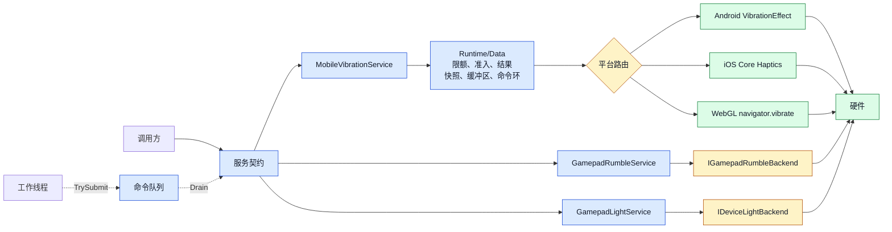

# CycloneGames.DeviceFeedback

[English | 简体中文](README.md)

设备反馈负责控制硬件输出：手机振动、手柄双马达震动、手柄或键盘的 RGB 灯光。本包为这三类输出提供统一契约、手机触觉的平台实现，以及可注入的手柄硬件 backend。

## 目录

- [概述](#概述)
- [快速上手](#快速上手)
- [核心概念](#核心概念)
- [架构](#架构)
- [服务契约](#服务契约)
- [播放反馈](#播放反馈)
- [依赖注入](#依赖注入)
- [低延迟播放](#低延迟播放)
- [跨线程提交](#跨线程提交)
- [能力与生命周期](#能力与生命周期)
- [准入、限额与诊断](#准入限额与诊断)
- [性能与内存](#性能与内存)
- [线程](#线程)
- [平台与 AOT](#平台与-aot)
- [创作](#创作)
- [错误处理](#错误处理)
- [验证](#验证)
- [扩展](#扩展)
- [参考](#参考)

## 概述

三个服务覆盖三类输出：

| 服务 | 输出 | 默认可用性 |
| --- | --- | --- |
| `MobileVibrationService` | 手机振动、Core Haptics、浏览器振动 | 依平台而定 |
| `GamepadRumbleService` | 手柄双马达 | 需要注入 backend |
| `GamepadLightService` | 手柄或键盘 RGB 灯光 | 需要注入 backend |

适用场景：项目需要跨 Android、iOS、WebGL 的统一触觉 API；需要设计师创作的 clip 资产；需要为平台专用手柄硬件保留清晰边界。本包不实现设备发现、按玩家的输入路由、自适应扳机或键盘多灯区，这些属于输入层或平台集成层。

手机侧路由在运行时选择：

| 平台 | 路由 |
| --- | --- |
| Android 30+ | `VibrationEffect` composition primitives，失败时回退到振幅 |
| Android 26+ | `VibrationEffect.createWaveform` |
| Android 26 以下 | `Vibrator.vibrate` 的 on/off 序列 |
| iOS 13+ | Core Haptics 瞬态、持续与复合播放器 |
| iOS 13 以下 | `UIFeedbackGenerator` 与公开振动音效 |
| WebGL | `navigator.vibrate` |
| Editor 与桌面端 | 无硬件路由，调用由准入拒绝 |

## 快速上手

### 前置条件

Unity 2022.3 或更新版本。工程实际版本以仓库中的
`UnityStarter/ProjectSettings/ProjectVersion.txt` 为准。Runtime 程序集为
`CycloneGames.DeviceFeedback.Runtime`，在调用方 asmdef 中添加引用。

### 第一个触觉反馈

```csharp
using CycloneGames.DeviceFeedback.Runtime;
using UnityEngine;

public sealed class HapticButton : MonoBehaviour
{
    private void Awake() => MobileVibration.Init();

    public void OnClick() => MobileVibration.PlayPreset(HapticPreset.Medium);

    private void OnApplicationQuit() => MobileVibration.Shutdown();
}
```

`Init()` 创建服务并初始化平台路由，`Shutdown()` 释放原生资源。重复调用
`Init()` 是安全的。

### 读取调用结果

每个 `void` playback 方法都通过 `LastResult` 发布结果，`*Checked` 方法直接返回同一个值。

```csharp
FeedbackResult result = MobileVibration.LastResult;
if (result.IsRejected)
{
    Debug.Log("Haptic refused: " + result.Status);
}
```

`FeedbackStatus` 覆盖接受、降级、非法输入、容量、未激活、不可用、已释放、能力不支持、原生失败与线程归属。参见[准入、限额与诊断](#准入限额与诊断)。

## 核心概念

### 参数

| 参数 | 范围 | 含义 |
| --- | --- | --- |
| `intensity` | 0 到 1 | Android 26+ 的振幅、iOS 13+ 的 `CHHapticEventParameterIntensity`、WebGL 的时长 |
| `durationSeconds` | 正数，受 `DeviceFeedbackLimits` 约束 | 效果时长 |
| `sharpness` | 0 到 1 | iOS 13+ 原生支持，其余平台近似处理 |

三者都在缓冲区增长与原生派发之前校验。非有限值按 `RejectedInvalid` 拒绝。

### 预设

`HapticPreset` 有七个值：`Light`、`Medium`、`Heavy`、`Success`、`Warning`、`Error`、`Selection`。每个服务把预设映射到自己的硬件路由。

### Authoring 数据与运行时数据

`HapticClip` 是用于创作的 `ScriptableObject`，持有一对 `AnimationCurve` 或一个 `HapticEvent` 数组。运行时播放使用由 `HapticClipBaker` 生成的不可变 `HapticClipSnapshot`，资产本身从不被修改。参见[低延迟播放](#低延迟播放)。

### 准入、限额与 profile

`DeviceFeedbackLimits` 约束单次操作，`DeviceFeedbackProfile` 承载最小采样间隔、缓存容量等运行时策略。两者都是值类型，由 composition root 提供；默认值是共享的不可变实例。

### 能力

`DeviceCapability` 报告当前设备可用的路由：`SupportsHaptics`、`SupportsAmplitude`、`SupportsSharpness`、`SupportsCoreHaptics`、`SupportsPattern`、`SupportsContinuousModulation` 与 `PlatformApiLevel`。

## 架构

### 目录结构

| 路径 | 内容 |
| --- | --- |
| `Runtime/Data/` | 值类型、限额、profile、准入、诊断、缓冲区租借、快照与命令环（同属 Runtime 程序集） |
| `Runtime/Haptics/` | 手机与手柄触觉服务、创作资产与 clip 烘焙器 |
| `Runtime/Lighting/` | 设备灯光服务与 backend 契约 |
| `Runtime/Plugins/iOS/` | Core Haptics 与回退用 Objective-C 桥接 |
| `Runtime/Plugins/WebGL/` | `navigator.vibrate` JavaScript 桥接 |
| `Editor/` | `HapticClip` Inspector |
| `Tests/Editor/` | EditMode 测试 |
| `Samples~/` | 可选示例场景 |

### 程序集

| 程序集 | 平台 | 用途 |
| --- | --- | --- |
| `CycloneGames.DeviceFeedback.Runtime` | Android、iOS、WebGL、tvOS、VisionOS、桌面、Editor | 公共契约与服务 |
| `CycloneGames.DeviceFeedback.Editor` | Editor | Inspector 与创作校验 |
| `CycloneGames.DeviceFeedback.Tests.Editor` | Editor | EditMode 测试 |

Runtime 程序集不引用其他 CycloneGames 包。可选集成可以在独立程序集中引用它；Runtime 不反向引用任何集成。

### 数据流



`MobileVibrationService` 使用不可变 `HapticClipSnapshot` 或直接参数，再选择平台路由。
`GamepadRumbleService` 与 `GamepadLightService` 转发给注入的 backend。工作线程只通过
`TrySubmit` 进入；`Drain` 在 owner 线程投递队列中的命令。

## 服务契约

### `IHapticFeedbackService`

| 成员 | 用途 |
| --- | --- |
| `IsAvailable`、`IsActive` | 可用性与主开关 |
| `Initialize` | 准备平台路由 |
| `PlayPreset(HapticPreset)` | 播放共享预设 |
| `Play(float, float, float)` | 按强度、时长与锐度播放 |
| `PlayCurve(AnimationCurve, float, AnimationCurve, int)` | 采样强度曲线 |
| `PlayClip(HapticClip)` | 播放创作 clip |
| `Cancel` | 停止当前输出 |

### `IMobileVibrationService`

增加 `HasVibrator`、`Vibrate` 重载、`VibratePop`、`VibratePeek`、`VibrateNope`、iOS 专用反馈方法与 `UpdateContinuousParameters`，并继承 `IDisposable`。

### `IGamepadRumbleService`

增加 `SetMotorSpeeds(float, float)` 与 `Rumble(float, float, float)`。

### `IDeviceLightService`

增加 `SetColor`、`Flash`、`PlayGradient`、`PlayIntensityCurve`、`CancelAnimation` 与 `Reset`。

### `IFeedbackResultProvider`

| 成员 | 用途 |
| --- | --- |
| `LastResult` | 最近一次调用的结果 |
| `Limits` | 当前操作预算 |
| `Capability` | 当前硬件能力 |
| `GetMemoryStats()` | 实例级计数与缓冲区状态 |
| `RefreshCapabilities()` | 重新探测硬件 |
| `ResetDiagnostics()` | 清空实例级计数器 |

三个服务都实现该契约。

### Backend

`IGamepadRumbleBackend` 与 `IDeviceLightBackend` 负责设备发现、计时与原生调用。`NoopGamepadRumbleBackend.Instance` 与 `NoopDeviceLightBackend.Instance` 是默认值，两者的 `IsAvailable` 均为 `false`，因此未安装 backend 的项目不会产生硬件输出。

构造参数 `ownsBackend` 决定服务是否释放 backend。当 composition root 拥有 backend 时，把它设为 `false`。

## 播放反馈

### 直接播放

```csharp
var service = new MobileVibrationService();
service.Initialize();

service.Play(intensity: 0.8f, durationSeconds: 0.25f, sharpness: 0.9f);
FeedbackResult result = service.LastResult;
```

### 曲线

`PlayCurve` 采样强度曲线与可选的锐度曲线。采样网格量化为 2 的幂，覆盖 `t = 0` 到 `t = 1`，有效间隔使总时长接近 `durationSeconds`。

```csharp
AnimationCurve intensity = AnimationCurve.EaseInOut(0f, 0f, 1f, 1f);
AnimationCurve sharpness = AnimationCurve.Linear(0f, 0.3f, 1f, 0.9f);
service.PlayCurve(intensity, 1.5f, sharpness, sampleIntervalMs: 20);
```

### HapticClip 资产

通过 `Assets > Create > CycloneGames > Device Feedback > Haptic Clip` 创建 `HapticClip`。曲线模式由 `intensityCurve` 与 `sharpnessCurve` 驱动；事件模式下 `events` 优先，曲线被忽略。

```csharp
[CreateAssetMenu] public HapticClip explosionClip;

service.PlayClip(explosionClip);
```

### 序列振动

```csharp
service.Vibrate(200);                                  // 200 ms
service.Vibrate(new long[] { 0, 100, 50, 100 }, -1);  // 播放一次
service.Vibrate(new long[] { 0, 100, 50, 100 }, 0);   // 从索引 0 循环
service.Cancel();                                      // 停止循环
```

`repeat = -1` 表示播放一次，其他合法索引表示从该位置循环。Android 把序列交给 `VibrationEffect`；iOS 13+ 构造 Core Haptics 复合模式；WebGL 折叠为总时长。

### iOS 专用反馈

```csharp
service.VibrateIOS(IOSImpactStyle.Heavy);
service.VibrateIOS(IOSNotificationStyle.Success);
service.VibrateIOSSelection();
```

iOS 13+ 使用 Core Haptics 瞬态事件，更早版本使用 `UIFeedbackGenerator`。非法枚举值被拒绝且不抛异常。

### 实时调制

```csharp
service.Play(0.5f, 5f, 0.5f);

void Update()
{
    service.UpdateContinuousParameters(charge, 0.7f);
}
```

该路由要求 `SupportsContinuousModulation`，在 Android 与 WebGL 上不可用。

### 平台能力矩阵

| 功能 | Android | iOS 13 以下 | iOS 13+ | WebGL | Editor |
| --- | --- | --- | --- | --- | --- |
| 基础振动 | 是 | 是 | 是 | 是 | 无输出 |
| 时长控制 | 是 | 否 | 是 | 是 | 无输出 |
| 振幅 | API 26+ | 否 | 是 | 否 | 无输出 |
| 锐度 | 否 | 否 | 是 | 否 | 无输出 |
| 序列 | 是 | 否 | 复合模式 | 总时长 | 无输出 |
| 曲线波形 | API 26+ | 仅峰值 | 原生曲线 | 总时长 | 无输出 |
| HapticClip 事件 | 波形 | 否 | `CHHapticEvent` | 总时长 | 无输出 |
| 实时调制 | 否 | 否 | 是 | 否 | 无输出 |
| Cancel | 是 | 否 | 是 | 是 | 无输出 |
| 手柄震动与灯光 | 需要 backend | 需要 backend | 需要 backend | 需要 backend | no-op 默认 |

## 依赖注入

把具体服务注册为 gameplay 代码所需的接口。

```csharp
public sealed class CombatController
{
    private readonly IHapticFeedbackService _haptics;

    public CombatController(IHapticFeedbackService haptics)
    {
        _haptics = haptics;
        _haptics.Initialize();
    }

    public void OnHit() => _haptics.Play(0.9f, 0.12f, 0.25f);
    public void OnExplosion(HapticClip clip) => _haptics.PlayClip(clip);
}
```

```csharp
var limits = new DeviceFeedbackLimits(300_000, 4_096, 2_048, 4_096);
var profile = new DeviceFeedbackProfile(minimumSampleIntervalMilliseconds: 10);
var service = new MobileVibrationService(limits, profile);
container.RegisterInstance<IHapticFeedbackService>(service);
```

只在没有 composition root 的项目中使用 `MobileVibration`。同一作用域内混用静态门面与注入服务会产生两个独立会话，各自持有缓冲区与原生句柄。

### 所有权

| 所有者 | 持有 |
| --- | --- |
| Composition root | 服务实例、backend、限额与 profile |
| 服务 | 缓冲区租借、clip 缓存、命令队列与计数器 |
| Backend | 设备发现、定时器与原生句柄 |
| Scope 关闭 | 先 `Cancel`、再 `Dispose`，`ownsBackend` 为 true 时释放 backend |

`Dispose` 停止输出并释放原生资源，`Reinitialize` 重新准备已释放的实例。

## 低延迟播放

在调用线程上采样曲线或构建事件时间轴，耗时与 clip 规模成正比。烘焙把这部分工作移到加载期。

### 烘焙 clip

```csharp
HapticClip clip = Resources.Load<HapticClip>("Haptics/Explosion");

if (HapticClipBaker.TryBake(
        clip,
        DeviceFeedbackLimits.Default,
        DeviceFeedbackProfile.Default,
        out HapticClipSnapshot snapshot,
        out FeedbackResult result))
{
    // Keep the snapshot for the lifetime of the scene.
}
else
{
    Debug.Log("Bake refused: " + result.Status);
}
```

`TryBake` 完成曲线采样、按时间排序事件、展开静音间隙、转换振幅，并把数组裁剪为平台 API 所需的精确长度。失败时返回 `false` 与带拒绝状态的 `FeedbackResult`，源资产不变。

### 播放快照

```csharp
service.PlayClipSnapshot(snapshot);
FeedbackResult result = service.PlayClipSnapshotChecked(snapshot);
```

`PlayClipSnapshot` 不采样、不排序、不计算间隔、不增长缓冲区。烘焙数组直接传给平台边界；iOS 与 Android 26+ 无需拷贝，数组长度已满足要求。

### Clip 缓存

`PlayClip(HapticClip)` 在首次使用时烘焙，并把快照保存在服务自有、有界的缓存中。容量由 `DeviceFeedbackProfile.ClipCacheMaxEntries` 设置（默认 32，绝对上限 128）。重复播放同一 clip 走快照路径。`Dispose` 清空缓存，`Reinitialize` 按需重建状态。

### 延迟契约

owner 线程上的同步播放立即派发，从不入队；跨线程命令在下一次 `Drain` 送达。烘焙是唯一的准备步骤，应在输入敏感帧之外完成。

## 跨线程提交

工作线程需要请求反馈时使用 `TrySubmit`；owner 线程每帧调用一次 `Drain`。

```csharp
var command = new FeedbackCommand
{
    Kind = FeedbackCommandKind.VibrateMilliseconds,
    Priority = FeedbackPriority.Normal,
    DeviceId = new FeedbackDeviceId(playerId),
    DurationMilliseconds = 40
};

if (!service.TrySubmit(in command))
{
    // Queue is full or the payload is invalid.
}
```

```csharp
void Update() => service.Drain(maxCommands: 64);
```

| 成员 | 契约 |
| --- | --- |
| `TrySubmit` | 任意线程安全；队列已满或载荷非法时返回 `false` |
| `Drain` | 仅 owner 线程；由 `maxCommands` 限制每帧工作量 |
| `GetCommandStats()` | 容量、入队、拒绝、已处理、延迟与待处理计数 |

命令环有 256 个槽位。溢出被拒绝并计数，绝不分配。每个槽位有 free、writing、ready 三种状态；仍在写入的生产者会把该槽位推迟到下一次 drain。`FeedbackCommandKind` 覆盖 `Play`、`PlayPreset`、`PlayClipSnapshot`、`VibrateMilliseconds` 与 `Cancel`。

`FeedbackCommand` 只含值字段与一个可选的 `HapticClipSnapshot`，不含闭包、委托或 Unity 对象。

## 能力与生命周期

```csharp
DeviceCapability capability = service.Capability;
if (!capability.SupportsSharpness)
{
    // Select a route that does not need sharpness.
}

service.RefreshCapabilities();
```

| 方法 | 效果 |
| --- | --- |
| `RefreshCapabilities()` | 清除能力缓存与 composition 失败闩锁，下次使用时重新探测 |
| `Reinitialize()` | 复活已释放的实例并初始化平台路由 |
| `ResetDiagnostics()` | 清空实例级计数器 |
| `IsActive` | 主开关；设为 `false` 时停止当前输出 |
| `Dispose()` | 停止输出、释放原生资源、清空缓存与队列 |

`HasVibrator` 返回 `SupportsHaptics`。iOS 上先检查 Core Haptics，再回退到设备类别判断。

## 准入、限额与诊断

### 限额

`DeviceFeedbackLimits` 有四个字段，各自带默认值与硬上限：

| 预算 | 默认值 | 硬上限 |
| --- | --- | --- |
| `MaximumDurationMilliseconds` | 300,000 | 3,600,000 |
| `MaximumWaveformSampleCount` | 4,096 | 65,536 |
| `MaximumHapticEventCount` | 2,048 | 16,384 |
| `MaximumPatternSegmentCount` | 4,096 | 65,536 |

构造函数拒绝超出 1 到硬上限范围的取值。操作超出预算时，准入在任何缓冲区增长或原生派发之前返回。

### Profile

| 字段 | 默认值 | 绝对上限 |
| --- | --- | --- |
| `MinimumSampleIntervalMilliseconds` | 5 | 1 到 300,000 |
| `ExactArrayCacheMaxEntries` | 16 | 64 |
| `ExactArrayCacheBudgetBytes` | 1 MiB | 8 MiB |
| `CacheableMaximumLength` | 8,192 | 65,536 |
| `ClipCacheMaxEntries` | 32 | 128 |

### 结果与计数

`FeedbackResult` 携带 `Status`、`DurationMilliseconds`、`WaveformSampleCount`、`HapticEventCount` 与 `PatternSegmentCount`，用 `IsAccepted` 与 `IsRejected` 分支。

`GetMemoryStats()` 返回 `DeviceFeedbackMemoryStats` 快照，包含接受与拒绝计数、峰值、保留缓冲区字节数、缓冲区增长次数以及精确数组的分配与复用次数。计数器属于单个服务实例。

`DeviceFeedbackDiagnostics` 是供不持有服务实例的宿主使用的进程级聚合，默认关闭。设置 `GlobalAggregationEnabled = true` 启用，调用 `Reset()` 清空。

## 性能与内存

| 属性 | 设计 |
| --- | --- |
| 临时缓冲区 | 每个服务一个 `DeviceFeedbackBufferLease`，随服务释放 |
| 增长 | 容量按 2 的幂摊还增长 |
| 精确长度数组 | 按长度索引的缓存，条目数与字节预算均有上限 |
| 采样网格 | 向下量化到 2 的幂，有效间隔保持总时长 |
| 创作事件 | 在烘焙期复制与排序，不在派发线程处理 |
| 准入 | 整数运算，派发路径无浮点除法 |
| 预设 | static readonly payload 表 |
| 诊断 | 实例内普通字段；仅可选全局聚合使用原子操作 |

稳态播放不分配托管缓冲区。Android JNI 调用仍会为每次原生派发创建 `AndroidJavaObject` wrapper，这属于 Unity 平台边界成本。iOS 与 WebGL 的稳态路径在初始化后不分配托管内存。

烘焙 clip 会一次性分配快照数组，这是每个已烘焙 clip 的固定成本，与播放次数无关。

## 线程

每个服务采用 owner-thread 约束。首次调用记录 owner 线程，之后的同线程调用只需一次 volatile 读。其他线程的同步调用返回 `RejectedThreadAffinity`，且不触碰实例状态；跨线程工作使用 `TrySubmit` 与 `Drain`。

`MobileVibration` 与 `Shutdown` 使用同一把锁访问单例，并在 subsystem registration 时清理，关闭域重载的 play 会话不会保留过期实例。

iOS 原生状态仅限主线程。Objective-C 桥接在有界集合中保活瞬态播放器，并在关闭期间抑制引擎回调。

## 平台与 AOT

Runtime 程序集声明 Unity 2022.3，目标平台包括 Android、iOS、WebGL、tvOS、VisionOS、桌面与 Editor。只有 Android、iOS、WebGL 具备手机路由；其余平台接受手柄与灯光 backend，但不提供内建振动。

Runtime 代码不使用反射发现、动态代码生成或 `RegexOptions.Compiled`。原生插件在 C ABI 边界校验数量与指针，并强制 16,384 事件上限。交付配置需在 IL2CPP 与 managed stripping 的目标 Player 构建上验证。

## 创作

### `HapticClip`

| 字段 | 类型 | 用途 |
| --- | --- | --- |
| `duration` | `float` | 曲线模式下的 clip 时长（秒） |
| `intensityCurve` | `AnimationCurve` | 归一化时间上的强度 |
| `sharpnessCurve` | `AnimationCurve` | 归一化时间上的锐度 |
| `events` | `HapticEvent[]` | 离散事件；非空时忽略曲线 |
| `HasEvents` | `bool` | `events` 至少有一项时为 true |

### `HapticEvent`

| 字段 | 类型 | 约束 |
| --- | --- | --- |
| `type` | `HapticEventType` | `Transient` 或 `Continuous` |
| `time` | `float` | 非负起始时间（秒） |
| `duration` | `float` | 非负；仅 `Continuous` 使用 |
| `intensity` | `float` | 0 到 1 |
| `sharpness` | `float` | 0 到 1 |

事件在烘焙期按 `time` 排序。`Transient` 使用固定 30 ms 长度；`Continuous` 时长为零时取 10 ms 下限。事件之间的静音在 Android 上成为零振幅波形段。

### Inspector

`HapticClipInspector` 显示当前模式、校验事件数值，并在事件数超过默认准入上限时给出提示。它通过 `SerializedObject` 编辑，因此 Undo、多对象编辑与 Prefab Override 均可用。

## 错误处理

| 状态 | 原因 | 处理 |
| --- | --- | --- |
| `RejectedInvalid` | 非有限或超范围输入、null clip、未知预设或枚举 | 修正调用方输入 |
| `RejectedCapacity` | 操作超出限额，或命令队列已满 | 降低请求量或执行 `Drain` |
| `RejectedInactive` | `IsActive` 为 false | 重新启用服务 |
| `RejectedUnavailable` | 无硬件路由或未安装 backend | 安装 backend 或检查能力 |
| `RejectedDisposed` | 服务已释放 | 调用 `Reinitialize` 或创建新服务 |
| `RejectedUnsupported` | 路由缺少所需能力 | 选择受支持的路由 |
| `RejectedNativeFailure` | 回退过程中记录的平台 adapter 失败 | 检查 `GetMemoryStats` 与设备日志 |
| `RejectedThreadAffinity` | 非 owner 线程的同步调用 | 使用 `TrySubmit` |
| `Degraded` | 通过降级路由产生了输出 | 视为成功，但保真度降低 |

被拒绝的调用不产生原生派发。用 `LastResult` 或 `*Checked` 方法区分接受与拒绝。

## 验证

从 Unity Test Runner 运行 EditMode 套件：

```text
<UnityEditor> -batchmode -nographics -projectPath <repo-root>/UnityStarter -runTests -testPlatform EditMode -assemblyNames CycloneGames.DeviceFeedback.Tests.Editor -testResults <result-path> -quit
```

套件覆盖容量边界、非有限输入拒绝、非法枚举、实例级诊断、重新初始化、缓冲区增长、烘焙快照、创作资产不可变与跨线程提交。

新增 backend 或目标 Player 时，按以下顺序检查：

1. 打开 Unity 工程，确认 runtime 与 editor 程序集编译通过。
2. 运行 EditMode 套件。
3. 打开 `HapticClip` 资产，确认 Inspector、Undo 与 Prefab Override。
4. 为 Android、iOS、WebGL 构建并在代表性硬件上验证输出。
5. 在 IL2CPP Player 构建上检查延迟、分配与 managed stripping。

## 扩展

实现 backend 并传给服务构造函数。

```csharp
public sealed class MyRumbleBackend : IGamepadRumbleBackend
{
    public bool IsAvailable => true;

    public void Initialize() { }
    public void SetMotorSpeeds(float low, float high) { /* write to hardware */ }
    public void Rumble(float low, float high, float duration) { /* schedule a stop */ }
    public void Stop() { /* stop motors */ }
    public void Dispose() { /* release handles */ }
}

var rumble = new GamepadRumbleService(new MyRumbleBackend(), ownsBackend: true);
```

Backend 负责设备发现、计时与原生调用；服务负责输入钳制、准入、结果记录与转发。可选第三方依赖放在独立 integration 程序集中，Runtime 程序集不引用集成。

## 参考

- [Core Haptics](https://developer.apple.com/documentation/corehaptics)
- [Android VibrationEffect](https://developer.android.com/reference/android/os/VibrationEffect)
- [Web Vibration API](https://developer.mozilla.org/en-US/docs/Web/API/Vibration_API)
