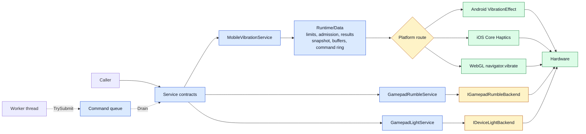

# CycloneGames.DeviceFeedback

[English | 简体中文](README.SCH.md)

Device feedback controls hardware output: vibration on a phone, rumble motors on
a gamepad, and RGB light on a controller or keyboard. This package provides one
set of contracts for those outputs, platform implementations for mobile haptics,
and injectable backends for controller hardware.

## Table of contents

- [Overview](#overview)
- [Getting started](#getting-started)
- [Core concepts](#core-concepts)
- [Architecture](#architecture)
- [Service contracts](#service-contracts)
- [Playing feedback](#playing-feedback)
- [Dependency injection](#dependency-injection)
- [Low-latency playback](#low-latency-playback)
- [Cross-thread submission](#cross-thread-submission)
- [Capability and lifecycle](#capability-and-lifecycle)
- [Admission, limits and diagnostics](#admission-limits-and-diagnostics)
- [Performance and memory](#performance-and-memory)
- [Threading](#threading)
- [Platform and AOT](#platform-and-aot)
- [Authoring](#authoring)
- [Error handling](#error-handling)
- [Validation](#validation)
- [Extending](#extending)
- [References](#references)

## Overview

Three services cover the three output families:

| Service | Output | Default availability |
| --- | --- | --- |
| `MobileVibrationService` | Phone vibration, Core Haptics, browser vibration | Platform-dependent |
| `GamepadRumbleService` | Dual rumble motors | Requires an injected backend |
| `GamepadLightService` | Controller or keyboard RGB light | Requires an injected backend |

The package is appropriate when a project needs one haptic API across Android,
iOS and WebGL, designer-authored clip assets, or a boundary for platform-specific
controller hardware. It does not implement device discovery, per-player input
routing, adaptive triggers or multi-zone keyboard lighting. Those belong to an
input or platform integration layer.

Mobile routes are selected at runtime:

| Platform | Route |
| --- | --- |
| Android 30+ | `VibrationEffect` composition primitives, with amplitude fallback |
| Android 26+ | `VibrationEffect.createWaveform` |
| Android below 26 | `Vibrator.vibrate` with an on/off pattern |
| iOS 13+ | Core Haptics transient, continuous and pattern players |
| iOS below 13 | `UIFeedbackGenerator` and the public vibration sound |
| WebGL | `navigator.vibrate` |
| Editor and desktop | No hardware route; calls are refused by admission |

## Getting started

### Requirements

Unity 2022.3 or newer. Read the exact editor version from
`UnityStarter/ProjectSettings/ProjectVersion.txt` in this repository. The runtime
assembly is `CycloneGames.DeviceFeedback.Runtime`; add it to your asmdef
references.

### First haptic

```csharp
using CycloneGames.DeviceFeedback.Runtime;
using UnityEngine;

public sealed class HapticButton : MonoBehaviour
{
    private void Awake() => MobileVibration.Init();

    public void OnClick() => MobileVibration.PlayPreset(HapticPreset.Medium);

    private void OnApplicationQuit() => MobileVibration.Shutdown();
}
```

`Init()` creates the service and initializes the platform route. `Shutdown()`
disposes native resources. Calling `Init()` more than once is safe.

### Use the result of a call

Every `void` playback method publishes its outcome through `LastResult`. The
`*Checked` methods return the same value directly.

```csharp
FeedbackResult result = MobileVibration.LastResult;
if (result.IsRejected)
{
    Debug.Log("Haptic refused: " + result.Status);
}
```

`FeedbackStatus` covers accepted, degraded, invalid input, capacity, inactive,
unavailable, disposed, unsupported, native failure and thread affinity. See
[Admission, limits and diagnostics](#admission-limits-and-diagnostics).

## Core concepts

### Parameters

| Parameter | Range | Meaning |
| --- | --- | --- |
| `intensity` | 0 to 1 | Amplitude on Android 26+, `CHHapticEventParameterIntensity` on iOS 13+, duration on WebGL |
| `durationSeconds` | positive, bounded by `DeviceFeedbackLimits` | Length of the effect |
| `sharpness` | 0 to 1 | Native on iOS 13+; approximated elsewhere |

All three are checked before any buffer growth or native dispatch. Non-finite
values are rejected as `RejectedInvalid`.

### Presets

`HapticPreset` has seven values: `Light`, `Medium`, `Heavy`, `Success`, `Warning`,
`Error`, `Selection`. Each service maps a preset to its own hardware route.

### Authoring data and runtime data

`HapticClip` is a `ScriptableObject` used for authoring. It holds an
`AnimationCurve` pair or an array of `HapticEvent` values. Runtime playback uses
an immutable `HapticClipSnapshot` produced by `HapticClipBaker`. The asset itself
is never modified. See [Low-latency playback](#low-latency-playback).

### Admission, limits and profile

`DeviceFeedbackLimits` bounds one operation. `DeviceFeedbackProfile` holds
runtime policies such as the minimum sample interval and cache sizes. Both are
value types supplied by the composition root; the defaults are shared immutable
instances.

### Capability

`DeviceCapability` reports which routes the current device can use:
`SupportsHaptics`, `SupportsAmplitude`, `SupportsSharpness`,
`SupportsCoreHaptics`, `SupportsPattern`, `SupportsContinuousModulation` and
`PlatformApiLevel`.

## Architecture

### Directory layout

| Path | Contents |
| --- | --- |
| `Runtime/Data/` | Value types, limits, profiles, admission, diagnostics, buffer lease, snapshots and command ring (same runtime assembly) |
| `Runtime/Haptics/` | Mobile and gamepad haptic services, authoring assets and the clip baker |
| `Runtime/Lighting/` | Device light service and backend contracts |
| `Runtime/Plugins/iOS/` | Core Haptics and fallback Objective-C bridge |
| `Runtime/Plugins/WebGL/` | `navigator.vibrate` JavaScript bridge |
| `Editor/` | `HapticClip` inspector |
| `Tests/Editor/` | EditMode tests |
| `Samples~/` | Opt-in example scene |

### Assemblies

| Assembly | Platform | Purpose |
| --- | --- | --- |
| `CycloneGames.DeviceFeedback.Runtime` | Android, iOS, WebGL, tvOS, VisionOS, desktop, Editor | Public contracts and services |
| `CycloneGames.DeviceFeedback.Editor` | Editor | Inspector and authoring validation |
| `CycloneGames.DeviceFeedback.Tests.Editor` | Editor | EditMode tests |

The runtime assembly has no references to other CycloneGames packages. Optional
integrations can reference it from a separate assembly; the runtime never
references an integration.

### Data flow



`MobileVibrationService` either uses an immutable `HapticClipSnapshot` or direct
parameters, then selects the platform route. `GamepadRumbleService` and
`GamepadLightService` forward to an injected backend instead. Worker threads
only enter through `TrySubmit`; `Drain` delivers queued commands on the owner
thread.

## Service contracts

### `IHapticFeedbackService`

| Member | Purpose |
| --- | --- |
| `IsAvailable`, `IsActive` | Availability and master switch |
| `Initialize` | Prepare the platform route |
| `PlayPreset(HapticPreset)` | Play a shared preset |
| `Play(float, float, float)` | Play intensity, duration and sharpness |
| `PlayCurve(AnimationCurve, float, AnimationCurve, int)` | Sample an intensity curve |
| `PlayClip(HapticClip)` | Play an authored clip |
| `Cancel` | Stop active output |

### `IMobileVibrationService`

Adds `HasVibrator`, `Vibrate` overloads, `VibratePop`, `VibratePeek`,
`VibrateNope`, the iOS-specific feedback methods, and
`UpdateContinuousParameters`. It inherits `IDisposable`.

### `IGamepadRumbleService`

Adds `SetMotorSpeeds(float, float)` and `Rumble(float, float, float)`.

### `IDeviceLightService`

Adds `SetColor`, `Flash`, `PlayGradient`, `PlayIntensityCurve`,
`CancelAnimation` and `Reset`.

### `IFeedbackResultProvider`

| Member | Purpose |
| --- | --- |
| `LastResult` | Outcome of the most recent call |
| `Limits` | Active operation budgets |
| `Capability` | Active hardware capabilities |
| `GetMemoryStats()` | Per-instance counters and buffer state |
| `RefreshCapabilities()` | Re-probe hardware |
| `ResetDiagnostics()` | Clear per-instance counters |

All three services implement this contract.

### Backends

`IGamepadRumbleBackend` and `IDeviceLightBackend` own device discovery, timing
and native calls. `NoopGamepadRumbleBackend.Instance` and
`NoopDeviceLightBackend.Instance` are the defaults; both report
`IsAvailable = false`, so a project without a backend produces no hardware
output.

The `ownsBackend` constructor flag controls whether the service disposes the
backend. Set it to `false` when a composition root owns the backend.

## Playing feedback

### Direct playback

```csharp
var service = new MobileVibrationService();
service.Initialize();

service.Play(intensity: 0.8f, durationSeconds: 0.25f, sharpness: 0.9f);
FeedbackResult result = service.LastResult;
```

### Curves

`PlayCurve` samples the intensity curve and an optional sharpness curve. The
sample grid is quantized to a power of two and covers `t = 0` through `t = 1`.
The effective interval keeps the total duration close to `durationSeconds`.

```csharp
AnimationCurve intensity = AnimationCurve.EaseInOut(0f, 0f, 1f, 1f);
AnimationCurve sharpness = AnimationCurve.Linear(0f, 0.3f, 1f, 0.9f);
service.PlayCurve(intensity, 1.5f, sharpness, sampleIntervalMs: 20);
```

### Haptic clips

Create a `HapticClip` with `Assets > Create > CycloneGames > Device Feedback >
Haptic Clip`. In curve mode the `intensityCurve` and `sharpnessCurve` drive the
effect. In event mode the `events` array takes precedence and the curves are
ignored.

```csharp
[CreateAssetMenu] public HapticClip explosionClip;

service.PlayClip(explosionClip);
```

### Pattern vibration

```csharp
service.Vibrate(200);                                  // 200 ms
service.Vibrate(new long[] { 0, 100, 50, 100 }, -1);  // one pass
service.Vibrate(new long[] { 0, 100, 50, 100 }, 0);   // loop from index 0
service.Cancel();                                      // stop a loop
```

`repeat = -1` plays once. Any other valid index loops from that offset. Android
passes the pattern to `VibrationEffect`; iOS 13+ builds a Core Haptics pattern;
WebGL collapses the pattern to a total duration.

### iOS-specific feedback

```csharp
service.VibrateIOS(IOSImpactStyle.Heavy);
service.VibrateIOS(IOSNotificationStyle.Success);
service.VibrateIOSSelection();
```

On iOS 13+ these use Core Haptics transients. On older iOS versions they use
`UIFeedbackGenerator`. Invalid enum values are rejected without an exception.

### Real-time modulation

```csharp
service.Play(0.5f, 5f, 0.5f);

void Update()
{
    service.UpdateContinuousParameters(charge, 0.7f);
}
```

This route requires `SupportsContinuousModulation`. It is unavailable on Android
and WebGL.

### Platform capability matrix

| Feature | Android | iOS below 13 | iOS 13+ | WebGL | Editor |
| --- | --- | --- | --- | --- | --- |
| Basic vibration | Yes | Yes | Yes | Yes | No output |
| Duration control | Yes | No | Yes | Yes | No output |
| Amplitude | API 26+ | No | Yes | No | No output |
| Sharpness | No | No | Yes | No | No output |
| Pattern | Yes | No | Composite | Total duration | No output |
| Curve waveform | API 26+ | Peak only | Native curves | Total duration | No output |
| HapticClip events | Waveform | No | `CHHapticEvent` | Total duration | No output |
| Real-time modulation | No | No | Yes | No | No output |
| Cancel | Yes | No | Yes | Yes | No output |
| Gamepad rumble and light | Backend required | Backend required | Backend required | Backend required | No-op default |

## Dependency injection

Register a concrete service against the interface your gameplay code needs.

```csharp
public sealed class CombatController
{
    private readonly IHapticFeedbackService _haptics;

    public CombatController(IHapticFeedbackService haptics)
    {
        _haptics = haptics;
        _haptics.Initialize();
    }

    public void OnHit() => _haptics.Play(0.9f, 0.12f, 0.25f);
    public void OnExplosion(HapticClip clip) => _haptics.PlayClip(clip);
}
```

```csharp
var limits = new DeviceFeedbackLimits(300_000, 4_096, 2_048, 4_096);
var profile = new DeviceFeedbackProfile(minimumSampleIntervalMilliseconds: 10);
var service = new MobileVibrationService(limits, profile);
container.RegisterInstance<IHapticFeedbackService>(service);
```

Use `MobileVibration` only in projects without a composition root. Mixing the
static facade and an injected service in one scope creates two independent
sessions with separate buffers and native handles.

### Ownership

| Owner | Owns |
| --- | --- |
| Composition root | Service instances, backends, limits and profiles |
| Service | Buffer lease, clip cache, command queue and counters |
| Backend | Device discovery, timers and native handles |
| Scope shutdown | `Cancel`, `Dispose`, then backend disposal when `ownsBackend` is true |

`Dispose` stops active output and releases native resources. `Reinitialize`
prepares the disposed instance again.

## Low-latency playback

Sampling a curve or building an event timeline on the calling thread costs time
proportional to the clip size. Baking moves that work to load time.

### Bake a clip

```csharp
HapticClip clip = Resources.Load<HapticClip>("Haptics/Explosion");

if (HapticClipBaker.TryBake(
        clip,
        DeviceFeedbackLimits.Default,
        DeviceFeedbackProfile.Default,
        out HapticClipSnapshot snapshot,
        out FeedbackResult result))
{
    // Keep the snapshot for the lifetime of the scene.
}
else
{
    Debug.Log("Bake refused: " + result.Status);
}
```

`TryBake` samples curves, orders events by time, expands silence gaps, converts
amplitudes and trims arrays to the exact lengths required by the platform APIs.
A failed bake returns `false` and a `FeedbackResult` with the rejection status.
The source asset is unchanged.

### Play a snapshot

```csharp
service.PlayClipSnapshot(snapshot);
FeedbackResult result = service.PlayClipSnapshotChecked(snapshot);
```

`PlayClipSnapshot` does no sampling, sorting, interval computation or buffer
growth. The baked arrays are passed to the platform boundary directly. On iOS
and Android 26+ no copy is needed; the arrays already have the required length.

### Clip cache

`PlayClip(HapticClip)` bakes on first use and keeps the snapshot in a bounded
cache owned by the service. `DeviceFeedbackProfile.ClipCacheMaxEntries` sets the
capacity (default 32, absolute ceiling 128). Replaying the same clip takes the
snapshot path. Clear the cache with `Dispose`; `Reinitialize` rebuilds state on
demand.

### Latency contract

Synchronous playback on the owner thread is dispatched immediately and never
queued. Cross-thread commands are delivered at the next `Drain`. Baking is the
only preparation step; do it outside input-sensitive frames.

## Cross-thread submission

Use `TrySubmit` when a worker thread needs to request feedback. Use `Drain` on
the owner thread, once per frame.

```csharp
var command = new FeedbackCommand
{
    Kind = FeedbackCommandKind.VibrateMilliseconds,
    Priority = FeedbackPriority.Normal,
    DeviceId = new FeedbackDeviceId(playerId),
    DurationMilliseconds = 40
};

if (!service.TrySubmit(in command))
{
    // Queue is full or the payload is invalid.
}
```

```csharp
void Update() => service.Drain(maxCommands: 64);
```

| Member | Contract |
| --- | --- |
| `TrySubmit` | Safe from any thread. Returns `false` on a full queue or an invalid payload |
| `Drain` | Owner thread only. Bounded by `maxCommands` |
| `GetCommandStats()` | Capacity, enqueued, rejected, drained, deferred and pending counts |

The ring has 256 slots. Overflow is refused and counted; it never allocates.
Each slot has a free, writing or ready state. A producer still writing defers
that slot to the next drain. `FeedbackCommandKind` covers `Play`, `PlayPreset`,
`PlayClipSnapshot`, `VibrateMilliseconds` and `Cancel`.

`FeedbackCommand` holds value fields and an optional `HapticClipSnapshot`. It
contains no closures, delegates or Unity objects.

## Capability and lifecycle

```csharp
DeviceCapability capability = service.Capability;
if (!capability.SupportsSharpness)
{
    // Select a route that does not need sharpness.
}

service.RefreshCapabilities();
```

| Method | Effect |
| --- | --- |
| `RefreshCapabilities()` | Clear the cached capability and composition-failure latches, then re-probe on next use |
| `Reinitialize()` | Revive a disposed instance and initialize its platform route |
| `ResetDiagnostics()` | Clear per-instance counters |
| `IsActive` | Master switch; setting it to `false` stops active output |
| `Dispose()` | Stop output, release native resources, clear the cache and queue |

`HasVibrator` reports `SupportsHaptics`. On iOS, capability detection checks
Core Haptics first and falls back to the device class.

## Admission, limits and diagnostics

### Limits

`DeviceFeedbackLimits` has four fields with defaults and hard ceilings:

| Budget | Default | Hard ceiling |
| --- | --- | --- |
| `MaximumDurationMilliseconds` | 300,000 | 3,600,000 |
| `MaximumWaveformSampleCount` | 4,096 | 65,536 |
| `MaximumHapticEventCount` | 2,048 | 16,384 |
| `MaximumPatternSegmentCount` | 4,096 | 65,536 |

The constructor rejects values outside 1 through the hard ceiling. Admission
returns before any buffer growth or native dispatch when an operation exceeds a
budget.

### Profile

| Field | Default | Absolute ceiling |
| --- | --- | --- |
| `MinimumSampleIntervalMilliseconds` | 5 | 1 to 300,000 |
| `ExactArrayCacheMaxEntries` | 16 | 64 |
| `ExactArrayCacheBudgetBytes` | 1 MiB | 8 MiB |
| `CacheableMaximumLength` | 8,192 | 65,536 |
| `ClipCacheMaxEntries` | 32 | 128 |

### Results and counters

`FeedbackResult` carries `Status`, `DurationMilliseconds`,
`WaveformSampleCount`, `HapticEventCount` and `PatternSegmentCount`. Use
`IsAccepted` and `IsRejected` for branching.

`GetMemoryStats()` returns a `DeviceFeedbackMemoryStats` snapshot with accepted
and rejected counts, peak values, retained buffer bytes, buffer growth count and
exact-array allocation and reuse counts. Counters belong to one service
instance.

`DeviceFeedbackDiagnostics` is a process-wide aggregate for hosts that do not
hold a service instance. It is disabled by default. Set
`GlobalAggregationEnabled = true` to enable it; call `Reset()` to clear it.

## Performance and memory

| Property | Design |
| --- | --- |
| Scratch buffers | One `DeviceFeedbackBufferLease` per service, disposed with the service |
| Growth | Power-of-two capacity, amortized |
| Exact-length arrays | Length-keyed cache with a bounded entry count and byte budget |
| Sample grid | Quantized down to a power of two; the effective interval preserves duration |
| Authoring events | Copied and ordered at bake time, never on the dispatch thread |
| Admission | Integer arithmetic, no floating-point division on the dispatch path |
| Presets | Static readonly payload table |
| Diagnostics | Plain fields per instance; atomic operations only in the optional global aggregate |

Steady-state playback allocates no managed buffers. Android JNI calls still
create `AndroidJavaObject` wrappers per native dispatch; that cost belongs to the
Unity platform boundary. iOS and WebGL steady-state paths allocate no managed
memory after initialization.

The one-time bake of a clip allocates its snapshot arrays. This is a fixed cost
per baked clip, independent of how often the clip plays.

## Threading

Each service is owner-thread confined. The first call records the owner thread;
later calls from that thread proceed with one volatile read. Synchronous calls
from another thread return `RejectedThreadAffinity` without touching instance
state. Use `TrySubmit` and `Drain` for cross-thread work.

`MobileVibration` reads its singleton under the same lock as `Shutdown` and
clears it on subsystem registration, so a play session with domain reload
disabled does not retain a stale instance.

Native iOS state is main-thread only. The Objective-C bridge retains transient
players in a bounded set and suppresses engine callbacks during shutdown.

## Platform and AOT

The runtime assembly declares Unity 2022.3. It targets Android, iOS, WebGL,
tvOS, VisionOS, desktop and Editor. Only Android, iOS and WebGL have mobile
routes; the other targets accept gamepad and light backends but produce no built-in
vibration.

Runtime code uses no reflection discovery, no dynamic code generation and no
`RegexOptions.Compiled`. Native plugins validate counts and pointers at the C
ABI boundary and enforce a 16,384-event ceiling. Validate shipped configurations
on target Player builds with IL2CPP and managed stripping.

## Authoring

### `HapticClip`

| Field | Type | Purpose |
| --- | --- | --- |
| `duration` | `float` | Clip length in seconds in curve mode |
| `intensityCurve` | `AnimationCurve` | Intensity over normalized time |
| `sharpnessCurve` | `AnimationCurve` | Sharpness over normalized time |
| `events` | `HapticEvent[]` | Discrete events; when non-empty, curves are ignored |
| `HasEvents` | `bool` | True when `events` has at least one entry |

### `HapticEvent`

| Field | Type | Constraint |
| --- | --- | --- |
| `type` | `HapticEventType` | `Transient` or `Continuous` |
| `time` | `float` | Non-negative start time in seconds |
| `duration` | `float` | Non-negative; used for `Continuous` |
| `intensity` | `float` | 0 to 1 |
| `sharpness` | `float` | 0 to 1 |

Events are ordered by `time` at bake time. `Transient` uses a fixed 30 ms length;
`Continuous` with a zero duration uses a 10 ms minimum. Silence between events
becomes a zero-amplitude waveform segment on Android.

### Inspector

`HapticClipInspector` shows which mode is active, validates event values, and
warns when the event count exceeds the default admission limit. It edits through
`SerializedObject`, so Undo, multi-object editing and Prefab overrides work.

## Error handling

| Status | Cause | Action |
| --- | --- | --- |
| `RejectedInvalid` | Non-finite or out-of-range input, null clip, unknown preset or enum | Fix the caller input |
| `RejectedCapacity` | Operation exceeds a limit, or the command queue is full | Lower the request or drain the queue |
| `RejectedInactive` | `IsActive` is false | Re-enable the service |
| `RejectedUnavailable` | No hardware route or no backend | Install a backend or check capability |
| `RejectedDisposed` | Service was disposed | Call `Reinitialize` or create a new service |
| `RejectedUnsupported` | Route lacks the requested capability | Select a supported route |
| `RejectedNativeFailure` | Platform adapter failure recorded during fallback | Check `GetMemoryStats` and device logs |
| `RejectedThreadAffinity` | Synchronous call from a non-owner thread | Use `TrySubmit` |
| `Degraded` | Output produced through a reduced route | Treat as success with reduced fidelity |

Rejected calls produce no native dispatch. Use `LastResult` or a `*Checked`
method to distinguish them from accepted calls.

## Validation

Run the EditMode suite from Unity Test Runner:

```text
<UnityEditor> -batchmode -nographics -projectPath <repo-root>/UnityStarter -runTests -testPlatform EditMode -assemblyNames CycloneGames.DeviceFeedback.Tests.Editor -testResults <result-path> -quit
```

The suite covers capacity boundaries, non-finite input rejection, invalid enums,
per-instance diagnostics, reinitialization, buffer growth, baked snapshots,
authoring immutability and cross-thread submission.

For a new backend or a target Player, check these points:

1. Open the Unity project and confirm the runtime and editor assemblies compile.
2. Run the EditMode suite.
3. Open a `HapticClip` asset and confirm the inspector, Undo and Prefab override.
4. Build for Android, iOS and WebGL and verify output on representative hardware.
5. Check latency, allocation and managed stripping on an IL2CPP Player build.

## Extending

Implement a backend and pass it to the service constructor.

```csharp
public sealed class MyRumbleBackend : IGamepadRumbleBackend
{
    public bool IsAvailable => true;

    public void Initialize() { }
    public void SetMotorSpeeds(float low, float high) { /* write to hardware */ }
    public void Rumble(float low, float high, float duration) { /* schedule a stop */ }
    public void Stop() { /* stop motors */ }
    public void Dispose() { /* release handles */ }
}

var rumble = new GamepadRumbleService(new MyRumbleBackend(), ownsBackend: true);
```

A backend owns device discovery, timing and native calls. The service clamps
inputs, applies admission, records results and forwards calls. Keep optional
third-party dependencies in a separate integration assembly; the runtime
assembly does not reference integrations.

## References

- [Core Haptics](https://developer.apple.com/documentation/corehaptics)
- [Android VibrationEffect](https://developer.android.com/reference/android/os/VibrationEffect)
- [Web Vibration API](https://developer.mozilla.org/en-US/docs/Web/API/Vibration_API)
