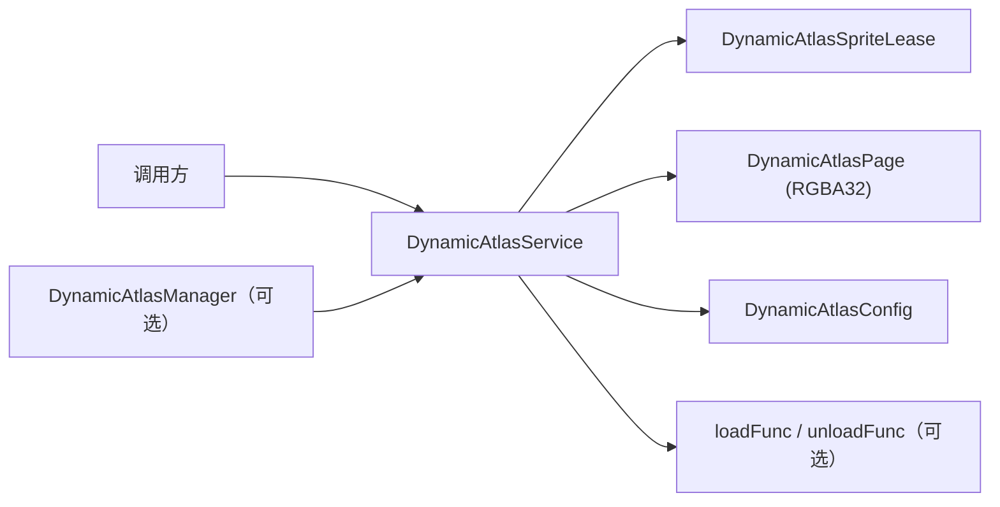

# CycloneGames.DynamicAtlas

[English | 简体中文](README.SCH.md)

`CycloneGames.DynamicAtlas` 是有边界的运行时精灵图集。它把只能在运行时才确定的精灵打进固定数量的未压缩页，为每个条目发放显式租约，并在页数、条目数和字节预算触顶时直接拒绝，而不是继续增长。

本包是独立运行时能力。`CycloneGames.UIFramework` 不依赖它，没有它也能编译；`CycloneGames.AtlasPipeline` 不依赖它，保持纯 Editor 构建工具。窗口生命周期核心没有任何一处引用本包，本包也不引用任何 UI 类型。

## 目录

- [CycloneGames.DynamicAtlas](#cyclonegamesdynamicatlas)
  - [目录](#目录)
  - [概述](#概述)
  - [架构](#架构)
    - [程序集布局](#程序集布局)
  - [快速开始](#快速开始)
  - [核心概念](#核心概念)
    - [租约](#租约)
    - [页与拷贝路径](#页与拷贝路径)
    - [容量模型](#容量模型)
  - [与构建期图集的关系](#与构建期图集的关系)
  - [性能与内存](#性能与内存)
  - [线程、AOT 与裁剪](#线程aot-与裁剪)
  - [验证](#验证)
  - [API 参考](#api-参考)
  - [故障排查](#故障排查)

## 概述

本服务面向构建期看不见的内容：运行时下载的图标、运营期替换的图片、玩家生成的装扮、按语言覆盖的资源，以及分散在多张构建期图集里、但需要在运行时同页合批的精灵。

`DynamicAtlasService` 把这些精灵打进有上限的 `RGBA32` 页。格式不可配置，因为 `SetPixels`/`Apply` 与 `Graphics.CopyTexture` 的局部区域写入都要求未压缩目标。构建期已知的内容应使用压缩的 `SpriteAtlas`，见[与构建期图集的关系](#与构建期图集的关系)。

关键性质：

- **页数有界** —— 显式配置 `pageSize`、`maxPages`、`maxEntries`、`memoryBudgetBytes`。准入失败返回状态码，而不是无限扩张。
- **显式租约** —— `DynamicAtlasSpriteLease` 是值类型句柄，每个条目持有一个引用。重复释放是幂等的，过期句柄是空操作。
- **命中零分配** —— 池化的条目与租约记录（上限 256）使缓存内容重复获取不产生分配。
- **每帧缺失预算** —— `maxMissesPerFrame` 限制同一帧的像素工作量；超出的请求返回 `Throttled`，后续帧自动续上。
- **GPU 优先拷贝** —— 格式匹配时用 `Graphics.CopyTexture` 直接写入 GPU-only 页；可读 CPU 原始拷贝与同步回读是显式可选项。
- **稳定键** —— 序数比较、区分大小写、带命名空间的键，长度有上限。
- **保留策略** —— `RemoveWhenUnused` 或 `RetainUntilCapacityPressure`，配合 `TrimUnused`。
- **平台档位** —— 通过 `CreateForCurrentPlatform` 提供桌面高端、移动高端、移动低端与 WebGL 起始档位。

完整用法、拷贝路径分析、平台档位表与故障排查见[动态图集指南](Documents~/DynamicAtlas.SCH.md)。

## 架构



`DynamicAtlasService` 是页、条目与租约记录的唯一所有者。`DynamicAtlasManager` 是可选的 `MonoBehaviour` 生命周期宿主；已有组合根的项目直接构造服务。服务不接触场景对象、Canvas 或 UI 组件。

### 程序集布局

| 程序集 | 用途 | 激活条件 |
| --- | --- | --- |
| `CycloneGames.DynamicAtlas.Runtime` | 核心运行时 | 始终 |
| `CycloneGames.DynamicAtlas.Editor` | 调试窗口、Inspector、SpriteAtlas 兼容性工具 | 仅 Editor |
| `CycloneGames.DynamicAtlas.Samples` | 可选示例 | `autoReferenced: false` |

运行时程序集引用 `UniTask`（主线程判定）与后端中立的 `CycloneGames.Logging.Core`。本包没有任何程序集引用 `UnityEngine.UI`、TextMeshPro、`UnityEngine.U2D`，也不引用任何 CycloneGames UI 包。下面的快速上手是 UGUI 消费端示例，包本身不需要 UGUI 即可编译。

诊断使用稳定的 `CycloneGames.DynamicAtlas` 日志分类。Writer 生命周期由宿主负责；没有后端时 `NullLogWriter` 会丢弃消息。

## 快速开始

```csharp
using CycloneGames.DynamicAtlas;
using UnityEngine;
using UnityEngine.UI;

public sealed class InventoryIcon : MonoBehaviour
{
    [SerializeField] private Image image;
    [SerializeField] private Sprite sourceSprite;

    private DynamicAtlasService atlas;
    private DynamicAtlasSpriteLease iconLease;

    private void Awake()
    {
        DynamicAtlasConfig config = DynamicAtlasConfig.CreateForCurrentPlatform();
        atlas = new DynamicAtlasService(config);
    }

    private void OnEnable()
    {
        DynamicAtlasInsertStatus status = atlas.TryAcquireSprite(
            "inventory/icons/iron-sword",
            sourceSprite,
            out iconLease);

        if (status == DynamicAtlasInsertStatus.Success ||
            status == DynamicAtlasInsertStatus.CacheHit)
        {
            image.sprite = iconLease.Sprite;
        }
    }

    private void OnDisable()
    {
        image.sprite = null;
        iconLease.Dispose();
        iconLease = default;
    }

    private void OnDestroy()
    {
        atlas?.Dispose();
        atlas = null;
    }
}
```

## 核心概念

### 租约

一个租约恰好持有一个引用。获取已缓存的键返回 `CacheHit`，只增加引用计数，不拷贝像素。重复释放、或在 `Clear` 之后释放，都是空操作。容量压力永远不会驱逐仍有活跃租约的条目；此时准入直接失败。

### 页与拷贝路径

每张页在创建时确定唯一的拷贝模式，因此 CPU 上传不可能覆盖仅存在于 GPU 的内容：

| 模式 | 准入条件 | 说明 |
| --- | --- | --- |
| GPU-only | `Graphics.CopyTexture` 且格式匹配 | 不保留 CPU 副本 |
| CPU-backed | `AllowCpuRawCopy` | 源可读且目标格式完全一致 |
| Readback | `AllowSynchronousReadback` | 临时 RenderTexture 加 `ReadPixels`，可能阻塞渲染线程 |

`DynamicAtlasStats.SynchronousReadbackCount` 让这条昂贵路径可见，而不是静默发生。

### 容量模型

任一上限触顶时准入直接拒绝，绝不截断：`maxPages`、`maxEntries`、`maxEntriesPerPage`、`memoryBudgetBytes`，以及每帧缺失预算。每次拒绝都带一个 `DynamicAtlasInsertStatus` 值；`DynamicAtlasStats` 的计数器分别统计命中、缺失、插入、驱逐与拒绝。

## 与构建期图集的关系

构建期 `SpriteAtlas` 是打包产物，不是源。把它里面的精灵抽出来重新打进运行时页**从不减少纹理内存**：源页仍然驻留（SpriteAtlas 无法按精灵卸载），而运行时页是未压缩的，源却是 BC7 或 ASTC。唯一收益是减少 draw call。

因此本包把图集精灵当作普通输入来接收并校验，而不承担图集策略：

- `TryAcquireSprite` 接受任意 `Sprite`，读取 `texture` 与 `textureRect`。
- 启用了旋转或紧密打包的精灵会被拒绝，返回 `UnsupportedSpritePacking`；矩形拷贝无法保留那种几何。
- `textureRect` 与 `rect` 不一致时，按裁剪或旋转打包拒绝。
- 非矩形网格几何被拒绝。
- 无法拷入 `RGBA32` 页的源格式返回 `CopyUnsupported`，除非回退策略允许。

构建期图集要被抽取，必须是矩形、不旋转、未压缩。`CycloneGames.AtlasPipeline` 把这条要求表达为 **Runtime Extraction (DynamicAtlas)** 规则预设，并在被标记的图集违反要求时让构建失败。该预设就是两个包之间的全部耦合：一份文档化的三字段契约，两边都没有程序集引用。

### 无头环境与低内存设备

`NullDynamicAtlas.Shared` 不接触设备即可实现同一契约。每次获取都返回 `DynamicAtlasInsertStatus.Disabled`，因此与客户端共享的组合根可以无条件构造图集，调用方按状态回退到非图集路径。

`DynamicAtlasManager` 订阅 `Application.lowMemory`，在平台报告内存压力时清空所有零引用条目。通过 `SetService` 注入的服务不受影响：该策略归注入方所有。

## 性能与内存

- 缓存命中零分配；缺失工作量按 `maxMissesPerFrame` 逐帧限制。
- 页纹理只创建一次并在条目间复用；释放的槽位会被合并。
- `GetStats()` 返回值类型快照，不产生分配。
- `CopyPageSnapshots` 与 `CopyEntrySnapshots` 写入调用方提供的缓冲区。
- 估算纹理字节数包含待销毁页，预算无法通过延迟拆除绕过。
- 用于清零新页的共享零填充缓冲区上限为 4 MiB。更大的页改为就地清零原始字节，因此常驻托管内存不随页面积增长。

## 线程、AOT 与裁剪

所有成员必须在创建服务的 Unity 主线程上调用；跨线程调用直接抛异常。守卫在构造时捕获，绝不从其他线程访问 Unity 对象。本包不使用反射、动态代码生成或仅 JIT 可用的 API，因此在 IL2CPP 与托管裁剪下安全。

## 验证

EditMode 测试覆盖容量准入、租约计数、保留与驱逐、拷贝路径拒绝、统计一致性、配置组合矩阵、种子驱动的随机操作序列，以及长时运行不变量。PlayMode 测试覆盖真实播放循环下的 GPU 拷贝行为。通过 `Window > General > Test Runner` 运行。

## API 参考

| 类型 | 用途 |
| --- | --- |
| `DynamicAtlasService` | `IDynamicAtlas` 的默认实现 |
| `IDynamicAtlas` | 获取、裁剪、统计与批处理的 owner 线程契约 |
| `DynamicAtlasSpriteLease` | 值类型单引用句柄 |
| `DynamicAtlasConfig` | 页大小、容量、保留策略、拷贝回退 |
| `DynamicAtlasManager` | 可选的 `MonoBehaviour` 生命周期宿主 |
| `DynamicAtlasStats` | 有界计数器快照 |
| `DynamicAtlasInsertStatus` | 拒绝与成功状态码 |
| `DynamicAtlasWriteBatch` | 延迟纹理上传直至释放 |

## 故障排查

| 现象 | 原因 | 处理 |
| --- | --- | --- |
| 突发请求返回 `Throttled` | 每帧缺失预算耗尽 | 后续帧重试；只有在实测后才提高预算 |
| 返回 `UnsupportedSpritePacking` | 源图集启用了旋转或紧密打包 | 在源图集规则上同时关闭两者 |
| 返回 `CopyUnsupported` | 源格式与 `RGBA32` 不一致 | 改用未压缩源，或启用回读回退 |
| 返回 `PageCapacityReached` | 活跃租约下触达 `maxPages` 或字节预算 | 释放租约或提高上限 |
| 精灵显示为白块 | 源超过单页尺寸被拒绝 | 启用 `ScaleDown` 并允许回读，或缩小源图 |
