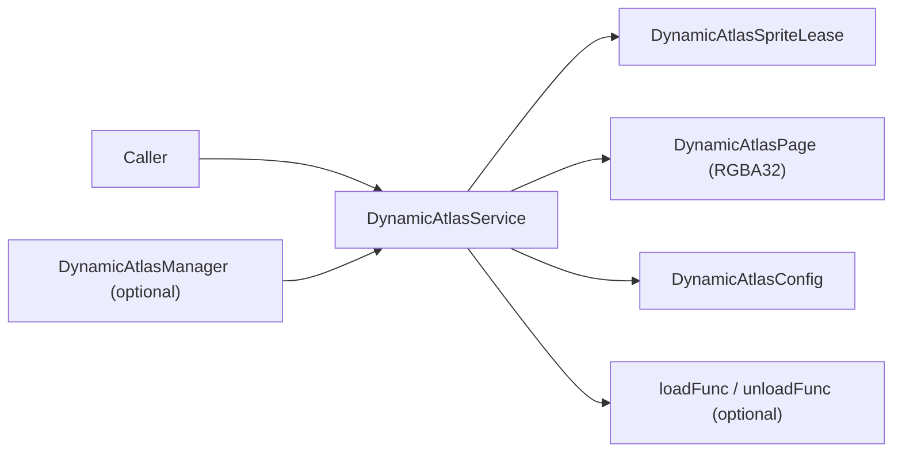

# CycloneGames.DynamicAtlas

[English | 简体中文](README.SCH.md)

`CycloneGames.DynamicAtlas` is a bounded runtime sprite atlas. It packs sprites that only become known at runtime onto a fixed set of uncompressed pages, gives every entry an explicit lease, and refuses to grow past configured page, entry, and byte ceilings.

The package is a standalone runtime capability. `CycloneGames.UIFramework` does not depend on it and compiles without it; `CycloneGames.AtlasPipeline` does not depend on it and stays an Editor-only build tool. Nothing in the core window lifecycle references this package, and this package references no UI type.

## Table of Contents

- [CycloneGames.DynamicAtlas](#cyclonegamesdynamicatlas)
  - [Table of Contents](#table-of-contents)
  - [Overview](#overview)
  - [Architecture](#architecture)
    - [Assembly layout](#assembly-layout)
  - [Quick Start](#quick-start)
  - [Core Concepts](#core-concepts)
    - [Leases](#leases)
    - [Pages and copy paths](#pages-and-copy-paths)
    - [Capacity model](#capacity-model)
  - [Relationship to Build-Time Atlases](#relationship-to-build-time-atlases)
  - [Performance and Memory](#performance-and-memory)
  - [Threading, AOT, and Stripping](#threading-aot-and-stripping)
  - [Validation](#validation)
  - [API Reference](#api-reference)
  - [Troubleshooting](#troubleshooting)

## Overview

The service exists for content the build cannot see: runtime-downloaded icons, live-service images, player-generated cosmetics, per-locale overrides, and sprites authored in several build-time atlases that must share one runtime page for batching.

`DynamicAtlasService` packs those sprites into bounded `RGBA32` pages. The format is not configurable because partial-region writes from both `SetPixels`/`Apply` and `Graphics.CopyTexture` require an uncompressed destination. Content known at build time belongs in a compressed `SpriteAtlas` instead; see [Relationship to Build-Time Atlases](#relationship-to-build-time-atlases).

Key properties:

- **Bounded pages** — explicit `pageSize`, `maxPages`, `maxEntries`, and `memoryBudgetBytes` limits. Admission fails with a status code instead of growing without limit.
- **Explicit leases** — `DynamicAtlasSpriteLease` is a value-type handle owning one reference per entry. Disposal is idempotent and stale handles are no-ops.
- **Zero-allocation cache hits** — pooled entries and lease records (capped at 256) make reacquisition of cached content allocation-free.
- **Per-frame miss budget** — `maxMissesPerFrame` throttles cache-miss pixel work; excess misses return `Throttled` and resume on a later frame.
- **GPU-first copy** — `Graphics.CopyTexture` into GPU-only pages when formats match; readable CPU raw copy and synchronous readback are opt-in fallbacks.
- **Stable keys** — ordinal, case-sensitive, namespaced keys with a bounded length.
- **Retention policies** — `RemoveWhenUnused` or `RetainUntilCapacityPressure` with `TrimUnused`.
- **Platform profiles** — Desktop High, Mobile High, Mobile Low, and WebGL starting profiles via `CreateForCurrentPlatform`.

The complete usage guide, copy-path analysis, platform profile table, and troubleshooting live in [Dynamic Atlas Guide](Documents~/DynamicAtlas.md).

## Architecture



`DynamicAtlasService` is the only owner of pages, entries, and lease records. `DynamicAtlasManager` is an optional `MonoBehaviour` lifetime host; code with a composition root constructs the service directly. The service never touches scene objects, canvases, or UI components.

### Assembly layout

| Assembly | Purpose | Activation |
| --- | --- | --- |
| `CycloneGames.DynamicAtlas.Runtime` | Core runtime | Always |
| `CycloneGames.DynamicAtlas.Editor` | Debugger, inspector, SpriteAtlas compatibility tooling | Editor only |
| `CycloneGames.DynamicAtlas.Samples` | Opt-in example | `autoReferenced: false` |

The runtime assembly references `UniTask` (main-thread detection) and the backend-neutral `CycloneGames.Logging.Core`. No assembly in this package references `UnityEngine.UI`, TextMeshPro, `UnityEngine.U2D`, or any CycloneGames UI package. The quick start below shows a UGUI consumer; the package itself compiles without UGUI.

Diagnostics use the stable `CycloneGames.DynamicAtlas` `LogChannel` category. Writer lifecycle belongs to the host; without a backend, `NullLogWriter` discards messages.

## Quick Start

```csharp
using CycloneGames.DynamicAtlas;
using UnityEngine;
using UnityEngine.UI;

public sealed class InventoryIcon : MonoBehaviour
{
    [SerializeField] private Image image;
    [SerializeField] private Sprite sourceSprite;

    private DynamicAtlasService atlas;
    private DynamicAtlasSpriteLease iconLease;

    private void Awake()
    {
        DynamicAtlasConfig config = DynamicAtlasConfig.CreateForCurrentPlatform();
        atlas = new DynamicAtlasService(config);
    }

    private void OnEnable()
    {
        DynamicAtlasInsertStatus status = atlas.TryAcquireSprite(
            "inventory/icons/iron-sword",
            sourceSprite,
            out iconLease);

        if (status == DynamicAtlasInsertStatus.Success ||
            status == DynamicAtlasInsertStatus.CacheHit)
        {
            image.sprite = iconLease.Sprite;
        }
    }

    private void OnDisable()
    {
        image.sprite = null;
        iconLease.Dispose();
        iconLease = default;
    }

    private void OnDestroy()
    {
        atlas?.Dispose();
        atlas = null;
    }
}
```

## Core Concepts

### Leases

A lease owns exactly one reference. Acquiring an already-cached key returns `CacheHit` and increments the count without copying pixels. Disposing a lease twice, or after `Clear`, is a no-op. Active leases are never evicted by capacity pressure; admission fails instead.

### Pages and copy paths

Each page commits to one copy mode at creation, so a CPU upload can never overwrite content that exists only on the GPU:

| Mode | Admission | Notes |
| --- | --- | --- |
| GPU-only | `Graphics.CopyTexture` with matching formats | No CPU copy retained |
| CPU-backed | `AllowCpuRawCopy` | Runnable source with the exact destination format |
| Readback | `AllowSynchronousReadback` | Temporary render texture plus `ReadPixels`; can stall the render thread |

`DynamicAtlasStats.SynchronousReadbackCount` makes the expensive path visible instead of silent.

### Capacity model

Admission is rejected, never truncated, when any ceiling is reached: `maxPages`, `maxEntries`, `maxEntriesPerPage`, `memoryBudgetBytes`, or the per-frame miss budget. Every rejection carries a `DynamicAtlasInsertStatus` value; `DynamicAtlasStats` counters separate cache hits, misses, insertions, evictions, and rejections.

## Relationship to Build-Time Atlases

A build-time `SpriteAtlas` is a packing artifact, not a source. Extracting a sprite out of one and repacking it into a runtime page **never reduces texture memory**: the source page stays resident (a SpriteAtlas cannot be unloaded per sprite), and the runtime page is uncompressed while the source is BC7 or ASTC. The only benefit is draw-call reduction.

The package therefore accepts an atlas sprite as an ordinary input and validates it, instead of owning atlas policy:

- `TryAcquireSprite` accepts any `Sprite`, reading `texture` plus `textureRect`.
- Sprites packed with rotation or tight packing are rejected with `UnsupportedSpritePacking`; the rect copy cannot preserve that geometry.
- A `textureRect` that disagrees with `rect` is rejected as trimmed or rotated packing.
- Non-rectangular mesh geometry is rejected.
- A source format that cannot be copied into an `RGBA32` page is rejected with `CopyUnsupported` unless a fallback policy permits it.

For a build-time atlas to be extractable it must be rectangular, unrotated, and uncompressed. `CycloneGames.AtlasPipeline` expresses that requirement as the **Runtime Extraction (DynamicAtlas)** rule preset and fails the build when a marked atlas violates it. That preset is the entire coupling between the two packages: a documented three-field contract, with no assembly reference in either direction.

### Headless and low-memory devices

`NullDynamicAtlas.Shared` implements the contract without touching a device. Every acquire returns `DynamicAtlasInsertStatus.Disabled`, so a composition root shared with a client can construct an atlas unconditionally and callers fall back to their un-atlased path.

`DynamicAtlasManager` subscribes to `Application.lowMemory` and trims every zero-reference entry when the platform reports memory pressure. A service injected through `SetService` is left alone: its injector owns that policy.

## Performance and Memory

- Cache hits allocate nothing; miss work is bounded per frame by `maxMissesPerFrame`.
- Page textures are created once and reused across entries; released slots are coalesced.
- `GetStats()` returns a value-type snapshot with no allocation.
- `CopyPageSnapshots` and `CopyEntrySnapshots` write into caller-owned buffers.
- Estimated texture bytes include pending-destruction pages, so the budget cannot be escaped through deferred teardown.
- The shared zero-fill buffer used to clear new pages is capped at 4 MiB. Larger pages clear their raw bytes in place, so retained managed memory does not scale with page area.

## Threading, AOT, and Stripping

All members must run on the Unity main thread that created the service; off-thread calls throw. The guard is captured at construction and never touches Unity objects from another thread. The package uses no reflection, no dynamic code generation, and no JIT-only API, so it is safe under IL2CPP and managed stripping.

## Validation

EditMode tests cover capacity admission, lease arithmetic, retention and eviction, copy-path rejection, statistics consistency, combinatorial configuration matrices, seeded randomized operation sequences, and long-run soak invariants. PlayMode tests cover GPU copy behavior in a real player loop. Run them from `Window > General > Test Runner`.

## API Reference

| Type | Purpose |
| --- | --- |
| `DynamicAtlasService` | Default `IDynamicAtlas` implementation |
| `IDynamicAtlas` | Owner-thread contract for acquire, trim, stats, batching |
| `DynamicAtlasSpriteLease` | Value-type single-reference handle |
| `DynamicAtlasConfig` | Page size, capacities, retention, copy fallbacks |
| `DynamicAtlasManager` | Optional `MonoBehaviour` lifetime host |
| `DynamicAtlasStats` | Bounded counter snapshot |
| `DynamicAtlasInsertStatus` | Rejection and success codes |
| `DynamicAtlasWriteBatch` | Defers texture uploads until disposal |

## Troubleshooting

| Symptom | Cause | Fix |
| --- | --- | --- |
| `Throttled` on a burst | `maxMissesPerFrame` budget exhausted | Retry on a later frame; raise the budget only after measuring |
| `UnsupportedSpritePacking` | Source atlas uses rotation or tight packing | Disable both on the source atlas rule |
| `CopyUnsupported` | Source format differs from `RGBA32` | Use an uncompressed source or enable a readback fallback |
| `PageCapacityReached` | `maxPages` or `memoryBudgetBytes` reached with active leases | Release leases or raise the ceiling |
| Sprite renders as a white quad | Source exceeded one page and was rejected | Enable `ScaleDown` with a readback fallback, or shrink the source |
