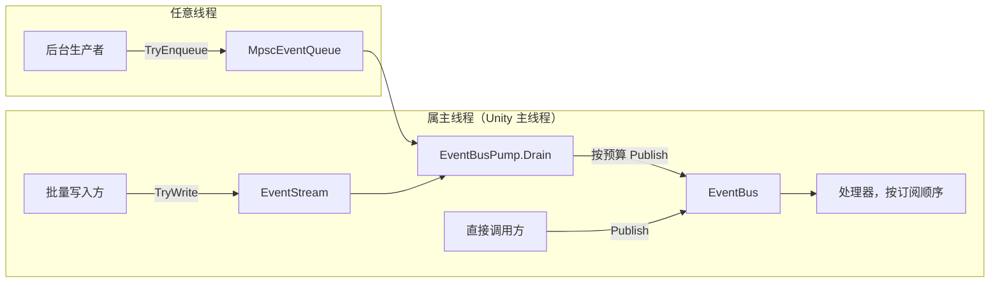
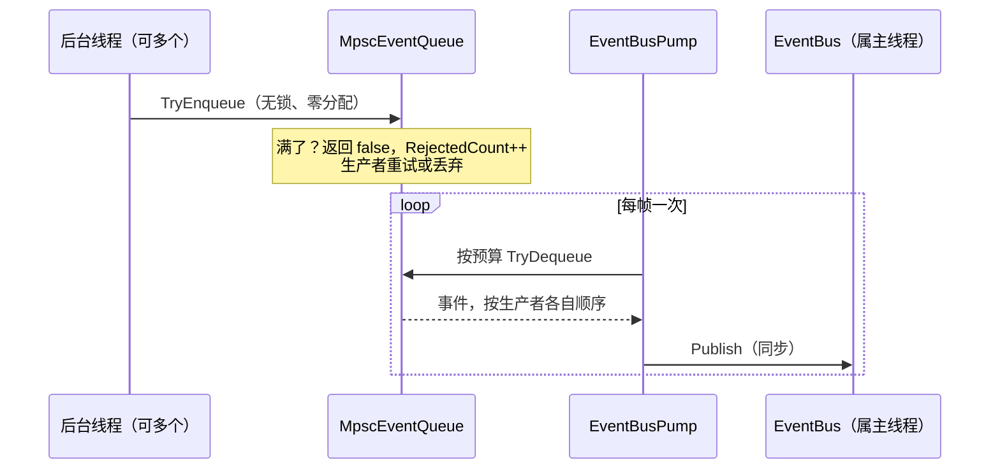

# CycloneGames.EventBus

[English | 简体中文](README.md)

面向 Unity 与纯 C# 宿主的零分配一对多事件总线，按生产环境负载设计：同步确定性派发、显式的线程边界、有界容器、可配置的帧成本上限——在包括移动端、WebGL、主机在内的所有平台上行为一致。

## 目录

- [CycloneGames.EventBus](#cyclonegameseventbus)
  - [目录](#目录)
  - [为什么需要这个模块](#为什么需要这个模块)
  - [架构](#架构)
  - [第 1 级：最小可用总线](#第-1-级最小可用总线)
  - [第 2 级：用 Scope 成组管理订阅](#第-2-级用-scope-成组管理订阅)
  - [第 3 级：用 EventStream 做批量缓冲](#第-3-级用-eventstream-做批量缓冲)
  - [第 4 级：跨线程边界](#第-4-级跨线程边界)
  - [第 5 级：用 EventBusContext 做组合](#第-5-级用-eventbuscontext-做组合)
  - [第 6 级：异步与响应式集成](#第-6-级异步与响应式集成)
  - [可以依赖的语义](#可以依赖的语义)
    - [派发期间的结构变更](#派发期间的结构变更)
    - [错误策略](#错误策略)
    - [重入上限](#重入上限)
    - [线程模型速查](#线程模型速查)
  - [容量、预算与背压](#容量预算与背压)
  - [性能与平台说明](#性能与平台说明)
  - [诊断与故障排查](#诊断与故障排查)
  - [示例](#示例)
  - [验证](#验证)

## 为什么需要这个模块

解耦通知看起来很简单——一个回调列表加一个循环——但生产环境会以可预期的方式击碎简单实现：

| 朴素实现的问题 | 生产环境中的代价 | 本模块的方案 |
| --- | --- | --- |
| `List<Action>` + `foreach` 派发 | 每次发布都有枚举器与闭包分配，移动端出现 GC 尖峰 | `EventBus<T>`：句柄池化、数组派发，发布路径 **0 字节** |
| "处处线程安全"的总线 | 热路径上的锁或并发集合，在弱多核硬件上代价最高 | 单线程密闭总线（无锁）+ 唯一一座显式跨线程桥（`MpscEventQueue<T>`） |
| 后台生产者的无界队列 | 消费者一旦停滞，内存无限增长直到进程死亡 | 有界容器：拒绝、计数、施加背压 |
| 无帧成本控制 | 积压在一帧内排空，直接卡帧 | `EventBusPump` 双预算（每源 + 每帧） |
| 订阅者抛异常 | 一个坏掉的监听者会静默阻断排在它后面的所有人 | 显式 `PublishErrorPolicy`；默认策略永不跳过任何订阅者 |
| 派发中订阅/退订 | 视时序不同导致处理器被跳过、重复投递或崩溃 | 有文档、有测试覆盖的结构变更语义 |

贯穿全部设计的原则：**热路径几乎什么都不做，其他一切都是显式的**。发布就是一次数组扫描——无锁、无分配、无日志。跨线程、批处理、调度、错误处理都是按需组合的机制，而不是无论用不用都要付费的环境行为。

## 架构

| 程序集 | 路径 | 职责 |
| --- | --- | --- |
| `CycloneGames.EventBus.Core` | `Core/` | 总线、容器、配置、命令端口、诊断。不引用 `UnityEngine`（`noEngineReferences: true`）。 |
| `CycloneGames.EventBus.Runtime` | `Runtime/` | 组合门面、帧泵、两个薄 `MonoBehaviour` 宿主。 |
| `CycloneGames.EventBus.Editor` | `Editor/` | 只读诊断窗口。 |
| `CycloneGames.EventBus.Integrations.Logging` | `Integrations/Logging/` | 对接 CycloneGames.Logging 的 `IEventBusLogSink` 适配器。 |
| `...Runtime.Integrations.R3` | `Runtime/Integrations/R3/` | `Observable<T>` 桥。仅在安装 `com.cysharp.r3` 时编译（asmdef `versionDefines`）。 |
| `...Runtime.Integrations.UniTask` | `Runtime/Integrations/UniTask/` | 一次性 `WaitAsync`。仅在安装 UniTask 时编译。 |
| `...Runtime.Integrations.VitalRouter` | `Runtime/Integrations/VitalRouter/` | VitalRouter `Router` 适配器。仅在安装 VitalRouter 时编译。 |
| `...Tests.EditMode` / `...Tests.Integrations` | `Tests/` | 契约、并发、零分配与生命周期测试套件。 |



保证可移植性的依赖规则：**Core 只依赖 BCL**——无引擎 API、无 `unsafe`、无反射、无动态代码生成。非 Unity 宿主（headless 服务器、CLI 工具、其他引擎）可以原样使用 Core，只需用自己的 tick 驱动替换两个 `MonoBehaviour` 适配器。

## 第 1 级：最小可用总线

事件就是普通的 struct。不需要接口、基类或特性：

```csharp
using CycloneGames.EventBus.Core;

public struct ValueChangedEvent
{
    public int Id;
    public float NewValue;
}
```

创建总线、订阅、发布、退订：

```csharp
var bus = new EventBus<ValueChangedEvent>();

// 缓存委托：把方法组直接传给 Subscribe 每次都会分配一个新委托，
// 因为 C# 不会缓存实例方法组转换。
Action<ValueChangedEvent> handler = OnValueChanged;
IEventSubscription subscription = bus.Subscribe(handler);

bus.Publish(new ValueChangedEvent { Id = 7, NewValue = 0.5f });

subscription.Dispose(); // 幂等。O(1) 退订。

static void OnValueChanged(ValueChangedEvent evt) { /* 同步执行 */ }
```

即使在这个最小级别，你也已经获得：

- **同步、有序派发**——处理器按订阅顺序在发布线程上执行。无队列、无异步完成、无重排。
- **零分配**——预热之后 `Publish` 不分配任何内存。
- **确定性成本**——每次发布 `O(订阅数)`，每个处理器一次间接调用。可以逐帧 profiling。

## 第 2 级：用 Scope 成组管理订阅

真实系统会订阅多个事件，并且必须在关闭时全部释放。Scope 收集句柄并按相反顺序统一释放：

```csharp
var scope = new SubscriptionScope();
scope.Add(bus, handler);
scope.Add(otherBus, otherHandler);

scope.Dispose(); // 释放记录的所有订阅。幂等。
```

在 Unity 中，`EventBusScopeMonoBehaviour` 把 Scope 绑定到 `GameObject` 生命周期：

```csharp
public sealed class PanelController : MonoBehaviour
{
    private void Awake()
    {
        EventBusScopeMonoBehaviour scope = gameObject.AddComponent<EventBusScopeMonoBehaviour>();
        scope.Subscribe(bus, OnValueChanged); // 销毁时自动释放。
    }

    private void OnValueChanged(ValueChangedEvent evt) { }
}
```

显式 Scope——而不是弱引用——是本模块对"陈旧订阅者"的答案。弱事件模式会把泄漏问题换成非确定性投递和额外 GC 压力；Scope 让释放时机成为代码中可见的设计决定。

## 第 3 级：用 EventStream 做批量缓冲

当一个系统每帧产生大量事件时，逐个立即发布会让派发成本和顺序变成隐式的——与帧内其他工作交织在一起。`EventStream<T>` 把"一帧内散落的 N 次发布"变成"写 N 次，冲洗一次"：

```csharp
var stream = new EventStream<ValueChangedEvent>(capacity: 512);
var pump = new EventBusPump();
pump.AddStream(stream, bus);

// 生产者侧，帧内任意时刻：
stream.TryWrite(new ValueChangedEvent { Id = 7, NewValue = 0.5f });

// 每帧一个显式冲洗点：
pump.Drain(maxEventsPerTarget: 256, maxEventsPerTick: 2048);
```

换来的性质：

- **显式的派发时机**——冲洗点是一个决定，可复现、可 profiling。
- **帧成本上限**——`FlushTo(bus, budget)` 可以把大批量摊到多帧。
- **有界内存**——容量构造时固定。写满时拒绝写入并计入 `RejectedCount`；永不增长。

## 第 4 级：跨线程边界

总线按设计是单线程密闭的——这正是它能无锁的原因。后台工作（网络、加载、任务完成回调）通过 `MpscEventQueue<T>` 进入，这是一座有界、无锁的多生产者/单消费者环：

```csharp
var queue = new MpscEventQueue<AssetLoadedEvent>(capacity: 1024);
var pump = new EventBusPump();
pump.AddQueue(queue, bus);

// 任意后台线程：
bool accepted = queue.TryEnqueue(new AssetLoadedEvent { AssetId = 42 });

// 属主线程，每帧一次：
pump.Drain(maxEventsPerTarget: 256, maxEventsPerTick: 2048);
```



三条规则保证安全：

1. **只有属主线程接触总线。** 队列就是线程边界的全部。
2. **`TryEnqueue` 返回 `false` 是背压，不是丢失。** 事件仍在你手里：重试、丢弃或自行计数。`RejectedCount` 持续上升说明消费者跟不上——加大容量或排空预算。
3. **关闭顺序**：先 `Close()` 入口 → 生产者观察到 `false` 后停止 → 在属主线程排空（或 `Clear()`）剩余事件。关闭后已入队的事件仍可排空。

必须在其他线程释放订阅的回调（例如线程池线程上触发的取消），使用 `bus.ScheduleRemoval(handle)`——总线上唯一线程安全的成员。移除会在属主线程的下一个入口点生效。

## 第 5 级：用 EventBusContext 做组合

一个应用拥有很多总线。`EventBusContext` 是组合根门面：总线、命令发布器、根 Scope 的统一入口，带显式销毁顺序（订阅 → 子 Scope → 拥有的总线 → 命令后端）：

```csharp
using EventBusContext context = new EventBusBuilder()
    .WithConfiguration(new EventBusConfiguration(
        maxDispatchDepth: 64,
        publishErrorPolicy: PublishErrorPolicy.ContinueOnError))
    .Build();

EventBus<ValueChangedEvent> bus = context.GetOrCreateBus<ValueChangedEvent>();
context.RootScope.Add(bus, handler);
```

总线所有权在注册调用点显式声明：

| 方法 | 所有权 |
| --- | --- |
| `RegisterBus<T>` | 调用方所有；Context 永不销毁它。 |
| `RegisterOwnedBus<T>` | 所有权转移给 Context。 |
| `GetOrCreateBus<T>` | 由 Context 创建并拥有。 |

模块刻意不提供进程级单例。对完全没有组合根的代码，`EventBusGlobal<T>` 提供按类型的静态持有者——同时带有服务定位器通常的代价（依赖隐式化、测试必须重置状态）。有组合根的地方优先使用 Context 或构造函数注入。

命令端口（`ICommandPublisher`）覆盖"定向、单处理器"的命令场景，与一对多通知互补。内置 `InProcessCommandPublisher` 是零依赖实现；其他后端（例如 VitalRouter 适配器）通过 `EventBusBuilder.WithCommandPublisherFactory` 注入，因此 Core 永不引用任何集成程序集。

## 第 6 级：异步与响应式集成

可选，仅在安装对应包时编译：

```csharp
// UniTask：等待下一个匹配事件。一次池化订阅 + 一个完成源。
ValueChangedEvent evt = await bus.WaitAsync(e => e.Id == 7, cancellationToken);

// R3：把总线适配为 observable（或把 observable 订阅进总线）。
Observable<ValueChangedEvent> observable = bus.ToObservable();
```

集成类型只出现在各自的程序集中；Core 不依赖 UniTask、R3、VitalRouter 或任何日志库。日志走窄端口 `IEventBusLogSink`（默认 `NullEventBusLogSink`：冷路径一次 `IsEnabled` 调用，派发路径零成本）。

## 可以依赖的语义

### 派发期间的结构变更

处理器可以在派发中安全地订阅、退订或销毁总线。语义有定义且有测试覆盖：

| `Publish` 期间的变更 | 行为 |
| --- | --- |
| 订阅 | 新处理器从**下一轮**开始触发，本轮绝不触发。 |
| 退订 | 从该时刻起跳过，同一轮内生效。 |
| `Compact()` / `Clear()` | 抛 `InvalidOperationException`（索引会在循环下方移动）。自动压缩会被推迟。 |
| `Dispose()` | 推迟：当前轮原子地完成，`IsDisposed` 立即为 true，最外层轮退出时执行拆除。 |

### 错误策略

通过 `EventBusConfiguration.PublishErrorPolicy` 按总线配置：

| 策略 | 行为 | 适用 |
| --- | --- | --- |
| `Stop` | 第一个异常立即传播；其余处理器跳过。 | 小总线、调试期快速暴露。 |
| `Swallow` | 全部执行；故障记录并计数；`Publish` 正常返回。 | 尽力而为的监听者。 |
| `ContinueOnError`（默认） | 全部执行；轮结束后以原始堆栈重抛第一个异常。 | 大型项目的默认值：一个坏监听者永远不会静默吞掉其他人的投递。 |

### 重入上限

`MaxDispatchDepth`（默认 64）为递归发布设界——处理器发布的事件又回到自身。无界链只可能以栈溢出告终，而栈溢出在任何平台上都无法恢复。被拒绝的发布计入 `DroppedReentrantCount` 并以 `Warning` 记录日志；该计数上升意味着存在需要打断的发布环，而不是应该盲目调高的上限。

### 线程模型速查

| 类型 | 契约 |
| --- | --- |
| `EventBus<T>`、`EventStream<T>`、`EventBusPump`、`EventBusContext`、`SubscriptionScope` | 单线程密闭（属主线程） |
| `MpscEventQueue<T>` | `TryEnqueue`/`Close` 任意线程；`TryDequeue`/`FlushTo`/`Clear` 仅属主线程 |
| `EventBus<T>.ScheduleRemoval` | 任意线程——总线唯一的跨线程成员 |

同步原语仅限 `Interlocked` 与 `Volatile`。派发路径无锁、无自旋、不创建线程。

## 容量、预算与背压

模块内的一切都是**有界的、构造时定容的**。这就是长期运行稳定性的答案：没有任何结构随运行时间增长，因此内存与帧成本在进程生命周期内保持平稳。

- **总线**用 `initialCapacity` 按稳态订阅数定容；用 `PeakSubscriptionCount` 实测校准。后备数组只增不减——一次性峰值之后用 `Clear()` 或重建总线。
- **Stream 和 Ring 按最坏的一帧定容**，而不是平均帧。容器满了会拒绝并计数（`RejectedCount`），而不是分配。
- **帧上界**用泵的双预算控制：每源预算（公平性——一个被打满的源不能饿死邻居）与每帧预算（真正的帧成本上限）。两者在 `EventBusPumpMonoBehaviour` 上都可在运行时调整，因此针对低配设备无需改代码即可调低。
- **拒绝 ≠ 丢失。** `RejectedCount` 是被拒绝的写入（调用方可重试——正常背压）；`DroppedCount` 是确认的丢失（已进入容器、被 `Clear` 丢弃未读）。两者分开，离线排查才有可能。
- **容器计数器要送进面板。** 总线计数器对背压是盲的，因此把你关心的容器用 `context.RegisterContainer(队列|Stream|发布器)` 注册进去。它们的 `Pending` / `Rejected` / `Dropped` 随即出现在调试器的 **Containers** 标签页，并聚合进 Summary 的 **Backpressure** 分区。注册是借用引用：context 从不会 dispose 容器。

对高频事件，优先减少发布（在源头做变更检测或限频）或通过 Stream 批量冲洗。合并（latest-value-wins）刻意不内置——哪个值存活是产品决策，由调用方拥有。

## 性能与平台说明

| 路径 | 复杂度 | 模块自身分配 | 说明（使该复杂度成立的前提） |
| --- | --- | --- | --- |
| `Publish` | `O(订阅数)` | 0 字节 | 每个存活处理器一次间接调用 |
| `Subscribe` | `O(1)` | 稳态 0 字节 | 经死槽空闲链表 O(1) 复用；仅当抖动幅度不超过句柄池上限（见下）时才零分配 |
| `IEventSubscription.Dispose` | `O(1)` | 0 字节 | 每个槽位记录自己的句柄 |
| `Unsubscribe(Action<T>)` | `O(槽位数)` | 0 字节 | 线性标识扫描 |
| `Compact` | `O(槽位数)` | 0 字节 | 原地、不缩容，按退订摊还 |
| `TryEnqueue` / `TryDequeue` | `O(1)` | 0 字节 | Vyukov 环，位置与争用计数器缓存行填充 |
| `EventStream.TryWrite` / `FlushTo` | `O(1)` / `O(冲洗数)` | 0 字节 | 有界环，无元素搬运 |
| `EventBusPump.Drain` | `O(源数 + 排空数)` | 0 字节 | 索引循环，无枚举器 |

- **句柄池上限。** `Subscribe` / `Dispose` 只有在**同时存活**的句柄数不超过池上限时才零分配。上限随总线容量在固定边界内缩放（下界 32，硬上限 4096）：为 N 个订阅者定容的总线最多保留 N 个句柄。抖动幅度超过上限时，多出的句柄会被重新构造而不是回收，因此应按预期的并发订阅/退订峰值幅度为总线定容。单句柄的稳态抖动（常见情形）永远不会触及上限。

- **AOT / IL2CPP / 裁剪安全**：无反射、无动态代码生成、无 `unsafe`、无 P/Invoke。
- **WebGL**：线程原语在单线程目标上编译为空操作；环退化为普通 FIFO，行为不变。
- **移动端 / ARM64**：环位置与争用计数器按 128 字节填充，同时覆盖 64 字节与 128 字节缓存行架构。
- **内存卫生**：压缩清理陈旧委托、含引用的已消费环槽被清零、句柄池有上界——已销毁的监听者不会被模块钉活。

## 诊断与故障排查

每总线计数器（`IEventBusDiagnostics`，由 `EventBusContext.GetDiagnosticsSnapshot` 聚合，可在 `Tools/CycloneGames/EventBus/Debugger` 的只读窗口中查看）：

| 计数器 | 含义 |
| --- | --- |
| `SubscriptionCount` / `PeakSubscriptionCount` | 当前订阅数 / 历史峰值（定容依据）。 |
| `TombstoneCount` | 待压缩的死槽。持续上升 = 订阅抖动；应改用活动标志门控，而不是反复订阅。 |
| `PublishCount` | 构造以来的派发次数。 |
| `DroppedReentrantCount` | 被重入上限拒绝的发布。 |
| `SubscriberErrorCount` | 被策略处理的订阅者异常。 |

窗口默认打开 **Issues** 标签页：按严重度排序的总览（严重度 / 类别 / 主体 / 定位 / 数值 / Δ / 修复 / 趋势），一屏回答*哪个事件、在哪里、为什么、怎么修*。每行可点击跳到所属 bus（自动展开）或容器；每个 bus/容器保留最近 32 次快照的迷你趋势条。订阅者异常在此直接透出异常类型、消息与肇事 handler，无需再跳 Console。

最近一次订阅者异常由第三个冷路径端口 `IEventBusFaultInspection`（`TryGetLastFault` → `Count`、`ExceptionTypeName`、截断至 256 字符的 `Message`、`SubscriberName`、`DeclaringTypeName`）暴露。它读取委托元数据，故 `SubscriberName`/`DeclaringTypeName` 在 Player 构建中可能被裁剪——与 `IEventBusSubscriberInspection` 同为编辑器工具契约。

容器背压是另一个更窄的端口（`IEventBusContainerDiagnostics`）：`MpscEventQueue<T>`、`EventStream<T>`、`InProcessCommandPublisher` 与 `EventBusPump` 各自暴露 `GetContainerSnapshot()`。用 `context.RegisterContainer(...)` 注册后，调试器的 **Containers** 标签页逐行列出，Summary 标签页聚合 Pending / Rejected / Dropped。队列被写满、Stream 拒绝写入、或泵的某个源积压，都会在这里最先暴露——总线计数器看不见这些。

**泄漏定位工作流**：调试器出现红色 `Dead N` pill 或错误横幅，意味着有订阅者比它的 target 活得久。展开对应 bus 行——每个 `DESTROYED` 行都给出处理方法名、声明类型与已销毁 target 的类型，用一次 IDE 全局搜索即可定位到那条 `Subscribe` 调用。修复方式是结构性的而不是加判空：把订阅绑定到生命周期（`EventBusScopeMonoBehaviour` 或 `SubscriptionScope`），让销毁时自动释放。

| 症状 | 可能原因 | 处理 |
| --- | --- | --- |
| 调试器出现 `DESTROYED` 行 / "destroyed subscriber targets" 警告 | 订阅者的 target 已销毁但未退订。委托会钉住其整个对象图（真实泄漏，内存受限设备上最严重），且仍会被调用——若 handler 访问 Unity API 则每次发布付一次异常成本 | 按行内显示的方法名、声明类型、target 类型全局搜索对应的 `Subscribe` 调用，然后改用 `EventBusScopeMonoBehaviour`、`SubscriptionScope`，或在 `OnDestroy` 中显式 `Dispose` |
| 处理器不触发 | 在派发轮中订阅，或发布到了另一个总线实例 | 轮中订阅下一轮生效；检查实例 |
| `DroppedReentrantCount` 上升 | 处理器在环中发布自己的事件类型 | 打断环或拆分事件类型 |
| `Compact`/`Clear` 抛 `InvalidOperationException` | 在处理器内调用 | 派发中这些操作会自动推迟；请在派发外调用 |
| `Drain` 抛"不可重入" | 冲洗回调排空了自己所在的泵 | 拆到第二个泵或推迟到下一帧 |
| 后台事件丢失 | 从其他线程直接 Publish | 走 `MpscEventQueue<T>` + 泵 |
| Profiler 抓到分配 | 分配发生在处理器内部，不在 `Publish` | 对完整调用链 profiling；派发路径本身不分配 |

## 示例

`Samples/` 目录内置了一个 Demo。把 `EventBusSampleBootstrap` 组件挂到场景中任意 GameObject 上并进入 Play 模式：它会构建 `EventBusContext` 并通过每种容器驱动真实流量——直接发布、批量 `EventStream`、后台线程 `MpscEventQueue`，外加可选的故障注入（会抛异常的订阅者、订阅抖动、销毁未退订的泄漏目标、触发深度上限的递归发布链），让调试窗口的每个计数器都有真实数据可看。它还会注册所有容器，并故意灌满一个偏小的 Stream，使调试器的 **Containers** 标签页里 `Rejected`（被拒绝的写入）与 `Dropped`（缓冲区事件被丢弃未读）双双上升——这正是总线计数器无法提供的背压视图。Editor 桥接会自动注册 context；打开 `Tools/CycloneGames/EventBus/Debugger` 后按 Play 即可。流量速率与故障注入均可在 Inspector 调整。删除 `Samples` 文件夹即可完全移除。

## 验证

EditMode 套件（契约、并发、抖动伸缩、生命周期）：

```text
<UnityEditor> -batchmode -nographics -projectPath <repo-root>/UnityStarter -runTests -testPlatform EditMode -assemblyNames CycloneGames.EventBus.Tests.EditMode -testResults <result-path> -quit
<UnityEditor> -batchmode -nographics -projectPath <repo-root>/UnityStarter -runTests -testPlatform EditMode -assemblyNames CycloneGames.EventBus.Tests.Integrations -testResults <result-path> -quit
```

抖动路径由 `EventBusChurnScalingTests` 守护，它断言三条性质：订阅/退订复用不随存活订阅数增长；超过句柄池上限的抖动不构造任何新句柄；派发扇出保持在宽松预算内。

> 测量注意：`GC.GetAllocatedBytesForCurrentThread` 在 **Editor 的 Mono 下不可靠**（返回常数，对它断言等于空断言）。因此句柄回收断言用精确的句柄回收计数而非字节数。真机零分配证明仍需目标 Player + Profiler 在 IL2CPP（或发布后端）下确认：代表性帧的派发路径无 `GC.Alloc`。
