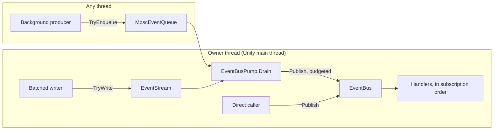
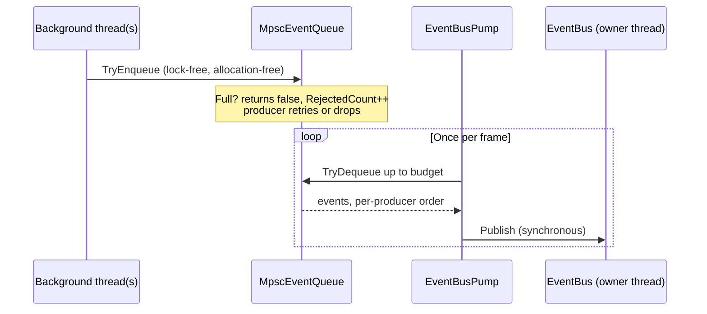

# CycloneGames.EventBus

[English | 简体中文](README.SCH.md)

A zero-allocation, one-to-many event bus for Unity and pure C# hosts, built for production workloads: synchronous deterministic dispatch, an explicit thread boundary, bounded containers, and a frame-cost ceiling you configure — on every platform, including mobile, WebGL, and consoles.

## Table of Contents

- [CycloneGames.EventBus](#cyclonegameseventbus)
  - [Table of Contents](#table-of-contents)
  - [Why This Module Exists](#why-this-module-exists)
  - [Architecture](#architecture)
  - [Level 1: The Smallest Useful Bus](#level-1-the-smallest-useful-bus)
  - [Level 2: Grouping Subscriptions with Scopes](#level-2-grouping-subscriptions-with-scopes)
  - [Level 3: Batching with EventStream](#level-3-batching-with-eventstream)
  - [Level 4: Crossing a Thread Boundary](#level-4-crossing-a-thread-boundary)
  - [Level 5: Composition with EventBusContext](#level-5-composition-with-eventbuscontext)
  - [Level 6: Async and Reactive Integrations](#level-6-async-and-reactive-integrations)
  - [Semantics You Can Rely On](#semantics-you-can-rely-on)
    - [Structural changes during dispatch](#structural-changes-during-dispatch)
    - [Error policy](#error-policy)
    - [Re-entrancy ceiling](#re-entrancy-ceiling)
    - [Thread model summary](#thread-model-summary)
  - [Capacity, Budgets, and Backpressure](#capacity-budgets-and-backpressure)
  - [Performance and Platform Notes](#performance-and-platform-notes)
  - [Diagnostics and Troubleshooting](#diagnostics-and-troubleshooting)
  - [Samples](#samples)
  - [Validation](#validation)

## Why This Module Exists

Decoupled notification looks simple — a list of callbacks and a loop — and production use breaks the simple version in predictable ways:

| Problem in a naive implementation | What it costs in production | This module's answer |
| --- | --- | --- |
| `List<Action>` + `foreach` dispatch | Enumerator and closure allocations per publish; GC spikes on mobile | `EventBus<T>`: pooled handles, array dispatch, **0 bytes** on the publish path |
| "Thread-safe everywhere" bus | Locks or concurrent collections on the hot path, worst exactly on weak multi-core hardware | Single-thread-confined bus (lock-free) + one explicit cross-thread bridge (`MpscEventQueue<T>`) |
| Unbounded queues for background producers | A stalled consumer grows memory until the process dies | Bounded containers that refuse, count, and apply backpressure |
| No frame-cost control | A backlog drains in one frame and drops it | `EventBusPump` with per-source and per-frame budgets |
| Exceptions in subscribers | One broken listener silently blocks everyone subscribed after it | Explicit `PublishErrorPolicy`; default never skips a subscriber |
| Subscribe/unsubscribe during dispatch | Skipped handlers, double-delivery, or crashes depending on timing | Documented, tested structural-change semantics |

The design principle behind all of this: **the hot path does almost nothing, and everything else is explicit**. Publishing is an array scan with no lock, no allocation, and no logging. Crossing threads, batching, scheduling, and error handling are opt-in mechanisms you compose — not ambient behavior you pay for whether you use it or not.

## Architecture

| Assembly | Path | Purpose |
| --- | --- | --- |
| `CycloneGames.EventBus.Core` | `Core/` | Bus, containers, configuration, command port, diagnostics. No `UnityEngine` reference (`noEngineReferences: true`). |
| `CycloneGames.EventBus.Runtime` | `Runtime/` | Composition facade, frame pump, two thin `MonoBehaviour` hosts. |
| `CycloneGames.EventBus.Editor` | `Editor/` | Read-only diagnostics window. |
| `CycloneGames.EventBus.Integrations.Logging` | `Integrations/Logging/` | `IEventBusLogSink` adapter for CycloneGames.Logging. |
| `...Runtime.Integrations.R3` | `Runtime/Integrations/R3/` | `Observable<T>` bridge. Compiled only when `com.cysharp.r3` is present (asmdef `versionDefines`). |
| `...Runtime.Integrations.UniTask` | `Runtime/Integrations/UniTask/` | One-shot `WaitAsync`. Compiled only when UniTask is present. |
| `...Runtime.Integrations.VitalRouter` | `Runtime/Integrations/VitalRouter/` | Adapter over a VitalRouter `Router`. Compiled only when VitalRouter is present. |
| `...Tests.EditMode` / `...Tests.Integrations` | `Tests/` | Contract, concurrency, zero-allocation, and lifecycle suites. |



The dependency rule that keeps this portable: **Core depends on the BCL only** — no engine API, no `unsafe`, no reflection, no dynamic code generation. A non-Unity host (headless server, CLI tool, another engine) uses Core unchanged and replaces only the two `MonoBehaviour` adapters with its own tick driver.

## Level 1: The Smallest Useful Bus

Events are plain structs. No interface, no base class, no attributes:

```csharp
using CycloneGames.EventBus.Core;

public struct ValueChangedEvent
{
    public int Id;
    public float NewValue;
}
```

Create a bus, subscribe, publish, unsubscribe:

```csharp
var bus = new EventBus<ValueChangedEvent>();

// Cache the delegate: passing a method group to Subscribe allocates a new
// delegate every call, because C# does not cache instance method group conversions.
Action<ValueChangedEvent> handler = OnValueChanged;
IEventSubscription subscription = bus.Subscribe(handler);

bus.Publish(new ValueChangedEvent { Id = 7, NewValue = 0.5f });

subscription.Dispose(); // Idempotent. Unsubscribes in O(1).

static void OnValueChanged(ValueChangedEvent evt) { /* runs synchronously */ }
```

What you get even at this level:

- **Synchronous, ordered dispatch** — handlers run in subscription order on the publishing thread. No queue, no async completion, no reordering.
- **Zero allocation** — after warm-up, `Publish` allocates nothing. 
- **Deterministic cost** — `O(subscriber count)` per publish, one indirect call per handler. You can profile it frame by frame.

## Level 2: Grouping Subscriptions with Scopes

Real systems subscribe to several events and must release all of them on shutdown. A scope collects handles and releases them together, in reverse order:

```csharp
var scope = new SubscriptionScope();
scope.Add(bus, handler);
scope.Add(otherBus, otherHandler);

scope.Dispose(); // Releases every recorded subscription. Idempotent.
```

In Unity, `EventBusScopeMonoBehaviour` binds a scope to a `GameObject` lifetime:

```csharp
public sealed class PanelController : MonoBehaviour
{
    private void Awake()
    {
        EventBusScopeMonoBehaviour scope = gameObject.AddComponent<EventBusScopeMonoBehaviour>();
        scope.Subscribe(bus, OnValueChanged); // Released automatically on destroy.
    }

    private void OnValueChanged(ValueChangedEvent evt) { }
}
```

Explicit scopes — not weak references — are this module's answer to stale subscribers. A weak-event pattern would trade a leak problem for non-deterministic delivery and extra GC pressure; a scope makes the release moment a design decision you can see in the code.

## Level 3: Batching with EventStream

When one system produces many events per frame, publishing each one immediately makes dispatch cost and ordering implicit — interleaved with whatever else the frame was doing. `EventStream<T>` turns "N publishes scattered through the frame" into "write N, flush once":

```csharp
var stream = new EventStream<ValueChangedEvent>(capacity: 512);
var pump = new EventBusPump();
pump.AddStream(stream, bus);

// Producer side, any time during the frame:
stream.TryWrite(new ValueChangedEvent { Id = 7, NewValue = 0.5f });

// One explicit flush point per frame:
pump.Drain(maxEventsPerTarget: 256, maxEventsPerTick: 2048);
```

Properties this buys you:

- **Explicit dispatch timing** — the flush point is a decision, reproducible and profilable.
- **A frame-cost ceiling** — `FlushTo(bus, budget)` spreads a large batch across frames.
- **Bounded memory** — capacity is fixed at construction. A full stream refuses the write and counts it in `RejectedCount`; it never grows.

## Level 4: Crossing a Thread Boundary

The bus is single-thread-confined by design — that is what makes it lock-free. Background work (networking, loading, job completion) enters through `MpscEventQueue<T>`, a bounded, lock-free, multi-producer/single-consumer ring:

```csharp
var queue = new MpscEventQueue<AssetLoadedEvent>(capacity: 1024);
var pump = new EventBusPump();
pump.AddQueue(queue, bus);

// Any background thread:
bool accepted = queue.TryEnqueue(new AssetLoadedEvent { AssetId = 42 });

// Owner thread, once per frame:
pump.Drain(maxEventsPerTarget: 256, maxEventsPerTick: 2048);
```



Three rules keep this safe:

1. **Only the owner thread touches the bus.** The queue is the entire thread boundary.
2. **`TryEnqueue` returning `false` is backpressure, not loss.** The event is still yours; retry, drop, or count it. `RejectedCount` climbing means the consumer cannot keep up — raise capacity or the drain budget.
3. **Shutdown order**: `Close()` the ingress → producers observe `false` and stop → drain (or `Clear()`) the remainder on the owner thread. Queued events stay drainable after close.

A foreign-thread callback that must release a subscription (for example, a cancellation firing on a thread-pool thread) uses `bus.ScheduleRemoval(handle)` — the only thread-safe member of the bus. The removal is applied on the owner thread at the next entry point.

## Level 5: Composition with EventBusContext

An application owns many buses. `EventBusContext` is the composition-root facade: one entry point for buses, the command publisher, and the root scope, with explicit disposal order (subscriptions → child scopes → owned buses → command backend):

```csharp
using EventBusContext context = new EventBusBuilder()
    .WithConfiguration(new EventBusConfiguration(
        maxDispatchDepth: 64,
        publishErrorPolicy: PublishErrorPolicy.ContinueOnError))
    .Build();

EventBus<ValueChangedEvent> bus = context.GetOrCreateBus<ValueChangedEvent>();
context.RootScope.Add(bus, handler);
```

Bus ownership is explicit at the registration call site:

| Method | Ownership |
| --- | --- |
| `RegisterBus<T>` | Caller-owned; the context never disposes it. |
| `RegisterOwnedBus<T>` | Transferred to the context. |
| `GetOrCreateBus<T>` | Created and owned by the context. |

There is deliberately no process-global singleton. For code with no composition root at all, `EventBusGlobal<T>` provides a per-type static holder — with the usual service-locator trade-off (implicit dependencies, tests must reset state). Prefer the context or constructor injection where a composition root exists.

A command port (`ICommandPublisher`) covers directed, one-handler commands rather than one-to-many notification. The built-in `InProcessCommandPublisher` is the no-dependency implementation; another backend (for example a VitalRouter adapter) is supplied through `EventBusBuilder.WithCommandPublisherFactory`, so Core never references an integration assembly.

## Level 6: Async and Reactive Integrations

Optional, compiled only when the corresponding package is installed:

```csharp
// UniTask: await the next matching event. One pooled subscription + one completion source.
ValueChangedEvent evt = await bus.WaitAsync(e => e.Id == 7, cancellationToken);

// R3: adapt a bus to an observable (or subscribe an observable into a bus).
Observable<ValueChangedEvent> observable = bus.ToObservable();
```

Integration types appear only in their own assemblies; Core never depends on UniTask, R3, VitalRouter, or any logging library. Logging goes through the narrow `IEventBusLogSink` port (default: `NullEventBusLogSink`, which costs one `IsEnabled` call on cold paths and nothing on the dispatch path).

## Semantics You Can Rely On

### Structural changes during dispatch

Handlers may safely subscribe, unsubscribe, or dispose the bus mid-dispatch. The semantics are defined and covered by tests:

| Change during `Publish` | Behavior |
| --- | --- |
| Subscribe | The new handler fires from the **next** round, never this one. |
| Unsubscribe | Skipped from that point on, within the same round. |
| `Compact()` / `Clear()` | Throws `InvalidOperationException` (indices would shift under the loop). Automatic compaction is deferred instead. |
| `Dispose()` | Deferred: the current round completes atomically, `IsDisposed` turns true immediately, teardown runs when the outermost round exits. |

### Error policy

Decided per bus via `EventBusConfiguration.PublishErrorPolicy`:

| Policy | Behavior | Use for |
| --- | --- | --- |
| `Stop` | First exception propagates immediately; remaining handlers skipped. | Small buses, fail-loud debugging. |
| `Swallow` | All handlers run; faults logged and counted; `Publish` returns normally. | Best-effort listeners. |
| `ContinueOnError` (default) | All handlers run; the first exception is rethrown after the round with its original stack. | The default for large projects: one broken listener can never silently cost others their delivery. |

### Re-entrancy ceiling

`MaxDispatchDepth` (default 64) bounds recursive publish — a handler publishing an event that leads back to itself. An unbounded chain would otherwise end in a stack overflow no platform can recover from. A refused publish is counted in `DroppedReentrantCount` and logged at `Warning`; a climbing counter means a publish cycle to break, not a limit to raise blindly.

### Thread model summary

| Type | Contract |
| --- | --- |
| `EventBus<T>`, `EventStream<T>`, `EventBusPump`, `EventBusContext`, `SubscriptionScope` | Single-thread-confined (owner thread) |
| `MpscEventQueue<T>` | `TryEnqueue`/`Close` from any thread; `TryDequeue`/`FlushTo`/`Clear` owner thread only |
| `EventBus<T>.ScheduleRemoval` | Any thread — the only cross-thread member of the bus |

Synchronization is limited to `Interlocked` and `Volatile`. No locks on the dispatch path, no spinning, no thread creation.

## Capacity, Budgets, and Backpressure

Everything in this module is **bounded and sized at construction**. That is the long-running-stability story: no structure grows with uptime, so memory and frame cost stay flat for the life of the process.

- **Size the bus** with `initialCapacity` to the steady-state subscriber count; measure with `PeakSubscriptionCount`. The backing array never shrinks — after a one-time peak, `Clear()` or replace the bus.
- **Size streams and rings to the worst frame**, not the average one. Full containers refuse and count (`RejectedCount`) instead of allocating.
- **Bound the frame** with the pump's two budgets: per-source (fairness — one flooded source cannot starve others) and per-tick (the actual frame ceiling). Both are runtime-tunable on `EventBusPumpMonoBehaviour`, so a build can lower them on constrained hardware without a code change.
- **Rejected ≠ dropped.** `RejectedCount` is a refused write (caller may retry — normal backpressure). `DroppedCount` is a confirmed loss (entered the container, discarded unread by `Clear`). Keeping them separate is what makes offline triage possible.
- **Container counters reach the panel.** The bus counters are blind to backpressure, so register the containers you care about with `context.RegisterContainer(queueOrStreamOrPublisher)`. Their `Pending` / `Rejected` / `Dropped` counters then appear on the debugger's **Containers** tab and aggregate into the Summary **Backpressure** section. Registration is a borrowed reference: the context never disposes a container.

For high-frequency events, prefer publishing less (gate at the source on a changed-value check or a rate) or batching through a stream. Coalescing (latest-value-wins) is deliberately not built in — which value survives is a product decision, owned by the caller.

## Performance and Platform Notes

| Path | Complexity | Module-owned allocation | Notes (the precondition that makes it hold) |
| --- | --- | --- | --- |
| `Publish` | `O(subscribers)` | 0 bytes | One indirect call per live handler |
| `Subscribe` | `O(1)` | 0 bytes in steady state | O(1) reuse off a dead-slot free list; allocation-free only while the churn amplitude is within the handle-pool ceiling (below) |
| `IEventSubscription.Dispose` | `O(1)` | 0 bytes | Each slot records its own handle |
| `Unsubscribe(Action<T>)` | `O(slots)` | 0 bytes | Linear identity scan |
| `Compact` | `O(slots)` | 0 bytes | In place, non-shrinking, amortized against unsubscribes |
| `TryEnqueue` / `TryDequeue` | `O(1)` | 0 bytes | Vyukov ring, cache-line-padded positions |
| `EventStream.TryWrite` / `FlushTo` | `O(1)` / `O(flushed)` | 0 bytes | Bounded ring, no element moves |
| `EventBusPump.Drain` | `O(targets + drained)` | 0 bytes | Indexed loop, no enumerator |

- **Handle-pool ceiling.** `Subscribe` / `Dispose` are allocation-free only while the number of *simultaneously live* handles stays within the pool ceiling. The ceiling scales with the bus capacity inside fixed bounds (floor 32, hard cap 4096): a bus sized for N subscribers retains up to N handles. A churn amplitude above the ceiling constructs the surplus handles instead of recycling them, so size the bus to the peak concurrent subscribe/dispose amplitude you expect. Steady churn of a single handle (the common case) never touches the ceiling.

- **AOT / IL2CPP / stripping safe**: no reflection, no dynamic code generation, no `unsafe`, no P/Invoke.
- **WebGL**: threading primitives compile away on the single-threaded target; the ring degenerates to a plain FIFO with identical behavior.
- **Mobile/ARM64**: ring positions and contended counters are padded to 128 bytes, covering both 64-byte and 128-byte cache-line architectures.
- **Memory hygiene**: compaction clears stale delegates, consumed ring slots holding references are zeroed, and the handle pool is bounded — destroyed listeners cannot be pinned alive by the module.

## Diagnostics and Troubleshooting

Per-bus counters (`IEventBusDiagnostics`, aggregated by `EventBusContext.GetDiagnosticsSnapshot`, viewable in the read-only debugger window under `Tools/CycloneGames/EventBus/Debugger`):

| Counter | Meaning |
| --- | --- |
| `SubscriptionCount` / `PeakSubscriptionCount` | Live subscribers / high-water mark for sizing. |
| `TombstoneCount` | Dead slots awaiting compaction. Climbing steadily = subscription churn; gate with an activity flag instead of resubscribing. |
| `PublishCount` | Dispatch entries since construction. |
| `DroppedReentrantCount` | Publishes refused by the re-entrancy ceiling. |
| `SubscriberErrorCount` | Subscriber exceptions handled by policy. |

The window opens on an **Issues** tab: a severity-sorted overview (severity / category / subject / where / value / delta / fix / trend) that answers *which event, where, why, and how to fix* on one screen. Each row clicks through to the owning bus (expanded) or container, and a per-bus/container mini trend bar shows the last 32 snapshots. Subscriber exceptions surface here with their exception type and message and the offending handler, so the Console round-trip is no longer needed.

The most recent subscriber exception is exposed by a third cold-path port, `IEventBusFaultInspection` (`TryGetLastFault` → `Count`, `ExceptionTypeName`, `Message` truncated to 256 chars, `SubscriberName`, `DeclaringTypeName`). It reads delegate metadata, so `SubscriberName`/`DeclaringTypeName` may be stripped in a Player build — same Editor-tooling contract as `IEventBusSubscriberInspection`.

Container backpressure is a separate, narrower port (`IEventBusContainerDiagnostics`): `MpscEventQueue<T>`, `EventStream<T>`, `InProcessCommandPublisher`, and `EventBusPump` each expose `GetContainerSnapshot()`. Register one with `context.RegisterContainer(...)`; the debugger's **Containers** tab lists each row, and the Summary tab aggregates Pending / Rejected / Dropped. This is where a saturated queue, a refused stream write, or a backlog in one pump source shows up first — the bus counters cannot see any of it.

**Leak detection workflow**: a red `Dead N` pill or error banner in the debugger means subscribers outlived their targets. Expand the bus row — each `DESTROYED` row names the handler method, its declaring type, and the dead target's type, which is enough to find the offending `Subscribe` call with one IDE search. The fix is structural, not a null check: bind the subscription to a lifetime (`EventBusScopeMonoBehaviour` or a `SubscriptionScope`) so release happens on destroy.

| Symptom | Likely cause | Resolution |
| --- | --- | --- |
| `DESTROYED` rows / "destroyed subscriber targets" in the debugger | A subscriber's target was destroyed without unsubscribing. The delegate pins its object graph (a real leak, worst on memory-constrained devices) and it is still invoked — costing an exception per publish if it touches Unity APIs | The row names the method, its declaring type, and the target type: search the codebase for that class's `Subscribe` call, then release the subscription on destroy — via `EventBusScopeMonoBehaviour`, a `SubscriptionScope`, or an explicit `Dispose` in `OnDestroy` |
| Handlers never fire | Subscribed mid-round, or publishing on a different bus instance | Mid-round subscriptions fire from the next round; check the instance |
| `DroppedReentrantCount` climbs | A handler publishes its own event type in a cycle | Break the cycle or split the event type |
| `InvalidOperationException` from `Compact`/`Clear` | Called from inside a handler | These are deferred automatically during dispatch; call them outside |
| `Drain` throws "not re-entrant" | A flush callback drained its own pump | Split work into a second pump or defer to the next tick |
| Background events lost | Published directly on the bus from another thread | Route through `MpscEventQueue<T>` + pump |
| Allocation in a Profiler capture | Allocates inside a handler, not in `Publish` | Profile the full call path; the dispatch path itself allocates nothing |

## Samples

A self-contained Demo lives in `Samples/`. Add the `EventBusSampleBootstrap` component to any GameObject in a scene and enter Play mode: it builds an `EventBusContext` and drives live traffic through every container — direct publishes, a batched `EventStream`, a background-thread `MpscEventQueue`, plus opt-in fault injection (a faulty subscriber, subscription churn, destroyed-target leaks, and a re-entrant publish chain that exercises the depth ceiling) so every counter in the debugger window has meaningful data. It also registers every container, and floods a deliberately undersized stream, so the debugger's **Containers** tab shows `Rejected` climbing (refused writes) and `Dropped` climbing (buffered events discarded unread) — the backpressure view the bus counters cannot provide. The Editor bridge registers the context automatically; open `Tools/CycloneGames/EventBus/Debugger` and press Play. Traffic rates and fault injection are tunable in the Inspector. Delete the `Samples` folder to remove the Demo entirely.

## Validation

EditMode suites (contract, concurrency, churn-scaling, lifecycle):

```text
<UnityEditor> -batchmode -nographics -projectPath <repo-root>/UnityStarter -runTests -testPlatform EditMode -assemblyNames CycloneGames.EventBus.Tests.EditMode -testResults <result-path> -quit
<UnityEditor> -batchmode -nographics -projectPath <repo-root>/UnityStarter -runTests -testPlatform EditMode -assemblyNames CycloneGames.EventBus.Tests.Integrations -testResults <result-path> -quit
```

The churn path is guarded by `EventBusChurnScalingTests`, which asserts three properties: subscribe/dispose reuse does not scale with the live subscriber count; churn above the handle-pool ceiling constructs no new handles; dispatch fanout stays within a coarse budget.

> Measurement caveat: `GC.GetAllocatedBytesForCurrentThread` is **not reliable under the Editor's Mono** (it returns a constant, so an assertion against it is vacuous). The handle-recycling assertion therefore counts exact handle recycling instead of bytes. Real device proof of zero allocation still requires the target Player + Profiler under IL2CPP (or the shipping backend): confirm that a representative frame produces no `GC.Alloc` on the dispatch path.
