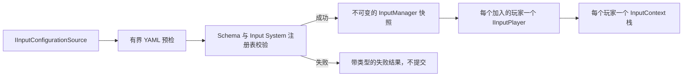
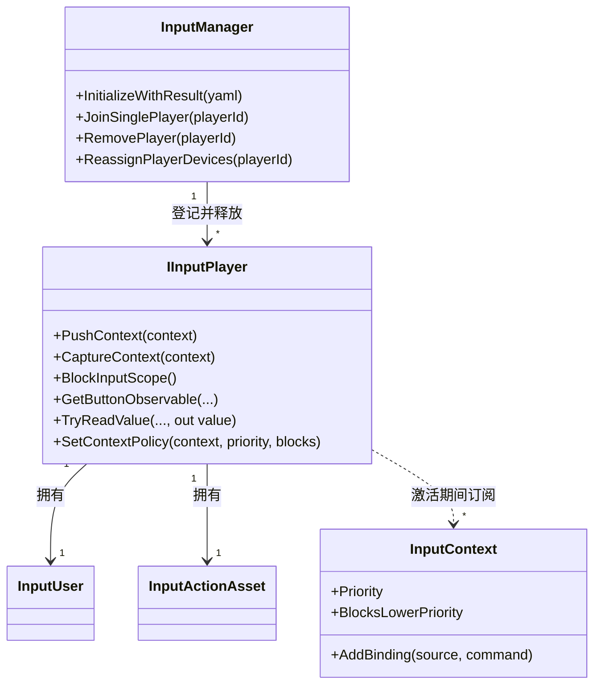
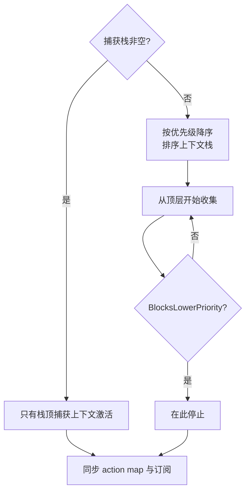

# CycloneGames.InputSystem

[English](README.md) | 简体中文

构建在 Unity Input System 之上的输入层。动作、绑定和映射上下文用 YAML 编写，文件在生效前会被校验，每个本地玩家拥有独立的 `InputUser` 和 action asset。游戏代码压入映射上下文，通过 R3 流或同步读取获取输入。

适合玩家需要独立设备归属，或输入路由随 UI 状态（玩法、菜单、模态）变化的场景。只有一个玩家和一张静态 action map 时不需要它。

## 目录

1. [快速开始](#1-快速开始)
2. [工作原理](#2-工作原理)
3. [映射上下文](#3-映射上下文)
4. [读取动作](#4-读取动作)
5. [本地多人与设备](#5-本地多人与设备)
6. [重绑定与绑定档案](#6-重绑定与绑定档案)
7. [配置](#7-配置)
8. [加载与存储](#8-加载与存储)
9. [失败模型与排错](#9-失败模型与排错)
10. [性能与线程](#10-性能与线程)
11. [归属与释放](#11-归属与释放)
12. [程序集、测试与文档](#12-程序集测试与文档)

## 1. 快速开始

### 依赖

| 包 | 用途 |
| --- | --- |
| `com.unity.inputsystem` | 动作、绑定、设备 |
| `com.cysharp.unitask` | 异步加载与加入 |
| `com.cysharp.r3` | 动作流 |
| `jp.hadashikick.vyaml` | YAML 解析 |
| `com.cyclone-games.hash` | 确定性 action ID |
| `com.cyclone-games.logging` | 诊断日志 |

版本在 `package.json` 中声明。在 asmdef 中引用 `CycloneGames.InputSystem.Runtime`。UGUI、VContainer 和 Tools 程序集按需引用。

### 最小配置

```yaml
schemaVersion: 1
playerSlots:
- playerId: 0
  contexts:
  - name: Gameplay
    actionMap: PlayerActions
    bindings:
    - type: vector2
      action: Move
      expectedControlType: Vector2
      deviceBindings:
      - "<Gamepad>/leftStick"
      compositeBindings:
      - name: 2DVector
        parameters: mode=2
        parts:
        - name: up
          path: <Keyboard>/w
        - name: down
          path: <Keyboard>/s
        - name: left
          path: <Keyboard>/a
        - name: right
          path: <Keyboard>/d
    - type: button
      action: Confirm
      deviceBindings:
      - "<Gamepad>/buttonSouth"
      - "<Keyboard>/enter"
```

用 `Tools > CycloneGames > Input System Editor` 编写，或直接手写。`schemaVersion` 必填，只接受版本 `1`。

### 最小启动代码

```csharp
using CycloneGames.InputSystem.Runtime;
using CycloneGames.Logging;
using UnityEngine;

public sealed class PlayerInputBootstrap : MonoBehaviour
{
    private static readonly LogChannel Log = LogChannel.Create("Game.Input");

    [SerializeField] private TextAsset _configuration;

    private InputManager _manager;
    private InputContext _gameplay;

    private void Awake()
    {
        _manager = new InputManager();
        InputManagerInitializationResult initialized =
            _manager.InitializeWithResult(_configuration.text);

        if (!initialized.IsSuccess)
        {
            Log.Error($"Input initialization failed: {initialized.Status}: {initialized.Message}");
            enabled = false;
            return;
        }

        IInputPlayer player = _manager.JoinSinglePlayer(0);
        if (player == null)
        {
            Log.Error("No declared control scheme can be matched for player 0.");
            enabled = false;
            return;
        }

        _gameplay = new InputContext("PlayerActions", "Gameplay")
            .AddBinding(
                player.GetVector2Observable("Gameplay", "PlayerActions", "Move"),
                new MoveCommand(OnMove));

        player.PushContext(_gameplay);
    }

    private void OnMove(Vector2 direction)
    {
        // 把值转给玩法层自己的移动服务。
    }

    private void OnDestroy()
    {
        _gameplay?.Dispose();
        _manager?.Dispose();
    }
}
```

`InitializeWithResult` 返回带类型的结果，加入玩家前先检查 `IsSuccess`。已释放的 manager 不能再次初始化，需要重新创建。`InputManager.Instance` 是全局入口；显式构造让释放和测试更清楚。

配置只声明有哪些上下文，不会压入它们。对应的产品状态开始时再创建并压入 `InputContext`。

## 2. 工作原理

### 从 YAML 到运行中的玩家



初始化是事务性的。先对原始内容做有界形状预检，再在克隆上做 schema 与语义校验：按当前 Input System 注册表检查布局、路径、interaction、processor、composite 和控制方案，然后构建、解析并释放临时的 action graph。只有校验成功才提交运行时快照。每个加入的玩家之后得到自己的 action asset。

### 对象模型



| 概念 | 表示 | 职责 |
| --- | --- | --- |
| 动作 | `ActionBindingConfig` 和内部的 Unity `InputAction` | 给一个或多个绑定一个逻辑名和值类型。 |
| 映射上下文 | YAML 的 `ContextDefinitionConfig` 加运行时的 `InputContext` | 按优先级和阻断策略组织动作与命令绑定。 |
| Interaction | 动作级 `interactions` | 用 Unity Input System 语法决定动作何时 started、performed、canceled。composite part 上的 interaction 会被拒绝。 |
| Processor | `processors` 或 composite part 的 `processors` | 在消费者读取前变换值。 |
| Composite | `CompositeBindingConfig` | 用命名的 part 组合出 `2DVector` 这样的值。 |
| 控制方案 | `ControlSchemeConfig` | 声明一个 binding group 以及必需、可选或备选的设备布局。 |
| 玩家 | 由 `InputUser` 支撑的 `IInputPlayer` | 拥有配对设备、action asset、激活上下文、流和绑定覆盖。 |
| 绑定档案 | `InputBindingOverrideProfile` 或每玩家覆盖 JSON | 独立于配置存储，持久化 context/map/action 绑定选择器。 |

action、binding、interaction、processor 和设备的基础语义见 [Unity Input System 手册](https://docs.unity3d.com/Manual/com.unity.inputsystem.html)。

## 3. 映射上下文

### 栈、优先级与阻断

`PushContext` 把一个运行时上下文压入玩家栈。激活上下文按优先级降序排序，优先级相同时保持入栈顺序，后压入的在上层。一次刷新这样计算激活集合：



非阻断的浮层可以和 Gameplay 共存；`blocksLowerPriority: true` 的 Menu 会让 Gameplay 不再激活。

```csharp
InputContext gameplay = new InputContext("PlayerActions", "Gameplay")
    .AddBinding(
        player.GetVector2Observable("Gameplay", "PlayerActions", "Move"),
        new MoveCommand(MoveCharacter))
    .AddBinding(
        player.GetButtonObservable("Gameplay", "PlayerActions", "Confirm"),
        new ActionCommand(Confirm));

InputContext menu = new InputContext("UIActions", "Menu", priority: 100, blocksLowerPriority: true)
    .AddBinding(
        player.GetVector2Observable("Menu", "UIActions", "Navigate"),
        new MoveCommand(NavigateMenu));

player.PushContext(gameplay);
player.PushContext(menu);

player.RemoveContext(menu); // Gameplay 重新激活。
gameplay.Dispose();
menu.Dispose();
```

压入上下文之前先绑定命令。上下文拥有命令映射，玩家在上下文激活期间持有活的订阅。名称区分大小写。`ActiveContextName` 报告栈顶的激活上下文。

两参构造 `InputContext(actionMapName, name)` 从同名的 YAML 上下文读取优先级和阻断策略，四参构造在代码里直接指定两者。上下文只有在名称和 action map 都匹配已配置项时才会解析；构造函数要求两者都提供，无法构造只带 action map 的实例。同一层的窗口应使用同一个优先级，不同的数值会覆盖入栈顺序。

### 修改激活中上下文的策略

`SetContextPolicy` 修改玩家已拥有的某个上下文的优先级和阻断策略，不替换上下文，也不重建它的绑定。`ClearContextPolicy` 恢复构造时或 YAML 中的策略。

```csharp
// 模态阶段：对话框阻断 Gameplay。
player.PushContext(dialog);

// 预览阶段：对话框保持打开，Gameplay 重新接收输入。
player.SetContextPolicy(dialog, dialogPriority, blocksLowerPriority: false);

// 回到模态。
player.SetContextPolicy(dialog, dialogPriority, blocksLowerPriority: true);
```

策略按玩家保存，所以两个玩家可以共享同一个 `InputContext` 并各自应用不同策略。策略变化触发一次刷新，重复设置相同的值不会触发。进入或离开激活集合的上下文会重建订阅：跨越这次变化一直按住的按钮既不产生按下边沿，也不报告按下状态，直到松开后重新按下；`Vector2` 和 `Float` 动作在 map 重新启用时再次给出当前值。

### 刷新的结果

一次刷新只处理变化的部分。启用状态已经匹配激活集合的 action map 不会被动到，仍然激活的上下文保留它的订阅。无变化的刷新不产生分配。

如果上下文变化过程中启用 action map 或订阅自定义 observable 抛出异常，模型变更保留，该玩家的所有 action map 和订阅被禁用，`ActiveContextName` 被清空，发起调用的地方收到异常。移除出问题的绑定后调用 `RefreshActiveContext()`。同步重入的刷新会合并，上限 16 轮；超过上限时输入保持禁用，而不是阻塞主线程。

### 捕获与全局阻断

`CaptureContext` 临时让一个捕获上下文优先于所有普通上下文，返回一个可重复释放的 `IDisposable`。释放作用域后回到下一个捕获上下文或普通上下文集合。

`BlockInputScope` 禁用玩家的所有 action map。阻断按深度计数，所有对应作用域或 `UnblockInput` 调用都释放后输入才恢复。

```csharp
using IDisposable modalCapture = player.CaptureContext(modalContext);
using IDisposable loadingBlock = player.BlockInputScope();
```

两个作用域都要在 Unity 主线程上、在创建它们的流程里释放。

## 4. 读取动作

### 两种寻址方式

| 形式 | 示例 | 用途 |
| --- | --- | --- |
| 生成的 ID | `player.GetButtonObservable(InputActions.Actions.UI_Confirm)` | 推荐。调用时不做字符串查找。 |
| 带上下文的名称 | `player.GetButtonObservable("UI", "UIActions", "Confirm")` | 工具和一次性代码。 |

每个 ID 是 `context/map/action` 的确定性 FNV-1a 32 位哈希。用 `InputHashUtility.GetActionId` 计算，或用 Editor 窗口生成常量。未知 ID 返回空 observable 并记录一条警告。

### 流与读取

| API | 发出 | 说明 |
| --- | --- | --- |
| `GetVector2Observable` | `Vector2` | 事件驱动动作在 cancel 时发出零值。 |
| `GetScalarObservable` | `float` | 事件驱动动作在 cancel 时发出零值。 |
| `GetButtonObservable` | `Unit` | 每次 performed 发出一次。 |
| `GetPressStateObservable` | `bool` | 订阅时给出当前值，之后按下为 `true`、松开为 `false`。 |
| `GetLongPressObservable` | `Unit` | 按住达到 `longPressMs` 时发出一次。 |
| `GetLongPressProgressObservable` | `float` | 按住期间为 `0..1`，提前松开为 `-1`。仅 Button。 |
| `GetChordObservable` | `Unit` | 两个按钮动作在时间窗口内先后按下。参数是两个 ID。 |
| `TryReadValue` | `out TValue` | 同步读取当前值。 |

```csharp
int moveId = InputHashUtility.GetActionId("Gameplay", "PlayerActions", "Move");
player.GetVector2Observable(moveId).Subscribe(MoveCharacter);

if (player.TryReadValue(moveId, out Vector2 move))
{
    ApplyMove(move);
}

int confirm = InputHashUtility.GetActionId("Gameplay", "PlayerActions", "Confirm");
int cancel = InputHashUtility.GetActionId("Gameplay", "PlayerActions", "Cancel");
player.GetChordObservable(confirm, cancel, windowMs: 200f)
    .Subscribe(_ => OpenShortcut());
```

`EventDriven` 动作在 performed 时发出，在 cancel 时发出中性值。`Polling` 的 `Vector2` 和 `Float` 动作由玩家唯一的 update 泵读取，前提是它的 action map 处于启用状态。需要连续采样的值用 polling，离散的状态变化用事件驱动。

模块的长按支持 `Button` 和 `Float`，由 `longPressMs > 0` 启用，与 Unity 的 `hold(...)` interaction 相互独立。`Float` 长按要求 `longPressValueThreshold` 落在 `(0,1]`。和弦需要两个已配置的按钮动作，松开后流复位。

每个订阅都要有明确的生命周期，由 `InputContext`、`CompositeDisposable` 或持有它的组件释放。
### 缓存按下边沿

按下边沿可以缓存若干帧，由消费方决定何时取用：玩家在落地前几帧按下的跳跃，落地时依然算数。

| 成员 | 作用 |
| --- | --- |
| `TryConsumeBuffered(actionId, windowFrames)` | 取走窗口内最新的一次按下。同一次按下只能被取走一次。 |
| `TryPeekBuffered(actionId, windowFrames)` | 只看不取。 |
| `ActionBuffer` | 底层环形缓冲，需要自定时钟时可以按自己的 tick 记录和查询。 |

```csharp
int jumpId = InputHashUtility.GetActionId("Gameplay", "PlayerActions", "Jump");

void Update()
{
    if (isGrounded && player.TryConsumeBuffered(jumpId, windowFrames: 6))
    {
        Jump();
    }
}
```

窗口按帧计，`0` 只接受当帧。上下文集合变化、`BlockInput` 前后都会清空缓冲，边沿不会跨输入状态。缓冲按玩家预分配，默认 64 条、保留 600 帧，运行期不再分配。


## 5. 本地多人与设备

### 加入

| API | 设备策略 | 典型用途 |
| --- | --- | --- |
| `JoinSinglePlayer` / `JoinSinglePlayerAsync` | 用未被占用的设备匹配首选及其余控制方案。 | 标准的本地玩家创建。 |
| `JoinPlayerAndLockDevice` | 要求给定设备属于某个已声明的方案，并占用该方案匹配到的全部设备。 | 用已知的某个手柄加入。 |
| `JoinPlayerOnSharedDevice` | 配对当前键盘，以及存在时的鼠标，不做独占占用。 | 共享键盘的模式。 |
| `StartListeningForPlayers` | 按下加入绑定后用第一个未登记的槽位创建玩家；所有声明槽位填满后，扩展主玩家的设备集合。 | 大厅加入流程。 |
| `PairAdditionalDevice` | 给已加入的玩家再配对一个已声明布局的设备。设备无法占用或布局未声明时返回失败。 | 单人热插拔。 |
| `RemovePlayer` | 释放玩家，解除 `InputUser` 的配对，归还占用。 | 离开、重置槽位、重新初始化前的关闭。 |
| `JoinPlayersBatch` / `JoinPlayersBatchAsync` | 一次加入多个玩家。异步重载在除最后一个玩家外的每个玩家之后让出一帧。 | 加载界面。 |

```csharp
IInputPlayer player1 = manager.JoinPlayerAndLockDevice(0, gamepad1);
IInputPlayer player2 = manager.JoinPlayerAndLockDevice(1, gamepad2);
```

每个玩家把自己的 action asset 关联到它的 `InputUser`，所以 `InputActionAsset.devices` 就是该玩家的配对设备白名单。锁定的槽位还会激活一个控制方案，把 binding mask 收窄到该方案的 group。设置 `pairAllMatchingDevices: true` 的槽位不设置控制方案，所有 binding 都有效，但只在该玩家的白名单设备上，这样一个玩家可以在键鼠和手柄之间切换而不用重新加入，第二个玩家仍能占用其余设备。逐 binding 的 `deviceBindingGroups` 和槽位的 `controlSchemes` 依赖已激活的方案，所以这种模式下它们不生效。

`maxDevicesPerLayout`（默认 `1`，钳制到 `1..8`）限制这种槽位对每个引用到的布局最多占用几个设备。`deviceSwitchDebounceMs`（默认 `0`，钳制到 `0..5000`）是 `ActiveDeviceKind` 再次切换前的最小停留时间。

异步重载接受 `CancellationToken`。单人超时返回 `null`，调用方的取消会向上传递。批量整体超时或 manager 关闭时返回已成功加入的那部分。对已登记的玩家 ID，加入方法是幂等的。

控制方案的匹配使用 `deviceRequirements`：`isOptional` 允许设备缺失，`isOr` 按 Unity Input System 的方案顺序表示备选。没有声明方案时，由配置的直接路径和 composite part 路径推导出的布局互为备选，选取第一个可占用的匹配设备。如果该设备是键盘或鼠标，另一个可占用的键盘或鼠标设备会作为伴随设备一起加入。

### 设备状态与提示

```csharp
private void ObserveDevices(IInputPlayer player)
{
    player.OnDeviceStatusChanged += status =>
    {
        switch (status.ChangeKind)
        {
            case InputPlayerDeviceChangeKind.Lost:
                PauseForMissingDevice(status.DeviceId);
                break;
            case InputPlayerDeviceChangeKind.Regained:
                ResumeAfterDeviceReturn(status.DeviceId);
                break;
            case InputPlayerDeviceChangeKind.Paired:
            case InputPlayerDeviceChangeKind.Unpaired:
                RefreshDevicePresentation(status.DeviceKind, status.Layout);
                break;
        }
    };
}
```

`ActiveDeviceKind` 在观察到有意义的动作活动时变化，用来切换按键提示图标。需要精确替换提示时，`InputPlayer.DeviceActivity` 会为该玩家自己设备上的每一次活动发布一个 `InputDeviceActivity`：

| 字段 | 含义 |
| --- | --- |
| `PlayerId`、`DeviceId` | 所属槽位和 Unity 设备 id。 |
| `DeviceLayout` | 具体布局，例如 `DualShockGamepad` 或 `XInputController`。 |
| `Family` | `InputDeviceFamily`：`Keyboard`、`Mouse`、`Gamepad`、`Touchscreen`、`Joystick`、`Other`。 |
| `PromptKind` | 给现有消费者用的粗粒度 `InputDeviceKind`。 |
| `ControlPath` | 已知时给出触发活动的控制路径。 |
| `Timestamp` | 玩家帧时间戳，由 `UpdateRuntimeState` 推进。 |

这个流由 Unity 的 `onAnyButtonPress` 驱动，并按玩家的设备白名单过滤。鼠标移动、摇杆漂移这类连续活动可以用 `NotifyDeviceActivity(device)` 或 `NotifyDeviceActivity(device, control)` 上报。`InputDeviceIconSet.GetIcon(kind, deviceLayout)` 先按具体布局查找图标，找不到时退回到粗粒度的种类。`DeviceActivity` 是原始流，不做去抖，产品 UI 里按 `Family` 或 `DeviceLayout` 去重。

控制方案在加入时选定一次。如果玩家的全部配对设备都断开，玩家仍然登记着，白名单为空，方案不变。调用 `InputManager.ReassignPlayerDevices(playerId)` 移除并用当前可用的设备重新加入该玩家。在 `OnDeviceStatusChanged` 里，当 `ChangeKind` 为 `Lost` 或 `Unpaired` 且 `User.pairedDevices.Count == 0` 时调用，延后一帧，避免在玩家自己的回调里释放它。`InputManager.AutoReassignOnDeviceLoss`（默认 `false`）会在拓扑变化时自动执行同样的恢复。

## 6. 重绑定与绑定档案

`RebindAction` 应用一个已经选好的路径。产品自己的重绑定 UI 负责捕获候选按键、执行保留键和无障碍策略、处理冲突，然后应用覆盖。`CheckBindingConflicts` 是针对已配置直接绑定的编写期诊断，不评估候选按键或运行时覆盖。

```csharp
bool changed = player.RebindAction(
    "Gameplay", "PlayerActions", "Confirm",
    "<Keyboard>/space",
    "<Keyboard>/f");

string[] effectivePaths = player.GetActionBindings("Gameplay", "PlayerActions", "Confirm");

player.ResetActionBinding("Gameplay", "PlayerActions", "Confirm");
player.ResetAllActionBindings();
```

每玩家 JSON 使用模块自有的 schema，包含 context/map/action 标识、绑定序号和原始绑定信息。导入时先暂存并校验文档，再替换已有的覆盖。每玩家文档最多 128 条覆盖记录、1 MiB 严格 UTF-8。manager 档案聚合多个玩家的 JSON，总预算 4 MiB，可以在玩家加入之前导入，未应用的条目在玩家构造时应用。

产品使用 `CycloneGames.Persistence` 时，注入产品选定的 `IPersistenceStorage` 和 `IPersistenceCodec<string>`，把导出的档案当作不透明 JSON 存储。codec 可以把字符串编码为严格 UTF-8，但不能解释或改写 InputSystem 的 schema。`InputManager` 是唯一的档案校验者。下面的类属于产品代码或产品自己的集成程序集：

```csharp
using System.Threading;
using System.Threading.Tasks;
using CycloneGames.InputSystem.Runtime;
using CycloneGames.Persistence;

public sealed class InputBindingProfilePersistence
{
    private const int StoredContentVersion = 1;
    private const int MaximumPayloadBytes = 1024 * 1024;

    private readonly InputManager _manager;
    private readonly PersistenceStore<string> _store;

    public InputBindingProfilePersistence(
        InputManager manager,
        IPersistenceStorage storage,
        IPersistenceCodec<string> strictUtf8Codec)
    {
        _manager = manager;
        _store = new PersistenceStore<string>(
            storage,
            new PersistenceProfile<string>(strictUtf8Codec, new PersistenceLimits(MaximumPayloadBytes)));
    }

    public async Task<PersistenceOperationResult> SaveAsync(CancellationToken cancellationToken)
    {
        string opaqueJson = _manager.ExportBindingOverrideProfileJson();
        return await _store.SaveAsync(in opaqueJson, StoredContentVersion, cancellationToken);
    }

    public async Task<string> LoadAndApplyAsync(CancellationToken cancellationToken)
    {
        PersistenceLoadResult<string> loaded = await _store.LoadAsync(StoredContentVersion, cancellationToken);
        if (loaded.Status == PersistenceLoadStatus.Missing) return null;
        if (!loaded.IsSuccess) return loaded.ErrorCode.ToString();

        if (!_manager.ImportBindingOverrideProfileJson(loaded.Value))
            return "The binding profile does not match the active input configuration.";

        return null;
    }
}
```

在组合根创建一次这个对象。玩家加入之前加载，在明确的设置提交或生命周期检查点保存。预算耗尽属于预期失败时，用 `TryExportBindingOverridesJson` 或 `TryExportBindingOverrideProfile`。加载失败时保持配置的默认值。

## 7. 配置

### 字段参考

| 层级 | 字段 | 含义 |
| --- | --- | --- |
| 根 | `schemaVersion` | 必须为 `1`，其它值以 `UnsupportedSchemaVersion` 拒绝。 |
| 根 | `schemaFingerprint` | 可选的 Editor 诊断值，不影响运行时是否接受数据。 |
| 根 | `joinAction` | 可选的共享加入绑定。玩家槽位的加入绑定也会被考虑。 |
| 根 | `playerSlots` | 玩家模板，`playerId` 唯一且非负。 |
| 玩家 | `controlSchemes` | 可选的设备匹配方案。 |
| 玩家 | `defaultControlScheme` | 首选方案，匹配不上时依次尝试其余已声明的方案。 |
| 玩家 | `pairAllMatchingDevices` | 为每个引用到的布局占用设备，不设置控制方案。 |
| 玩家 | `maxDevicesPerLayout` | 启用 `pairAllMatchingDevices` 时每个引用到的布局最多占用的设备数。默认 `1`，钳制到 `1..8`。 |
| 玩家 | `deviceSwitchDebounceMs` | `ActiveDeviceKind` 再次切换前的最小停留时间。默认 `0`，钳制到 `0..5000`。 |
| 玩家 | `contexts` | 该玩家的命名映射上下文。 |
| 上下文 | `name`、`actionMap` | 上下文标识和对外公开的 action map 标识。 |
| 上下文 | `priority` | 数值大的先被考虑。默认 `0`，限制范围 `-100000..100000`。 |
| 上下文 | `blocksLowerPriority` | 为 `true` 时停止激活优先级更低的上下文。默认 `false`。 |
| 动作 | `type` | `Button`、`Vector2` 或 `Float`。 |
| 动作 | `action` | 逻辑动作名。context、map 和 action 组成稳定的标识。 |
| 动作 | `expectedControlType` | Unity 期望的控制布局：`Button`、`Vector2`、`Axis`。 |
| 动作 | `deviceBindings` | 直接的 Unity 控制路径。 |
| 动作 | `deviceBindingGroups` | 逐 binding 的控制方案 group，与 `deviceBindings` 按位置对应。省略或为空的项回退到 `bindingGroups`。 |
| 动作 | `compositeBindings` | composite 的名称、参数、group 和 part。 |
| 动作 | `bindingGroups` | 动作级的控制方案 binding group，分号分隔。 |
| 动作 | `interactions`、`processors` | 应用到动作的 Unity Input System 表达式。 |
| 动作 | `updateMode` | `EventDriven`（默认）或 `Polling`。delta 路径按 polling 处理。 |
| 动作 | `longPressMs` | `Button` 或 `Float` 的模块长按时长，`0` 表示关闭。 |
| 动作 | `longPressValueThreshold` | `Float` 的触发阈值。启用 Float 长按时必须在 `(0,1]`，否则可以为 `0..1`。 |
| composite part | `name`、`path`、`processors` | 命名的 part 控制路径，可带 part 级 processor。part 上非空的 `interactions` 会被拒绝。 |

`deviceBindings` 只放直接控制路径。composite 在 `compositeBindings` 中声明，`parameters` 不带外层括号，interaction 写在所属动作上。

```yaml
- type: vector2
  action: Move
  expectedControlType: Vector2
  deviceBindings:
  - "<Gamepad>/leftStick"
  compositeBindings:
  - name: 2DVector
    parameters: mode=2
    parts:
    - name: up
      path: <Keyboard>/w
    - name: down
      path: <Keyboard>/s
    - name: left
      path: <Keyboard>/a
    - name: right
      path: <Keyboard>/d
```

### 校验预算

默认限制：8 个玩家、每玩家 32 个上下文、每上下文 128 个动作、每玩家共 1,024 个动作、每动作 16 个直接与 composite part 绑定项、每动作 16 个 composite、每 composite 16 个 part、每玩家 16 个控制方案、每方案 16 个设备要求、每个技术字符串 256 个字符。通过 `InputManager` 构造函数注入更严格的 `InputConfigurationLimits`。

在 VYaml 物化之前，运行时和 Editor 的 YAML 入口把输入限制为 1 MiB 无 BOM 的严格 UTF-8、16,384 行、每行 4,096 个字符、64 个缩进空格、65,536 个结构 token、嵌套深度 64。YAML 锚点、别名、显式 tag、指令、文档标记、块标量、Tab 缩进、被禁止的控制字符以及 CR/LF 以外的行分隔符都会被拒绝。

一个动作大约序列化成十二行 YAML，所以行数预算把一份序列化后的配置限制在所有玩家合计约 1,300 个动作（`InputConfigurationLimits.ApproximateMaxSerializedTotalActions`）。准备与校验在克隆上进行，不会改写源文件。

### Editor 工作流

打开 `Tools > CycloneGames > Input System Editor`。左侧面板显示运行时路径和代码生成路径，并带定位快捷方式。右侧工作区把序列化配置和文件操作分开。

1. 选择 `Assets` 下的默认配置目录，文件名是 `input_config.yaml`。
2. 可选，选择 `Application.persistentDataPath` 下用户配置的相对子目录。
3. 加载用户配置或默认配置，或生成一份默认配置。
4. 编辑加入动作、玩家槽位、控制方案、上下文、绑定、composite、interaction、processor、优先级和阻断策略。
5. 解决校验错误。错误会阻止保存，但不会禁用输入字段。
6. 使用 `Save User Config`、`Save User + Generate Code`、`Save Project Default` 或 `Restore User from Default`。
7. 选择 `Assets` 下的代码生成目录和命名空间，生成 `InputActions.cs`。

生成的代码包含 `InputActions.Contexts`、`InputActions.ActionMaps`，以及 `InputActions.Actions` 下带上下文的 ID。context、map 或 action 标识变化后重新生成。

## 8. 加载与存储

`IInputConfigurationSource` 只读，`IInputConfigurationStore` 增加保存和删除。`FileInputConfigurationStore` 接受一个固定根目录和相对的 Unicode Form C 逻辑键，`/` 是唯一的逻辑分隔符，`\` 会被拒绝。它拒绝绝对路径、URI、目录穿越、不安全字符以及包含符号链接或重解析点的路径，限制内容为严格 UTF-8，通过临时文件写入，并保留一个固定的 `.bak`。

`UriInputConfigurationSource` 从本地 `StreamingAssets`、Android 的 `jar:file` 位置、同源的 StreamingAssets Web URL 或白名单内的 HTTPS 主机读取默认配置。逻辑 URI 最长 4,096 个字符。HTTPS 白名单最多 64 个 DNS/IPv4 主机，每个不超过 253 个字符。白名单端点必须使用 443 端口，不带凭据和 fragment，禁用重定向，读取有字节预算和超时。

```csharp
using System.IO;
using CycloneGames.InputSystem.Runtime;
using UnityEngine;

var manager = new InputManager();
var defaults = new UriInputConfigurationSource();
var users = new FileInputConfigurationStore(Application.persistentDataPath);

string defaultUri = Path.Combine(Application.streamingAssetsPath, "input_config.yaml");
InputSystemLoadResult load = await InputSystemLoader.LoadAndInitializeAsync(
    new InputSystemBootstrapOptions(
        InputSystemBootstrapMode.Optional,
        defaults,
        defaultUri,
        users,
        "input/user_input_settings.yaml",
        persistDefaultToUser: true),
    manager,
    forceReinitialize: false,
    cancellationToken: cancellationToken);

if (!load.IsBootstrapComplete)
{
    Debug.LogError($"Input load failed: {load.Status}: {load.Error}");
}
```

| 模式 | 行为 |
| --- | --- |
| `Disabled` | 不做任何读取。 |
| `Optional` | 用户配置和默认配置都不存在时返回 `NotConfigured`。 |
| `Required` | 没有可用配置时报告 `DefaultConfigurationUnavailable`。 |

有效的用户配置按原样使用。用户文件缺失时回退到校验过的默认配置，并设置了 `persistDefaultToUser` 时把它复制到用户存储。无效的用户文件被保留，当次会话使用有效的默认配置。主文件缺失但 `.bak` 可读时，存储报告备份恢复。只有 schema 校验和 Input System 预检都通过后才提交配置。

`InputManager` 只持有校验过的运行时状态，不保留 URI、source 或 store。`ReinitializeWithResult` 在有玩家激活时拒绝替换。先移除玩家、释放上下文，再重新初始化，然后重建玩家服务并重新应用已接受的绑定档案。重新初始化失败时，已提交的配置保持不变。

## 9. 失败模型与排错

### 带类型的结果

| 类型 | 报告的内容 |
| --- | --- |
| `InputConfigurationReadResult`、`InputConfigurationStoreResult` | `NotFound`、`InvalidKey`、`TooLarge`、`Unsupported`、`AccessDenied`、`IoError`。 |
| `InputSystemLoadResult` | 用户或默认配置成功、默认配置不可用、配置无效、manager 初始化失败。 |
| `InputManagerInitializationResult` | 空内容、线程错误、存在激活玩家、manager 已释放、解析失败、schema 校验失败、`InputSystemPreflightFailed`。提供 `Validation` 和 `Preflight`。 |
| `InputConfigurationPreflightResult` | `Status`、有界的 `Issues`、`WasTruncated`。 |
| 加入方法 | 槽位、设备或方案无法解析时返回 `null`，调用方的取消不会被转换成成功。 |
| 重绑定与档案 API | 标识未知、选择器不匹配、schema 不支持、条目重复或超出预算时返回 `false`。 |

### 排错

| 现象 | 可能原因 | 处理 |
| --- | --- | --- |
| 初始化不成功 | 内容为空或超长、YAML 解析错误、`schemaVersion` 不支持、标识无效、重复、超出配置限制、Input System 注册缺失、action graph 解析失败 | 查看 `InputManagerInitializationResult.Status`、`Message`、`Validation.Issues`、`Preflight.Issues`。在初始化之前注册自定义布局、interaction、processor 和 composite。 |
| 有效的用户设置被忽略 | 读取或校验失败 | 查看 `InputSystemLoadResult.UserStorageStatus`，对比用户文件和默认配置。 |
| `JoinSinglePlayer` 返回 `null` | 玩家 ID 未知、没有匹配的方案、必需的设备缺失，或设备已被占用 | 在 Input Debugger 中查看槽位方案和已配对的设备。 |
| 动作流没有事件 | 上下文未压入、context/map/action 大小写不符、上下文被阻断或捕获、输入被全局阻断、取值 getter 用错 | 使用带上下文的 getter 或生成的 ID，查看 `ActiveContextName`。 |
| polling 值一直是中性值 | action map 被禁用、设备未配对、绑定被方案屏蔽、控制布局不对、值类型不匹配 | 检查激活的上下文、方案 group、配对的设备和控制路径。 |
| 长按流为空 | `longPressMs` 为 `0`，或动作不存在 | 启用一个有界的时长，检查标识。 |
| 重新初始化报告 `ActivePlayers` | 已登记的玩家仍持有 action asset | 移除玩家和上下文，重新初始化后再创建。 |
| 绑定档案导入返回 `false` | 档案 schema 或大小无效，或选择器不再匹配 | 保持配置的默认值，保留档案，提供产品自己的重置入口。 |
| 文件存储报告 `InvalidKey` | 绝对路径、URI、目录穿越、空片段、不安全字符或重解析点路径 | 传入存储固定根目录下的相对逻辑键。 |
| VContainer 类型不可用 | 包派生的 define 缺失，或消费者的 asmdef 没有引用 | 安装该包并添加集成程序集的 asmdef 引用。 |
| 常量生成失败 | 命名空间或标识符无效、生成的名称重复、action ID 冲突、输出路径不安全 | 修正 YAML 标识或 Editor 设置，不要手改生成的文件。 |

## 10. 性能与线程

### 运行时开销

| 区域 | 行为 | 适用 |
| --- | --- | --- |
| 初始化 | 形状检查、克隆、Input System 注册表校验、临时 action graph、提交。 | 放在对输入敏感的帧之外，在所有自定义 Input System 注册之后。复用已提交的 manager。 |
| 事件驱动动作 | action map 启用期间，Unity 回调转发到预先创建的 subject。 | 按钮和离散值。订阅回调保持简短。 |
| polling 与长按 | 每个玩家一个 update 订阅，服务所有 polling 动作和长按进度。 | 仅在需要连续采样时使用。 |
| 上下文变化 | 只对上一个激活集合与新的激活集合之间的差异调整 action map 和订阅。 | 状态切换时，而不是每帧。 |
| 重绑定与档案 | 导出、导入和冲突检查时枚举绑定，分配数组或 JSON。 | 设置和存档流程。 |
| 设备活动 | 使用动作活动和 Input System 的设备、用户通知。 | `ActiveDeviceKind` 是展示用的提示。硬件噪声大时产品 UI 自己做去抖。 |
| Tools 录制 | 录制期间使用固定容量的列表，创建快照时复制样本。 | 查看 `WasTruncated` 和 `DroppedSampleCount`。 |

初始化和玩家构造会发出 profiler marker `CycloneGames.Input.Initialize`、`CycloneGames.Input.JoinPlayer` 和 `CycloneGames.Input.BuildAsset`。上下文刷新发出 `CycloneGames.Input.RequestContextRefresh` 和 `CycloneGames.Input.ActivateTopContext`。测试程序集通过 internal 的 `InputPlayer.GetProjectionDiagnostics()` 读取 action map 与订阅复用的累计计数。

### 线程与平台

Unity API 以及玩家、上下文操作都限定在 Unity 主线程。`UriInputConfigurationSource` 在使用 `UnityWebRequest` 之前切回 Unity 主线程。`FileInputConfigurationStore` 提供异步 I/O，但不会让 `InputManager`、`IInputPlayer` 或 `InputContext` 变成线程安全。异步加载要传递取消，修改 manager 之前回到 Unity 主线程，并在主线程上释放 Unity 持有的状态。

| 目标 | 默认配置路径 | 用户持久化 |
| --- | --- | --- |
| Windows、macOS、Linux | 通过 `UriInputConfigurationSource` 读取本地 `StreamingAssets` | `persistentDataPath` 下的 `FileInputConfigurationStore` |
| Android | 通过 `UnityWebRequest` 读取 `jar:file` 或 StreamingAssets | 应用持久数据目录下的 `FileInputConfigurationStore` |
| iOS | 本地 StreamingAssets URI 或文件路径 | 应用持久数据目录下的 `FileInputConfigurationStore` |
| WebGL | 同源的 StreamingAssets Web URI | 产品提供的 `IInputConfigurationStore` |
| 主机 | 平台认可的 source 适配器，或打包的 StreamingAssets 路径 | 平台认可的 store 适配器 |
| 远程 HTTPS | 白名单内的 HTTPS 主机，443 端口，不带凭据、fragment，不重定向 | 产品选定的 store |

控制路径和设备布局随平台与包版本变化。每个要发布的方案都用 Input Debugger 和有代表性的硬件验证。

## 11. 归属与释放

| 所有者 | 拥有 |
| --- | --- |
| 组合根 | `InputManager`、配置 source 和 store、绑定档案持久化。 |
| `InputManager` | 已登记的玩家，移除或释放 manager 时释放它们。 |
| `InputPlayer` | `InputUser`、自己的 `InputActionAsset`、subject、update 订阅、设备订阅。 |
| 产品状态 | `InputContext` 实例以及捕获、阻断作用域。释放上下文会把它从所有使用它的玩家上移除。 |
| 订阅者 | 不经过激活 `InputContext` 管理的直接 R3 订阅。 |

子系统登记会让所有仍然存活的 manager 失效，所以关闭 Domain Reload 的运行会话不会残留用户、动作或监听器。`InputManager.GetMemoryStats()` 和 `InputPlayer.GetMemoryStats()` 在主线程上返回不分配内存的数量快照。`InputConfigurationLimits` 的各项都有公开的绝对上限。捕获作用域的数量上限是 `InputPlayer.MaximumContextCaptureDepth`（`1024`），泄漏的作用域会触发失败关闭，不会让捕获栈无限增长。

### 存储的数据

| 数据 | 所有者 | 默认路径或键 | 格式 |
| --- | --- | --- | --- |
| 默认输入配置 | 组合根 | 产品选定的 source 和键，StreamingAssets 可选 | YAML，schema `1` |
| 用户输入配置 | 产品运行时，通过 `IInputConfigurationStore` | `persistentDataPath` 下的 `input/user_input_settings.yaml` | YAML，外加一个同名 `.bak` |
| 绑定覆盖档案 | 组合根 | 产品选定的绑定条目 | 模块自有的 JSON，schema `1` |
| Editor 设置 | Input System Editor | `UserSettings/CycloneGames.InputSystem.EditorSettings.asset` | Unity 序列化的 Editor 设置 |
| 生成的常量 | 项目或代码所有者 | `Assets/.../InputActions.cs` | 生成的 C# |

`DeleteAsync` 同时删除用户主文件和它的 `.bak`。无效的用户内容会被保留而不是被覆盖。常量从 YAML 重新生成，不要手工编辑。这些数据都不使用 `PlayerPrefs`、`EditorPrefs` 或 `SessionState`。

### 可选集成

**UGUI。** 在 asmdef 中引用 `CycloneGames.InputSystem.Runtime.Integrations.UGUI`，使用 `InputDeviceIconSet`、`InputDeviceIconSwitcher` 以及横向和纵向的菜单导航组件。该程序集只包含展示适配器。

**VContainer。** 集成注册由容器持有的 `InputManager`、`IInputPlayerResolver`、`IInputSystemInitializer` 和诊断。组合根提供一个不可变的 `InputSystemVContainerOptions`。只有 `registerEntryPoint: true` 时才登记入口，只有 `throwOnStartupFailure: true` 时启动失败才向上抛出，否则结果留在 `IInputSystemInitializerDiagnostics.LastResult`。该作用域内的所有消费者必须解析到同一个 manager。

```csharp
var bootstrap = new InputSystemBootstrapOptions(
    InputSystemBootstrapMode.Optional,
    new UriInputConfigurationSource(),
    Path.Combine(Application.streamingAssetsPath, "input_config.yaml"),
    new FileInputConfigurationStore(Application.persistentDataPath),
    "input/user_input_settings.yaml");

var options = new InputSystemVContainerOptions(bootstrap);

builder.Install(new InputSystemVContainerInstaller(options));
```

**Tools。** `CycloneGames.InputSystem.Tools.Runtime` 是按需引用的诊断工具。`InputRecorder` 把选定的流记录到固定容量的内存缓冲区，溢出时累加 `DroppedSampleCount`。`StopRecording` 创建不可变的快照，`InputReplayCursor` 按录制顺序消费样本。

**示例。** 示例程序集、场景和 fixture 按需引用，见 [Samples/README.md](Samples/README.SCH.md)。

## 12. 程序集、测试与文档

| 程序集 | 路径 | 用途 |
| --- | --- | --- |
| `CycloneGames.InputSystem.Runtime` | `Runtime/Scripts/` | 配置、manager、玩家、上下文、响应式输入、存储边界。依赖 Unity Input System、UniTask、R3、VYaml、CycloneGames.Hash 和 `CycloneGames.Logging.Core`。 |
| `CycloneGames.InputSystem.Editor` | `Editor/` | YAML 编写、校验、文件写入、常量生成。仅 Editor。 |
| `CycloneGames.InputSystem.Runtime.Integrations.UGUI` | `Runtime/Scripts/Integrations/UGUI/` | 展示适配器。 |
| `CycloneGames.InputSystem.Runtime.Integrations.VContainer` | `Runtime/Scripts/Integrations/DI/VContainer/Base/` | 容器持有的 manager、异步启动、resolver 适配器。 |
| `CycloneGames.InputSystem.Tools.Runtime` | `Runtime/Tools/` | `InputRecorder` 和 `InputReplayCursor`。 |
| `CycloneGames.InputSystem.Sample` | `Samples/` | 按需引用的场景和启动示例。 |
| `CycloneGames.InputSystem.Tests.Editor` | `Tests/Editor/` | EditMode 的校验、回归、模糊和性能测试。 |

可选程序集的 `autoReferenced` 为 `false`，只在用到对应功能的地方显式添加 asmdef 引用。UGUI 和 VContainer 使用包派生的 `versionDefines` 与 `defineConstraints`，缺少对应的包时该程序集不参与编译。

诊断日志使用根为 `CycloneGames.InputSystem` 的 `LogChannel` 类别。日志 writer 的生命周期属于宿主。`com.cyclone-games.logging` 提供默认的 `NullLogWriter`，组合根可以安装 `com.cyclone-games.logging.pipeline`、添加 `com.cyclone-games.logging.unity`，或提供另一个 `ILogWriter` 后端。

### API 参考

| 类型 | 用途 |
| --- | --- |
| `InputManager` | 校验并提交配置，加入和移除玩家，监听加入，聚合档案。 |
| `InputManagerInitializationResult` | 通过 `Status`、`Validation`、`Preflight` 查看解析、schema 校验和 Input System 预检。 |
| `IInputPlayer` | 读取动作，管理上下文及其策略，观察设备状态，重绑定，导入和导出覆盖。 |
| `InputContext` | 把 R3 流绑定到命令，提供优先级和阻断策略。 |
| `InputConfigurationValidator`、`InputConfigurationLimits` | 在明确的预算下校验不受信任的 DTO。 |
| `InputConfigurationYamlPreflight`、`InputConfigurationYamlCodec` | 执行严格的 YAML 子集，并序列化准备好的配置。 |
| `IInputConfigurationSource`、`IInputConfigurationStore` | 读取和持久化适配器。 |
| `UriInputConfigurationSource`、`FileInputConfigurationStore` | 内置的默认配置 source 和限定根目录的本地 store。 |
| `InputSystemLoader` | 选择用户或默认配置，只用校验过的内容初始化。 |
| `InputHashUtility` | 确定性的 map 哈希和带上下文的 action ID。 |
| `InputBindingValidator` | 检测已配置直接绑定的冲突。 |
| `InputRx` | 键盘、指针、手柄、触摸、用户、动作和 `PlayerInput` 的底层 R3 封装。 |
| `InputActionBuffer` | 按下边沿的定长环形缓冲，按 tick 记录、按窗口消费。 |

### 运行测试

```text
<UnityEditor> -batchmode -nographics -projectPath <repo-root>/UnityStarter -runTests -testPlatform EditMode -assemblyNames CycloneGames.InputSystem.Tests.Editor -testResults <result-path> -quit
```

使用 `UnityStarter/ProjectSettings/ProjectVersion.txt` 中标注的 Unity 版本。

### 其它文档

- [入门指南](Documents~/GettingStarted.SCH.md)
- [配置指南](Documents~/Configuration.SCH.md)
- [运行时指南](Documents~/RuntimeGuide.SCH.md)
- [示例](Samples/README.SCH.md)
- [Unity Input System 手册](https://docs.unity3d.com/Manual/com.unity.inputsystem.html)
