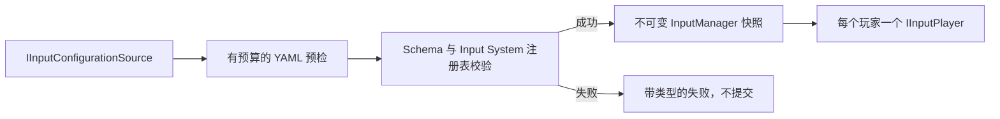

# CycloneGames.InputSystem

[English | 简体中文](README.md)

建立在 Unity Input System 之上的输入层。适合需要按玩家隔离设备所有权，或输入路由随 UI 状态（游戏、菜单、弹窗）变化的场景。单人、静态 action map 的项目直接用 Unity Input System 更简单。

## 快速开始

### 依赖

| Package | 用途 |
| --- | --- |
| `com.unity.inputsystem` | 动作、绑定、设备 |
| `com.cysharp.unitask` | 异步加载与加入玩家 |
| `com.cysharp.r3` | 动作流 |
| `jp.hadashikick.vyaml` | YAML 解析 |
| `com.cyclone-games.hash` | 稳定的动作 ID |
| `com.cyclone-games.logging` | 诊断日志 |

版本声明见 `package.json`。在 asmdef 中添加对 `CycloneGames.InputSystem.Runtime` 的引用。UGUI、VContainer 和 Tools 程序集均为可选，用到时才添加引用。

### 最小示例

用 `Tools > CycloneGames > Input System Editor` 生成配置，把生成的 YAML `TextAsset` 赋给 `_configuration`：

```csharp
using CycloneGames.InputSystem.Runtime;
using CycloneGames.Logging;
using UnityEngine;

public sealed class PlayerInputBootstrap : MonoBehaviour
{
    private static readonly LogChannel Log = LogChannel.Create("Game.Input");

    [SerializeField] private TextAsset _configuration;

    private InputManager _manager;
    private InputContext _gameplay;

    private void Awake()
    {
        _manager = new InputManager();
        InputManagerInitializationResult initialized =
            _manager.InitializeWithResult(_configuration.text);

        if (!initialized.IsSuccess)
        {
            Log.Error($"Input initialization failed: {initialized.Status}: {initialized.Message}");
            enabled = false;
            return;
        }

        IInputPlayer player = _manager.JoinSinglePlayer(0);
        if (player == null)
        {
            Log.Error("No declared control scheme can be matched for player 0.");
            enabled = false;
            return;
        }

        _gameplay = new InputContext("PlayerActions", "Gameplay")
            .AddBinding(
                player.GetVector2Observable("Gameplay", "PlayerActions", "Move"),
                new MoveCommand(OnMove));

        player.PushContext(_gameplay);
    }

    private void OnMove(Vector2 direction)
    {
        // Forward the value to a gameplay-owned movement service.
    }

    private void OnDestroy()
    {
        _gameplay?.Dispose();
        _manager?.Dispose();
    }
}
```

`InitializeWithResult` 返回带类型的结果，加入玩家前先检查 `IsSuccess`。已释放的 manager 不能重新初始化，需要新建一个。manager 由 composition root 持有并在退出时释放。`InputManager.Instance` 提供全局入口；显式构造让关闭流程和测试更容易追踪。

配置只声明有哪些上下文，不会自动推送。在对应的业务状态开始时创建并推送 `InputContext`。

## 核心概念

### 从 YAML 到运行中的玩家



初始化是事务式的。克隆前先做有预算的形状预检，随后在副本上做 schema 准备和语义校验。在 Unity 主线程上，依据当前 Input System 注册表校验 layout、path、interaction、processor、composite 和 control scheme，构造临时 action graph、解析后释放。只有预检全部通过才提交不可变运行时快照。之后每个加入的玩家获得单独构造、由自己持有的 action asset。

| Concept | Representation | Responsibility |
| --- | --- | --- |
| Action | `ActionBindingConfig` 与内部 Unity `InputAction` | 为一个或多个绑定指定逻辑名和值类型。 |
| Mapping context | YAML `ContextDefinitionConfig` 与运行时 `InputContext` | 按优先级、低优先级阻断策略组织动作和命令绑定。 |
| Interaction | 动作级 `interactions` | 用 Unity Input System 语法决定动作何时 started、performed、canceled。composite part 上的 interaction 会被拒绝。 |
| Processor | `processors` 或 composite part 的 `processors` | 在消费端读取前变换值。 |
| Composite | `CompositeBindingConfig` | 用命名 part 组合出 `2DVector` 之类的值。 |
| Control scheme | `ControlSchemeConfig` | 声明 binding group 以及必需、可选或替代的设备 layout。 |
| Player | `IInputPlayer`，底层为 `InputUser` | 持有配对设备、action asset、活动上下文、流和绑定覆盖。 |
| Binding profile | `InputBindingOverrideProfile` 或每玩家覆盖 JSON | 独立于配置存储，持久化 context/map/action 绑定选择器。 |

底层动作、绑定、interaction、processor 和设备的语义以 [Unity Input System 手册](https://docs.unity3d.com/Manual/com.unity.inputsystem.html) 为准。

### 映射上下文

`PushContext` 把运行时上下文加入常规集合。活动上下文按优先级降序排列，同优先级保持入栈顺序。求值从最高优先级开始，遇到 `BlocksLowerPriority == true` 的活动上下文即停止。非阻断的覆盖层可以与 Gameplay 共存，而 Menu 会阻断 Gameplay。

```csharp
InputContext gameplay = new InputContext("PlayerActions", "Gameplay")
    .AddBinding(
        player.GetVector2Observable("Gameplay", "PlayerActions", "Move"),
        new MoveCommand(MoveCharacter))
    .AddBinding(
        player.GetButtonObservable("Gameplay", "PlayerActions", "Confirm"),
        new ActionCommand(Confirm));

InputContext menu = new InputContext("UIActions", "Menu")
    .AddBinding(
        player.GetVector2Observable("Menu", "UIActions", "Navigate"),
        new MoveCommand(NavigateMenu));

player.PushContext(gameplay);
player.PushContext(menu); // YAML 中优先级 100 且阻断，Menu 生效。

player.RemoveContext(menu); // Gameplay 重新生效。
gameplay.Dispose();
menu.Dispose();
```

先绑定命令再推送上下文。上下文持有命令映射，玩家在上下文活动期间持有实时订阅。名称按 ordinal 比较且区分大小写，`ActiveContextName` 返回当前最高优先级的活动上下文。

两参数构造 `InputContext(actionMapName, name)` 从匹配的 YAML 上下文读取优先级和阻断策略；四参数构造直接指定运行时策略：

```csharp
var menu = new InputContext("UIActions", "Menu", priority: 100, blocksLowerPriority: true);
```

上下文切换时如果启用 map 或订阅自定义 observable 抛异常，模型变更仍然提交，所有投影出的 map 与订阅会全部停用，`ActiveContextName` 被清空，发起调用的接口重新抛出异常。移除出错的绑定后调用 `RefreshActiveContext()` 重试。同步重入刷新会合并，上限 16 轮；超过上限时输入保持停用，不会让主线程空转。

### 捕获与全局阻断

`CaptureContext` 临时把一个捕获上下文排在所有常规上下文之前，返回幂等的 `IDisposable`；释放后回到下一个捕获上下文或常规优先级集合。

`BlockInputScope` 停用该玩家的所有 action map。阻断按深度计数，所有匹配的 scope 或 `UnblockInput` 调用都释放后输入才恢复。

```csharp
using IDisposable modalCapture = player.CaptureContext(modalContext);
using IDisposable loadingBlock = player.BlockInputScope();
```

两个 scope 都要在创建它的流程内、在 Unity 主线程上释放。

### 读取动作

`EventDriven` 动作在 performed 时发出值，cancel 时发出中性值。`Polling` 的 `Vector2` 和 `Float` 动作由玩家唯一的 update pump 在 map 启用期间读取。需要连续采样用 polling，离散状态变化用事件驱动。每个订阅都要有明确的生命周期：`InputContext`、`CompositeDisposable` 或持有它的组件负责释放。

生成或计算出的动作 ID 避免重复字符串查找，并包含上下文标识：

```csharp
int moveId = InputHashUtility.GetActionId("Gameplay", "PlayerActions", "Move");
player.GetVector2Observable(moveId).Subscribe(MoveCharacter);

if (player.TryReadValue(moveId, out Vector2 move))
{
    ApplyMove(move);
}
```

每个 ID 是 `context/map/action` 的确定性 FNV-1a 32 位 hash。只带动作名、或带 map/动作名的重载仍然可用，但标识有歧义时会返回空 observable。带上下文限定的 API 是稳定选择。

## 常见任务

### 本地多人

| API | 设备策略 | 典型用途 |
| --- | --- | --- |
| `JoinSinglePlayer` / `JoinSinglePlayerAsync` | 从未占用的设备中依次匹配首选和其余 control scheme。 | 常规本地玩家创建。 |
| `JoinPlayerAndLockDevice` | 要求传入设备参与某个有效 scheme，并占用该 scheme 匹配到的全部设备。 | 从已知手柄加入。 |
| `JoinPlayerOnSharedDevice` | 配对当前键盘以及存在的鼠标，不做独占占用。 | 共享键盘模式。 |
| `StartListeningForPlayers` | join 绑定从第一个未注册槽位创建玩家；所有声明槽位都占满后扩展主玩家的设备集。 | 大厅加入流程。 |
| `PairAdditionalDevice` | 给已加入玩家再配对一个声明 layout 的设备。设备不可占用或 layout 未声明时失败关闭。 | 单人热插拔。 |
| `RemovePlayer` | 释放玩家、解绑 `InputUser`、释放占用。 | 离场、槽位重置、重新初始化前的清理。 |

```csharp
IInputPlayer player1 = manager.JoinPlayerAndLockDevice(0, gamepad1);
IInputPlayer player2 = manager.JoinPlayerAndLockDevice(1, gamepad2);
```

每个玩家的 action asset 都与自己的 `InputUser` 关联，因此 `InputActionAsset.devices` 始终是该玩家的配对设备白名单。锁定槽位还会激活一个 control scheme，把 binding mask 收窄到该 scheme 的 group。`pairAllMatchingDevices: true` 的槽位不设置 scheme：所有绑定保持有效，但只在该玩家的白名单设备上生效。这样单个玩家可以在键鼠和手柄之间切换而无需重新加入，第二个本地玩家仍能占用其余设备。逐绑定 `deviceBindingGroups` 和槽位 `controlSchemes` 都依赖活动 scheme，因此该模式会忽略它们。

`maxDevicesPerLayout`（默认 `1`，钳制到 `1..8`）限制此类槽位对每种引用 layout 可占用的设备数。`deviceSwitchDebounceMs`（默认 `0`，钳制到 `0..5000`）设定 `ActiveDeviceKind` 再次切换前的最短停留时间。

异步重载接受 `CancellationToken`。单玩家超时返回 `null`；调用方取消会向上传播。批量总超时或 manager 关闭返回已成功加入的前缀。调用方取消只回滚该批次创建的玩家，保留已有注册，然后抛出异常。对已注册的玩家 ID，join 方法是幂等的，直接返回该玩家。

`JoinPlayersBatchAsync` 把批次摊到多帧，除最后一个玩家外每加入一个就让出一帧，N 个玩家最多跨 N 帧。在八玩家、每玩家三个上下文、每上下文 32 个动作的参考配置下，EditMode 基准测得总计 739.9 ms、每玩家 92.5 ms、最差帧 114.8 ms。请在加载界面执行批量加入。返回的列表只在任务完成后才完整，同步版本 `JoinPlayersBatch` 在调用帧内完成。

control scheme 匹配由 `deviceRequirements` 驱动：`isOptional` 允许设备缺失，`isOr` 按 Unity Input System 的 scheme 顺序表达替代条件。没有声明 scheme 时，从配置的直接绑定和 composite part 路径推导出的 layout 互为替代，选中第一个可占用的匹配设备。若选中的是键盘或鼠标，另一个可占用的键鼠设备会作为伴随设备加入。显式声明 scheme 更利于审查设备所有权。

```csharp
private void ObserveDevices(IInputPlayer player)
{
    player.OnDeviceStatusChanged += status =>
    {
        switch (status.ChangeKind)
        {
            case InputPlayerDeviceChangeKind.Lost:
                PauseForMissingDevice(status.DeviceId);
                break;
            case InputPlayerDeviceChangeKind.Regained:
                ResumeAfterDeviceReturn(status.DeviceId);
                break;
            case InputPlayerDeviceChangeKind.Paired:
            case InputPlayerDeviceChangeKind.Unpaired:
                RefreshDevicePresentation(status.DeviceKind, status.Layout);
                break;
        }
    };
}
```

`ActiveDeviceKind` 在观察到有效动作活动时变化，用于图标展示。需要精确的提示替换时，`InputPlayer.DeviceActivity` 会为该玩家自己设备上的每次活动发布 `InputDeviceActivity`：

| 字段 | 含义 |
| --- | --- |
| `PlayerId`, `DeviceId` | 所属槽位与具体的 Unity 设备 id。 |
| `DeviceLayout` | 具体 layout，例如 `DualShockGamepad` 或 `XInputController`。 |
| `Family` | `InputDeviceFamily`：`Keyboard`、`Mouse`、`Gamepad`、`Touchscreen`、`Joystick`、`Other`。 |
| `PromptKind` | 供既有消费端使用的粗粒度 `InputDeviceKind`。 |
| `ControlPath` | 已知时给出来源控制的完整路径。 |
| `Timestamp` | 玩家帧时间戳，由 `UpdateRuntimeState` 推进。 |

该流由 Unity 的 `onAnyButtonPress` 驱动，并按玩家设备白名单过滤，其他本地玩家无法劫持提示。连续活动（鼠标移动、摇杆漂移）可用 `NotifyDeviceActivity(device)` 或 `NotifyDeviceActivity(device, control)` 显式上报。`InputDeviceIconSet.GetIcon(kind, deviceLayout)` 先按 layout 查精灵（Xbox 与 PlayStation 图标），再回退到粗粒度 kind。`DeviceActivity` 是未去抖的原始流，业务 UI 需按 `Family` 或 `DeviceLayout` 去重；去抖后的粗粒度状态仍看 `ActiveDeviceKind`。

control scheme 只在加入时选定一次。玩家所有配对设备断开后，玩家仍保持注册，白名单为空，scheme 与 binding mask 不变。调用 `InputManager.ReassignPlayerDevices(playerId)` 会用当前可用设备移除并重新加入该玩家，同时刷新 scheme、binding mask 和白名单。通常在 `OnDeviceStatusChanged` 中、`ChangeKind` 为 `Lost`/`Unpaired` 且 `User.pairedDevices.Count == 0` 时调用，并延迟一帧，避免在自身回调里释放玩家。`InputManager.AutoReassignOnDeviceLoss`（默认 `false`）在设备拓扑变化时自动执行同样的恢复。

### 弹窗捕获与输入阻断

```csharp
IDisposable capture = player.CaptureContext(modalDialogContext);
try
{
    // Drive the modal flow.
}
finally
{
    capture.Dispose();
}

using (player.BlockInputScope())
{
    // Synchronous transition. For async code, keep the scope in a try/finally.
}
```

### 长按与组合键

动作级 `interactions` 和 `processors` 在创建内部动作时转发给 Unity Input System。composite part 可以加 `processors`，但不能加 `interactions`。初始化预检会按当前注册环境解析表达式名和参数、layout、控制路径、composite 与 composite part，因此自定义的 layout、interaction、processor、composite 要在 `InitializeWithResult` 或 `ReinitializeWithResult` 之前注册。

模块自带的长按完成流支持 `Button` 和 `Float`，由 `longPressMs > 0` 启用，与 Unity 的 `hold(...)` interaction 相互独立。进度仅对 `Button` 可用，按住期间为 `0..1`，提前松开发出 `-1`。`Float` 长按时 `longPressValueThreshold` 必须有限且位于 `(0,1]`；长按关闭时允许 `0..1`。

```csharp
player.GetLongPressObservable("Gameplay", "PlayerActions", "Confirm")
    .Subscribe(_ => OpenConfirmDetails());

player.GetLongPressProgressObservable("Gameplay", "PlayerActions", "Confirm")
    .Subscribe(progress => UpdateHoldMeter(progress));

int confirm = InputHashUtility.GetActionId("Gameplay", "PlayerActions", "Confirm");
int cancel = InputHashUtility.GetActionId("Gameplay", "PlayerActions", "Cancel");
player.GetChordObservable(confirm, cancel, windowMs: 200f)
    .Subscribe(_ => OpenShortcut());
```

组合键要求两个已配置的按钮动作。该流在指定时间窗内识别两次按下，松开后复位。

### 重绑定与绑定档案

`RebindAction` 应用已经选定的路径。业务侧的 rebind UI 负责采集候选控制、执行保留键与无障碍策略、与当前有效路径比较、向用户确认冲突处理方式，然后应用覆盖。`CheckBindingConflicts` 是针对配置中直接绑定的 authoring 诊断，不评估待定候选或运行时覆盖。

```csharp
bool changed = player.RebindAction(
    "Gameplay", "PlayerActions", "Confirm",
    "<Keyboard>/space",
    "<Keyboard>/f");

string[] effectivePaths = player.GetActionBindings("Gameplay", "PlayerActions", "Confirm");

player.ResetActionBinding("Gameplay", "PlayerActions", "Confirm");
player.ResetAllActionBindings();
```

每玩家 JSON 使用模块自有 schema，包含 context/map/action 标识、绑定序号和原始绑定元数据。导入时先暂存并校验文档，再替换活动覆盖。单份每玩家文档上限为 128 条覆盖记录和 1 MiB 严格 UTF-8。manager 档案在 4 MiB 总预算下聚合各玩家 JSON，可在玩家加入前导入，待处理条目在玩家构造时应用。

项目若使用 `CycloneGames.Persistence`，注入项目选定的 `IPersistenceStorage` 和 `IPersistenceCodec<string>`，把导出的档案当作不透明 JSON 存储。codec 可以把字符串编码为严格 UTF-8，但不能解释或改写 InputSystem 的 schema。`InputManager` 是唯一的档案校验方。下面这个类应放在业务代码或项目自己的集成程序集中：

```csharp
using System.Threading;
using System.Threading.Tasks;
using CycloneGames.InputSystem.Runtime;
using CycloneGames.Persistence;

public sealed class InputBindingProfilePersistence
{
    private const int StoredContentVersion = 1;
    private const int MaximumPayloadBytes = 1024 * 1024;

    private readonly InputManager _manager;
    private readonly PersistenceStore<string> _store;

    public InputBindingProfilePersistence(
        InputManager manager,
        IPersistenceStorage storage,
        IPersistenceCodec<string> strictUtf8Codec)
    {
        _manager = manager;
        _store = new PersistenceStore<string>(
            storage,
            new PersistenceProfile<string>(
                strictUtf8Codec,
                new PersistenceLimits(MaximumPayloadBytes)));
    }

    public async Task<PersistenceOperationResult> SaveAsync(
        CancellationToken cancellationToken)
    {
        string opaqueJson = _manager.ExportBindingOverrideProfileJson();
        return await _store.SaveAsync(
            in opaqueJson,
            StoredContentVersion,
            cancellationToken);
    }

    public async Task<string> LoadAndApplyAsync(CancellationToken cancellationToken)
    {
        PersistenceLoadResult<string> loaded = await _store.LoadAsync(
            StoredContentVersion,
            cancellationToken);
        if (loaded.Status == PersistenceLoadStatus.Missing)
            return null;

        if (!loaded.IsSuccess)
            return loaded.ErrorCode.ToString();

        if (!_manager.ImportBindingOverrideProfileJson(loaded.Value))
            return "The binding profile does not match the active input configuration.";

        return null;
    }
}
```

在 composition root 中只构造一次，玩家加入前加载，在明确的设置提交或生命周期检查点保存。预算耗尽属于预期失败路径时用 `TryExportBindingOverridesJson` 或 `TryExportBindingOverrideProfile`。加载失败时保持配置默认值；数据缺失是首次运行的正常状态。

### 加载配置

`IInputConfigurationSource` 只读，`IInputConfigurationStore` 增加保存和删除。`FileInputConfigurationStore` 接受固定根目录和相对、Unicode Form C 的逻辑键；`/` 是唯一的分段分隔符，`\` 被拒绝。它还拒绝根路径、URI、路径穿越、不安全字符，以及操作边界上可检测到的符号链接或重解析点；内容按严格 UTF-8 限额，经临时文件写入，并保留一个固定 `.bak` 用于恢复。

`UriInputConfigurationSource` 从本地 `StreamingAssets`、Android `jar:file`、同源 StreamingAssets Web URL 或显式加入允许列表的 HTTPS 主机读取默认配置。逻辑 URI 上限 4,096 字符。HTTPS 允许列表最多 64 个受限 DNS/IPv4 主机，每个不超过 253 字符；端点必须使用 443 端口，不含凭据或 fragment，重定向关闭，读取有字节预算和超时。

```csharp
using System.IO;
using CycloneGames.InputSystem.Runtime;
using CycloneGames.Logging;
using UnityEngine;

LogChannel log = LogChannel.Create("Game.Input");
var manager = new InputManager();
var defaults = new UriInputConfigurationSource();
var users = new FileInputConfigurationStore(Application.persistentDataPath);

string defaultUri = Path.Combine(Application.streamingAssetsPath, "input_config.yaml");
InputSystemLoadResult load = await InputSystemLoader.LoadAndInitializeAsync(
    new InputSystemBootstrapOptions(
        InputSystemBootstrapMode.Optional,
        defaults,
        defaultUri,
        users,
        "input/user_input_settings.yaml",
        persistDefaultToUser: true),
    manager,
    forceReinitialize: false,
    cancellationToken: cancellationToken);

if (!load.IsBootstrapComplete)
{
    log.Error($"Input load failed: {load.Status}: {load.Error}");
}
```

`Disabled` 不执行任何读取。`Optional` 在用户与默认内容都缺失时返回 `NotConfigured`；`Required` 在无可用配置时报告 `DefaultConfigurationUnavailable`。有效的用户文件直接使用；文件缺失时回退到已校验的默认配置并复制进用户存储；无效文件保留，本次会话使用有效默认配置。主文件缺失但 `.bak` 可读时，存储层报告备份恢复。只有 schema 校验和 Input System 预检都通过才提交配置。

`InputManager` 只持有已校验的运行时状态，不保留 URI、source 或 store。`ReinitializeWithResult` 在有活动玩家时拒绝替换：先移除玩家、释放上下文，重新初始化，再重建玩家服务并重新应用已接受的绑定档案。重新初始化失败时已提交的配置保持不变。

## 配置参考

| 层级 | 字段 | 含义 |
| --- | --- | --- |
| Root | `schemaVersion` | 运行时 schema 权威值。新文件写 `1`。 |
| Root | `schemaFingerprint` | 可选的 Editor 诊断信息，不参与运行时数据的批准或拒绝。 |
| Root | `joinAction` | 可选的共享 join 绑定，玩家槽位的 join 绑定同样参与。 |
| Root | `playerSlots` | 经校验的玩家模板，用唯一非负 `playerId` 标识。 |
| Player | `controlSchemes` | 可选的确定性设备匹配 scheme。 |
| Player | `defaultControlScheme` | 首选 scheme；无法匹配时尝试其余已声明 scheme。 |
| Player | `pairAllMatchingDevices` | 占用每种引用 layout 的设备且不设置 control scheme，action asset 仍限定在该玩家的设备白名单内。 |
| Player | `maxDevicesPerLayout` | 启用 `pairAllMatchingDevices` 时每种引用 layout 可占用的设备上限。默认 `1`，钳制到 `1..8`。 |
| Player | `deviceSwitchDebounceMs` | `ActiveDeviceKind` 再次切换前的最短停留时间。默认 `0`，钳制到 `0..5000`。 |
| Player | `contexts` | 该玩家的命名映射上下文。 |
| Context | `name`, `actionMap` | 上下文标识与公开 action map 标识。 |
| Context | `priority` | 数值高的先求值，默认限额接受 `-100000..100000`。 |
| Context | `blocksLowerPriority` | 为 `true` 时停止激活更低优先级上下文。 |
| Action | `type` | `Button`、`Vector2` 或 `Float`。 |
| Action | `action` | 逻辑动作名。context、map、action 共同构成稳定标识。 |
| Action | `expectedControlType` | Unity 期望的控制 layout（`Button`、`Vector2`、`Axis`）。 |
| Action | `deviceBindings` | 直接控制路径。 |
| Action | `deviceBindingGroups` | 逐绑定的 control scheme group，按位置与 `deviceBindings` 对齐。省略列表或空条目会回退到 `bindingGroups`。 |
| Action | `compositeBindings` | 结构化的 composite 名称、参数、group 与 part。 |
| Action | `bindingGroups` | 分号分隔的动作级 control scheme binding group。 |
| Action | `interactions`, `processors` | 应用到动作的 Unity Input System 表达式。 |
| Action | `updateMode` | `EventDriven` 或 `Polling`，delta 路径按 polling 处理。 |
| Action | `longPressMs` | `Button` 或 `Float` 的模块长按完成时长，`0` 关闭该流。 |
| Action | `longPressValueThreshold` | `Float` 触发阈值。启用 Float 长按时须在 `(0,1]`，关闭长按时可为 `0..1`。 |
| Composite part | `name`, `path`, `processors` | 命名 part 的控制路径与可选的 part 局部 processor。非空 part `interactions` 会被拒绝。 |

`deviceBindings` 只放直接控制路径，composite 必须用 `compositeBindings`，不要把 `2DVector(...)` 写进 `deviceBindings`。composite 的 `parameters` 不带外层括号。interaction 写在所属动作上，不写在 composite part 上。

`deviceBindingGroups` 是精确形式。Unity 的 binding group 是绑定级概念：同一个动作同时有键盘和手柄绑定时，给每个绑定各指定 scheme group，能让活动 scheme 的 `bindingMask` 在 `InputUser` 设备白名单之外再形成一道独立约束。没有它，携带 `KeyboardMouse;Gamepad` 的手柄绑定在白名单放宽（例如 `PairAdditionalDevice` 之后）时仍会在 `KeyboardMouse` scheme 下解析生效。该列表条目数必须与 `deviceBindings` 一致，非空条目必须指向已声明的 scheme group。

### 校验预算

默认限额：8 个玩家、每玩家 32 个上下文、每上下文 128 个动作、每玩家总计 1,024 个动作、每动作 16 个直接/composite part 绑定条目、每动作 16 个 composite、每 composite 16 个 part、每玩家 16 个 control scheme、每 scheme 16 个设备要求、技术字符串 256 字符。可向 `InputManager` 构造函数注入更严格的 `InputConfigurationLimits`。

在进入 VYaml 实例化之前，运行时与 Editor 的 YAML 入口还限制：1 MiB 严格 UTF-8 无 BOM、16,384 行、每行 4,096 字符、64 个缩进空格、65,536 个结构 token、嵌套深度 64。YAML anchor、alias、显式 tag、指令与文档标记、块标量、Tab 缩进、被禁止的控制/格式/私用区字符，以及非 CR/LF 的行分隔符都不在这个严格子集内。

一个动作序列化后约占十二行，所以 16,384 行预算把序列化配置限制在全体玩家共约 1,300 个动作（`InputConfigurationLimits.ApproximateMaxSerializedTotalActions`）。上面的每玩家动作上限约束的是程序化构造的配置，在多人规模下通过 YAML 源达不到。超出行预算会在预检阶段被拒绝，消息中会给出行数上限。

`schemaVersion` 是权威值。当前文件写 schema `1`，负值和未来值都会被拒绝。准备与校验都在副本上进行，不会改写源文件。

## Editor 工作流

打开 `Tools > CycloneGames > Input System Editor`。左侧项目设置面板显示运行时和代码生成路径，并提供 reveal/ping 快捷操作；右侧工作区把序列化配置与文件操作分开。彩色徽标区分可编辑、有效、待检查、无效和可选状态。校验错误会阻止持久化，但不会禁用工作副本中的字段。

1. 在 `Assets` 下选择默认配置目录，文件名为 `input_config.yaml`。
2. 在 `Application.persistentDataPath` 下选择可选的用户配置相对子目录。
3. 加载用户或默认文件，或生成一份默认工作配置。
4. 编辑 join 动作、玩家槽位、control scheme、上下文、直接绑定、composite、interaction、processor、优先级与阻断策略。
5. 保存前解决全部校验错误。
6. 使用 `Save User Config`、`Save User + Generate Code`、`Save Project Default` 或 `Restore User from Default`。
7. 在 `Assets` 下选择代码生成目录和命名空间，生成 `InputActions.cs`。

Editor 使用隐藏的内存 `ScriptableObject` 工作副本和 `SerializedObject`/`SerializedProperty`，Undo/Redo 与序列化字段处理都留在 Editor 路径中。

生成的代码包含 `InputActions.Contexts`、`InputActions.ActionMaps`，以及 `InputActions.Actions` 下带上下文限定的 ID。context、map 或 action 标识变化后需要重新生成。

## 进阶主题

### 失败模型

可恢复的操作返回带类型的结果：

- `InputConfigurationReadResult` 与 `InputConfigurationStoreResult` 报告 `NotFound`、`InvalidKey`、`TooLarge`、`Unsupported`、`AccessDenied` 或 `IoError`。
- `InputSystemLoadResult` 区分用户/默认成功、默认不可用、配置无效、manager 初始化失败。
- `InputManagerInitializationResult` 报告内容为空、线程错误、存在活动玩家、manager 已释放、解析失败、schema 校验失败或 `InputSystemPreflightFailed`，并通过 `Validation` 和（预检执行过时）`Preflight` 暴露细节。
- join 方法在槽位、设备或 scheme 无法解析时返回 `null`；调用方取消不会被转成成功。
- rebind 与档案 API 在标识未知、选择器不匹配、schema 不支持、条目重复或超出预算时返回 `false`。

### 所有权与释放

| 持有者 | 持有内容 |
| --- | --- |
| Composition root | `InputManager`、配置 source 与 store、绑定档案持久化。 |
| `InputManager` | 已注册玩家，在移除或 manager 释放时一并释放。 |
| `InputPlayer` | `InputUser`、生成的 `InputActionAsset`、subject、update 订阅、设备订阅。 |
| 业务状态 | `InputContext` 实例以及捕获/阻断 scope；释放上下文会把它从所有使用它的玩家上移除。 |
| 订阅持有者 | 未通过活动 `InputContext` 管理的直接 R3 订阅。 |

Subsystem registration 会让所有仍活动的 manager 失效，避免关闭 Domain Reload 的 play session 残留 user、action、listener 或静态监听计数。正常退出时业务侧仍需释放 manager。`InputManager.GetMemoryStats()` 与 `InputPlayer.GetMemoryStats()` 提供主线程、无分配的计数快照。可配置的 `InputConfigurationLimits` 值带有公开绝对上限，调用方无法把实际产品预算换成 `int.MaxValue`。重复捕获 scope 另受 `InputPlayer.MaximumContextCaptureDepth`（`1024`）约束；泄漏的 scope 会失败关闭，不会无限增长捕获栈。

### 性能

| 方面 | 运行时行为 | 使用位置 |
| --- | --- | --- |
| 初始化 | 有预算的形状检查、克隆并校验 DTO、校验 Input System 注册、构造并解析再释放临时 action graph、提交不可变快照。 | 避开输入敏感帧，放在所有自定义 Input System 注册之后，复用已提交的 manager。 |
| 事件驱动动作 | map 启用期间，Unity 回调转发到预创建的 subject。 | 按钮和离散值，订阅回调保持有界。 |
| Polling 与长按 | 每玩家一个 update 订阅服务所有 polling 动作和长按进度。 | 仅在需要连续采样时使用。 |
| 上下文切换 | 释放活动命令订阅、停用 map、排序活动上下文、启用选中 map、重建命令订阅。 | 状态切换时执行，不要每帧执行。 |
| Rebinding 与档案操作 | 导出、导入、冲突检查时枚举绑定并分配数组/JSON；manager 导入会为每个暂存玩家构造并释放临时 action graph。 | 设置与保存流程。 |
| 设备活动 | 使用动作活动以及 Input System 的设备/用户通知。 | `ActiveDeviceKind` 只是展示提示；硬件抖动时业务 UI 需自行去抖。 |
| Tools 录制 | 录制期间使用固定容量列表，创建快照时复制样本。`CancelRecording(maximumSamplesToDiscard)` 停止订阅并按调用方限定的分块释放样本引用。 | 检查 `WasTruncated`/`DroppedSampleCount`。 |

初始化和玩家构造可用 Unity Profiler 标记 `CycloneGames.Input.Initialize`、`CycloneGames.Input.JoinPlayer`、`CycloneGames.Input.BuildAsset` 观测。

### 线程与平台

Unity API 以及玩家/上下文操作限定在主线程。`UriInputConfigurationSource` 在使用 `UnityWebRequest` 前切回 Unity 主线程。`FileInputConfigurationStore` 提供异步 I/O，但不会让 `InputManager`、`IInputPlayer` 或 `InputContext` 变成线程安全。异步加载要传递取消令牌，回到 Unity 主线程后再修改 manager，并在该线程释放 Unity 持有的状态。

| 目标平台 | 默认配置路径 | 用户持久化 |
| --- | --- | --- |
| Windows、macOS、Linux | 通过 `UriInputConfigurationSource` 读本地 `StreamingAssets` | `persistentDataPath` 下的 `FileInputConfigurationStore` |
| Android | 通过 `UnityWebRequest` 读 `jar:file`/StreamingAssets | 应用 persistent data 下的 `FileInputConfigurationStore` |
| iOS | 本地 StreamingAssets URI/文件路径 | 应用 persistent data 下的 `FileInputConfigurationStore` |
| WebGL | 同源 StreamingAssets Web URI | 项目自行提供 `IInputConfigurationStore` |
| 主机平台 | 平台认可的 source adapter 或打包的 StreamingAssets 路径 | 平台认可的 store adapter |
| 远程 HTTPS | 允许列表内的 HTTPS 主机，443 端口，无凭据/fragment/重定向 | 项目选定的 store |

控制路径和设备 layout 因平台与包版本而异，发布前用 Unity Input Debugger 和代表性硬件验证每个 scheme。

### 存储的数据

| 数据 | 持有者 | 默认路径/键 | 格式 |
| --- | --- | --- | --- |
| 默认输入配置 | 项目 composition root | 项目选定的 source/key，StreamingAssets 可选 | YAML，带 schema 版本 |
| 用户输入配置 | 项目运行时，经 `IInputConfigurationStore` | `persistentDataPath` 下的 `input/user_input_settings.yaml` | YAML 加一个同级 `.bak` |
| 绑定覆盖档案 | 项目 composition root | 项目选定的 bound entry | 模块自有不透明 JSON，schema `1` |
| Editor 本地设置 | Input System Editor | `UserSettings/CycloneGames.InputSystem.EditorSettings.asset` | Unity 序列化的 Editor 设置 |
| 生成的常量 | 项目/代码持有者 | `Assets/.../InputActions.cs` | 生成的 C# |

`DeleteAsync` 会同时删除主用户文件和 `.bak`。无效的用户内容会保留而不被覆盖，清理需要通过 `DeleteAsync` 显式执行。常量从 YAML 重新生成，不要手工编辑。这些记录都不使用 `PlayerPrefs`、`EditorPrefs` 或 `SessionState`。

### 可选集成

**UGUI。** 在 asmdef 中引用 `CycloneGames.InputSystem.Runtime.Integrations.UGUI`，使用 `InputDeviceIconSet`、`InputDeviceIconSwitcher` 和横/纵向菜单导航组件。该程序集只负责展示适配，核心运行时不引用 UGUI。

**VContainer。** 集成层注册容器持有的 `InputManager`、`IInputPlayerResolver`、`IInputSystemInitializer` 与诊断组件。它不会自行决定配置来源、存储路径、启动时机或失败处理：由 composition root 构造不可变的 `InputSystemVContainerOptions` 传入。只有 `registerEntryPoint: true` 才注册 entry point，只有 `throwOnStartupFailure: true` 才把启动失败升级为异常；其余情况结果保留在 `IInputSystemInitializerDiagnostics.LastResult`。同一作用域内的消费端必须解析/注入同一个 manager，混用 `InputManager.Instance` 会创建另一个会话。

```csharp
var bootstrap = new InputSystemBootstrapOptions(
    InputSystemBootstrapMode.Optional,
    new UriInputConfigurationSource(),
    Path.Combine(Application.streamingAssetsPath, "input_config.yaml"),
    new FileInputConfigurationStore(Application.persistentDataPath),
    "input/user_input_settings.yaml");

var options = new InputSystemVContainerOptions(bootstrap);

builder.Install(new InputSystemVContainerInstaller(options));
```

**Tools。** `CycloneGames.InputSystem.Tools.Runtime` 是可选的诊断工具。`InputRecorder` 把选定的带上下文限定的流记录到固定容量的内存缓冲区，溢出时递增 `DroppedSampleCount`，录制期间缓冲区不会增长。`StopRecording` 创建不可变快照，`InputReplayCursor` 按录制的 tick/顺序消费样本。

**Sample。** sample 程序集、场景与 fixture 均为可选，不会自动被引用或加入 Build Settings，见 [Samples/README.md](Samples/README.md)。

### 程序集

| 程序集 | 路径 | 用途 |
| --- | --- | --- |
| `CycloneGames.InputSystem.Runtime` | `Runtime/Scripts/` | 配置、manager、玩家、上下文、响应式输入、存储边界。依赖 Unity Input System、UniTask、R3、VYaml、CycloneGames.Hash 与 `CycloneGames.Logging.Core`。 |
| `CycloneGames.InputSystem.Editor` | `Editor/` | YAML authoring、校验、安全写入、常量生成，仅 Editor。 |
| `CycloneGames.InputSystem.Runtime.Integrations.UGUI` | `Runtime/Scripts/Integrations/UGUI/` | 展示适配器，`autoReferenced: false`。 |
| `CycloneGames.InputSystem.Runtime.Integrations.VContainer` | `Runtime/Scripts/Integrations/DI/VContainer/Base/` | 容器持有的 manager、异步启动、resolver 适配器，无 AssetManagement 依赖。 |

| `CycloneGames.InputSystem.Tools.Runtime` | `Runtime/Tools/` | `InputRecorder` 与 `InputReplayCursor` 诊断工具。 |
| `CycloneGames.InputSystem.Sample` | `Samples/` | 可选的 scene 与 bootstrap 示例。 |
| `CycloneGames.InputSystem.Tests.Editor` | `Tests/Editor/` | EditMode 校验与回归覆盖。 |

可选程序集设置了 `autoReferenced: false`，只在用到对应功能时添加显式 asmdef 引用。UGUI 与 VContainer 通过 package 派生的 `versionDefines` 和 `defineConstraints` 激活，缺少对应 package 时排除该程序集。

诊断使用以 `CycloneGames.InputSystem` 为根的稳定 `LogChannel` category。logging writer 生命周期由 host 负责。`com.cyclone-games.logging` 提供 `NullLogWriter` 默认实现；composition root 可以安装 `com.cyclone-games.logging.pipeline`、加入 `com.cyclone-games.logging.unity`，或提供其他 `ILogWriter` backend。

## API 参考

| 类型 | 用途 |
| --- | --- |
| `InputManager` | 校验并提交配置、加入/移除玩家、监听加入、聚合档案、持有玩家服务。 |
| `InputManagerInitializationResult` | 通过 `Status`、`Validation`、`Preflight`、`WasMigrated` 查看解析、schema 校验、Input System 预检、生命周期与准备结果。 |
| `InputConfigurationPreflightResult` | 通过 `Status`、有界的 `Issues`、`WasTruncated` 查看主线程注册表与临时 action graph 校验结果。 |
| `IInputPlayer` | 读取动作、管理上下文、观察设备状态、重绑定、导入导出每玩家覆盖。 |
| `InputContext` | 把 R3 流绑定到命令，指定优先级与阻断策略。 |
| `InputConfigurationValidator` / `InputConfigurationLimits` | 在显式分配/迭代预算下校验不可信 DTO。 |
| `InputConfigurationYamlPreflight` / `InputConfigurationYamlCodec` | 执行实例化前的严格 YAML 子集检查，把准备好的配置序列化为有界的规范 YAML。 |
| `IInputConfigurationSource` / `IInputConfigurationStore` | 实现显式的读取与持久化适配器。 |
| `UriInputConfigurationSource` / `FileInputConfigurationStore` | 内置的有界默认源与限定根目录的本地存储实现。 |
| `InputSystemLoader` | 选择用户/默认内容、保留无效用户数据、只用已校验内容初始化。 |
| `InputHashUtility` | 生成确定性的 map hash 与带上下文限定的动作 ID。 |
| `InputBindingValidator` | 检测玩家或上下文中已配置的直接绑定冲突。 |
| `InputRx` | 面向键盘、指针、手柄、触摸、用户、动作和 `PlayerInput` 的底层 R3 包装。 |

## 故障排查

| 现象 | 常见原因 | 处理 |
| --- | --- | --- |
| 初始化失败 | 内容为空或过大、YAML 解析错误、schema 错误、标识非法、重复、超出限额、Input System 注册缺失、graph 解析失败 | 检查 `InputManagerInitializationResult.Status`、`Message`、`Validation.Issues`、`Preflight.Issues`；初始化前注册自定义 layout/interaction/processor/composite。 |
| 有效的用户设置被忽略 | 读取或校验失败 | 检查 `InputSystemLoadResult.UserStorageStatus`，保留用户文件并与默认配置比对。 |
| `JoinSinglePlayer` 返回 `null` | 玩家 ID 未知、无匹配的 scheme、必需设备缺失或设备已被占用 | 在 Input Debugger 中检查玩家槽位 scheme 与当前配对/占用设备。 |
| 动作流没有事件 | 上下文未推送、context/map/action 大小写不符、上下文被阻断/捕获、全局阻断、取值 getter 用错、标识有歧义 | 使用带上下文限定的 getter，检查 `ActiveContextName`。 |
| Polling 值始终为中性 | map 未启用、设备未配对、绑定被 scheme 屏蔽、控制 layout 不符、值类型不符 | 核对活动上下文、scheme group、配对设备和控制路径。 |
| 长按 getter 为空 | `longPressMs` 为 `0`、动作不存在或标识有歧义 | 设置有界时长，使用带上下文限定的 getter。 |
| 重新初始化报告 `ActivePlayers` | 已注册玩家仍持有 action asset 与配置派生状态 | 移除玩家和上下文后再重新初始化并重建。 |
| 绑定档案导入返回 `false` | 档案 schema/大小无效，或 context/map/action/绑定选择器不再匹配 | 保持配置默认值，保留档案，提供项目自有的重置入口。 |
| 文件存储报告 `InvalidKey` | 根路径、URI、路径穿越、空段、不安全字符或重解析点路径 | 传入存储固定根目录下的相对逻辑键。 |
| VContainer 类型不可用 | package 派生 define 缺失，或消费端 asmdef 缺少可选引用 | 安装对应 package 并添加集成 asmdef 引用。 |
| 常量生成失败 | 命名空间/标识符非法、生成名重复、动作 ID 冲突、输出路径不安全 | 修正 YAML 标识或 Editor 设置，不要编辑生成文件。 |

## 运行测试

```text
<UnityEditor> -batchmode -nographics -projectPath <repo-root>/UnityStarter -runTests -testPlatform EditMode -assemblyNames CycloneGames.InputSystem.Tests.Editor -testResults <result-path> -quit
```

使用与 `UnityStarter/ProjectSettings/ProjectVersion.txt` 匹配的 Unity 可执行文件。

## 相关文档

- [入门](Documents~/GettingStarted.md)
- [配置指南](Documents~/Configuration.md)
- [运行时指南](Documents~/RuntimeGuide.md)
- [示例](Samples/README.md)
- [Unity Input System 手册](https://docs.unity3d.com/Manual/com.unity.inputsystem.html)
