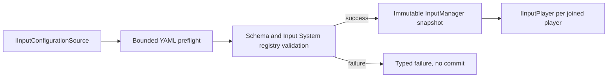

# CycloneGames.InputSystem

[English | 简体中文](README.SCH.md)

An input layer over Unity Input System. Contexts, actions and bindings are authored in YAML. The file is validated before it becomes active, and each local player gets an independent `InputUser` and action asset. Game code pushes mapping contexts and reads actions through R3 streams or synchronous reads.

Use this module when players need separate device ownership, or when input routing changes with UI state (gameplay, menu, modal). A single player with one static action map does not need it.

## Quick start

### Requirements

| Package | Used for |
| --- | --- |
| `com.unity.inputsystem` | Actions, bindings, devices |
| `com.cysharp.unitask` | Async loading and joins |
| `com.cysharp.r3` | Action streams |
| `jp.hadashikick.vyaml` | YAML parsing |
| `com.cyclone-games.hash` | Deterministic action IDs |
| `com.cyclone-games.logging` | Diagnostics |

Versions are declared in `package.json`. Add an asmdef reference to `CycloneGames.InputSystem.Runtime`. The UGUI, VContainer and Tools assemblies are opt-in and need explicit references.

### Minimal example

Create a configuration with `Tools > CycloneGames > Input System Editor`, then assign the generated YAML `TextAsset` to `_configuration`:

```csharp
using CycloneGames.InputSystem.Runtime;
using CycloneGames.Logging;
using UnityEngine;

public sealed class PlayerInputBootstrap : MonoBehaviour
{
    private static readonly LogChannel Log = LogChannel.Create("Game.Input");

    [SerializeField] private TextAsset _configuration;

    private InputManager _manager;
    private InputContext _gameplay;

    private void Awake()
    {
        _manager = new InputManager();
        InputManagerInitializationResult initialized =
            _manager.InitializeWithResult(_configuration.text);

        if (!initialized.IsSuccess)
        {
            Log.Error($"Input initialization failed: {initialized.Status}: {initialized.Message}");
            enabled = false;
            return;
        }

        IInputPlayer player = _manager.JoinSinglePlayer(0);
        if (player == null)
        {
            Log.Error("No declared control scheme can be matched for player 0.");
            enabled = false;
            return;
        }

        _gameplay = new InputContext("PlayerActions", "Gameplay")
            .AddBinding(
                player.GetVector2Observable("Gameplay", "PlayerActions", "Move"),
                new MoveCommand(OnMove));

        player.PushContext(_gameplay);
    }

    private void OnMove(Vector2 direction)
    {
        // Forward the value to a gameplay-owned movement service.
    }

    private void OnDestroy()
    {
        _gameplay?.Dispose();
        _manager?.Dispose();
    }
}
```

`InitializeWithResult` returns a typed result; check `IsSuccess` before joining. A disposed manager cannot be initialized again, so construct a new one. The composition root owns the manager and disposes it on teardown. `InputManager.Instance` is available as a global entry point; explicit construction makes shutdown and tests visible.

The configuration declares which contexts exist. It does not push them. Create and push `InputContext` objects when the corresponding product state begins.

## Core concepts

### From YAML to a running player



The initialization path is transactional. A bounded shape preflight runs before cloning; schema preparation and semantic validation run on the clone. On the Unity main thread it validates layouts, paths, interactions, processors, composites and control schemes against the current Input System registry, builds temporary action graphs, resolves them, then disposes them. Only a successful preflight commits the immutable runtime snapshot. Each joined player later receives a separately constructed action asset that the player owns.

| Concept | Representation | Responsibility |
| --- | --- | --- |
| Action | `ActionBindingConfig` and an internal Unity `InputAction` | Gives a logical name and value type to one or more bindings. |
| Mapping context | YAML `ContextDefinitionConfig` plus runtime `InputContext` | Groups actions and command bindings under a priority and lower-context blocking policy. |
| Interaction | Action-level `interactions` | Uses Unity Input System syntax to decide when an action starts, performs or cancels. Composite-part interactions are rejected. |
| Processor | `processors` or composite-part `processors` | Transforms values before consumers read them. |
| Composite | `CompositeBindingConfig` | Builds values such as `2DVector` from named parts. |
| Control scheme | `ControlSchemeConfig` | Declares a binding group and required, optional or alternative device layouts. |
| Player | `IInputPlayer` backed by an `InputUser` | Owns paired devices, an action asset, active contexts, streams and binding overrides. |
| Binding profile | `InputBindingOverrideProfile` or per-player override JSON | Persists stable context/map/action binding selectors independently of configuration storage. |

The [Unity Input System manual](https://docs.unity3d.com/Manual/com.unity.inputsystem.html) defines the underlying action, binding, interaction, processor and device semantics.

### Mapping contexts

`PushContext` adds a runtime context to the normal set. Active contexts are sorted by descending priority; equal priorities keep stack order. Evaluation runs from the top until it reaches an active context with `BlocksLowerPriority == true`. A non-blocking overlay can coexist with Gameplay while a Menu blocks Gameplay.

```csharp
InputContext gameplay = new InputContext("PlayerActions", "Gameplay")
    .AddBinding(
        player.GetVector2Observable("Gameplay", "PlayerActions", "Move"),
        new MoveCommand(MoveCharacter))
    .AddBinding(
        player.GetButtonObservable("Gameplay", "PlayerActions", "Confirm"),
        new ActionCommand(Confirm));

InputContext menu = new InputContext("UIActions", "Menu")
    .AddBinding(
        player.GetVector2Observable("Menu", "UIActions", "Navigate"),
        new MoveCommand(NavigateMenu));

player.PushContext(gameplay);
player.PushContext(menu); // YAML priority 100 and blocking policy make Menu authoritative.

player.RemoveContext(menu); // Gameplay becomes active again.
gameplay.Dispose();
menu.Dispose();
```

Bind commands before pushing a context. The context owns the command mappings; the player owns the live subscriptions while that context is active. Names are ordinal and case-sensitive. `ActiveContextName` reports the highest active context.

The two-argument `InputContext(actionMapName, name)` constructor reads priority and blocking policy from the matching YAML context. The four-argument constructor supplies an explicit runtime policy:

```csharp
var menu = new InputContext("UIActions", "Menu", priority: 100, blocksLowerPriority: true);
```

If enabling a map or subscribing a custom observable throws during a context change, the model change stays committed, all projected maps and subscriptions are disabled, `ActiveContextName` is cleared, and the initiating call rethrows. Remove the failing binding, then call `RefreshActiveContext()`. Synchronous reentrant refreshes are coalesced and capped at 16 passes; exceeding the cap leaves input disabled rather than spinning the main thread.

### Capture and global blocking

`CaptureContext` temporarily selects one capture context ahead of all normal contexts. It returns an idempotent `IDisposable`; disposing the scope reveals the next capture or the normal priority set.

`BlockInputScope` disables all action maps for the player. Blocks are depth-counted, so input resumes only after every matching scope or `UnblockInput` call is released.

```csharp
using IDisposable modalCapture = player.CaptureContext(modalContext);
using IDisposable loadingBlock = player.BlockInputScope();
```

Dispose both scopes on the Unity main thread, inside the flow that created them.

### Reading actions

`EventDriven` actions emit on performed and emit a neutral value on cancel. `Polling` `Vector2` and `Float` actions are read by the player's single update pump while their map is enabled. Use polling for values that need continuous sampling and event-driven mode for discrete state changes. Every subscription needs a visible lifetime: an `InputContext`, a `CompositeDisposable`, or the owning component disposes it.

Generated or computed action IDs avoid repeated string lookup and include context identity:

```csharp
int moveId = InputHashUtility.GetActionId("Gameplay", "PlayerActions", "Move");
player.GetVector2Observable(moveId).Subscribe(MoveCharacter);

if (player.TryReadValue(moveId, out Vector2 move))
{
    ApplyMove(move);
}
```

Each ID is the deterministic FNV-1a 32-bit hash of `context/map/action`. Short action-only and map/action overloads remain available, but return an empty observable when the identity is ambiguous. Context-qualified APIs are the stable choice.

## Common tasks

### Local multiplayer

| API | Device policy | Typical use |
| --- | --- | --- |
| `JoinSinglePlayer` / `JoinSinglePlayerAsync` | Matches the preferred then remaining control schemes from unclaimed devices. | Standard local player creation. |
| `JoinPlayerAndLockDevice` | Requires the supplied device to participate in a valid declared scheme; claims all matched scheme devices. | A user joined from a known gamepad. |
| `JoinPlayerOnSharedDevice` | Pairs current keyboard and, when present, mouse without exclusive claiming. | Shared-keyboard modes. |
| `StartListeningForPlayers` | A join binding creates a player from the first unregistered slot; once every declared slot is filled it extends the primary player's device set. | Lobby join flow. |
| `PairAdditionalDevice` | Pairs one more declared-layout device to an already joined player. Fails closed for an unclaimable device or undeclared layout. | Single-player hot-plug. |
| `RemovePlayer` | Disposes the player, unpairs its `InputUser`, releases claims. | Leave, slot reset, pre-reinitialize shutdown. |

```csharp
IInputPlayer player1 = manager.JoinPlayerAndLockDevice(0, gamepad1);
IInputPlayer player2 = manager.JoinPlayerAndLockDevice(1, gamepad2);
```

Every player associates its action asset with its `InputUser`, so `InputActionAsset.devices` is always that player's paired-device whitelist. A locked slot also activates a control scheme, which narrows the binding mask to the scheme's group. A slot with `pairAllMatchingDevices: true` leaves the scheme unset: every binding stays live, but only on that player's whitelisted devices. This lets one player move between keyboard/mouse and gamepad without re-joining while a second player can still claim the remaining devices. Per-binding `deviceBindingGroups` and the slot's `controlSchemes` key off an active scheme, so this mode ignores them.

`maxDevicesPerLayout` (default `1`, clamped to `1..8`) bounds how many devices of each referenced layout such a slot may claim. `deviceSwitchDebounceMs` (default `0`, clamped to `0..5000`) sets a minimum dwell time before `ActiveDeviceKind` may switch again.

Async overloads accept a `CancellationToken`. A single-player timeout returns `null`; caller cancellation is propagated. Batch aggregate timeout or manager shutdown returns the successfully joined prefix. Caller cancellation rolls back only players created by that batch, preserves pre-existing registrations, then throws. Join methods are idempotent for an already registered player ID.

`JoinPlayersBatchAsync` spreads a batch across frames, yielding after each player except the last, so N players span up to N frames. At the reference configuration of eight players, three contexts and 32 actions per context, the EditMode benchmark measured 739.9 ms total, 92.5 ms per player and a 114.8 ms worst frame. Run the batch during a loading screen. The returned list is complete only when the task completes. `JoinPlayersBatch` is the synchronous counterpart and completes inside the calling frame.

Control-scheme matching uses `deviceRequirements`: `isOptional` permits a missing device, `isOr` expresses an alternative in Unity Input System scheme order. With no schemes declared, layouts derived from configured direct and composite-part paths are alternatives and the first claimable matching device is selected. When that device is a keyboard or mouse, the other claimable keyboard/mouse device is added as its companion. Explicit schemes make ownership reviewable.

```csharp
private void ObserveDevices(IInputPlayer player)
{
    player.OnDeviceStatusChanged += status =>
    {
        switch (status.ChangeKind)
        {
            case InputPlayerDeviceChangeKind.Lost:
                PauseForMissingDevice(status.DeviceId);
                break;
            case InputPlayerDeviceChangeKind.Regained:
                ResumeAfterDeviceReturn(status.DeviceId);
                break;
            case InputPlayerDeviceChangeKind.Paired:
            case InputPlayerDeviceChangeKind.Unpaired:
                RefreshDevicePresentation(status.DeviceKind, status.Layout);
                break;
        }
    };
}
```

`ActiveDeviceKind` changes when meaningful action activity is observed and drives glyph presentation. For precise prompt replacement, `InputPlayer.DeviceActivity` publishes an `InputDeviceActivity` for every observed activity on that player's own devices:

| Field | Meaning |
| --- | --- |
| `PlayerId`, `DeviceId` | Owning slot and concrete Unity device id. |
| `DeviceLayout` | Concrete layout, for example `DualShockGamepad` or `XInputController`. |
| `Family` | `InputDeviceFamily`: `Keyboard`, `Mouse`, `Gamepad`, `Touchscreen`, `Joystick`, `Other`. |
| `PromptKind` | Coarse `InputDeviceKind` for existing consumers. |
| `ControlPath` | Full control path of the originating control when known. |
| `Timestamp` | Player frame timestamp, advanced by `UpdateRuntimeState`. |

The stream is driven by Unity's `onAnyButtonPress` and filtered to the player's device whitelist, so another local player cannot hijack prompts. Continuous activity (mouse movement, analog drift) can be reported with `NotifyDeviceActivity(device)` or `NotifyDeviceActivity(device, control)`. `InputDeviceIconSet.GetIcon(kind, deviceLayout)` resolves a per-layout sprite first (Xbox versus PlayStation glyphs) and falls back to the coarse kind. `DeviceActivity` is a raw stream, not debounced; deduplicate by `Family` or `DeviceLayout` in product UI and keep `ActiveDeviceKind` for the debounced coarse state.

A control scheme is selected once at join time. If all of a player's paired devices disconnect, the player stays registered with an empty whitelist and unchanged scheme and binding mask. Call `InputManager.ReassignPlayerDevices(playerId)` to remove and re-join that player with currently available devices; scheme, binding mask and whitelist are refreshed together. Call it from `OnDeviceStatusChanged` when `ChangeKind` is `Lost`/`Unpaired` and `User.pairedDevices.Count == 0`, deferred by one frame so the player is not disposed inside its own callback. `InputManager.AutoReassignOnDeviceLoss` (default `false`) performs the same recovery automatically on a topology change.

### Modal capture and input blocking

```csharp
IDisposable capture = player.CaptureContext(modalDialogContext);
try
{
    // Drive the modal flow.
}
finally
{
    capture.Dispose();
}

using (player.BlockInputScope())
{
    // Synchronous transition. For async code, keep the scope in a try/finally.
}
```

### Long press and chords

Action-level `interactions` and `processors` are forwarded to Unity Input System when internal actions are created. Composite parts can add `processors`; part-level `interactions` are rejected. Initialization preflight resolves expression names and parameters, layouts, control paths, composites and composite parts against the registered environment, so register product-defined layouts, interactions, processors and composites before `InitializeWithResult` or `ReinitializeWithResult`.

The module's long-press stream supports `Button` and `Float`, is enabled by `longPressMs > 0`, and is separate from a Unity `hold(...)` interaction. Progress is available for `Button` only, in `0..1` while held; a release before completion emits `-1`. For a `Float` long press, `longPressValueThreshold` must be finite and in `(0,1]`; when long press is disabled the accepted range is `0..1`.

```csharp
player.GetLongPressObservable("Gameplay", "PlayerActions", "Confirm")
    .Subscribe(_ => OpenConfirmDetails());

player.GetLongPressProgressObservable("Gameplay", "PlayerActions", "Confirm")
    .Subscribe(progress => UpdateHoldMeter(progress));

int confirm = InputHashUtility.GetActionId("Gameplay", "PlayerActions", "Confirm");
int cancel = InputHashUtility.GetActionId("Gameplay", "PlayerActions", "Cancel");
player.GetChordObservable(confirm, cancel, windowMs: 200f)
    .Subscribe(_ => OpenShortcut());
```

Chords require two configured button actions. The stream recognizes two presses within the requested window and resets after release.

### Rebinding and binding profiles

`RebindAction` applies an already chosen path. A product-owned rebind UI captures the candidate control, enforces reserved-key and accessibility policy, compares it with current effective paths, asks the user how to resolve a conflict, then applies the override. `CheckBindingConflicts` is an authoring diagnostic for configured direct bindings; it does not evaluate a pending candidate or runtime overrides.

```csharp
bool changed = player.RebindAction(
    "Gameplay", "PlayerActions", "Confirm",
    "<Keyboard>/space",
    "<Keyboard>/f");

string[] effectivePaths = player.GetActionBindings("Gameplay", "PlayerActions", "Confirm");

player.ResetActionBinding("Gameplay", "PlayerActions", "Confirm");
player.ResetAllActionBindings();
```

Per-player JSON uses a module-owned schema with context/map/action identity, a binding ordinal and original binding metadata. Import stages and validates the document before replacing active overrides. A per-player document is limited to 128 override records and 1 MiB of strict UTF-8. Manager profiles aggregate per-player JSON under a 4 MiB total budget and can be imported before players join; pending entries are applied during player construction.

When a product uses `CycloneGames.Persistence`, inject a product-selected `IPersistenceStorage` and `IPersistenceCodec<string>` and store the exported profile as opaque JSON. The codec may encode the string as strict UTF-8, but must not interpret or rewrite the InputSystem schema. `InputManager` is the only profile validator. This class belongs in product code or a product-owned integration assembly:

```csharp
using System.Threading;
using System.Threading.Tasks;
using CycloneGames.InputSystem.Runtime;
using CycloneGames.Persistence;

public sealed class InputBindingProfilePersistence
{
    private const int StoredContentVersion = 1;
    private const int MaximumPayloadBytes = 1024 * 1024;

    private readonly InputManager _manager;
    private readonly PersistenceStore<string> _store;

    public InputBindingProfilePersistence(
        InputManager manager,
        IPersistenceStorage storage,
        IPersistenceCodec<string> strictUtf8Codec)
    {
        _manager = manager;
        _store = new PersistenceStore<string>(
            storage,
            new PersistenceProfile<string>(
                strictUtf8Codec,
                new PersistenceLimits(MaximumPayloadBytes)));
    }

    public async Task<PersistenceOperationResult> SaveAsync(
        CancellationToken cancellationToken)
    {
        string opaqueJson = _manager.ExportBindingOverrideProfileJson();
        return await _store.SaveAsync(
            in opaqueJson,
            StoredContentVersion,
            cancellationToken);
    }

    public async Task<string> LoadAndApplyAsync(CancellationToken cancellationToken)
    {
        PersistenceLoadResult<string> loaded = await _store.LoadAsync(
            StoredContentVersion,
            cancellationToken);
        if (loaded.Status == PersistenceLoadStatus.Missing)
            return null;

        if (!loaded.IsSuccess)
            return loaded.ErrorCode.ToString();

        if (!_manager.ImportBindingOverrideProfileJson(loaded.Value))
            return "The binding profile does not match the active input configuration.";

        return null;
    }
}
```

Construct this owner once at the composition root, load before players join, and save at explicit settings commits or lifecycle checkpoints. Use `TryExportBindingOverridesJson` or `TryExportBindingOverrideProfile` when budget exhaustion is an expected failure path. Keep configured defaults active when loading fails; missing data is a normal first-run state.

### Loading configuration

`IInputConfigurationSource` is read-only. `IInputConfigurationStore` adds save and delete. `FileInputConfigurationStore` accepts a fixed root and relative Unicode Form C logical keys; `/` is the only logical segment separator and `\` is rejected. It rejects rooted paths, URIs, traversal, unsafe characters and paths containing a detectable symbolic link or reparse point, bounds strict UTF-8 content, writes through a temporary file and retains one fixed `.bak` for recovery.

`UriInputConfigurationSource` reads defaults from local `StreamingAssets`, Android `jar:file` locations, same-origin StreamingAssets web URLs, or an allowlisted HTTPS host. Logical URIs are capped at 4,096 characters. The HTTPS allowlist accepts at most 64 bounded DNS/IPv4 hosts, each no longer than 253 characters. Allowlisted endpoints must use port 443 with no credentials or fragment; redirects are disabled and the read has a byte budget and timeout.

```csharp
using System.IO;
using CycloneGames.InputSystem.Runtime;
using CycloneGames.Logging;
using UnityEngine;

LogChannel log = LogChannel.Create("Game.Input");
var manager = new InputManager();
var defaults = new UriInputConfigurationSource();
var users = new FileInputConfigurationStore(Application.persistentDataPath);

string defaultUri = Path.Combine(Application.streamingAssetsPath, "input_config.yaml");
InputSystemLoadResult load = await InputSystemLoader.LoadAndInitializeAsync(
    new InputSystemBootstrapOptions(
        InputSystemBootstrapMode.Optional,
        defaults,
        defaultUri,
        users,
        "input/user_input_settings.yaml",
        persistDefaultToUser: true),
    manager,
    forceReinitialize: false,
    cancellationToken: cancellationToken);

if (!load.IsBootstrapComplete)
{
    log.Error($"Input load failed: {load.Status}: {load.Error}");
}
```

`Disabled` performs no reads. `Optional` returns `NotConfigured` when both user and default content are absent; `Required` reports `DefaultConfigurationUnavailable` when no usable configuration exists. A valid user file is used as-is; a missing file falls back to the validated default and copies it into the user store; an invalid file is preserved while the valid default is used for that session. When the primary file is missing but its `.bak` is readable, the store reports backup recovery. Configuration commits only after schema validation and Input System preflight both succeed.

`InputManager` owns only validated runtime state and does not retain a URI, source or store. `ReinitializeWithResult` refuses replacement while players are active: remove players, release contexts, reinitialize, then rebuild player services and reapply an accepted binding profile. A failed reinitialize leaves the committed configuration unchanged.

## Configuration reference

| Level | Field | Meaning |
| --- | --- | --- |
| Root | `schemaVersion` | Runtime schema authority. Author new files with value `1`. |
| Root | `schemaFingerprint` | Optional Editor diagnostic. Does not approve or reject runtime data. |
| Root | `joinAction` | Optional shared join binding. Player-slot join bindings are also considered. |
| Root | `playerSlots` | Validated player templates identified by unique non-negative `playerId` values. |
| Player | `controlSchemes` | Optional deterministic device-matching schemes. |
| Player | `defaultControlScheme` | Preferred scheme; other declared schemes are tried if it cannot match. |
| Player | `pairAllMatchingDevices` | Claims devices for every referenced layout and leaves the control scheme unset. The action asset stays confined to that player's device whitelist. |
| Player | `maxDevicesPerLayout` | Upper bound on devices claimed per referenced layout when `pairAllMatchingDevices` is enabled. Default `1`, clamped to `1..8`. |
| Player | `deviceSwitchDebounceMs` | Minimum dwell time before `ActiveDeviceKind` may switch again. Default `0`, clamped to `0..5000`. |
| Player | `contexts` | Named mapping contexts for that player. |
| Context | `name`, `actionMap` | Context identity and public action-map identity. |
| Context | `priority` | Higher values are considered first. Default limits accept `-100000..100000`. |
| Context | `blocksLowerPriority` | Stops activation below this context when `true`. |
| Action | `type` | `Button`, `Vector2`, or `Float`. |
| Action | `action` | Logical action name. Context, map and action form the stable identity. |
| Action | `expectedControlType` | Unity expected control layout (`Button`, `Vector2`, `Axis`). |
| Action | `deviceBindings` | Direct Unity control paths. |
| Action | `deviceBindingGroups` | Per-binding control-scheme groups, positionally aligned with `deviceBindings`. An omitted list or empty entry falls back to `bindingGroups`. |
| Action | `compositeBindings` | Structured composite name, parameters, groups and parts. |
| Action | `bindingGroups` | Semicolon-separated action-level control-scheme binding groups. |
| Action | `interactions`, `processors` | Unity Input System expressions applied to the action. |
| Action | `updateMode` | `EventDriven` or `Polling`. Delta paths are treated as polling. |
| Action | `longPressMs` | Module long-press completion duration for `Button` or `Float`; `0` disables the stream. |
| Action | `longPressValueThreshold` | `Float` actuation threshold. Must be in `(0,1]` when Float long press is enabled; may be `0..1` when disabled. |
| Composite part | `name`, `path`, `processors` | Named part control path with optional part-local processors. A non-empty part `interactions` value is rejected. |

`deviceBindings` contains only direct control paths. A composite must use `compositeBindings`; do not place `2DVector(...)` in `deviceBindings`. Composite `parameters` omits the outer parentheses. Put interactions on the containing action, not on composite parts.

`deviceBindingGroups` is the precise form. Unity binding groups are a binding-level concept: when one action has both a keyboard and a gamepad binding, assigning each binding its own scheme group makes the active scheme's `bindingMask` an independent second line of defence alongside the `InputUser` device whitelist. Without it, a gamepad binding carrying `KeyboardMouse;Gamepad` still resolves under a `KeyboardMouse` scheme as soon as the whitelist widens (for example after `PairAdditionalDevice`). The list must have exactly one entry per `deviceBindings` entry; each non-empty entry must name declared scheme groups.

### Validation budgets

Default limits: 8 players, 32 contexts per player, 128 actions per context, 1,024 total actions per player, 16 total direct/composite-part binding entries per action, 16 composites per action, 16 parts per composite, 16 control schemes per player, 16 device requirements per scheme, and 256 characters per technical string. Inject stricter `InputConfigurationLimits` into the `InputManager` constructor.

Before VYaml materialization, runtime and Editor YAML entry points also limit input to 1 MiB strict UTF-8 without BOM, 16,384 lines, 4,096 characters per line, 64 indentation spaces, 65,536 structural tokens and nesting depth 64. YAML anchors, aliases, explicit tags, directives/document markers, block scalars, tab indentation, forbidden control/format/private-use characters and non-CR/LF line separators are outside this strict subset.

One action serializes to roughly twelve YAML lines, so the 16,384-line budget caps a serialized configuration at about 1,300 total actions across all players (`InputConfigurationLimits.ApproximateMaxSerializedTotalActions`). The per-player action limits apply to programmatically constructed configuration; at multiplayer scale they are not reachable through the YAML source. Exceeding the line budget is rejected during preflight with a message naming the line limit.

`schemaVersion` is authoritative. Author current files with schema `1`; negative and future values are rejected. Preparation and validation operate on a clone and never rewrite the source file.

## Editor workflow

Open `Tools > CycloneGames > Input System Editor`. The left project-settings panel keeps runtime and code-generation paths visible with reveal/ping shortcuts. The right workspace keeps the serialized configuration separate from file operations. Colored badges distinguish editable, valid, review, invalid and optional states. Validation errors block persistence but never disable the working-copy fields.

1. Select a default-config folder under `Assets`; the file name is `input_config.yaml`.
2. Select an optional relative user-config subdirectory under `Application.persistentDataPath`.
3. Load the user or default file, or generate a default working configuration.
4. Edit join actions, player slots, control schemes, contexts, direct bindings, composites, interactions, processors, priorities and blocking policies.
5. Resolve validation errors before saving.
6. Use `Save User Config`, `Save User + Generate Code`, `Save Project Default`, or `Restore User from Default`.
7. Select a codegen folder under `Assets` and a namespace, then generate `InputActions.cs`.

The Editor uses a hidden in-memory `ScriptableObject` working copy and `SerializedObject`/`SerializedProperty`, so Undo/Redo and serialized-field handling remain in the Editor path.

Generated code contains `InputActions.Contexts`, `InputActions.ActionMaps` and context-qualified IDs under `InputActions.Actions`. Regenerate after changing context, map or action identities.

## Advanced topics

### Failure model

Recoverable operations return typed results:

- `InputConfigurationReadResult` and `InputConfigurationStoreResult` report `NotFound`, `InvalidKey`, `TooLarge`, `Unsupported`, `AccessDenied` or `IoError`.
- `InputSystemLoadResult` distinguishes user/default success, unavailable defaults, invalid configuration and manager initialization failure.
- `InputManagerInitializationResult` reports empty content, wrong thread, active players, disposed manager, parse failure, schema validation failure or `InputSystemPreflightFailed`. It exposes `Validation` and, when registry/graph preflight ran, `Preflight`.
- Join methods return `null` when a slot, device or scheme cannot be resolved; caller cancellation is not converted into success.
- Rebind/profile APIs return `false` for an unknown identity, selector mismatch, unsupported schema, duplicate entry or budget violation.

### Ownership and disposal

| Owner | Owns |
| --- | --- |
| Composition root | `InputManager`, configuration sources and stores, binding-profile persistence. |
| `InputManager` | Registered players; disposes them on removal or manager disposal. |
| `InputPlayer` | `InputUser`, generated `InputActionAsset`, subjects, update subscription, device subscriptions. |
| Product state | `InputContext` instances and capture/block scopes; disposing a context removes it from every player using it. |
| Subscription owner | Direct R3 subscriptions not managed through an active `InputContext`. |

Subsystem registration invalidates every still-active manager so domain-reload-disabled play sessions cannot retain users, actions, listeners or the static listening count. Product owners still dispose managers during normal teardown. `InputManager.GetMemoryStats()` and `InputPlayer.GetMemoryStats()` expose main-thread, allocation-free count snapshots. Configurable `InputConfigurationLimits` values have public absolute ceilings, so a caller cannot replace a practical product budget with `int.MaxValue`. Repeated capture scopes are independently capped at `InputPlayer.MaximumContextCaptureDepth` (`1024`); a leaked scope fails closed instead of growing the capture stack.

### Performance

| Area | Runtime behavior | Where to use it |
| --- | --- | --- |
| Initialization | Bounded shape checks, clones/validates DTOs, validates Input System registrations, builds/resolves/disposes temporary action graphs, commits immutable snapshot. | Outside input-sensitive frames, after all custom Input System registrations. Reuse the committed manager. |
| Event-driven actions | Unity callbacks forward to pre-created subjects while the action map is enabled. | Buttons and discrete values. Keep subscription callbacks bounded. |
| Polling and holds | One update subscription per player services all polling actions and hold progress. | Only when continuous sampling is required. |
| Context changes | Disposes active command subscriptions, disables maps, sorts active contexts, enables selected maps, recreates command subscriptions. | On state transitions, not every frame. |
| Rebinding/profile operations | Enumerates bindings and allocates arrays/JSON during export, import and conflict checks. Manager import builds and disposes a temporary action graph per staged player. | Settings and save flows. |
| Device activity | Uses action activity and Input System device/user notifications. | `ActiveDeviceKind` is a presentation hint; debounce product UI if hardware is noisy. |
| Tools recording | Fixed-capacity list while recording; snapshot creation copies samples. `CancelRecording(maximumSamplesToDiscard)` stops subscriptions and releases sample references in caller-bounded chunks. | Inspect `WasTruncated`/`DroppedSampleCount`. |

Profile initialization and player construction with Unity Profiler markers `CycloneGames.Input.Initialize`, `CycloneGames.Input.JoinPlayer` and `CycloneGames.Input.BuildAsset`.

### Threading and platforms

Unity API and player/context operations are main-thread confined. `UriInputConfigurationSource` switches to the Unity main thread before using `UnityWebRequest`. `FileInputConfigurationStore` exposes asynchronous I/O but does not make `InputManager`, `IInputPlayer` or `InputContext` thread-safe. Carry cancellation through async loading, return to the Unity main thread before manager mutation, and dispose Unity-owned state on that thread.

| Target | Default configuration path | User persistence |
| --- | --- | --- |
| Windows, macOS, Linux | Local `StreamingAssets` through `UriInputConfigurationSource` | `FileInputConfigurationStore` under `persistentDataPath` |
| Android | `jar:file`/StreamingAssets through `UnityWebRequest` | `FileInputConfigurationStore` under app persistent data |
| iOS | Local StreamingAssets URI/file path | `FileInputConfigurationStore` under app persistent data |
| WebGL | Same-origin StreamingAssets web URI | Product-supplied `IInputConfigurationStore` |
| Consoles | Platform-approved source adapter or packaged StreamingAssets path | Platform-approved store adapter |
| Remote HTTPS | Allowlisted HTTPS host, port 443, no credentials/fragments/redirects | Product-selected store |

Input control paths and device layouts vary by platform and package version. Validate every shipped scheme with Unity Input Debugger and representative hardware.

### Stored data

| Data | Owner | Default path/key | Format |
| --- | --- | --- | --- |
| Default input configuration | Product composition root | Product-selected source/key; StreamingAssets optional | YAML, schema-versioned |
| User input configuration | Product runtime via `IInputConfigurationStore` | `input/user_input_settings.yaml` under `persistentDataPath` | YAML plus one sibling `.bak` |
| Binding override profile | Product composition root | Product-selected bound entry | Module-owned opaque JSON, schema `1` |
| Editor-local settings | Input System Editor | `UserSettings/CycloneGames.InputSystem.EditorSettings.asset` | Unity serialized Editor settings |
| Generated constants | Project/code owner | `Assets/.../InputActions.cs` | Generated C# |

`DeleteAsync` removes both the primary user file and its `.bak`. Invalid user content is preserved rather than overwritten; `DeleteAsync` is the explicit way to clear it. Regenerate constants from YAML instead of hand-editing them. None of these records use `PlayerPrefs`, `EditorPrefs` or `SessionState`.

### Optional integrations

**UGUI.** Add an asmdef reference to `CycloneGames.InputSystem.Runtime.Integrations.UGUI` for `InputDeviceIconSet`, `InputDeviceIconSwitcher` and horizontal/vertical menu-navigation components. The assembly owns presentation adapters only; core runtime does not reference UGUI.

**VContainer.** The integration registers a container-owned `InputManager`, `IInputPlayerResolver`, `IInputSystemInitializer` and diagnostics. It does not discover configuration sources, storage roots, startup timing or failure handling: the composition root supplies an immutable `InputSystemVContainerOptions`. An entry point is registered only with `registerEntryPoint: true`, and a failed bootstrap is escalated only with `throwOnStartupFailure: true`; otherwise the result stays in `IInputSystemInitializerDiagnostics.LastResult`. Every consumer in that scope must resolve/inject the same manager, since `InputManager.Instance` would create a separate session.

```csharp
var bootstrap = new InputSystemBootstrapOptions(
    InputSystemBootstrapMode.Optional,
    new UriInputConfigurationSource(),
    Path.Combine(Application.streamingAssetsPath, "input_config.yaml"),
    new FileInputConfigurationStore(Application.persistentDataPath),
    "input/user_input_settings.yaml");

var options = new InputSystemVContainerOptions(bootstrap);

builder.Install(new InputSystemVContainerInstaller(options));
```

**Tools.** `CycloneGames.InputSystem.Tools.Runtime` is opt-in diagnostic tooling. `InputRecorder` records selected context-qualified streams into a fixed-capacity in-memory buffer. Overflow increments `DroppedSampleCount`; it never grows the sample buffer while recording. `StopRecording` creates an immutable snapshot, and `InputReplayCursor` consumes samples in recorded tick/order.

**Sample.** The sample assembly, scene and fixture are opt-in and are not automatically referenced or added to Build Settings. See [Samples/README.md](Samples/README.md).

### Assemblies

| Assembly | Path | Purpose |
| --- | --- | --- |
| `CycloneGames.InputSystem.Runtime` | `Runtime/Scripts/` | Configuration, manager, players, contexts, reactive input, storage boundaries. Depends on Unity Input System, UniTask, R3, VYaml, CycloneGames.Hash and `CycloneGames.Logging.Core`. |
| `CycloneGames.InputSystem.Editor` | `Editor/` | YAML authoring, validation, safe file writes, constant generation. Editor-only. |
| `CycloneGames.InputSystem.Runtime.Integrations.UGUI` | `Runtime/Scripts/Integrations/UGUI/` | Presentation adapters. `autoReferenced: false`. |
| `CycloneGames.InputSystem.Runtime.Integrations.VContainer` | `Runtime/Scripts/Integrations/DI/VContainer/Base/` | Container-owned manager, async startup, resolver adapters. No AssetManagement dependency. |

| `CycloneGames.InputSystem.Tools.Runtime` | `Runtime/Tools/` | `InputRecorder` and `InputReplayCursor` diagnostic tooling. |
| `CycloneGames.InputSystem.Sample` | `Samples/` | Opt-in scene and bootstrap example. |
| `CycloneGames.InputSystem.Tests.Editor` | `Tests/Editor/` | EditMode validation and regression coverage. |

Optional assemblies have `autoReferenced: false`. Add an explicit asmdef reference only where the feature is used. UGUI and VContainer activation use package-derived `versionDefines` with `defineConstraints`; missing packages exclude the corresponding assembly.

Diagnostics use stable `LogChannel` categories rooted at `CycloneGames.InputSystem`. The logging writer lifecycle belongs to the host. `com.cyclone-games.logging` supplies a `NullLogWriter` default; the composition root may install `com.cyclone-games.logging.pipeline`, add `com.cyclone-games.logging.unity`, or provide another `ILogWriter` backend.

## API reference

| Type | Use |
| --- | --- |
| `InputManager` | Validate/commit configuration, join/remove players, listen for joins, aggregate profiles, own player services. |
| `InputManagerInitializationResult` | Inspect parse, schema validation, Input System preflight, lifecycle and preparation outcomes through `Status`, `Validation`, `Preflight`, `WasMigrated`. |
| `InputConfigurationPreflightResult` | Inspect main-thread registry and temporary action-graph validation through `Status`, bounded `Issues`, `WasTruncated`. |
| `IInputPlayer` | Read actions, manage contexts, observe device state, rebind, import/export per-player overrides. |
| `InputContext` | Bind R3 streams to commands; supply priority/blocking policy. |
| `InputConfigurationValidator` / `InputConfigurationLimits` | Validate untrusted DTOs under explicit allocation/iteration budgets. |
| `InputConfigurationYamlPreflight` / `InputConfigurationYamlCodec` | Enforce the strict pre-materialization YAML subset; serialize a prepared configuration into bounded canonical YAML. |
| `IInputConfigurationSource` / `IInputConfigurationStore` | Implement explicit read and persistence adapters. |
| `UriInputConfigurationSource` / `FileInputConfigurationStore` | Built-in bounded default-source and root-confined local-store implementations. |
| `InputSystemLoader` | Select user/default content, preserve invalid user data, initialize only from validated content. |
| `InputHashUtility` | Generate deterministic map hashes and context-qualified action IDs. |
| `InputBindingValidator` | Detect configured direct-binding conflicts for a player or context. |
| `InputRx` | Low-level R3 wrappers for keyboard, pointer, gamepad, touch, users, actions, `PlayerInput`. |

## Troubleshooting

| Symptom | Likely cause | Resolution |
| --- | --- | --- |
| Initialization not successful | Empty/oversized content, YAML parse error, schema error, invalid identity, duplicate, configured limit, unavailable Input System registration, or graph-resolution failure | Inspect `InputManagerInitializationResult.Status`, `Message`, `Validation.Issues`, `Preflight.Issues`. Register custom layouts/interactions/processors/composites before initialization. |
| Valid user settings ignored | Read or validation failure | Inspect `InputSystemLoadResult.UserStorageStatus`; preserve and compare the user file with the default. |
| `JoinSinglePlayer` returns `null` | Unknown player ID, no successful scheme match, required device absent, or device already claimed | Inspect player slot schemes and currently paired/reserved devices in Input Debugger. |
| No action stream events | Context not pushed, context/map/action case mismatch, context blocked/captured, input globally blocked, wrong value getter, or action ambiguous | Use context-qualified getters and inspect `ActiveContextName`. |
| Polling value stays neutral | Map disabled, device not paired, binding masked by scheme, wrong control layout, or value type mismatch | Verify active context, scheme groups, paired devices and control path. |
| Long-press getter empty | `longPressMs` is `0`, action missing, or identity ambiguous | Enable a bounded duration and use the context-qualified getter. |
| Reinitialize reports `ActivePlayers` | Registered players still own action assets and configuration-derived state | Remove players and contexts, then reinitialize and recreate them. |
| Binding-profile import returns `false` | Profile schema/size invalid, or context/map/action/binding selectors no longer match | Keep configured defaults, preserve the profile, offer a product-owned reset. |
| File store reports `InvalidKey` | Rooted path, URI, traversal, empty segment, unsafe character, or reparse-point path | Pass a relative logical key under the store's fixed root. |
| VContainer types unavailable | Package-derived define absent or consumer asmdef lacks the optional reference | Install the package and add the integration asmdef reference. |
| Constant generation fails | Invalid namespace/identifier, duplicate generated name, action-ID collision, or unsafe output path | Fix YAML identities or Editor settings; do not edit the generated file. |

## Running the tests

```text
<UnityEditor> -batchmode -nographics -projectPath <repo-root>/UnityStarter -runTests -testPlatform EditMode -assemblyNames CycloneGames.InputSystem.Tests.Editor -testResults <result-path> -quit
```

Use the Unity executable matching `UnityStarter/ProjectSettings/ProjectVersion.txt`.

## Other documents

- [Getting started](Documents~/GettingStarted.md)
- [Configuration guide](Documents~/Configuration.md)
- [Runtime guide](Documents~/RuntimeGuide.md)
- [Sample](Samples/README.md)
- [Unity Input System manual](https://docs.unity3d.com/Manual/com.unity.inputsystem.html)
