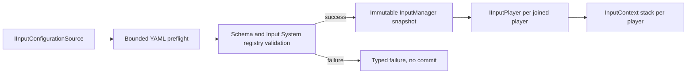
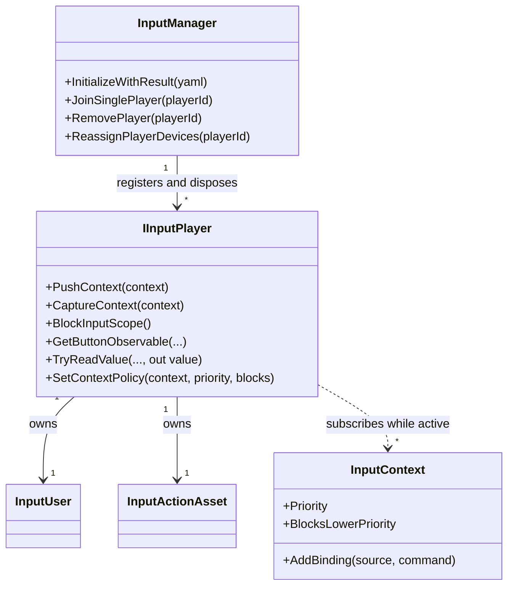
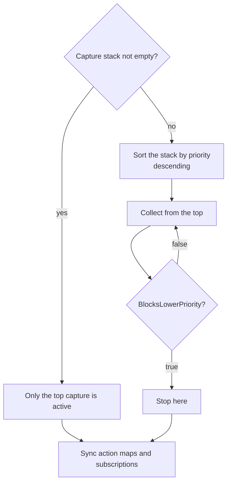

# CycloneGames.InputSystem

English | [简体中文](README.SCH.md)

An input layer on top of Unity Input System. Actions, bindings and mapping contexts are authored in YAML. The file is validated before it becomes active, and every local player gets its own `InputUser` and action asset. Game code pushes mapping contexts and reads actions through R3 streams or synchronous reads.

Use it when players need separate device ownership, or when input routing changes with UI state (gameplay, menu, modal). A single player with one static action map does not need it.

## Contents

1. [Quick start](#1-quick-start)
2. [How it works](#2-how-it-works)
3. [Mapping contexts](#3-mapping-contexts)
4. [Reading actions](#4-reading-actions)
5. [Local multiplayer and devices](#5-local-multiplayer-and-devices)
6. [Rebinding and binding profiles](#6-rebinding-and-binding-profiles)
7. [Configuration](#7-configuration)
8. [Loading and storage](#8-loading-and-storage)
9. [Failure model and troubleshooting](#9-failure-model-and-troubleshooting)
10. [Performance and threading](#10-performance-and-threading)
11. [Ownership and disposal](#11-ownership-and-disposal)
12. [Assemblies, tests and documents](#12-assemblies-tests-and-documents)

## 1. Quick start

### Requirements

| Package | Used for |
| --- | --- |
| `com.unity.inputsystem` | Actions, bindings, devices |
| `com.cysharp.unitask` | Async loading and joins |
| `com.cysharp.r3` | Action streams |
| `jp.hadashikick.vyaml` | YAML parsing |
| `com.cyclone-games.hash` | Deterministic action IDs |
| `com.cyclone-games.logging` | Diagnostics |

Versions are declared in `package.json`. Add an asmdef reference to `CycloneGames.InputSystem.Runtime`. The UGUI, VContainer and Tools assemblies are opt-in and need explicit references.

### Minimal configuration

```yaml
schemaVersion: 1
playerSlots:
- playerId: 0
  contexts:
  - name: Gameplay
    actionMap: PlayerActions
    bindings:
    - type: vector2
      action: Move
      expectedControlType: Vector2
      deviceBindings:
      - "<Gamepad>/leftStick"
      compositeBindings:
      - name: 2DVector
        parameters: mode=2
        parts:
        - name: up
          path: <Keyboard>/w
        - name: down
          path: <Keyboard>/s
        - name: left
          path: <Keyboard>/a
        - name: right
          path: <Keyboard>/d
    - type: button
      action: Confirm
      deviceBindings:
      - "<Gamepad>/buttonSouth"
      - "<Keyboard>/enter"
```

Author the file with `Tools > CycloneGames > Input System Editor`, or write it by hand. `schemaVersion` is required and only version `1` is accepted.

### Minimal bootstrap

```csharp
using CycloneGames.InputSystem.Runtime;
using CycloneGames.Logging;
using UnityEngine;

public sealed class PlayerInputBootstrap : MonoBehaviour
{
    private static readonly LogChannel Log = LogChannel.Create("Game.Input");

    [SerializeField] private TextAsset _configuration;

    private InputManager _manager;
    private InputContext _gameplay;

    private void Awake()
    {
        _manager = new InputManager();
        InputManagerInitializationResult initialized =
            _manager.InitializeWithResult(_configuration.text);

        if (!initialized.IsSuccess)
        {
            Log.Error($"Input initialization failed: {initialized.Status}: {initialized.Message}");
            enabled = false;
            return;
        }

        IInputPlayer player = _manager.JoinSinglePlayer(0);
        if (player == null)
        {
            Log.Error("No declared control scheme can be matched for player 0.");
            enabled = false;
            return;
        }

        _gameplay = new InputContext("PlayerActions", "Gameplay")
            .AddBinding(
                player.GetVector2Observable("Gameplay", "PlayerActions", "Move"),
                new MoveCommand(OnMove));

        player.PushContext(_gameplay);
    }

    private void OnMove(Vector2 direction)
    {
        // Forward the value to a gameplay-owned movement service.
    }

    private void OnDestroy()
    {
        _gameplay?.Dispose();
        _manager?.Dispose();
    }
}
```

`InitializeWithResult` returns a typed result. Check `IsSuccess` before joining a player. A disposed manager cannot be initialized again, so construct a new one. The manager has no process-wide instance: the composition root constructs it, passes it to loaders and UI components, and disposes it.

The configuration declares which contexts exist. It does not push them. Create and push `InputContext` objects when the matching product state begins.

## 2. How it works

### From YAML to a running player



Initialization is transactional. A bounded shape preflight runs before cloning. Schema and semantic validation run on the clone and check layouts, paths, interactions, processors, composites and control schemes against the current Input System registry, then build, resolve and dispose temporary action graphs. Only a successful validation commits the runtime snapshot. Each joined player later receives its own action asset.

### Object model



| Concept | Representation | Responsibility |
| --- | --- | --- |
| Action | `ActionBindingConfig` and an internal Unity `InputAction` | Gives a logical name and value type to one or more bindings. |
| Mapping context | YAML `ContextDefinitionConfig` plus runtime `InputContext` | Groups actions and command bindings under a priority and a blocking policy. |
| Interaction | Action-level `interactions` | Decides when an action starts, performs or cancels, using Unity Input System syntax. Composite-part interactions are rejected. |
| Processor | `processors` or composite-part `processors` | Transforms values before consumers read them. |
| Composite | `CompositeBindingConfig` | Builds values such as `2DVector` from named parts. |
| Control scheme | `ControlSchemeConfig` | Declares a binding group and required, optional or alternative device layouts. |
| Player | `IInputPlayer` backed by an `InputUser` | Owns paired devices, an action asset, active contexts, streams and binding overrides. |
| Binding profile | `InputBindingOverrideProfile` or per-player override JSON | Persists context/map/action binding selectors separately from configuration storage. |

The [Unity Input System manual](https://docs.unity3d.com/Manual/com.unity.inputsystem.html) defines the underlying action, binding, interaction, processor and device semantics.

## 3. Mapping contexts

### Stack, priority and blocking

`PushContext` adds a runtime context to the player's stack. Active contexts are sorted by priority in descending order. Equal priorities keep stack order, so the context pushed last is on top. A refresh computes the active set like this:



A non-blocking overlay can coexist with Gameplay, while a Menu with `blocksLowerPriority: true` makes Gameplay inactive.

```csharp
InputContext gameplay = new InputContext("PlayerActions", "Gameplay")
    .AddBinding(
        player.GetVector2Observable("Gameplay", "PlayerActions", "Move"),
        new MoveCommand(MoveCharacter))
    .AddBinding(
        player.GetButtonObservable("Gameplay", "PlayerActions", "Confirm"),
        new ActionCommand(Confirm));

InputContext menu = new InputContext("UIActions", "Menu", priority: 100, blocksLowerPriority: true)
    .AddBinding(
        player.GetVector2Observable("Menu", "UIActions", "Navigate"),
        new MoveCommand(NavigateMenu));

player.PushContext(gameplay);
player.PushContext(menu);

player.RemoveContext(menu); // Gameplay becomes active again.
gameplay.Dispose();
menu.Dispose();
```

Bind commands before pushing a context. The context owns the command mappings. The player owns the live subscriptions while the context is active. Names are ordinal and case-sensitive. `ActiveContextName` reports the top active context.

The two-argument `InputContext(actionMapName, name)` constructor reads priority and blocking from the matching YAML context. The four-argument constructor sets both values in code. A context resolves only when both name and action map match a configured context; the constructor requires both, so a map-only instance cannot be created. Windows that belong to one layer should share one priority value, because different priorities override stack order.

### Changing the policy of an active context

`SetContextPolicy` changes priority and blocking for a context the player already owns, without replacing the context or rebuilding its bindings. `ClearContextPolicy` restores the constructor or YAML policy.

```csharp
// Modal phase: the dialog blocks Gameplay.
player.PushContext(dialog);

// Preview phase: Gameplay receives input again while the dialog stays open.
player.SetContextPolicy(dialog, dialogPriority, blocksLowerPriority: false);

// Back to modal.
player.SetContextPolicy(dialog, dialogPriority, blocksLowerPriority: true);
```

The policy is stored per player, so two players can share one `InputContext` and apply different policies to it. A changed policy triggers one refresh; setting the same values again does nothing. Contexts that enter or leave the active set rebuild their subscriptions. A button held across that change reports no press event and no press state until it is released and pressed again; `Vector2` and `Float` actions re-deliver their current value when their map is enabled again.

### Refresh outcome

A refresh touches only what changed. Maps whose enabled state already matches the active set are left alone, and a context that stays active keeps its subscriptions. An unchanged refresh allocates nothing.

If enabling a map or subscribing a custom observable throws during a context change, the model change stays committed, all maps and subscriptions of the player are disabled, `ActiveContextName` is cleared, and the initiating call rethrows. Remove the failing binding and call `RefreshActiveContext()`. Synchronous reentrant refreshes are coalesced and capped at 16 passes. A refresh that exceeds the cap leaves input disabled instead of blocking the main thread.

### Capture and global blocking

`CaptureContext` temporarily selects one capture context ahead of all normal contexts. It returns an idempotent `IDisposable`. Disposing the scope reveals the next capture or the normal set.

`BlockInputScope` disables all action maps of the player. Blocks are depth-counted. Input resumes only after every matching scope or `UnblockInput` call is released.

```csharp
using IDisposable modalCapture = player.CaptureContext(modalContext);
using IDisposable loadingBlock = player.BlockInputScope();
```

Dispose both scopes on the Unity main thread, in the flow that created them.

## 4. Reading actions

### Two ways to address an action

| Form | Example | Use |
| --- | --- | --- |
| Generated ID | `player.GetButtonObservable(InputActions.Actions.UI_Confirm)` | Recommended. No string lookup at call time. |
| Context-qualified name | `player.GetButtonObservable("UI", "UIActions", "Confirm")` | Tools and one-off code. |

Each ID is the deterministic FNV-1a 32-bit hash of `context/map/action`. Compute one with `InputHashUtility.GetActionId`, or generate constants with the Editor window. An unknown ID returns an empty observable and logs a warning.

### Streams and reads

| API | Emits | Notes |
| --- | --- | --- |
| `GetVector2Observable` | `Vector2` | Zero on cancel for event-driven actions. |
| `GetScalarObservable` | `float` | Zero on cancel for event-driven actions. |
| `GetButtonObservable` | `Unit` | Once per performed press. |
| `GetPressStateObservable` | `bool` | Current state on subscribe, then `true` on press and `false` on release. |
| `GetLongPressObservable` | `Unit` | Once when a press reaches `longPressMs`. |
| `GetLongPressProgressObservable` | `float` | `0..1` while held, `-1` on an early release. Button only. |
| `GetChordObservable` | `Unit` | Two button actions pressed within a time window. Takes two IDs. |
| `TryReadValue` | `out TValue` | Synchronous read of the current value. |

```csharp
int moveId = InputHashUtility.GetActionId("Gameplay", "PlayerActions", "Move");
player.GetVector2Observable(moveId).Subscribe(MoveCharacter);

if (player.TryReadValue(moveId, out Vector2 move))
{
    ApplyMove(move);
}

int confirm = InputHashUtility.GetActionId("Gameplay", "PlayerActions", "Confirm");
int cancel = InputHashUtility.GetActionId("Gameplay", "PlayerActions", "Cancel");
player.GetChordObservable(confirm, cancel, windowMs: 200f)
    .Subscribe(_ => OpenShortcut());
```

`EventDriven` actions emit on performed and emit a neutral value on cancel. `Polling` `Vector2` and `Float` actions are read by the player's single update pump while their map is enabled. Use polling for values that need continuous sampling and event-driven mode for discrete state changes.

The module long press supports `Button` and `Float`, is enabled by `longPressMs > 0`, and is separate from a Unity `hold(...)` interaction. For a `Float` long press, `longPressValueThreshold` must be in `(0,1]`. Chords require two configured button actions. The stream resets after a release.

Every subscription needs a visible lifetime. An `InputContext`, a `CompositeDisposable` or the owning component disposes it.
### Buffering press events

A press can be buffered for a few frames and consumed later, so a jump pressed a few frames before landing still counts when the feet touch the ground.

| Member | Purpose |
| --- | --- |
| `TryConsumeBuffered(actionId, windowFrames)` | Takes the newest press inside the window. One press can be taken only once. |
| `TryPeekBuffered(actionId, windowFrames)` | Reads without taking. |
| `ActionBuffer` | The ring itself, for owners that record and query with their own ticks. |

```csharp
int jumpId = InputHashUtility.GetActionId("Gameplay", "PlayerActions", "Jump");

void Update()
{
    if (isGrounded && player.TryConsumeBuffered(jumpId, windowFrames: 6))
    {
        Jump();
    }
}
```

The window is measured in frames; `0` accepts only the current frame. Buffered presses are cleared when the active context set changes and around `BlockInput`, so a press never crosses an input state. The ring is preallocated per player, 64 entries with 600 frames of retention by default, and does not allocate at runtime.


## 5. Local multiplayer and devices

### Joining

| API | Device policy | Typical use |
| --- | --- | --- |
| `JoinSinglePlayer` / `JoinSinglePlayerAsync` | Matches the preferred then remaining control schemes from unclaimed devices. | Standard local player creation. |
| `JoinPlayerAndLockDevice` | Requires the supplied device to participate in a declared scheme and claims all matched scheme devices. | A user joined from a known gamepad. |
| `JoinPlayerOnSharedDevice` | Pairs current keyboard and, when present, mouse without exclusive claiming. | Shared-keyboard modes. |
| `StartListeningForPlayers` | A join binding creates a player from the first unregistered slot. Once every declared slot is filled, it extends the primary player's device set. | Lobby join flow. |
| `PairAdditionalDevice` | Pairs one more declared-layout device to an already joined player. Fails closed for an unclaimable device or undeclared layout. | Single-player hot-plug. |
| `RemovePlayer` | Disposes the player, unpairs its `InputUser`, releases claims. | Leave, slot reset, pre-reinitialize shutdown. |
| `JoinPlayersBatch` / `JoinPlayersBatchAsync` | Joins several players. The async overload yields after each player except the last. | Loading screens. |

```csharp
IInputPlayer player1 = manager.JoinPlayerAndLockDevice(0, gamepad1);
IInputPlayer player2 = manager.JoinPlayerAndLockDevice(1, gamepad2);
```

Every player associates its action asset with its `InputUser`, so `InputActionAsset.devices` is that player's paired-device whitelist. A locked slot also activates a control scheme, which narrows the binding mask to the scheme's group. A slot with `pairAllMatchingDevices: true` leaves the scheme unset. Every binding stays live, but only on that player's whitelisted devices, so one player can move between keyboard/mouse and gamepad without re-joining while a second player claims the remaining devices. Per-binding `deviceBindingGroups` and the slot's `controlSchemes` depend on an active scheme, so this mode ignores them.

`maxDevicesPerLayout` (default `1`, clamped to `1..8`) bounds how many devices of each referenced layout such a slot may claim. `deviceSwitchDebounceMs` (default `0`, clamped to `0..5000`) is the minimum dwell time before `ActiveDeviceKind` may switch again.

Async overloads accept a `CancellationToken`. A single-player timeout returns `null`. Caller cancellation is propagated. Batch aggregate timeout or manager shutdown returns the successfully joined prefix. Join methods are idempotent for an already registered player ID.

Control-scheme matching uses `deviceRequirements`: `isOptional` permits a missing device and `isOr` expresses an alternative in Unity Input System scheme order. With no schemes declared, layouts derived from configured direct and composite-part paths are alternatives and the first claimable matching device is selected. When that device is a keyboard or mouse, the other claimable keyboard/mouse device is added as its companion.

### Device state and prompts

```csharp
private void ObserveDevices(IInputPlayer player)
{
    player.OnDeviceStatusChanged += status =>
    {
        switch (status.ChangeKind)
        {
            case InputPlayerDeviceChangeKind.Lost:
                PauseForMissingDevice(status.DeviceId);
                break;
            case InputPlayerDeviceChangeKind.Regained:
                ResumeAfterDeviceReturn(status.DeviceId);
                break;
            case InputPlayerDeviceChangeKind.Paired:
            case InputPlayerDeviceChangeKind.Unpaired:
                RefreshDevicePresentation(status.DeviceKind, status.Layout);
                break;
        }
    };
}
```

`ActiveDeviceKind` changes when meaningful action activity is observed and drives glyph presentation. For prompt replacement, `InputPlayer.DeviceActivity` publishes an `InputDeviceActivity` for every observed activity on the player's own devices:

| Field | Meaning |
| --- | --- |
| `PlayerId`, `DeviceId` | Owning slot and Unity device id. |
| `DeviceLayout` | Concrete layout, for example `DualShockGamepad` or `XInputController`. |
| `Family` | `InputDeviceFamily`: `Keyboard`, `Mouse`, `Gamepad`, `Touchscreen`, `Joystick`, `Other`. |
| `PromptKind` | Coarse `InputDeviceKind` for existing consumers. |
| `ControlPath` | Control path of the originating control when known. |
| `Timestamp` | Player frame timestamp, advanced by `UpdateRuntimeState`. |

The stream is driven by Unity's `onAnyButtonPress` and filtered to the player's device whitelist. Continuous activity such as mouse movement or analog drift can be reported with `NotifyDeviceActivity(device)` or `NotifyDeviceActivity(device, control)`. `InputDeviceIconSet.GetIcon(kind, deviceLayout)` resolves a per-layout sprite first and falls back to the coarse kind. `DeviceActivity` is a raw stream and not debounced. Deduplicate by `Family` or `DeviceLayout` in product UI.

A control scheme is selected once at join time. If all of a player's paired devices disconnect, the player stays registered with an empty whitelist and an unchanged scheme. Call `InputManager.ReassignPlayerDevices(playerId)` to remove and re-join that player with the currently available devices. Call it from `OnDeviceStatusChanged` when `ChangeKind` is `Lost` or `Unpaired` and `User.pairedDevices.Count == 0`, deferred by one frame so the player is not disposed inside its own callback. `InputManager.AutoReassignOnDeviceLoss` (default `false`) performs the same recovery automatically on a topology change.

## 6. Rebinding and binding profiles

`RebindAction` applies an already chosen path. A product rebind UI captures the candidate control, enforces reserved-key and accessibility policy, resolves conflicts, then applies the override. `CheckBindingConflicts` is an authoring diagnostic for configured direct bindings. It does not evaluate a pending candidate or runtime overrides.

```csharp
bool changed = player.RebindAction(
    "Gameplay", "PlayerActions", "Confirm",
    "<Keyboard>/space",
    "<Keyboard>/f");

string[] effectivePaths = player.GetActionBindings("Gameplay", "PlayerActions", "Confirm");

player.ResetActionBinding("Gameplay", "PlayerActions", "Confirm");
player.ResetAllActionBindings();
```

Per-player JSON uses a module-owned schema with context/map/action identity, a binding ordinal and original binding metadata. Import stages and validates the document before replacing active overrides. A per-player document is limited to 128 override records and 1 MiB of strict UTF-8. Manager profiles aggregate per-player JSON under a 4 MiB budget and can be imported before players join. Pending entries are applied during player construction.

When a product uses `CycloneGames.Persistence`, inject a product-selected `IPersistenceStorage` and `IPersistenceCodec<string>` and store the exported profile as opaque JSON. The codec may encode the string as strict UTF-8 but must not interpret or rewrite the InputSystem schema. `InputManager` is the only profile validator. This class belongs in product code or a product-owned integration assembly:

```csharp
using System.Threading;
using System.Threading.Tasks;
using CycloneGames.InputSystem.Runtime;
using CycloneGames.Persistence;

public sealed class InputBindingProfilePersistence
{
    private const int StoredContentVersion = 1;
    private const int MaximumPayloadBytes = 1024 * 1024;

    private readonly InputManager _manager;
    private readonly PersistenceStore<string> _store;

    public InputBindingProfilePersistence(
        InputManager manager,
        IPersistenceStorage storage,
        IPersistenceCodec<string> strictUtf8Codec)
    {
        _manager = manager;
        _store = new PersistenceStore<string>(
            storage,
            new PersistenceProfile<string>(strictUtf8Codec, new PersistenceLimits(MaximumPayloadBytes)));
    }

    public async Task<PersistenceOperationResult> SaveAsync(CancellationToken cancellationToken)
    {
        string opaqueJson = _manager.ExportBindingOverrideProfileJson();
        return await _store.SaveAsync(in opaqueJson, StoredContentVersion, cancellationToken);
    }

    public async Task<string> LoadAndApplyAsync(CancellationToken cancellationToken)
    {
        PersistenceLoadResult<string> loaded = await _store.LoadAsync(StoredContentVersion, cancellationToken);
        if (loaded.Status == PersistenceLoadStatus.Missing) return null;
        if (!loaded.IsSuccess) return loaded.ErrorCode.ToString();

        if (!_manager.ImportBindingOverrideProfileJson(loaded.Value))
            return "The binding profile does not match the active input configuration.";

        return null;
    }
}
```

Construct this owner once at the composition root. Load before players join and save at explicit settings commits or lifecycle checkpoints. Use `TryExportBindingOverridesJson` or `TryExportBindingOverrideProfile` when budget exhaustion is an expected failure path. Keep configured defaults active when loading fails.

### Interactive capture

`InputRebindOperation` is the capture loop: it listens, validates the candidate against an `InputRebindPolicy`, reports conflicts, and applies the result through the player.

| Member | Behavior |
| --- | --- |
| `Start(now)` | Listens for the next button press. A session runs once; create a new one to retry. |
| `Offer(path, layout, now)` | Feeds a candidate directly when a product filters devices itself. |
| `Status` | `Idle`, `Listening`, `Accepted`, `Conflict`, `Canceled`, `TimedOut`. Terminal states never change. |
| `ConflictingBinding` | Path already bound to another binding of the same action. |
| `Apply()` / `ResolveConflictBySwap()` | Applies the accepted path, or swaps the conflicting binding first. |
| `Poll(now)` | Expires a session that carries a timeout. |

```csharp
var rebind = new InputRebindOperation(player, "UI", "UIActions", "Confirm", "<Gamepad>/buttonSouth",
    InputRebindPolicy.CreateDefault(), timeoutSeconds: 10d);
rebind.Start(Time.realtimeSinceStartupAsDouble);

// Later, from the settings screen.
if (rebind.Poll(Time.realtimeSinceStartupAsDouble)) CloseAndReport("timed out");
else if (rebind.Status == RebindStatus.Conflict) rebind.ResolveConflictBySwap();
else if (rebind.Status == RebindStatus.Accepted) rebind.Apply();
```

A captured control is converted to a layout path, so a rebind done on one gamepad also works on another. Escape is reserved by default; a rejected candidate keeps the session listening and reports the reason in `LastRejection`.

## 7. Configuration

### Reference

| Level | Field | Meaning |
| --- | --- | --- |
| Root | `schemaVersion` | Must be `1`. Any other value is rejected with `UnsupportedSchemaVersion`. |
| Root | `schemaFingerprint` | Optional Editor diagnostic. Does not approve or reject runtime data. |
| Root | `joinAction` | Optional shared join binding. Player-slot join bindings are also considered. |
| Root | `playerSlots` | Player templates with unique non-negative `playerId` values. |
| Player | `controlSchemes` | Optional device-matching schemes. |
| Player | `defaultControlScheme` | Preferred scheme. Other declared schemes are tried if it cannot match. |
| Player | `pairAllMatchingDevices` | Claims devices for every referenced layout and leaves the control scheme unset. |
| Player | `maxDevicesPerLayout` | Devices claimed per referenced layout when `pairAllMatchingDevices` is enabled. Default `1`, clamped to `1..8`. |
| Player | `deviceSwitchDebounceMs` | Minimum dwell time before `ActiveDeviceKind` may switch again. Default `0`, clamped to `0..5000`. |
| Player | `contexts` | Named mapping contexts for that player. |
| Context | `name`, `actionMap` | Context identity and public action-map identity. |
| Context | `priority` | Higher values are considered first. Default `0`. Limits accept `-100000..100000`. |
| Context | `blocksLowerPriority` | Stops activation below this context when `true`. Default `false`. |
| Action | `type` | `Button`, `Vector2` or `Float`. |
| Action | `action` | Logical action name. Context, map and action form the stable identity. |
| Action | `expectedControlType` | Unity expected control layout: `Button`, `Vector2`, `Axis`. |
| Action | `deviceBindings` | Direct Unity control paths. |
| Action | `deviceBindingGroups` | Per-binding control-scheme groups, positionally aligned with `deviceBindings`. An omitted list or empty entry falls back to `bindingGroups`. |
| Action | `compositeBindings` | Composite name, parameters, groups and parts. |
| Action | `bindingGroups` | Semicolon-separated action-level control-scheme binding groups. |
| Action | `interactions`, `processors` | Unity Input System expressions applied to the action. |
| Action | `updateMode` | `EventDriven` (default) or `Polling`. Delta paths are treated as polling. |
| Action | `longPressMs` | Module long-press duration for `Button` or `Float`. `0` disables the stream. |
| Action | `longPressValueThreshold` | `Float` actuation threshold. Must be in `(0,1]` when Float long press is enabled and may be `0..1` otherwise. |
| Composite part | `name`, `path`, `processors` | Named part control path with optional part-local processors. A non-empty part `interactions` value is rejected. |

`deviceBindings` holds direct control paths only. A composite is declared in `compositeBindings`, its `parameters` omit the outer parentheses, and interactions belong to the containing action.

```yaml
- type: vector2
  action: Move
  expectedControlType: Vector2
  deviceBindings:
  - "<Gamepad>/leftStick"
  compositeBindings:
  - name: 2DVector
    parameters: mode=2
    parts:
    - name: up
      path: <Keyboard>/w
    - name: down
      path: <Keyboard>/s
    - name: left
      path: <Keyboard>/a
    - name: right
      path: <Keyboard>/d
```

### Validation budgets

Default limits: 8 players, 32 contexts per player, 128 actions per context, 1,024 total actions per player, 16 direct and composite-part binding entries per action, 16 composites per action, 16 parts per composite, 16 control schemes per player, 16 device requirements per scheme and 256 characters per technical string. Inject stricter `InputConfigurationLimits` through the `InputManager` constructor.

Before VYaml materialization, runtime and Editor YAML entry points limit input to 1 MiB of strict UTF-8 without BOM, 16,384 lines, 4,096 characters per line, 64 indentation spaces, 65,536 structural tokens and nesting depth 64. YAML anchors, aliases, explicit tags, directives, document markers, block scalars, tab indentation, forbidden control characters and non-CR/LF line separators are rejected.

One action serializes to about twelve YAML lines, so the line budget caps a serialized configuration at about 1,300 actions across all players (`InputConfigurationLimits.ApproximateMaxSerializedTotalActions`). Preparation and validation operate on a clone and never rewrite the source file.

### Version and identity

`schemaVersion` is the format gate and the only field that decides compatibility. A missing, older or newer value fails validation with a message that names the direction.

`schemaFingerprint` is an optional Editor stamp over the YAML key and type shape. It is written on save and compared when the file is opened, so a shape change without a version bump shows up as a warning. Player builds ignore it.

A content hash is not used as a version. Hashing the authored file would reject every legitimate edit, and binding overrides already key on selectors rather than file bytes. Hashes appear where identity matters, in `CycloneGames.AssetManagement` for content integrity and `CycloneGames.AtlasPipeline` for source cache keys.

### Editor workflow

Open `Tools > CycloneGames > Input System Editor`. The left panel keeps runtime and code-generation paths visible with reveal shortcuts. The right workspace keeps the serialized configuration separate from file operations.

1. Select a default-config folder under `Assets`. The file name is `input_config.yaml`.
2. Select an optional relative user-config subdirectory under `Application.persistentDataPath`.
3. Load the user or default file, or generate a default configuration.
4. Edit join actions, player slots, control schemes, contexts, bindings, composites, interactions, processors, priorities and blocking policies.
5. Resolve validation errors. Errors block persistence but do not disable the fields.
6. Use `Save User Config`, `Save User + Generate Code`, `Save Project Default`, or `Restore User from Default`.
7. Select a codegen folder under `Assets` and a namespace, then generate `InputActions.cs`.

Generated code contains `InputActions.Contexts`, `InputActions.ActionMaps` and context-qualified IDs under `InputActions.Actions`. Regenerate after changing context, map or action identities.

## 8. Loading and storage

`IInputConfigurationSource` is read-only. `IInputConfigurationStore` adds save and delete. `FileInputConfigurationStore` accepts a fixed root and relative Unicode Form C logical keys. `/` is the only logical segment separator and `\` is rejected. It rejects rooted paths, URIs, traversal, unsafe characters and paths that contain a symbolic link or reparse point, bounds strict UTF-8 content, writes through a temporary file and keeps one fixed `.bak`.

`UriInputConfigurationSource` reads defaults from local `StreamingAssets`, Android `jar:file` locations, same-origin StreamingAssets web URLs, or an allowlisted HTTPS host. Logical URIs are capped at 4,096 characters. The HTTPS allowlist accepts at most 64 bounded DNS/IPv4 hosts of up to 253 characters each. Allowlisted endpoints must use port 443 with no credentials or fragment. Redirects are disabled and the read has a byte budget and a timeout.

```csharp
using System.IO;
using CycloneGames.InputSystem.Runtime;
using UnityEngine;

var manager = new InputManager();
var defaults = new UriInputConfigurationSource();
var users = new FileInputConfigurationStore(Application.persistentDataPath);

string defaultUri = Path.Combine(Application.streamingAssetsPath, "input_config.yaml");
InputSystemLoadResult load = await InputSystemLoader.LoadAndInitializeAsync(
    new InputSystemBootstrapOptions(
        InputSystemBootstrapMode.Optional,
        defaults,
        defaultUri,
        users,
        "input/user_input_settings.yaml",
        persistDefaultToUser: true),
    manager,
    forceReinitialize: false,
    cancellationToken: cancellationToken);

if (!load.IsBootstrapComplete)
{
    Debug.LogError($"Input load failed: {load.Status}: {load.Error}");
}
```

| Mode | Behavior |
| --- | --- |
| `Disabled` | Performs no reads. |
| `Optional` | Returns `NotConfigured` when both user and default content are absent. |
| `Required` | Reports `DefaultConfigurationUnavailable` when no usable configuration exists. |

A valid user file is used as-is. A missing file falls back to the validated default and copies it into the user store when `persistDefaultToUser` is set. An invalid file is preserved while the valid default is used for that session. When the primary file is missing but its `.bak` is readable, the store reports backup recovery. Configuration commits only after schema validation and Input System preflight both succeed.

`InputManager` owns validated runtime state and does not retain a URI, source or store. `ReinitializeWithResult` refuses replacement while players are active. Remove players, release contexts, reinitialize, then rebuild player services and reapply an accepted binding profile. A failed reinitialize leaves the committed configuration unchanged.

## 9. Failure model and troubleshooting

### Typed results

| Type | Reports |
| --- | --- |
| `InputConfigurationReadResult`, `InputConfigurationStoreResult` | `NotFound`, `InvalidKey`, `TooLarge`, `Unsupported`, `AccessDenied`, `IoError`. |
| `InputSystemLoadResult` | User or default success, unavailable defaults, invalid configuration, manager initialization failure. |
| `InputManagerInitializationResult` | Empty content, wrong thread, active players, disposed manager, parse failure, schema validation failure, `InputSystemPreflightFailed`. Exposes `Validation` and `Preflight`. |
| `InputConfigurationPreflightResult` | `Status`, bounded `Issues`, `WasTruncated`. |
| Join methods | `null` when a slot, device or scheme cannot be resolved. Caller cancellation is not converted into success. |
| Rebind and profile APIs | `false` for an unknown identity, selector mismatch, unsupported schema, duplicate entry or budget violation. |

### Troubleshooting

| Symptom | Likely cause | Resolution |
| --- | --- | --- |
| Initialization not successful | Empty or oversized content, YAML parse error, unsupported `schemaVersion`, invalid identity, duplicate, configured limit, unavailable Input System registration, graph-resolution failure | Inspect `InputManagerInitializationResult.Status`, `Message`, `Validation.Issues`, `Preflight.Issues`. Register custom layouts, interactions, processors and composites before initialization. |
| Valid user settings ignored | Read or validation failure | Inspect `InputSystemLoadResult.UserStorageStatus` and compare the user file with the default. |
| `JoinSinglePlayer` returns `null` | Unknown player ID, no scheme match, required device absent, or device already claimed | Inspect slot schemes and paired devices in the Input Debugger. |
| No action stream events | Context not pushed, context/map/action case mismatch, context blocked or captured, input globally blocked, wrong value getter | Use context-qualified getters or generated IDs and inspect `ActiveContextName`. |
| Polling value stays neutral | Map disabled, device not paired, binding masked by scheme, wrong control layout, value type mismatch | Verify the active context, scheme groups, paired devices and control path. |
| Long-press stream empty | `longPressMs` is `0` or the action does not exist | Enable a bounded duration and check the identity. |
| Reinitialize reports `ActivePlayers` | Registered players still own action assets | Remove players and contexts, then reinitialize and recreate them. |
| Binding-profile import returns `false` | Profile schema or size invalid, or selectors no longer match | Keep configured defaults, preserve the profile, offer a product-owned reset. |
| File store reports `InvalidKey` | Rooted path, URI, traversal, empty segment, unsafe character or reparse-point path | Pass a relative logical key under the store's fixed root. |
| VContainer types unavailable | Package-derived define absent or consumer asmdef lacks the reference | Install the package and add the integration asmdef reference. |
| Constant generation fails | Invalid namespace or identifier, duplicate generated name, action-ID collision, unsafe output path | Fix YAML identities or Editor settings. Do not edit the generated file. |

## 10. Performance and threading

### Runtime cost

| Area | Behavior | Use |
| --- | --- | --- |
| Initialization | Shape checks, clone, Input System registry validation, temporary action graphs, commit. | Outside input-sensitive frames, after all custom Input System registrations. Reuse the committed manager. |
| Event-driven actions | Unity callbacks forward to pre-created subjects while the action map is enabled. | Buttons and discrete values. Keep subscription callbacks bounded. |
| Polling and holds | One update subscription per player services all polling actions and hold progress. | Only when continuous sampling is required. |
| Context changes | Maps and subscriptions change only for the difference between the previous and the new active set. | State transitions, not every frame. |
| Rebinding and profiles | Enumerates bindings and allocates arrays or JSON during export, import and conflict checks. | Settings and save flows. |
| Device activity | Uses action activity and Input System device and user notifications. | `ActiveDeviceKind` is a presentation hint. Debounce product UI if hardware is noisy. |
| Manager notifications | Handler arrays are copied on subscribe and read on notify, so a notification does not allocate. | Subscribe from the composition root, not per frame. |
| Tools recording | Fixed-capacity list while recording. Snapshot creation copies samples. | Inspect `WasTruncated` and `DroppedSampleCount`. |

Initialization and player construction emit the profiler markers `CycloneGames.Input.Initialize`, `CycloneGames.Input.JoinPlayer` and `CycloneGames.Input.BuildAsset`. A context refresh emits `CycloneGames.Input.RequestContextRefresh` and `CycloneGames.Input.ActivateTopContext`. The test assembly reads cumulative map and subscription reuse counters through the internal `InputPlayer.GetProjectionDiagnostics()`.

### Threading and platforms

Unity API and player or context operations are confined to the Unity main thread. `UriInputConfigurationSource` switches to the Unity main thread before using `UnityWebRequest`. `FileInputConfigurationStore` exposes asynchronous I/O but does not make `InputManager`, `IInputPlayer` or `InputContext` thread-safe. Carry cancellation through async loading, return to the Unity main thread before manager mutation, and dispose Unity-owned state on that thread.

| Target | Default configuration path | User persistence |
| --- | --- | --- |
| Windows, macOS, Linux | Local `StreamingAssets` through `UriInputConfigurationSource` | `FileInputConfigurationStore` under `persistentDataPath` |
| Android | `jar:file` or StreamingAssets through `UnityWebRequest` | `FileInputConfigurationStore` under app persistent data |
| iOS | Local StreamingAssets URI or file path | `FileInputConfigurationStore` under app persistent data |
| WebGL | Same-origin StreamingAssets web URI | Product-supplied `IInputConfigurationStore` |
| Consoles | Platform-approved source adapter or packaged StreamingAssets path | Platform-approved store adapter |
| Remote HTTPS | Allowlisted HTTPS host, port 443, no credentials, fragments or redirects | Product-selected store |

Input control paths and device layouts vary by platform and package version. Validate every shipped scheme with the Input Debugger and representative hardware.

## 11. Ownership and disposal

| Owner | Owns |
| --- | --- |
| Composition root | `InputManager`, configuration sources and stores, binding-profile persistence. |
| `InputManager` | Registered players. Disposes them on removal or manager disposal. |
| `InputPlayer` | `InputUser`, its `InputActionAsset`, subjects, update subscription, device subscriptions. |
| Product state | `InputContext` instances and capture or block scopes. Disposing a context removes it from every player using it. |
| Subscription owner | Direct R3 subscriptions not managed through an active `InputContext`. |

Subsystem registration invalidates every still-active manager, so play sessions without domain reload cannot retain users, actions or listeners. `InputManager.GetMemoryStats()` and `InputPlayer.GetMemoryStats()` return allocation-free count snapshots on the main thread. `InputConfigurationLimits` values have public absolute ceilings. Capture scopes are capped at `InputPlayer.MaximumContextCaptureDepth` (`1024`). A leaked scope fails closed instead of growing the capture stack.

### Stored data

| Data | Owner | Default path or key | Format |
| --- | --- | --- | --- |
| Default input configuration | Composition root | Product-selected source and key. StreamingAssets is optional. | YAML, schema `1` |
| User input configuration | Product runtime through `IInputConfigurationStore` | `input/user_input_settings.yaml` under `persistentDataPath` | YAML plus one sibling `.bak` |
| Binding override profile | Composition root | Product-selected bound entry | Module-owned JSON, schema `1` |
| Editor settings | Input System Editor | `UserSettings/CycloneGames.InputSystem.EditorSettings.asset` | Unity serialized Editor settings |
| Generated constants | Project or code owner | `Assets/.../InputActions.cs` | Generated C# |

`DeleteAsync` removes the primary user file and its `.bak`. Invalid user content is preserved rather than overwritten. Regenerate constants from YAML instead of editing them by hand. None of these records use `PlayerPrefs`, `EditorPrefs` or `SessionState`.

### Optional integrations

**UGUI.** Add an asmdef reference to `CycloneGames.InputSystem.Runtime.Integrations.UGUI` for `InputDeviceIconSet`, `InputDeviceIconSwitcher` and horizontal or vertical menu-navigation components. `InputDeviceIconSwitcher` reads the manager from a scene `InputManagerProvider`; assign it in the inspector. `InputDeviceIconSet` resolves sprites by control path, then device layout, then device kind; display text belongs to the product's localization system. The assembly owns presentation adapters only.

`InputDeviceIconSet` has two sources. `Direct` stores sprites in the asset and needs no setup. `ProviderKey` stores keys and resolves them through a product-owned `IInputPromptIconProvider`, so Addressables or bundle systems stay out of the input package. Lookups resolve lazily and cache the result; `WarmupAll` pins every entry when a screen must not load on open.

```csharp
iconSet.SetProvider(myProvider);   // one call, optional
iconSet.TryGetIcon("<Gamepad>/buttonSouth", kind, layout, out Sprite sprite);
```

The Inspector draws only the fields used by the selected source and warns about empty or duplicate keys.

Provider keys have two sources. `Asset` stores the asset GUID and the project-relative path; the Inspector keeps the path in sync from the GUID, so a rename or move does not leave a stale path. `CustomKey` is a plain string. The product provider receives the path or the custom key and decides how to load the sprite.

Inspector section headers, foldouts and cards come from `EditorUiUtility` in the input Editor assembly, so all input inspectors share the same layout. Derived classes can add serialized fields; those appear under `Additional Fields`.

**VContainer.** The integration registers a container-owned `InputManager`, `IInputPlayerResolver`, `IInputSystemInitializer` and diagnostics. The composition root supplies an immutable `InputSystemVContainerOptions`. An entry point is registered only with `registerEntryPoint: true`, and a failed bootstrap is escalated only with `throwOnStartupFailure: true`. Otherwise the result stays in `IInputSystemInitializerDiagnostics.LastResult`. Every consumer in that scope must resolve the same manager.

```csharp
var bootstrap = new InputSystemBootstrapOptions(
    InputSystemBootstrapMode.Optional,
    new UriInputConfigurationSource(),
    Path.Combine(Application.streamingAssetsPath, "input_config.yaml"),
    new FileInputConfigurationStore(Application.persistentDataPath),
    "input/user_input_settings.yaml");

var options = new InputSystemVContainerOptions(bootstrap);

builder.Install(new InputSystemVContainerInstaller(options));
```

**Tools.** `CycloneGames.InputSystem.Tools.Runtime` is opt-in diagnostic tooling. `InputRecorder` records selected streams into a fixed-capacity in-memory buffer. Overflow increments `DroppedSampleCount`. `StopRecording` creates an immutable snapshot and `InputReplayCursor` consumes samples in recorded order.

**Sample.** The sample assembly, scene and fixture are opt-in. See [Samples/README.md](Samples/README.md).

## 12. Assemblies, tests and documents

| Assembly | Path | Purpose |
| --- | --- | --- |
| `CycloneGames.InputSystem.Runtime` | `Runtime/Scripts/` | Configuration, manager, players, contexts, reactive input, storage boundaries. Depends on Unity Input System, UniTask, R3, VYaml, CycloneGames.Hash and `CycloneGames.Logging.Core`. |
| `CycloneGames.InputSystem.Editor` | `Editor/` | YAML authoring, validation, file writes, constant generation. Editor-only. |
| `CycloneGames.InputSystem.Runtime.Integrations.UGUI` | `Runtime/Scripts/Integrations/UGUI/` | Presentation adapters. |
| `CycloneGames.InputSystem.Runtime.Integrations.VContainer` | `Runtime/Scripts/Integrations/DI/VContainer/Base/` | Container-owned manager, async startup, resolver adapters. |
| `CycloneGames.InputSystem.Tools.Runtime` | `Runtime/Tools/` | `InputRecorder` and `InputReplayCursor`. |
| `CycloneGames.InputSystem.Sample` | `Samples/` | Opt-in scene and bootstrap example. |
| `CycloneGames.InputSystem.Tests.Editor` | `Tests/Editor/` | EditMode validation, regression, fuzz and performance coverage. |

Optional assemblies have `autoReferenced: false`. Add an explicit asmdef reference only where the feature is used. UGUI and VContainer use package-derived `versionDefines` with `defineConstraints`. A missing package excludes the corresponding assembly.

Diagnostics use `LogChannel` categories rooted at `CycloneGames.InputSystem`. The logging writer lifecycle belongs to the host. `com.cyclone-games.logging` supplies a `NullLogWriter` default. The composition root may install `com.cyclone-games.logging.pipeline`, add `com.cyclone-games.logging.unity`, or provide another `ILogWriter` backend.

### API reference

| Type | Use |
| --- | --- |
| `InputManager` | Validate and commit configuration, join and remove players, listen for joins, aggregate profiles. |
| `InputManagerInitializationResult` | Inspect parse, schema validation and Input System preflight through `Status`, `Validation`, `Preflight`. |
| `IInputPlayer` | Full player contract: the union of the three interfaces below. |
| `IInputActionReader` | Action streams, synchronous reads, buffered presses and the active device kind. |
| `IInputContextController` | Stack, priority and blocking policy, command bindings and the global block. |
| `IInputRebindOperations` | Rebind, reset, list bindings, import and export overrides. |
| `InputContext` | Bind R3 streams to commands and supply a priority and blocking policy. |
| `InputConfigurationValidator`, `InputConfigurationLimits` | Validate untrusted DTOs under explicit budgets. |
| `InputConfigurationYamlPreflight`, `InputConfigurationYamlCodec` | Enforce the strict YAML subset and serialize a prepared configuration. |
| `IInputConfigurationSource`, `IInputConfigurationStore` | Read and persistence adapters. |
| `UriInputConfigurationSource`, `FileInputConfigurationStore` | Built-in default source and root-confined local store. |
| `InputSystemLoader` | Select user or default content and initialize only from validated content. |
| `InputHashUtility` | Deterministic map hashes and context-qualified action IDs. |
| `InputBindingValidator` | Detect configured direct-binding conflicts. |
| `InputRx` | Low-level R3 wrappers for keyboard, pointer, gamepad, touch, users, actions and `PlayerInput`. |
| `InputActionBuffer` | Bounded ring of tick-stamped press events with windowed consumption. |

### Running the tests

```text
<UnityEditor> -batchmode -nographics -projectPath <repo-root>/UnityStarter -runTests -testPlatform EditMode -assemblyNames CycloneGames.InputSystem.Tests.Editor -testResults <result-path> -quit
```

Use the Unity executable named in `UnityStarter/ProjectSettings/ProjectVersion.txt`.

### Other documents

- [Getting started](Documents~/GettingStarted.md)
- [Configuration guide](Documents~/Configuration.md)
- [Runtime guide](Documents~/RuntimeGuide.md)
- [Sample](Samples/README.md)
- [Unity Input System manual](https://docs.unity3d.com/Manual/com.unity.inputsystem.html)
