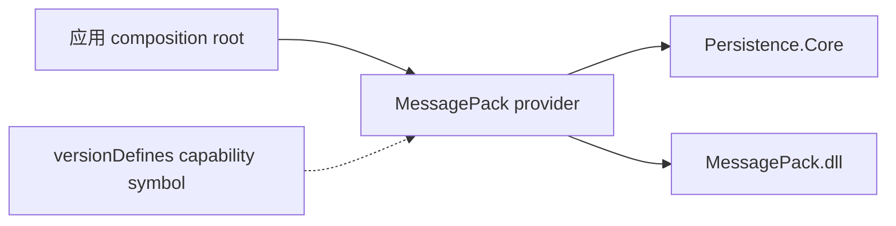
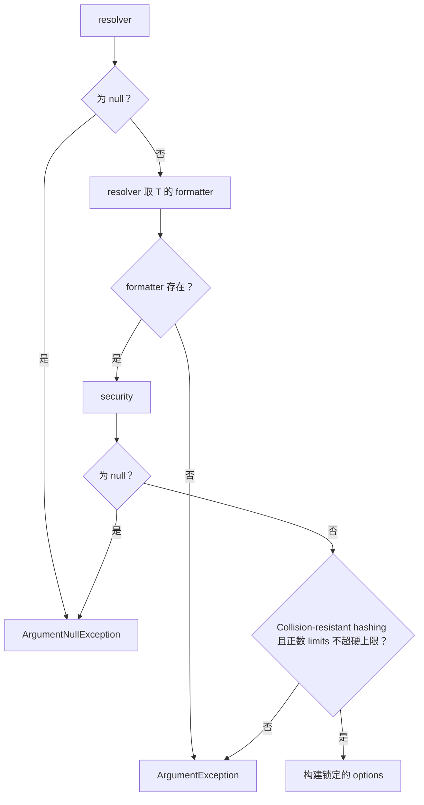

# CycloneGames.Persistence.MessagePack

[English](README.md) | 简体中文

`CycloneGames.Persistence.MessagePack` 是 [CycloneGames.Persistence](../CycloneGames.Persistence/README.SCH.md) 的 codec provider。`MessagePackPersistenceCodec<T>` 通过调用方提供的 source-generated resolver 与 `MessagePackSecurity` policy，把一个类型化 DTO 序列化为 MessagePack bytes。Record framing、字节上限、checksum 校验和 storage 编排仍由 core package 负责。

格式 token 是 `messagepack-nocompress`，表示无压缩、current-spec、使用显式 formatter 的 MessagePack。

## 目录

- [概述](#概述)
- [Assembly 与依赖](#assembly-与依赖)
- [快速上手](#快速上手)
- [公共 API](#公共-api)
- [构造函数校验](#构造函数校验)
- [序列化与反序列化](#序列化与反序列化)
- [格式身份](#格式身份)
- [安全策略](#安全策略)
- [AOT 与 IL2CPP](#aot-与-il2cpp)
- [测试](#测试)
- [问题排查](#问题排查)

## 概述

| 项目 | 值 |
| --- | --- |
| Namespace | `CycloneGames.Persistence.MessagePack` |
| Assembly | `CycloneGames.Persistence.MessagePack` |
| 格式 token | `messagepack-nocompress` |
| 契约 | `IPersistenceCodec<T>` |
| Wire profile | 无压缩、current spec、严格的程序集标识校验 |

Codec 不持有文件路径、全局 resolver 或应用状态。

## Assembly 与依赖

| Assembly | 引用 | `defineConstraints` | `autoReferenced` |
| --- | --- | --- | --- |
| `CycloneGames.Persistence.MessagePack` | `CycloneGames.Persistence.Core`、`MessagePack.dll` | `CYCLONEGAMES_HAS_MESSAGEPACK` | `false` |
| `CycloneGames.Persistence.Tests.MessagePack` | Core、provider、`MessagePack.dll`、`MessagePack.Annotations.dll` | `UNITY_INCLUDE_TESTS`、`CYCLONEGAMES_HAS_MESSAGEPACK` | `false` |

两个 asmdef 都声明同一条 `versionDefines`：`com.github.messagepack-csharp` 在 `[3.1.8,4.0.0)` 范围内时定义 `CYCLONEGAMES_HAS_MESSAGEPACK`。缺少该 Unity package 时，provider 与测试都不参与编译。该符号应通过 `versionDefines` 产生，不要在 PlayerSettings 中手动添加。

启用 provider 前，先安装 release 匹配的 `MessagePack` NuGet binary、annotations 和 analyzer/source generator，再安装同一 release 的 `com.github.messagepack-csharp` Unity package，并在 consumer asmdef 中引用 `CycloneGames.Persistence.MessagePack`。



## 快速上手

### 第 1 步：定义二进制契约

```csharp
using MessagePack;

[MessagePackObject]
public sealed class PlayerPreferences
{
    [Key(0)] public float LookSensitivity { get; set; }
    [Key(1)] public bool InvertY { get; set; }
}
```

使用 `[MessagePackObject]` 和显式整数 `[Key]`。运行 MessagePack source generator，使 `GeneratedMessagePackResolver` 包含该类型的 formatter。

### 第 2 步：配置安全策略

```csharp
MessagePackSecurity security = MessagePackSecurity.UntrustedData
    .WithMaximumObjectGraphDepth(64)
    .WithMaximumDecompressedSize(1024 * 1024);
```

`UntrustedData` 启用 collision-resistant hashing。两个 limit 都必须为正数，decompressed-size limit 不能超过 `PersistenceLimits.HardMaximumPayloadBytes`。

### 第 3 步：创建并绑定 codec

```csharp
var codec = new MessagePackPersistenceCodec<PlayerPreferences>(
    GeneratedMessagePackResolver.Instance,
    security);

IPersistenceStorage storage =
    UnityPersistentStorage.Create("Settings/input.cgp");

var profile = new PersistenceProfile<PlayerPreferences>(
    codec,
    new PersistenceLimits(256 * 1024));

var store = new PersistenceStore<PlayerPreferences>(storage, profile);
```

### 第 4 步：保存与加载

```csharp
var preferences = new PlayerPreferences
{
    LookSensitivity = 0.65f,
    InvertY = false
};

PersistenceOperationResult saved = await store.SaveAsync(in preferences, ct);
PersistenceLoadResult<PlayerPreferences> loaded = await store.LoadAsync(ct);

if (loaded.Status == PersistenceLoadStatus.Loaded)
{
    ApplyPreferences(loaded.Value);
}
```

## 公共 API

| 成员 | 说明 |
| --- | --- |
| `MessagePackPersistenceCodec(IFormatterResolver resolver, MessagePackSecurity security)` | 校验两个参数，并构建固定的 `MessagePackSerializerOptions`。 |
| `CodecId` | `messagepack-nocompress`，静态只读 `PersistenceCodecId`。 |
| `Serialize(in T value, IBufferWriter<byte> destination, in PersistenceWriteContext context)` | 调用 `MessagePackSerializer.Serialize` 并传入调用方 token。 |
| `Deserialize(ReadOnlyMemory<byte> payload, in PersistenceReadContext context)` | 调用 `MessagePackSerializer.Deserialize<T>`，并要求解码值消耗整个 payload。 |

Options 在构造时锁定。没有公开的 setter，也没有允许在该 token 下替换 option profile 的重载。

## 构造函数校验



| Option | 值 |
| --- | --- |
| `WithCompression` | `MessagePackCompression.None` |
| `WithOldSpec` | `false` |
| `WithOmitAssemblyVersion` | `false` |
| `WithAllowAssemblyVersionMismatch` | `false` |
| `WithSecurity` | 调用方传入并已通过校验的 policy |

## 序列化与反序列化

| 路径 | 行为 |
| --- | --- |
| `Serialize` | 直接写入 Core store 的 writer；codec 不分配中间数组。 |
| `Deserialize` | 读取借用的 `ReadOnlyMemory<byte>`，并比较 `bytesRead` 与 `payload.Length`。 |
| Trailing bytes | 抛 `InvalidDataException`，消息中给出未读取的字节数。 |
| 截断的 payload | MessagePack reader 抛异常，Store 归类为 `DeserializeFailed`。 |

一条 record 恰好承载一个值。拒绝 trailing bytes 可以在返回值之前发现重复编码和 framing 错误。

## 格式身份

`messagepack-nocompress` 是无压缩、使用显式整数 key 的 MessagePack。Formatter 从构造时传入的 generated resolver 解析。Contractless、typeless 和 reflection-generated resolver 不被接受，runtime type name 不会被持久化。

## 安全策略

以 `MessagePackSecurity.UntrustedData` 为基础 policy。构造函数拒绝缺少 collision-resistant hashing 的 policy、depth 或 decompressed-size limit 非正的 policy，以及超过 `PersistenceLimits.HardMaximumPayloadBytes` 的 limit。Codec 本身不启用压缩，压缩输入不能膨胀到超过 record 预算。

分配量取决于 DTO 与 generated formatter；两个 codec 方法都是同步 CPU 工作。

## AOT 与 IL2CPP

IL2CPP 下每个持久化 DTO 都需要 generated 或显式注册的 formatter。传入拥有该 DTO 的 assembly 所生成的 resolver，并用发布时的 DTO 集合和 stripping 配置做 Player build 验证。MessagePack binary、annotations、analyzer、generated resolver 和 Unity package 保持同一 release。

## 测试

`CycloneGames.Persistence.Tests.MessagePack` 是由 `UNITY_INCLUDE_TESTS` 与 `CYCLONEGAMES_HAS_MESSAGEPACK` 门控的 EditMode assembly。`MessagePackPersistenceCodecTests.cs` 覆盖 class/struct round trip、格式 token、trailing 与截断 payload、对 `MessagePackSecurity.TrustedData` 的拒绝，以及与使用相同无压缩 option profile 的 `MessagePackSerializer` 逐字节一致的输出。

## 问题排查

| 现象 | 原因 | 处理 |
| --- | --- | --- |
| Provider assembly 不编译 | 缺少 `com.github.messagepack-csharp`，或 release 不在支持范围内 | 安装匹配的 Unity package，让 `versionDefines` 解析出符号。 |
| 构造函数抛 `ArgumentException` | Resolver 没有 `T` 的显式 formatter | 添加 `[MessagePackObject]` 与 `[Key]`，重新生成 resolver。 |
| 构造函数抛 `ArgumentException` | 安全策略的 limit 为零，或 hashing 不满足要求 | 从 `MessagePackSecurity.UntrustedData` 起步，设置正数 limits。 |
| `InvalidDataException` 提示 trailing bytes | Payload 在第一个值之后还有数据 | 检查是否重复编码或写入方追加了数据。 |
| 反序列化后字段值不对 | Key 编号与 DTO 不一致 | 让 DTO 的 key 属性与序列化数据一致。 |
| IL2CPP Player 抛 `MissingFormatterException` | 使用 reflection-based 或 typeless resolver | 改用带显式 formatter 的 source-generated resolver。 |
| Load 返回 `RecordFormatMismatch` | Record 由不同 token 写入 | 绑定写入该 record 的 codec，或用当前 profile 重新写入。 |
