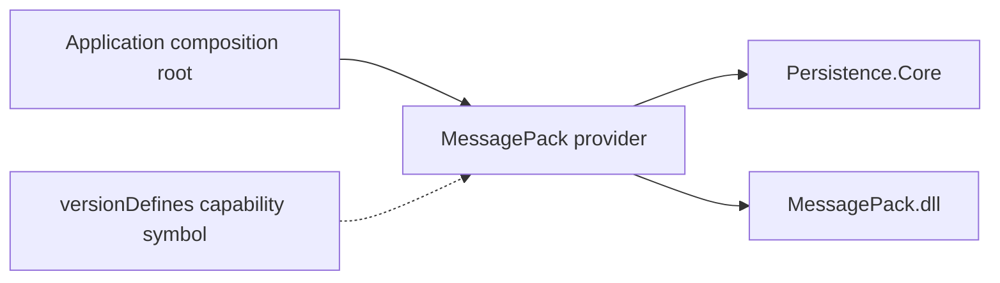
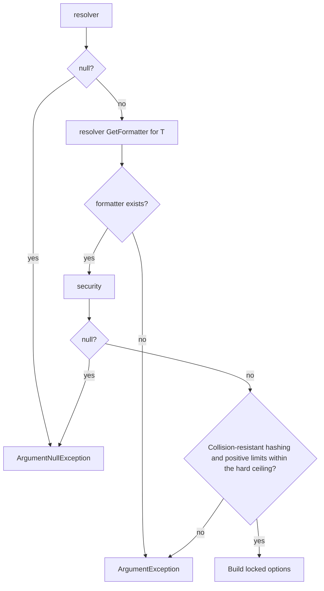

# CycloneGames.Persistence.MessagePack

[English | 简体中文](README.SCH.md)

`CycloneGames.Persistence.MessagePack` is a codec provider for [CycloneGames.Persistence](../CycloneGames.Persistence/README.md). `MessagePackPersistenceCodec<T>` serializes one typed DTO through a caller-supplied source-generated resolver and a `MessagePackSecurity` policy. Record framing, byte limits, checksum verification, and storage orchestration stay in the core package.

The format token is `messagepack-nocompress`. It names uncompressed, current-spec MessagePack with explicit formatters.

## Contents

- [Overview](#overview)
- [Assembly and dependencies](#assembly-and-dependencies)
- [Getting started](#getting-started)
- [Public API](#public-api)
- [Constructor validation](#constructor-validation)
- [Serialization and deserialization](#serialization-and-deserialization)
- [Format identity](#format-identity)
- [Security policy](#security-policy)
- [AOT and IL2CPP](#aot-and-il2cpp)
- [Tests](#tests)
- [Troubleshooting](#troubleshooting)

## Overview

| Item | Value |
| --- | --- |
| Namespace | `CycloneGames.Persistence.MessagePack` |
| Assembly | `CycloneGames.Persistence.MessagePack` |
| Format token | `messagepack-nocompress` |
| Contract | `IPersistenceCodec<T>` |
| Wire profile | Uncompressed, current spec, strict assembly identity checks |

The codec owns no file path, no global resolver, and no application state.

## Assembly and dependencies

| Assembly | References | `defineConstraints` | `autoReferenced` |
| --- | --- | --- | --- |
| `CycloneGames.Persistence.MessagePack` | `CycloneGames.Persistence.Core`, `MessagePack.dll` | `CYCLONEGAMES_HAS_MESSAGEPACK` | `false` |
| `CycloneGames.Persistence.Tests.MessagePack` | Core, provider, `MessagePack.dll`, `MessagePack.Annotations.dll` | `UNITY_INCLUDE_TESTS`, `CYCLONEGAMES_HAS_MESSAGEPACK` | `false` |

Both asmdefs declare the same `versionDefines` entry: `com.github.messagepack-csharp` in the range `[3.1.8,4.0.0)` defines `CYCLONEGAMES_HAS_MESSAGEPACK`. Without that Unity package, the provider and its tests are excluded from compilation. Add the define through `versionDefines`, not through PlayerSettings.

To activate the provider, install the matching `MessagePack` NuGet binary, annotations, and analyzer/source generator, then install the `com.github.messagepack-csharp` Unity package at the same release. Reference `CycloneGames.Persistence.MessagePack` from the consumer asmdef.



## Getting started

### Step 1: define the binary contract

```csharp
using MessagePack;

[MessagePackObject]
public sealed class PlayerPreferences
{
    [Key(0)] public float LookSensitivity { get; set; }
    [Key(1)] public bool InvertY { get; set; }
}
```

Use `[MessagePackObject]` with explicit integer `[Key]` values. Run the MessagePack source generator so `GeneratedMessagePackResolver` contains a formatter for this type.

### Step 2: configure the security policy

```csharp
MessagePackSecurity security = MessagePackSecurity.UntrustedData
    .WithMaximumObjectGraphDepth(64)
    .WithMaximumDecompressedSize(1024 * 1024);
```

`UntrustedData` enables collision-resistant hashing. Both limits must be positive, and the decompressed-size limit cannot exceed `PersistenceLimits.HardMaximumPayloadBytes`.

### Step 3: create and bind the codec

```csharp
var codec = new MessagePackPersistenceCodec<PlayerPreferences>(
    GeneratedMessagePackResolver.Instance,
    security);

IPersistenceStorage storage =
    UnityPersistentStorage.Create("Settings/input.cgp");

var profile = new PersistenceProfile<PlayerPreferences>(
    codec,
    new PersistenceLimits(256 * 1024));

var store = new PersistenceStore<PlayerPreferences>(storage, profile);
```

### Step 4: save and load

```csharp
var preferences = new PlayerPreferences
{
    LookSensitivity = 0.65f,
    InvertY = false
};

PersistenceOperationResult saved = await store.SaveAsync(in preferences, ct);
PersistenceLoadResult<PlayerPreferences> loaded = await store.LoadAsync(ct);

if (loaded.Status == PersistenceLoadStatus.Loaded)
{
    ApplyPreferences(loaded.Value);
}
```

## Public API

| Member | Description |
| --- | --- |
| `MessagePackPersistenceCodec(IFormatterResolver resolver, MessagePackSecurity security)` | Validates both arguments and builds the fixed `MessagePackSerializerOptions`. |
| `CodecId` | `messagepack-nocompress`, a static readonly `PersistenceCodecId`. |
| `Serialize(in T value, IBufferWriter<byte> destination, in PersistenceWriteContext context)` | Calls `MessagePackSerializer.Serialize` with the caller's cancellation token. |
| `Deserialize(ReadOnlyMemory<byte> payload, in PersistenceReadContext context)` | Calls `MessagePackSerializer.Deserialize<T>` and requires that the decoded value consumes the entire payload. |

Options are locked at construction. There is no public setter and no overload that accepts a different option profile under this token.

## Constructor validation



| Option | Value |
| --- | --- |
| `WithCompression` | `MessagePackCompression.None` |
| `WithOldSpec` | `false` |
| `WithOmitAssemblyVersion` | `false` |
| `WithAllowAssemblyVersionMismatch` | `false` |
| `WithSecurity` | The validated caller policy |

## Serialization and deserialization

| Path | Behavior |
| --- | --- |
| `Serialize` | Writes directly into the core store's writer. No intermediate array is allocated by the codec. |
| `Deserialize` | Reads the borrowed `ReadOnlyMemory<byte>` and compares `bytesRead` with `payload.Length`. |
| Trailing bytes | Throws `InvalidDataException` naming the unread byte count. |
| Truncated payload | The MessagePack reader throws; the store classifies it as `DeserializeFailed`. |

One record carries exactly one value. Rejecting trailing bytes catches double encoding and framing mistakes before the value is returned.

## Format identity

`messagepack-nocompress` is uncompressed MessagePack with explicit integer keys. A formatter is resolved from the generated resolver supplied at construction. Contractless, typeless, and reflection-generated resolvers are not accepted. Runtime type names are not persisted.

## Security policy

`MessagePackSecurity.UntrustedData` is the base policy. The constructor rejects policies without collision-resistant hashing, policies with non-positive depth or decompressed-size limits, and limits beyond `PersistenceLimits.HardMaximumPayloadBytes`. The codec itself does not enable compression, so a compressed input cannot expand past the record budget.

Allocation depends on the DTO and the generated formatter. Both codec methods are synchronous CPU work.

## AOT and IL2CPP

IL2CPP needs a generated or explicitly registered formatter for every persisted DTO. Pass the resolver produced by the assembly that owns the DTO and verify the shipping DTO set with a Player build using the shipping stripping configuration. Keep the MessagePack binary, annotations, analyzer, generated resolver, and Unity package on one release.

## Tests

`CycloneGames.Persistence.Tests.MessagePack` is an EditMode assembly gated by `UNITY_INCLUDE_TESTS` and `CYCLONEGAMES_HAS_MESSAGEPACK`. `MessagePackPersistenceCodecTests.cs` covers class and struct round trips, the format token, trailing and truncated payloads, rejection of `MessagePackSecurity.TrustedData`, and byte-for-byte equality with `MessagePackSerializer` configured with the same uncompressed option profile.

## Troubleshooting

| Symptom | Cause | Action |
| --- | --- | --- |
| Provider assembly does not compile | `com.github.messagepack-csharp` is absent or outside the supported range | Install the matching Unity package so `versionDefines` resolves the symbol. |
| `ArgumentException` in the constructor | The resolver has no explicit formatter for `T` | Add `[MessagePackObject]` and `[Key]` attributes, then regenerate the resolver. |
| `ArgumentException` in the constructor | The security policy has a zero limit or weak hashing | Start from `MessagePackSecurity.UntrustedData` with positive limits. |
| `InvalidDataException` mentioning trailing bytes | The payload contains data after the first value | Check for double encoding or an appended block. |
| Deserialized fields hold wrong values | Key numbers do not match the DTO | Align the DTO key attributes with the serialized data. |
| `MissingFormatterException` in an IL2CPP Player | A reflection-based or typeless resolver was used | Switch to a source-generated resolver with explicit formatters. |
| `RecordFormatMismatch` on load | The record was written by a different token | Bind the codec that wrote the record, or write it again with the current profile. |
