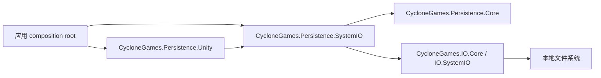
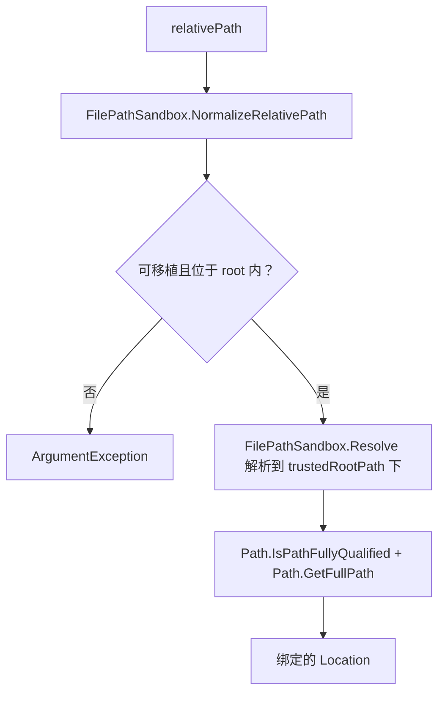
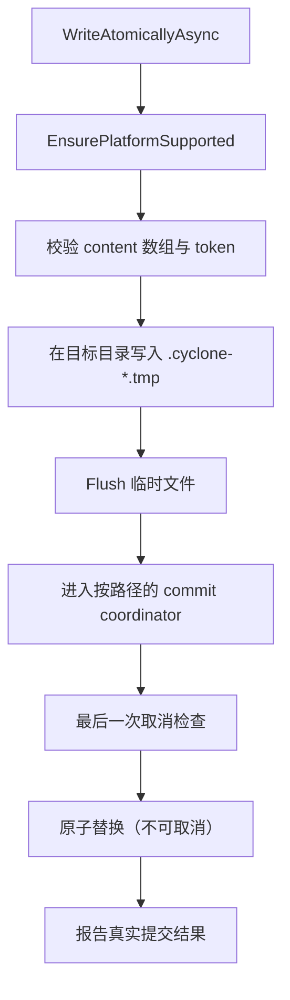

# CycloneGames.Persistence.SystemIO

[English](README.md) | 简体中文

`CycloneGames.Persistence.SystemIO` 为 [CycloneGames.Persistence](../CycloneGames.Persistence/README.SCH.md) 提供 `IPersistenceStorage` 实现，一条 record 对应一个文件。有界读取与原子替换委托给 `CycloneGames.IO`。另一个 assembly `CycloneGames.Persistence.Unity` 负责把可移植相对路径解析到 `Application.persistentDataPath` 下。

两个 assembly 都不选择 codec，也不处理 settings、存档槽位、加密或游戏状态。

## 目录

- [概述](#概述)
- [Assembly 与依赖](#assembly-与依赖)
- [快速上手](#快速上手)
- [公共 API](#公共-api)
- [Storage 契约](#storage-契约)
- [路径绑定](#路径绑定)
- [原子写入与取消](#原子写入与取消)
- [平台守卫](#平台守卫)
- [应用所有权](#应用所有权)
- [测试](#测试)
- [问题排查](#问题排查)

## 概述

| 类 | Assembly | 作用 |
| --- | --- | --- |
| `SystemFilePersistenceStorage` | `CycloneGames.Persistence.SystemIO` | 把一个完全限定路径绑定到 storage 契约 |
| `UnityPersistentStorage` | `CycloneGames.Persistence.Unity` | 把相对路径解析到 `Application.persistentDataPath` 下的静态工厂 |

Provider 不持有 worker thread、cache、queue、retry loop 或 timer。它只保存一个规范化路径，所有文件操作都委托给 `SystemFileStore`。

## Assembly 与依赖

| Assembly | 引用 | `autoReferenced` | `noEngineReferences` |
| --- | --- | --- | --- |
| `CycloneGames.Persistence.SystemIO` | `CycloneGames.Persistence.Core`、`CycloneGames.IO.Core`、`CycloneGames.IO.SystemIO` | `false` | `true` |
| `CycloneGames.Persistence.Unity` | `CycloneGames.Persistence.Core`、`CycloneGames.Persistence.SystemIO` | `false` | `false` |

`package.json` 声明依赖 `com.cyclone-games.persistence` `1.0.0` 与 `com.cyclone-games.io` `1.0.0`。Unity assembly 为访问 `Application.persistentDataPath` 而引用 `UnityEngine`。Consumer 只引用 composition root 实际使用的 assembly。



本 package 不依赖 VYaml、MessagePack、Settings、DI container 或 PlayerPrefs。

## 快速上手

### 第 1 步：在 Unity host 中绑定路径

```csharp
using CycloneGames.Persistence;
using CycloneGames.Persistence.Unity;

// Call on the Unity main thread (Awake or Start).
IPersistenceStorage storage =
    UnityPersistentStorage.Create("Settings/audio.cgp");
```

`Create` 只读取一次 `Application.persistentDataPath`。返回对象是 `SystemFilePersistenceStorage`，之后不再调用 Unity API，因此可以作为依赖传给非主线程代码。

### 第 2 步：在纯 C# host 中绑定路径

```csharp
using System.IO;
using CycloneGames.Persistence.SystemIO;

var storage = new SystemFilePersistenceStorage(
    Path.GetFullPath("./Data/player.cgp"));
```

直接构造函数只接受完全限定路径。它先用 `Path.IsPathFullyQualified` 检查，再由 `Path.GetFullPath` 规范化为 `Location`。

### 第 3 步：组装 store

```csharp
using CycloneGames.Persistence;
using CycloneGames.Persistence.VYaml;

var codec = new VYamlPersistenceCodec<AudioSettings>(
    GeneratedResolver.Instance);

var profile = new PersistenceProfile<AudioSettings>(
    codec,
    new PersistenceLimits(256 * 1024));

var store = new PersistenceStore<AudioSettings>(storage, profile);
```

一个 storage 实例代表一条 record。每条独立 record 或存档槽位使用独立的可信路径。父目录必须在首次写入前创建好，provider 不创建目录。

## 公共 API

### `SystemFilePersistenceStorage`

| 成员 | 说明 |
| --- | --- |
| `SystemFilePersistenceStorage(string absolutePath)` | 使用 `SystemFileStore.Default`；空路径或相对路径抛 `ArgumentException`。 |
| `Location` | 规范化后的绝对路径。属于诊断 metadata，进入遥测或玩家可见输出前要脱敏。 |
| `static CreateSandboxed(string trustedRootPath, string relativePath)` | 规范化可移植相对路径，并解析到可信 root 下。 |
| `ReadAsync(int maxByteCount, CancellationToken = default)` | 带 Missing 判断的有界读取，返回 `Found(byte[])` 或 `Missing()`。 |
| `WriteAtomicallyAsync(byte[] content, CancellationToken = default)` | 借用数组直到 task 完成；null 抛 `ArgumentNullException`。 |
| `DeleteAsync(CancellationToken = default)` | 幂等删除。 |

还有一个接收 `SystemFileStore` 的 internal 构造函数供测试使用。`EnsurePlatformSupported()` 是 internal，构造时和每次操作都会执行。

### `UnityPersistentStorage`

| 成员 | 说明 |
| --- | --- |
| `static IPersistenceStorage Create(string relativePath)` | 调用 `SystemFilePersistenceStorage.CreateSandboxed(Application.persistentDataPath, relativePath)`。 |

`Create` 必须在 Unity 主线程执行。路径校验由 `FilePathSandbox.NormalizeRelativePath` 完成。

## Storage 契约

| 方法 | 行为 |
| --- | --- |
| `ReadAsync` | 调用 `SystemFileStore.ReadBytesAsync(Location, maxByteCount, token)`。`FileNotFoundException` 与 `DirectoryNotFoundException` 转为 `Missing()`；其他 I/O 错误向上传播。 |
| `WriteAtomicallyAsync` | 调用 `SystemFileStore.WriteBytesAtomicallyAsync(Location, content, token)`。Provider 不保留也不修改 `content`。 |
| `DeleteAsync` | 检查取消状态，调用 `SystemFileStore.Delete(Location)`，目标不存在视为成功。 |

```csharp
await storage.WriteAtomicallyAsync(recordBytes, cancellationToken);
// The array is safe to clear once the task completes.

PersistenceStorageReadResult result =
    await storage.ReadAsync(maxByteCount: 1024, cancellationToken);

if (!result.IsMissing)
{
    byte[] record = result.Content; // 所有权移交给当前调用方。
}
```

Store 调用 `ReadAsync` 时传入 `PersistenceLimits.MaximumRecordBytes` 作为 `maxByteCount`，并接管返回数组的所有权。直接调用 storage 契约的调用方自己持有该数组。

## 路径绑定

`CreateSandboxed` 先规范化相对路径再解析：

```csharp
var storage = SystemFilePersistenceStorage.CreateSandboxed(
    "/home/app/data",
    "profiles/user.cgp");
```

`FilePathSandbox.NormalizeRelativePath` 拒绝以下输入：

| 输入 | 原因 |
| --- | --- |
| `../outside.save` | 包含遍历段 `..` |
| `Path.GetFullPath(...)` 这类 rooted path | 不是可移植相对路径 |
| `Saves//slot.save` | 空路径段 |
| `CON.save`、`NUL.save` | Windows 保留设备名 |
| 词法上逃逸出 root 的路径 | Root escape |

这是词法检查，不覆盖「绑定之后、操作之前目录被替换为 symlink 或 reparse point」的情况。存在对抗性本地写入者的产品需要基于 directory handle 或等价 no-follow 原语实现平台 provider。



## 原子写入与取消

`WriteBytesAtomicallyAsync` 在目标目录创建临时文件，写入并 flush 后替换目标文件。平台提供原子原语时，替换失败会保留原先完整的 record。



异步传输期间会响应 cancellation。等待按路径的 commit coordinator 本身不可取消；等待期间产生的取消请求会在当前 writer 进入协调区域后立即被观察。协调区域内最后一次取消检查通过后，替换成为不可取消的 commit point。替换已成功就报告成功，即使 token 随后取消。

临时文件使用 `.cyclone-*.tmp` 命名。进程突然终止可能在 commit 或清理前留下已写完的临时文件。本 provider 不在启动时扫描或删除临时文件。清理 policy 必须有明确 owner，并在删除前校验目录范围、文件名模式、文件年龄和 active writer 排除条件。

原子替换不是备份轮换，也不覆盖所有断电或存储控制器故障模式。

## 平台守卫

```csharp
#if UNITY_5_3_OR_NEWER && !UNITY_EDITOR && !UNITY_STANDALONE \
    && !UNITY_IOS && !UNITY_ANDROID && !UNITY_SERVER
    throw new PlatformNotSupportedException(
        "The System.IO persistence adapter is not enabled for this player platform. " +
        "Bind a platform save-data implementation to IPersistenceStorage instead.");
#endif
```

`EnsurePlatformSupported()` 会在不属于 `UNITY_STANDALONE`、`UNITY_IOS`、`UNITY_ANDROID`、`UNITY_SERVER` 的 WebGL 与主机目标上抛异常。Editor、桌面、移动端和 dedicated-server 构建放行。这些平台具备本地文件系统；WebGL 需要基于 IndexedDB 的 `IPersistenceStorage`，主机平台需要基于平台 save-data SDK 的 adapter。

读取会分配一份有界 record array，加上有界的 adapter 开销。写入借用已经物化的 record array，provider 层不复制内容。工作量为 O(record bytes)。

## 应用所有权

应用负责：

- 可信 root 与相对 record 名称；
- storage 与 `PersistenceStore<T>` 的生命周期；
- 序列化、校验、schema 决策和保存时机；
- 错误报告以及面向玩家的恢复策略。

Provider 只使用经过规范化的绑定路径，不会自行删除损坏的 record，也不附加重试或配额策略。

## 测试

| Assembly | 覆盖内容 |
| --- | --- |
| `CycloneGames.Persistence.Tests.SystemIO` | `CreateSandboxed` 路径拒绝、有界读取、原子写入、幂等删除、Missing round trip 与预取消操作。测试在 `SetUp` 创建临时目录，在 `TearDown` 删除。 |
| `CycloneGames.Persistence.Tests.Unity` | 非可移植相对路径的拒绝，以及 `Create` 返回 `IPersistenceStorage`。 |

两者都是由 `UNITY_INCLUDE_TESTS` 门控的 EditMode assembly。

## 问题排查

| 现象 | 原因 | 处理 |
| --- | --- | --- |
| 写入抛 `ArgumentNullException` | 传入 null content array | 传入 `PersistenceStore` 产生的 exact record array。 |
| 构造函数抛 `ArgumentException` | 路径不是完全限定路径 | 使用 `Path.GetFullPath` 或 `CreateSandboxed`。 |
| `CreateSandboxed` 抛 `ArgumentException` | 相对路径含 `..`、rooted path、空段或保留设备名 | 使用不含 traversal 的可移植相对路径。 |
| WebGL 抛 `PlatformNotSupportedException` | Provider 在该 player 平台主动抛出 | 注入基于 IndexedDB 的 `IPersistenceStorage` adapter。 |
| 有效路径产生 `FileNotFoundException` | 父目录不存在 | 首次写入前创建目录结构。 |
| 写入成功但旧文件仍在 | 平台缺少原子替换原语 | 在目标硬件上检查文件系统的原子替换能力。 |
| `.cyclone-*.tmp` 文件累积 | 写入期间进程终止 | 实现启动清理 policy，校验目录范围、pattern、年龄和 active writer 排除。 |
| `UnityPersistentStorage.Create` 在后台线程抛异常 | `Application.persistentDataPath` 需要主线程 | 从 `Awake` 或 `Start` 调用，并把构造好的 storage 作为依赖传入。 |
