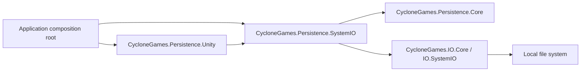
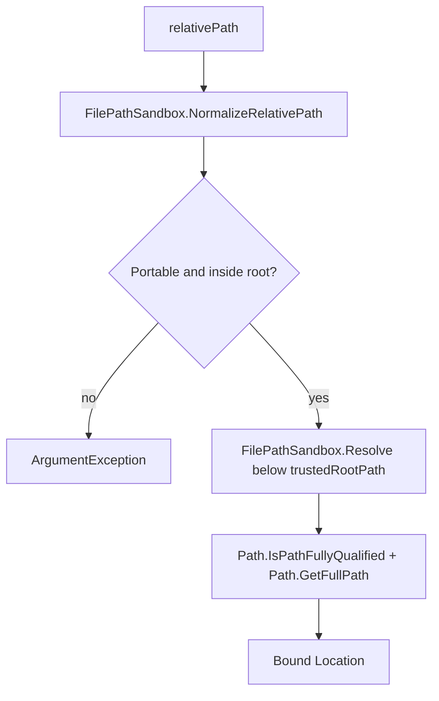
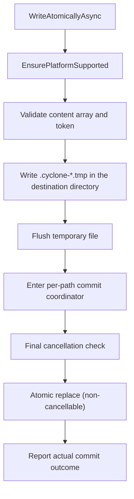

# CycloneGames.Persistence.SystemIO

[English | 简体中文](README.SCH.md)

`CycloneGames.Persistence.SystemIO` implements `IPersistenceStorage` for [CycloneGames.Persistence](../CycloneGames.Persistence/README.md) with one file per record. Bounded reads and atomic replacement are delegated to `CycloneGames.IO`. A second assembly, `CycloneGames.Persistence.Unity`, resolves portable relative paths below `Application.persistentDataPath`.

Neither assembly chooses a codec or handles settings, save slots, encryption, or game state.

## Contents

- [Overview](#overview)
- [Assembly and dependencies](#assembly-and-dependencies)
- [Getting started](#getting-started)
- [Public API](#public-api)
- [Storage contract](#storage-contract)
- [Path binding](#path-binding)
- [Atomic write and cancellation](#atomic-write-and-cancellation)
- [Platform guard](#platform-guard)
- [Application ownership](#application-ownership)
- [Tests](#tests)
- [Troubleshooting](#troubleshooting)

## Overview

| Class | Assembly | Role |
| --- | --- | --- |
| `SystemFilePersistenceStorage` | `CycloneGames.Persistence.SystemIO` | Binds one fully qualified path to the storage contract |
| `UnityPersistentStorage` | `CycloneGames.Persistence.Unity` | Static factory that resolves a relative path below `Application.persistentDataPath` |

The provider owns no worker thread, cache, queue, retry loop, or timer. It holds one normalized path and delegates every file operation to `SystemFileStore`.

## Assembly and dependencies

| Assembly | References | `autoReferenced` | `noEngineReferences` |
| --- | --- | --- | --- |
| `CycloneGames.Persistence.SystemIO` | `CycloneGames.Persistence.Core`, `CycloneGames.IO.Core`, `CycloneGames.IO.SystemIO` | `false` | `true` |
| `CycloneGames.Persistence.Unity` | `CycloneGames.Persistence.Core`, `CycloneGames.Persistence.SystemIO` | `false` | `false` |

`package.json` declares `com.cyclone-games.persistence` `1.0.0` and `com.cyclone-games.io` `1.0.0`. The Unity assembly references `UnityEngine` for `Application.persistentDataPath`. A consumer references only the assembly its composition root uses.



The package has no VYaml, MessagePack, Settings, DI-container, or PlayerPrefs dependency.

## Getting started

### Step 1: bind a path in a Unity host

```csharp
using CycloneGames.Persistence;
using CycloneGames.Persistence.Unity;

// Call on the Unity main thread (Awake or Start).
IPersistenceStorage storage =
    UnityPersistentStorage.Create("Settings/audio.cgp");
```

`Create` reads `Application.persistentDataPath` once. The returned object is a `SystemFilePersistenceStorage` and no longer calls Unity APIs, so it can be passed to code running off the main thread.

### Step 2: bind a path in a pure C# host

```csharp
using System.IO;
using CycloneGames.Persistence.SystemIO;

var storage = new SystemFilePersistenceStorage(
    Path.GetFullPath("./Data/player.cgp"));
```

The direct constructor accepts fully qualified paths only. `Path.IsPathFullyQualified` is checked before `Path.GetFullPath` normalizes the value into `Location`.

### Step 3: compose the store

```csharp
using CycloneGames.Persistence;
using CycloneGames.Persistence.VYaml;

var codec = new VYamlPersistenceCodec<AudioSettings>(
    GeneratedResolver.Instance);

var profile = new PersistenceProfile<AudioSettings>(
    codec,
    new PersistenceLimits(256 * 1024));

var store = new PersistenceStore<AudioSettings>(storage, profile);
```

One storage instance represents one record. Use a separate trusted path for each independent record or save slot. The parent directory must exist before the first write; the provider does not create directories.

## Public API

### `SystemFilePersistenceStorage`

| Member | Description |
| --- | --- |
| `SystemFilePersistenceStorage(string absolutePath)` | Uses `SystemFileStore.Default`; throws `ArgumentException` for a blank or relative path. |
| `Location` | Normalized absolute path. Diagnostic metadata; redact before telemetry or player-facing output. |
| `static CreateSandboxed(string trustedRootPath, string relativePath)` | Normalizes a portable relative path and resolves it below the trusted root. |
| `ReadAsync(int maxByteCount, CancellationToken = default)` | Bounded read with missing detection. Returns `Found(byte[])` or `Missing()`. |
| `WriteAtomicallyAsync(byte[] content, CancellationToken = default)` | Borrows the array until the task completes. Throws `ArgumentNullException` for null. |
| `DeleteAsync(CancellationToken = default)` | Idempotent deletion. |

An internal constructor accepts a `SystemFileStore` instance for tests. `EnsurePlatformSupported()` is internal and runs on construction and on every operation.

### `UnityPersistentStorage`

| Member | Description |
| --- | --- |
| `static IPersistenceStorage Create(string relativePath)` | Calls `SystemFilePersistenceStorage.CreateSandboxed(Application.persistentDataPath, relativePath)`. |

`Create` must run on the Unity main thread. Path validation is performed by `FilePathSandbox.NormalizeRelativePath`.

## Storage contract

| Method | Behavior |
| --- | --- |
| `ReadAsync` | Calls `SystemFileStore.ReadBytesAsync(Location, maxByteCount, token)`. `FileNotFoundException` and `DirectoryNotFoundException` become `Missing()`; other I/O errors propagate. |
| `WriteAtomicallyAsync` | Calls `SystemFileStore.WriteBytesAtomicallyAsync(Location, content, token)`. The provider does not retain or mutate `content`. |
| `DeleteAsync` | Checks cancellation, calls `SystemFileStore.Delete(Location)`, and treats a missing entry as success. |

```csharp
await storage.WriteAtomicallyAsync(recordBytes, cancellationToken);
// The array is safe to clear once the task completes.

PersistenceStorageReadResult result =
    await storage.ReadAsync(maxByteCount: 1024, cancellationToken);

if (!result.IsMissing)
{
    byte[] record = result.Content; // Ownership transfers to this caller.
}
```

When the store calls `ReadAsync`, it passes `PersistenceLimits.MaximumRecordBytes` as `maxByteCount` and takes ownership of the returned array. A direct caller of the storage contract owns the array itself.

## Path binding

`CreateSandboxed` normalizes the relative path before resolving it:

```csharp
var storage = SystemFilePersistenceStorage.CreateSandboxed(
    "/home/app/data",
    "profiles/user.cgp");
```

`FilePathSandbox.NormalizeRelativePath` rejects:

| Input | Reason |
| --- | --- |
| `../outside.save` | Traversal segment `..` |
| A rooted path such as `Path.GetFullPath(...)` | Not a portable relative path |
| `Saves//slot.save` | Empty path segment |
| `CON.save`, `NUL.save` | Reserved Windows device name |
| A path that lexically escapes the root | Root escape |

The check is lexical. It does not cover a directory being replaced by a symlink or reparse point between binding and an operation.



## Atomic write and cancellation

`WriteBytesAtomicallyAsync` creates a temporary file in the destination directory, writes and flushes it, then replaces the destination. A failed replacement leaves the previous complete record in place when the platform supplies the atomic primitive.



Cancellation is observed during asynchronous transfer. Waiting for the per-path commit coordinator is not cancellable; a cancellation request raised during that wait is observed immediately after this writer enters the coordinator. Once the final check inside the coordinator passes, replacement is the non-cancellable commit point. A successful replacement reports success even if the token is cancelled afterwards.

The temporary file uses the `.cyclone-*.tmp` pattern. Abrupt process termination can leave a completed temporary file before commit or cleanup. This provider does not scan or delete temporary files at startup. A cleanup policy needs an explicit owner and must validate directory scope, filename pattern, age, and active-writer exclusion before deleting anything.

Atomic replacement is not backup rotation and does not cover every power-loss or storage-controller failure mode.

## Platform guard

```csharp
#if UNITY_5_3_OR_NEWER && !UNITY_EDITOR && !UNITY_STANDALONE \
    && !UNITY_IOS && !UNITY_ANDROID && !UNITY_SERVER
    throw new PlatformNotSupportedException(
        "The System.IO persistence adapter is not enabled for this player platform. " +
        "Bind a platform save-data implementation to IPersistenceStorage instead.");
#endif
```

`EnsurePlatformSupported()` throws on WebGL and console targets that are not `UNITY_STANDALONE`, `UNITY_IOS`, `UNITY_ANDROID`, or `UNITY_SERVER`. Editor, desktop, mobile, and dedicated-server builds pass through. Those platforms use a local file system; WebGL needs an IndexedDB-backed `IPersistenceStorage`, and console targets need an adapter built on the platform save-data SDK.

Reads allocate one bounded record array plus bounded adapter overhead. Writes borrow the already materialized record array without a provider-level content clone. Work is O(record bytes).

## Application ownership

The application owns:

- the trusted root and the relative record name;
- the storage and `PersistenceStore<T>` lifetime;
- serialization, validation, schema decisions, and save timing;
- error reporting and the recovery policy shown to the player.

The provider uses only its normalized bound path, never deletes a damaged record on its own, and does not add a retry or quota policy.

## Tests

| Assembly | Coverage |
| --- | --- |
| `CycloneGames.Persistence.Tests.SystemIO` | `CreateSandboxed` path rejection, bounded read, atomic write, idempotent delete, missing round trip, and pre-cancelled operations. Tests use a temporary directory created in `SetUp` and removed in `TearDown`. |
| `CycloneGames.Persistence.Tests.Unity` | Rejection of non-portable relative paths and a successful `Create` that returns an `IPersistenceStorage`. |

Both are EditMode assemblies gated by `UNITY_INCLUDE_TESTS`.

## Troubleshooting

| Symptom | Cause | Action |
| --- | --- | --- |
| `ArgumentNullException` on write | A null content array was passed | Pass the exact record array produced by `PersistenceStore`. |
| `ArgumentException` in the constructor | The path is not fully qualified | Use `Path.GetFullPath` or `CreateSandboxed`. |
| `ArgumentException` in `CreateSandboxed` | The relative path contains `..`, a rooted path, an empty segment, or a reserved device name | Use a portable relative path without traversal. |
| `PlatformNotSupportedException` on WebGL | The provider throws on that player platform | Inject an IndexedDB-backed `IPersistenceStorage` adapter. |
| `FileNotFoundException` for a valid path | The parent directory does not exist | Create the directory structure before the first write. |
| Write succeeds but the old file remains | The platform lacks the atomic replacement primitive | Check the target file-system capabilities on the target hardware. |
| `.cyclone-*.tmp` files accumulate | The process terminated during a write | Implement a startup cleanup policy with directory scope, pattern, age, and active-writer exclusion checks. |
| `UnityPersistentStorage.Create` throws on a background thread | `Application.persistentDataPath` requires the main thread | Call it from `Awake` or `Start` and pass the constructed storage as a dependency. |
