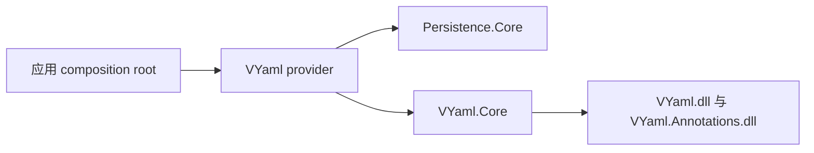
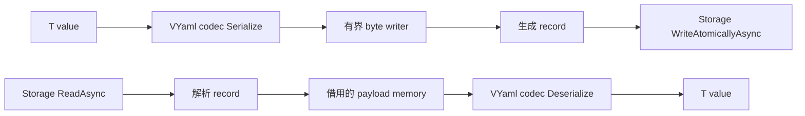

# CycloneGames.Persistence.VYaml

[English](README.md) | 简体中文

`CycloneGames.Persistence.VYaml` 是 [CycloneGames.Persistence](../CycloneGames.Persistence/README.SCH.md) 的 codec provider。`VYamlPersistenceCodec<T>` 通过 source-generated formatter resolver，把一个类型化 DTO 与 UTF-8 YAML 相互转换。Record framing、字节上限、checksum 校验和 storage 编排仍由 core package 负责。

格式 token 是 `vyaml-utf8-lf`。YAML 输出可以直接用文本编辑器查看，便于检查设置和诊断记录。

## 目录

- [概述](#概述)
- [Assembly 与依赖](#assembly-与依赖)
- [快速上手](#快速上手)
- [公共 API](#公共-api)
- [Resolver 链](#resolver-链)
- [序列化行为](#序列化行为)
- [DTO 规则](#dto-规则)
- [格式身份](#格式身份)
- [AOT 与 IL2CPP](#aot-与-il2cpp)
- [测试](#测试)
- [问题排查](#问题排查)

## 概述

| 项目 | 值 |
| --- | --- |
| Namespace | `CycloneGames.Persistence.VYaml` |
| Assembly | `CycloneGames.Persistence.VYaml` |
| 格式 token | `vyaml-utf8-lf` |
| 契约 | `IPersistenceCodec<T>` |
| 输出 | UTF-8 without BOM，LF 行尾 |

Codec 不持有文件路径、全局 resolver 或应用状态。它由 composition root 构造，并绑定到 `PersistenceProfile<T>`。

## Assembly 与依赖

| Assembly | 引用 | `autoReferenced` | `noEngineReferences` |
| --- | --- | --- | --- |
| `CycloneGames.Persistence.VYaml` | `CycloneGames.Persistence.Core`、`VYaml.Core` | `false` | `true` |
| `CycloneGames.Persistence.Tests.VYaml` | Core、provider、`VYaml.Core` | `false` | `true` |

两个 asmdef 都由 `CYCLONEGAMES_HAS_VYAML` 门控，该符号通过 `versionDefines` 依据 `jp.hadashikick.vyaml` 的 `[1.4.0,2.0.0)` 范围产生。缺少该 Unity package 时，provider 与测试都不参与编译，不会出现 `VYaml.Core` 缺引用的警告。符号生效后再在 consumer asmdef 中显式添加 `CycloneGames.Persistence.VYaml`。

当前 checkout 中 VYaml 由两部分协同安装：NuGetForUnity 安装 `VYaml`、`VYaml.Annotations` 和 source generator 产物；Unity Package Manager 通过 Git package URL 安装 `jp.hadashikick.vyaml`，它提供 `VYaml.Core` 和 Unity formatter。所有产物保持同一 release。测试 asmdef 设置 `overrideReferences: true`，并把 `VYaml.dll`、`VYaml.Annotations.dll` 列为 precompiled references。门控只感知 Unity package；NuGet assemblies 仍需单独安装，被门控的 assembly 才能编译。



## 快速上手

### 第 1 步：定义 DTO

```csharp
using VYaml.Annotations;

namespace MyGame.Contracts
{
    [YamlObject]
    public sealed partial class AudioSettings
    {
        public float MasterVolume { get; set; } = 1f;
        public bool Muted { get; set; }
    }
}
```

类必须是 `partial` 并标注 `[YamlObject]`。Source generator 会在 DTO 所在 namespace 生成 `GeneratedResolver`。修改字段后要重新构建。

### 第 2 步：创建 codec

```csharp
using CycloneGames.Persistence.VYaml;
using MyGame.Contracts;

var codec = new VYamlPersistenceCodec<AudioSettings>(
    GeneratedResolver.Instance);
```

构造函数会调用 `primaryResolver.GetFormatter<AudioSettings>()`。缺少 formatter 时抛 `ArgumentException`，传入 null 时抛 `ArgumentNullException`。

### 第 3 步：绑定到 store

```csharp
using CycloneGames.Persistence;
using CycloneGames.Persistence.Unity;

IPersistenceStorage storage =
    UnityPersistentStorage.Create("Settings/audio.cgp");

var profile = new PersistenceProfile<AudioSettings>(
    codec,
    new PersistenceLimits(256 * 1024));

var store = new PersistenceStore<AudioSettings>(storage, profile);
```

### 第 4 步：保存与加载

```csharp
var settings = new AudioSettings { MasterVolume = 0.8f, Muted = false };

PersistenceOperationResult saved = await store.SaveAsync(in settings, ct);
PersistenceLoadResult<AudioSettings> loaded = await store.LoadAsync(ct);

if (loaded.Status == PersistenceLoadStatus.Loaded)
{
    ApplySettings(loaded.Value);
}
```

## 公共 API

| 成员 | 说明 |
| --- | --- |
| `VYamlPersistenceCodec(IYamlFormatterResolver primaryResolver)` | 校验 resolver 是否包含 `T` 的 formatter，然后构建固定的 resolver 链。 |
| `CodecId` | `vyaml-utf8-lf`，静态只读 `PersistenceCodecId`。 |
| `Serialize(in T value, IBufferWriter<byte> destination, in PersistenceWriteContext context)` | 直接把 YAML 写入传入的 writer；destination 为 null 时抛 `ArgumentNullException`。 |
| `Deserialize(ReadOnlyMemory<byte> payload, in PersistenceReadContext context)` | 解析借用的 payload 并返回 `T`。 |

`YamlSerializerOptions` 只在构造时创建一次。除构造时传入的 resolver 外没有公开配置接口，构造完成后也没有可变状态。

## Resolver 链

`VYamlPersistenceCodec<T>` 在构造时创建一个私有的 `IYamlFormatterResolver`：

```csharp
public IYamlFormatter<TValue> GetFormatter<TValue>()
{
    IYamlFormatter<TValue> formatter = _primaryResolver.GetFormatter<TValue>();
    if (formatter != null) return formatter;

    formatter = StandardResolver.Instance.GetFormatter<TValue>();
    if (formatter != null) return formatter;

    return UnityResolver.Instance.GetFormatter<TValue>();
}
```

| 顺序 | Resolver | 处理范围 |
| --- | --- | --- |
| 1 | 调用方 generated resolver | `[YamlObject]` DTO 与嵌套生成类型 |
| 2 | `StandardResolver` | primitive、string、集合及内置类型 |
| 3 | `UnityResolver` | `UnityEngine` 类型 |

顺序固定，内置 fallback 不能覆盖 generated formatter。这里没有 reflection discovery、resolver registry、可变全局默认值，也没有 runtime type-name contract。



## 序列化行为

| 属性 | 行为 |
| --- | --- |
| 输出编码 | UTF-8 without BOM |
| 行尾 | 仅 LF，不含 CR 字节 |
| 目标 | Core store 的 writer，经由 `Utf8YamlEmitter` |
| 中间副本 | 无；emitter 通过 `GetSpan` 与 `Advance` 写入 |
| 反序列化输入 | Store 的 record array 借出的 `ReadOnlyMemory<byte>` |
| 保留 | 返回后不保留 payload、value、writer 或 context |

`Serialize` 在目标上创建 `Utf8YamlEmitter`，再调用 `YamlSerializer.Serialize`。目标有预算上限，payload 超出配置上限时会抛 `PersistencePayloadBudgetExceededException`，由 store 归类为 `PayloadTooLarge`。`Deserialize` 调用 `YamlSerializer.Deserialize<T>`；格式错误的 YAML 抛异常，store 归类为 `DeserializeFailed`。

除 core 强制的 record 字节上限之外，codec 不额外施加 parser depth、alias 展开、CPU 时间或栈预算。

## DTO 规则

- 每个持久化类型都要标注 `[YamlObject]` 并声明为 `partial`。
- 修改字段后重新生成 resolver。
- DTO 放在 `MyGame.Contracts` 之类的中性 namespace。生成的 formatter 代码引用 `VYaml.Annotations`、`VYaml.Serialization` 时没有 global 前缀，项目内的 `VYaml` namespace 会遮蔽依赖。
- 声明 `[YamlObject]` 类型的 assembly 需要各自的 internal `ModuleInitializerAttribute` shim。VYaml generator 依据 attribute metadata name 生成 `[ModuleInitializer]`，而 `VYaml.dll` 只暴露该 attribute 的 internal 副本。`Tests/Editor/ModuleInitializerAttributeShim.cs` 给出了定义。
- `T` 是纯 managed 数据，不能持有 `IDisposable` 资源、unmanaged handle 或线程亲和状态。

## 格式身份

`vyaml-utf8-lf` 是不带 BOM、LF 行尾的 UTF-8 YAML。VYaml 按字段名映射，payload 中缺失的字段取类型默认值。Token 在解析时按 ordinal 相等比较。

`vyaml-utf8-lf` 在解析时按 ordinal 相等比较。由其他 token 写出的 record 会在 codec 执行之前返回 `RecordFormatMismatch`。

## AOT 与 IL2CPP

IL2CPP 下每个持久化 DTO 都必须有 generated 或显式注册的 formatter。传入拥有该 DTO 的 assembly 所生成的 resolver，并用发布时的 DTO 集合与 stripping 配置做 Player build 验证。

Public contract 不暴露 `UnityEngine` 类型。只含标准 managed 类型的 DTO 不会进入 Unity formatter 路径；包含 Unity 类型的 DTO 会通过 `VYaml.Core` 解析，因此需要 Unity host。Codec 在持久化 workflow owner 选择的线程上同步执行，自身不持有可变状态。

## 测试

`CycloneGames.Persistence.Tests.VYaml` 是由 `UNITY_INCLUDE_TESTS` 门控的 EditMode assembly。`VYamlPersistenceCodecTests.cs` 覆盖格式 token、class/struct round trip、无 BOM 的 UTF-8 输出、LF-only 行尾、目标预算、resolver 校验以及反序列化失败后的恢复。`VYamlModuleInitializerShimTests.cs` 校验生成的注册类型。Fixture DTO 放在 `CycloneGames.Tests.Persistence.VYamlFixtures`。

## 问题排查

| 现象 | 原因 | 处理 |
| --- | --- | --- |
| 构造函数抛 `ArgumentNullException` | 传入 null resolver | 传入 `GeneratedResolver.Instance` 或其他具体 resolver。 |
| 构造函数抛 `ArgumentException` | Resolver 没有 `T` 的 formatter | 添加 `[YamlObject]`、声明 `partial` 并重新构建。 |
| 编译错误：`VYaml.Annotations` 不存在 | 项目内 `VYaml` namespace 遮蔽依赖 | 把 DTO 移到中性 namespace 后重新构建。 |
| 生成的 `[ModuleInitializer]` 报 CS0122 | Assembly 缺少 internal attribute shim | 添加 assembly-local `ModuleInitializerAttribute` 定义。 |
| IL2CPP Player 抛 `MissingFormatterException` | DTO 缺少 generated formatter | 生成或注册 formatter，并把 resolver 纳入构建。 |
| 输出含 CR 字节或 BOM | NuGet package 与 Unity package 不是同一 release | 对齐到同一 release。 |
| `DeserializeFailed` 且 YAML 结构损坏 | Record checksum 有效，但 YAML 无法解析 | 检查 payload，修正产生它的写入方。 |
| Save 返回 `PayloadTooLarge` | YAML 超出 profile 上限 | 在 1048576 内提高 `PersistenceLimits`，或缩减 DTO。 |
