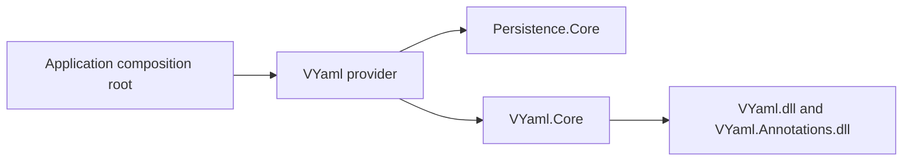
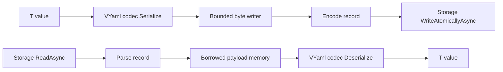

# CycloneGames.Persistence.VYaml

[English | 简体中文](README.SCH.md)

`CycloneGames.Persistence.VYaml` is a codec provider for [CycloneGames.Persistence](../CycloneGames.Persistence/README.md). `VYamlPersistenceCodec<T>` maps one typed DTO to UTF-8 YAML through a source-generated formatter resolver. Record framing, byte limits, checksum verification, and storage orchestration stay in the core package.

The format token is `vyaml-utf8-lf`. YAML output is readable in a text editor, which makes settings and diagnostic records easy to inspect.

## Contents

- [Overview](#overview)
- [Assembly and dependencies](#assembly-and-dependencies)
- [Getting started](#getting-started)
- [Public API](#public-api)
- [Resolver chain](#resolver-chain)
- [Serialization behavior](#serialization-behavior)
- [DTO rules](#dto-rules)
- [Format identity](#format-identity)
- [AOT and IL2CPP](#aot-and-il2cpp)
- [Tests](#tests)
- [Troubleshooting](#troubleshooting)

## Overview

| Item | Value |
| --- | --- |
| Namespace | `CycloneGames.Persistence.VYaml` |
| Assembly | `CycloneGames.Persistence.VYaml` |
| Format token | `vyaml-utf8-lf` |
| Contract | `IPersistenceCodec<T>` |
| Output | UTF-8 without BOM, LF line endings |

The codec owns no file path, no global resolver, and no application state. The composition root constructs it and binds it to a `PersistenceProfile<T>`.

## Assembly and dependencies

| Assembly | References | `autoReferenced` | `noEngineReferences` |
| --- | --- | --- | --- |
| `CycloneGames.Persistence.VYaml` | `CycloneGames.Persistence.Core`, `VYaml.Core` | `false` | `true` |
| `CycloneGames.Persistence.Tests.VYaml` | Core, provider, `VYaml.Core` | `false` | `true` |

Both asmdefs are gated by `CYCLONEGAMES_HAS_VYAML`, declared through `versionDefines` on `jp.hadashikick.vyaml` in the `[1.4.0,2.0.0)` range. When that Unity package is absent, the provider and its tests are excluded from compilation instead of reporting a missing `VYaml.Core` reference. Add `CycloneGames.Persistence.VYaml` to the consumer asmdef when the symbol is active.

VYaml is installed in two coordinated parts in this checkout: NuGetForUnity installs `VYaml`, `VYaml.Annotations`, and the source generator artifacts; Unity Package Manager installs `jp.hadashikick.vyaml` from its Git package URL, which supplies `VYaml.Core` and the Unity formatters. Keep all of them on one release. The test asmdef sets `overrideReferences: true` and lists `VYaml.dll` and `VYaml.Annotations.dll`. The gate observes the Unity package only; the NuGet assemblies still have to be installed before the gated assembly can compile.



## Getting started

### Step 1: define the DTO

```csharp
using VYaml.Annotations;

namespace MyGame.Contracts
{
    [YamlObject]
    public sealed partial class AudioSettings
    {
        public float MasterVolume { get; set; } = 1f;
        public bool Muted { get; set; }
    }
}
```

The class is `partial` and carries `[YamlObject]`. The source generator emits `GeneratedResolver` in the DTO namespace. Rebuild after changing fields.

### Step 2: create the codec

```csharp
using CycloneGames.Persistence.VYaml;
using MyGame.Contracts;

var codec = new VYamlPersistenceCodec<AudioSettings>(
    GeneratedResolver.Instance);
```

The constructor calls `primaryResolver.GetFormatter<AudioSettings>()`. A missing formatter throws `ArgumentException`; a null resolver throws `ArgumentNullException`.

### Step 3: bind it to a store

```csharp
using CycloneGames.Persistence;
using CycloneGames.Persistence.Unity;

IPersistenceStorage storage =
    UnityPersistentStorage.Create("Settings/audio.cgp");

var profile = new PersistenceProfile<AudioSettings>(
    codec,
    new PersistenceLimits(256 * 1024));

var store = new PersistenceStore<AudioSettings>(storage, profile);
```

### Step 4: save and load

```csharp
var settings = new AudioSettings { MasterVolume = 0.8f, Muted = false };

PersistenceOperationResult saved = await store.SaveAsync(in settings, ct);
PersistenceLoadResult<AudioSettings> loaded = await store.LoadAsync(ct);

if (loaded.Status == PersistenceLoadStatus.Loaded)
{
    ApplySettings(loaded.Value);
}
```

## Public API

| Member | Description |
| --- | --- |
| `VYamlPersistenceCodec(IYamlFormatterResolver primaryResolver)` | Validates that the resolver has a formatter for `T`, then builds the fixed resolver chain. |
| `CodecId` | `vyaml-utf8-lf`, a static readonly `PersistenceCodecId`. |
| `Serialize(in T value, IBufferWriter<byte> destination, in PersistenceWriteContext context)` | Emits YAML directly into the supplied writer. A null destination throws `ArgumentNullException`. |
| `Deserialize(ReadOnlyMemory<byte> payload, in PersistenceReadContext context)` | Parses the borrowed payload and returns `T`. |

`YamlSerializerOptions` is created once at construction. The codec has no public configuration beyond the resolver and no mutable state after construction.

## Resolver chain

`VYamlPersistenceCodec<T>` builds a private `IYamlFormatterResolver` at construction:

```csharp
public IYamlFormatter<TValue> GetFormatter<TValue>()
{
    IYamlFormatter<TValue> formatter = _primaryResolver.GetFormatter<TValue>();
    if (formatter != null) return formatter;

    formatter = StandardResolver.Instance.GetFormatter<TValue>();
    if (formatter != null) return formatter;

    return UnityResolver.Instance.GetFormatter<TValue>();
}
```

| Order | Resolver | Handles |
| --- | --- | --- |
| 1 | Caller's generated resolver | `[YamlObject]` DTOs and nested generated types |
| 2 | `StandardResolver` | Primitives, strings, collections, and built-in types |
| 3 | `UnityResolver` | `UnityEngine` types |

The order is fixed so built-in fallbacks cannot shadow a generated formatter. There is no reflection discovery, resolver registry, mutable global default, or runtime type-name contract.



## Serialization behavior

| Property | Behavior |
| --- | --- |
| Output encoding | UTF-8 without BOM |
| Line endings | LF only; no CR bytes |
| Destination | The core store's writer, through `Utf8YamlEmitter` |
| Intermediate copies | None; the emitter writes through `GetSpan` and `Advance` |
| Deserialization input | `ReadOnlyMemory<byte>` borrowed from the record array |
| Retention | The codec does not retain the payload, value, writer, or contexts |

`Serialize` creates `Utf8YamlEmitter` over the destination and calls `YamlSerializer.Serialize`. Because the destination is budget-capped, a payload past the configured limit raises `PersistencePayloadBudgetExceededException`, which the store maps to `PayloadTooLarge`. `Deserialize` calls `YamlSerializer.Deserialize<T>`; malformed YAML throws and the store classifies it as `DeserializeFailed`.

The codec adds no parser depth, alias expansion, CPU time, or stack budget beyond the record byte limit.

## DTO rules

- Mark every persisted type with `[YamlObject]` and declare it `partial`.
- Rebuild the generated resolver after changing fields.
- Keep DTOs in a namespace such as `MyGame.Contracts`. Generated formatter code references `VYaml.Annotations` and `VYaml.Serialization` without a global prefix, so a local `VYaml` namespace shadows the dependency.
- An assembly declaring `[YamlObject]` types needs its own internal `ModuleInitializerAttribute` shim. The VYaml generator emits `[ModuleInitializer]` based on the attribute metadata name, while `VYaml.dll` exposes only an internal copy. `Tests/Editor/ModuleInitializerAttributeShim.cs` shows the definition.
- `T` is plain managed data without `IDisposable` resources, unmanaged handles, or thread-affine state.

## Format identity

`vyaml-utf8-lf` is UTF-8 YAML without a BOM, with LF line endings. VYaml maps fields by name. A field absent from the payload receives its type default. The token is checked by ordinal equality during parsing.

`vyaml-utf8-lf` is checked by ordinal equality during parsing. A record written by another token returns `RecordFormatMismatch` before the codec runs.

## AOT and IL2CPP

IL2CPP needs a generated or explicitly registered formatter for every persisted DTO. Pass the resolver produced by the assembly that owns the DTO and verify the shipping DTO set with a Player build using the shipping stripping configuration.

The public contract exposes no `UnityEngine` types. A DTO with only standard managed types never enters the Unity formatter path; a DTO containing a Unity type resolves through `VYaml.Core` and needs a Unity host. The codec runs synchronously on the thread chosen by the owning persistence workflow and holds no mutable state.

## Tests

`CycloneGames.Persistence.Tests.VYaml` is an EditMode assembly gated by `UNITY_INCLUDE_TESTS`. `VYamlPersistenceCodecTests.cs` covers the format token, class and struct round trips, UTF-8 output without BOM, LF-only line endings, the destination budget, resolver validation, and recovery after a deserialize failure. `VYamlModuleInitializerShimTests.cs` checks the generated registration type. Fixture DTOs live in `CycloneGames.Tests.Persistence.VYamlFixtures`.

## Troubleshooting

| Symptom | Cause | Action |
| --- | --- | --- |
| `ArgumentNullException` in the constructor | A null resolver was passed | Pass `GeneratedResolver.Instance` or another concrete resolver. |
| `ArgumentException` in the constructor | The resolver has no formatter for `T` | Add `[YamlObject]`, declare the type `partial`, and rebuild. |
| Compiler error: `VYaml.Annotations` does not exist | A local `VYaml` namespace shadows the dependency | Move the DTO to a neutral namespace and rebuild. |
| CS0122 on a generated `[ModuleInitializer]` | The assembly lacks the internal attribute shim | Add the assembly-local `ModuleInitializerAttribute` definition. |
| `MissingFormatterException` in an IL2CPP Player | A DTO has no generated formatter | Generate or register the formatter and include the resolver in the build. |
| Output contains CR bytes or a BOM | The NuGet packages and Unity package are on different releases | Align them to one release. |
| `DeserializeFailed` with broken YAML | The record checksum is valid but the YAML cannot be parsed | Inspect the payload and fix the writer that produced it. |
| `PayloadTooLarge` on save | The YAML exceeded the profile limit | Raise `PersistenceLimits` up to 1048576, or reduce the DTO. |
