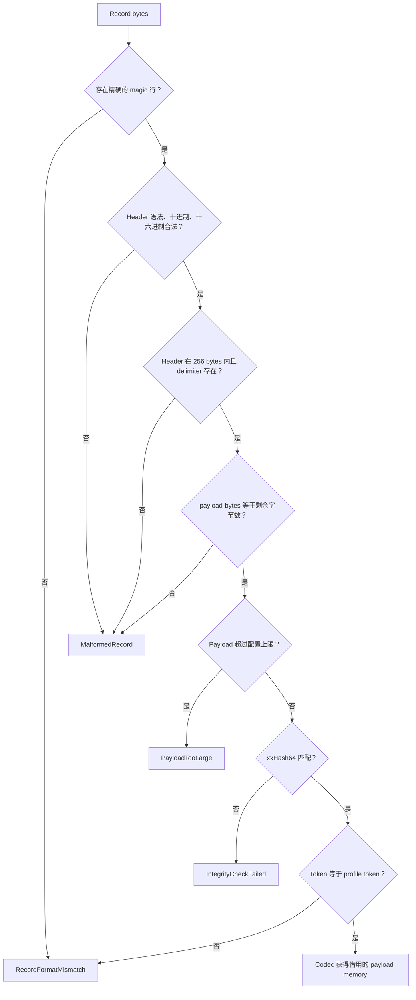

# Record 格式

[English](RecordFormat.md) | 简体中文

本文档定义一条持久化 record 的字节级契约。`CycloneGames.Persistence.Core` 中的 `PersistenceRecord.Encode` 与 `PersistenceRecord.Parse` 是参考实现。另一套实现必须产生并读取完全相同的字节。

## 目录

- [规范布局](#规范布局)
- [Header 字段](#header-字段)
- [格式身份](#格式身份)
- [字段规则](#字段规则)
- [Checksum 输入](#checksum-输入)
- [Parser 顺序](#parser-顺序)
- [实现要点](#实现要点)
- [Golden fixture](#golden-fixture)

## 规范布局

Record 由 ASCII header 和原样 payload bytes 组成。下面是一条完整 record，payload 是 `value: 42` 加末尾 LF，共 10 bytes：

```text
# cgp-record
# codec-id: test-yaml
# payload-bytes: 10
# xxh64: 4708293BF9A62D22
---
value: 42
```

四行 header 与 delimiter 行各以一个 LF 字节（0x0A）结尾。Header 不带 BOM，只使用 ASCII；CRLF 和单独 CR 都是非法输入。Payload 紧跟在 delimiter 行之后。Payload 末尾没有隐含换行：只有当 payload 本身以 LF 结尾时，文件才以 LF 结束。

四行 header 都是合法的 YAML 注释，因此 UTF-8 YAML payload 的 record 可以直接当作 YAML 文本阅读。二进制 payload 同样合法，header 不假设 payload 的内容。

## Header 字段

| 行 | 内容 | 含义 |
| --- | --- | --- |
| 1 | `# cgp-record` | 固定 magic，标识 framing |
| 2 | `# codec-id: test-yaml` | 格式身份 token，1 至 64 个 ASCII bytes |
| 3 | `# payload-bytes: 10` | delimiter 行之后全部字节数的规范十进制表示 |
| 4 | `# xxh64: 4708293BF9A62D22` | 16 位大写十六进制 |
| 5 | `---` | Delimiter，分隔 header 与 payload |

每个冒号后严格只有一个 ASCII 空格。字段按上述顺序各出现一次。

## 格式身份

`codec-id` token 是 wire format 身份，与 profile 中的 token 做 ordinal 相等比较。

| Token | 含义 |
| --- | --- |
| `vyaml-utf8-lf` | VYaml，UTF-8 without BOM，LF 行尾 |
| `messagepack-nocompress` | MessagePack，current spec，无压缩 |
| `test-yaml` | Golden fixture 使用的测试 codec |

Token 与绑定的 profile 不一致的 record 会以 `RecordFormatMismatch` 拒绝，即使 checksum 有效。

## 字段规则

- `codec-id` 为 1 至 64 个 ASCII bytes；首尾是 `[a-z0-9]`，其余字符限定为 `[a-z0-9._-]`，不含斜杠。`PersistenceCodecId.Validate` 与 `PersistenceRecord.IsValidIdentifier` 实现同一套语法。
- `payload-bytes` 是非负 `Int32` 的规范十进制：零只能写作 `0`，正数不含符号、空白或前导零。
- `xxh64` 恰好是 16 位大写十六进制 ASCII；小写数字非法。
- Header 最多 256 bytes。
- `payload-bytes` 必须等于 delimiter 行之后的全部字节。截断与 trailing bytes 都是非法 record。
- Payload bytes 由 codec 定义，可以是 UTF-8 YAML，也可以是任意二进制。

## Checksum 输入

Checksum 只检测偶发损坏，不提供真实性验证，也不是加密。

使用 xxHash64、seed 为零，计算以下字节序列：

| 顺序 | 字节 | 来源 |
| --- | --- | --- |
| 1 | `43 47 50 00` | Domain separator，ASCII 字母 CGP 加一个 NUL 字节 |
| 2 | `Int32LE(tokenByteLength)` | 长度前缀 |
| 3 | Token ASCII bytes | Header 第 2 行 |
| 4 | `Int32LE(payloadByteLength)` | 长度前缀，等于 Header 第 3 行 |
| 5 | 原样 payload bytes | Record body |

所有整数都是四字节 little-endian。长度前缀按字节计数，不按字符计数。Digest 写为 16 位大写十六进制 ASCII。

Token 参与 checksum。替换 token 而不重算 digest 会得到 `IntegrityCheckFailed`；若同时改动 `payload-bytes` 导致声明长度与剩余字节不符，则更早以 `MalformedRecord` 拒绝。

## Parser 顺序



只有全部检查通过后才会调用 codec。Checksum 失败或 token 不匹配都不会进入反序列化。

## 实现要点

- `Encode` 在分配前计算 header 长度，因此返回数组恰好是 `headerLength + payload.Length` bytes。
- `Parse` 原地读取 header，返回 payload offset 与 length。Store 据此构造 `ReadOnlyMemory<byte>` slice，不复制 payload。
- Header 扫描受 256 bytes 预算限制。没有 line feed 的 record 会直接失败，不会扫描整个 payload。
- Checksum 计算使用 `stackalloc` 与增量 `XxHash64` 状态，不分配拼接后的 metadata buffer。
- 池化 writer 由一个 store 复用：`Reset` 从 `ArrayPool<byte>.Shared` 取数组，`Release` 清零后归还。框架侧一次 save 只分配 record array，没有额外分配。
- Framing 常量与语法函数集中在 `PersistenceRecordHeader`。`TryRead` 以只读 span 暴露 token 与 payload，不解码也不计算 checksum。编码器、探测与 parser 共用这一份实现，语法判断不会互相矛盾。共享字节数组是私有的，调用方只能拿到 span。
- 1048576 bytes 的 payload 上限是 `PersistenceLimits` 强制的单记录预算，不是 record header 字段，也不参与 checksum。

## Golden fixture

`Tests/Core/Fixtures/Record.yaml.bytes` 是 `Encode_MatchesCommittedGoldenBytes` 使用的字节 fixture。它保持 LF-only，`.gitattributes` 固定了它的行尾。

| 属性 | 值 |
| --- | --- |
| Payload | `value: 42` 后接一个 LF 字节，共 10 bytes |
| Token | `test-yaml` |
| Checksum | `4708293BF9A62D22` |
