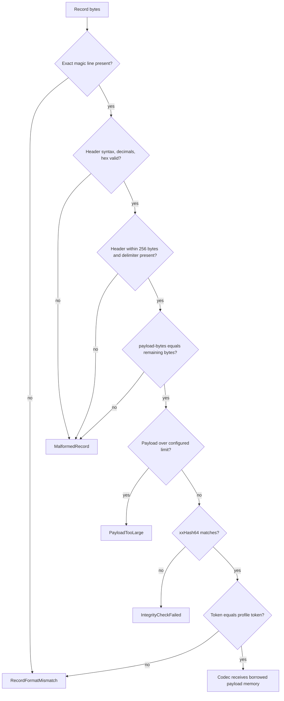

# Record format

[English | 简体中文](RecordFormat.SCH.md)

This document defines the byte-level contract for one persistence record. `PersistenceRecord.Encode` and `PersistenceRecord.Parse` in `CycloneGames.Persistence.Core` are the reference implementation. A second implementation must produce and consume identical bytes.

## Contents

- [Canonical layout](#canonical-layout)
- [Header fields](#header-fields)
- [Format identity](#format-identity)
- [Field rules](#field-rules)
- [Checksum input](#checksum-input)
- [Parser order](#parser-order)
- [Implementation notes](#implementation-notes)
- [Golden fixture](#golden-fixture)

## Canonical layout

A record is an ASCII header followed by exact payload bytes. The block below is a complete record whose payload is the ten bytes of `value: 42` plus a final LF:

```text
# cgp-record
# codec-id: test-yaml
# payload-bytes: 10
# xxh64: 4708293BF9A62D22
---
value: 42
```

Each of the four header lines and the delimiter line ends with one LF byte, 0x0A. The header has no BOM and uses ASCII only. CRLF and standalone CR are invalid. The payload begins immediately after the delimiter line. There is no implicit newline after the payload; a file ends with an LF only when the payload itself contains one.

The four header lines are valid YAML comments, so a record with a UTF-8 YAML payload can be read as YAML text. Binary payloads are equally valid; the header makes no assumption about payload content.

## Header fields

| Line | Content | Meaning |
| --- | --- | --- |
| 1 | `# cgp-record` | Fixed magic. Identifies the framing. |
| 2 | `# codec-id: test-yaml` | Format identity token, 1 to 64 ASCII bytes. |
| 3 | `# payload-bytes: 10` | Canonical decimal byte count of everything after the delimiter line. |
| 4 | `# xxh64: 4708293BF9A62D22` | 16 uppercase hexadecimal digits. |
| 5 | `---` | Delimiter. Separates the header from the payload. |

Every colon is followed by exactly one ASCII space. The fields appear once each, in this order.

## Format identity

The `codec-id` token is a wire format identity. It is compared against the profile token by ordinal equality.

| Token | Meaning |
| --- | --- |
| `vyaml-utf8-lf` | VYaml, UTF-8 without BOM, LF line endings |
| `messagepack-nocompress` | MessagePack, current spec, uncompressed |
| `test-yaml` | Test codec used by the golden fixture |

A record whose token differs from the bound profile is rejected with `RecordFormatMismatch`, even when its checksum is valid.

## Field rules

- `codec-id` is 1 to 64 ASCII bytes. It starts and ends with `[a-z0-9]`, contains `[a-z0-9._-]` elsewhere, and contains no slash. `PersistenceCodecId.Validate` and `PersistenceRecord.IsValidIdentifier` implement the same grammar.
- `payload-bytes` is a non-negative `Int32` in canonical decimal: zero is `0`, and a positive value has no sign, whitespace, or leading zero.
- `xxh64` is exactly 16 uppercase hexadecimal ASCII digits. Lowercase digits are invalid.
- The header is at most 256 bytes.
- `payload-bytes` must equal every byte after the delimiter line. Truncated payloads and trailing bytes are both invalid.
- Payload bytes are owned by the codec. They may be UTF-8 YAML or arbitrary binary.

## Checksum input

The checksum detects accidental corruption. It does not authenticate data and is not encryption.

Hash the following byte sequence with xxHash64 and seed zero:

| Order | Bytes | Source |
| --- | --- | --- |
| 1 | `43 47 50 00` | Domain separator, the ASCII letters CGP followed by a NUL byte |
| 2 | `Int32LE(tokenByteLength)` | Length prefix |
| 3 | Token ASCII bytes | Header line 2 |
| 4 | `Int32LE(payloadByteLength)` | Length prefix, equal to header line 3 |
| 5 | Exact payload bytes | Record body |

All integers are four-byte little-endian. Length prefixes count bytes, not characters. The digest is written as 16 uppercase hexadecimal ASCII digits.

The token is part of the checksum. Substituting another token without recomputing the digest produces `IntegrityCheckFailed`. A changed `payload-bytes` that no longer matches the remaining bytes is rejected earlier as `MalformedRecord`.

## Parser order



The codec is called only after every check passes. A checksum failure or a token mismatch never reaches deserialization.

## Implementation notes

- `Encode` computes the header length before allocating, so the returned array has exactly `headerLength + payload.Length` bytes.
- `Parse` reads the header in place and returns a payload offset and length. The store builds a `ReadOnlyMemory<byte>` slice from them; no payload copy is made.
- Header scanning is bounded by the 256-byte header budget. A record without a line feed fails without scanning the payload.
- Checksum computation uses `stackalloc` and an incremental `XxHash64` state. It does not allocate a concatenated metadata buffer.
- The pooled writer is reused by one store. `Reset` acquires an array from `ArrayPool<byte>.Shared` and `Release` returns it cleared. A save allocates the record array and nothing else on the framework side.
- Framing constants and grammar functions live in `PersistenceRecordHeader`. `TryRead` exposes the token and payload as read-only spans without decoding or hashing. The encoder, the probe, and the parser use this one source, so they cannot disagree about syntax. Shared byte arrays are private; callers receive spans only.
- The 1048576-byte payload ceiling is a single-record budget enforced by `PersistenceLimits`. It is not a field in the record header and does not participate in the checksum.

## Golden fixture

`Tests/Core/Fixtures/Record.yaml.bytes` is the byte fixture used by `Encode_MatchesCommittedGoldenBytes`. It is kept LF-only; `.gitattributes` pins its line endings.

| Property | Value |
| --- | --- |
| Payload | `value: 42` followed by an LF byte, 10 bytes total |
| Token | `test-yaml` |
| Checksum | `4708293BF9A62D22` |
