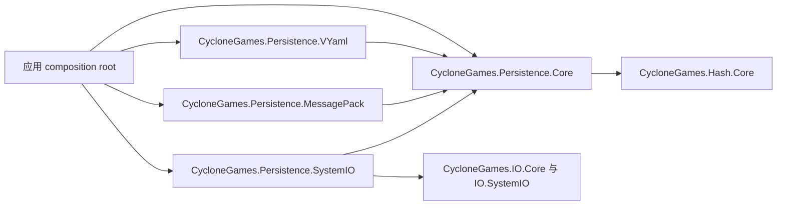
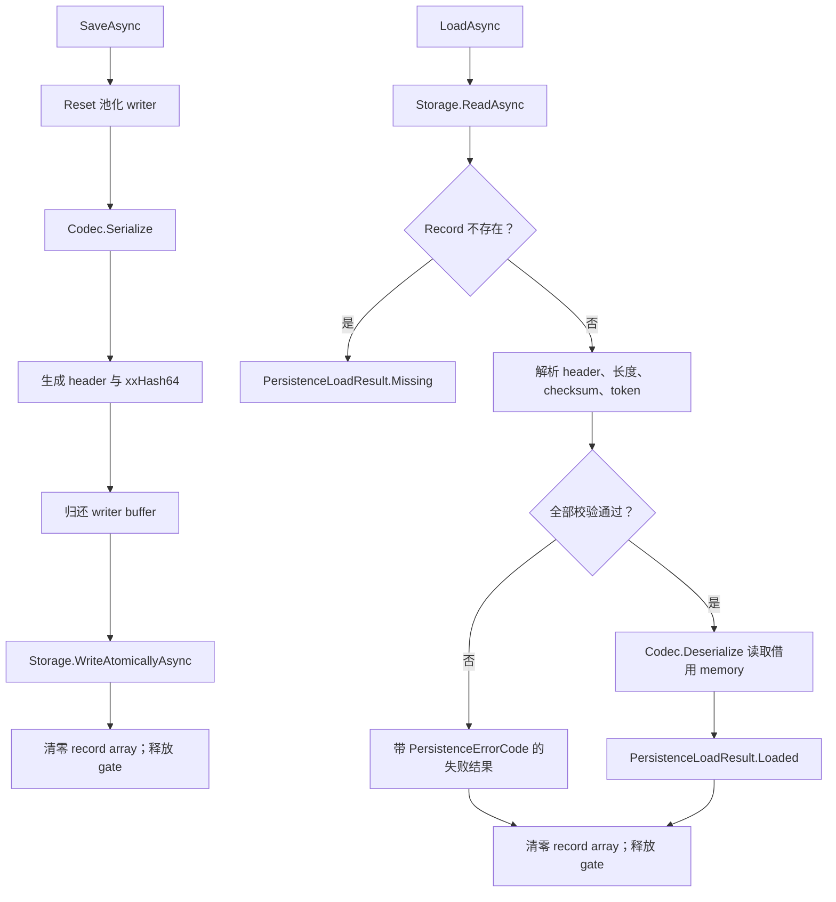
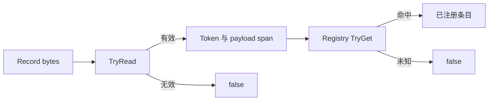

# CycloneGames.Persistence

[English](README.md) | 简体中文

`CycloneGames.Persistence` 负责读写一条有上界的 record。Codec 定义 wire format，storage adapter 持有字节，store 负责编排两者。Store 把每个 payload 包装进 ASCII header 与 xxHash64 checksum；framing、声明长度、checksum 或格式身份不匹配的 record 会在反序列化之前被拒绝。

Core assembly 只引用 `CycloneGames.Hash.Core`，并声明 `noEngineReferences: true`。它可以运行在 Unity、纯 C# host 和 headless 测试进程中。

## 目录

- [概述](#概述)
- [包结构](#包结构)
- [快速上手](#快速上手)
- [公共 API](#公共-api)
- [保存与加载流程](#保存与加载流程)
- [Record 格式](#record-格式)
- [结果与错误码](#结果与错误码)
- [取消、并发与异常](#取消并发与异常)
- [限制与诊断](#限制与诊断)
- [格式探测](#格式探测)
- [实现 provider](#实现-provider)
- [测试](#测试)
- [问题排查](#问题排查)

## 概述

| 关注点 | 所有者 | 职责 |
| --- | --- | --- |
| 包装、校验、编排 | `PersistenceStore<T>` | 生成和解析一条 record、分类失败、限制一个 active operation |
| 序列化 | `IPersistenceCodec<T>` | 在一个 `T` 与 payload bytes 之间转换 |
| 字节存储 | `IPersistenceStorage` | 在一个 location 上读取、原子写入和删除一条 record |
| 分配上界 | `PersistenceLimits` | 限制 payload 与 record 大小 |
| 组装 | `PersistenceProfile<T>` | 把一个 codec 与一个 limits 实例绑定 |

Store 不保存应用状态、不维护缓存、也不知道路径。它不创建 worker thread，也不调用 `Task.Run`。一次操作搬移整条 record，这是冷路径 API。

Codec 声明一个 `PersistenceCodecId`。这个 token 标识一种 wire format，按 ordinal 相等比较。运行时只读取绑定到 profile 的格式；由其他格式写出的 record 一律拒绝。详见 [Record 格式](Documentation~/RecordFormat.SCH.md)。

## 包结构

| Assembly | Package | 引用 |
| --- | --- | --- |
| `CycloneGames.Persistence.Core` | `com.cyclone-games.persistence` | `CycloneGames.Hash.Core` |

`package.json` 声明依赖 `com.cyclone-games.hash` `1.0.0`，Unity 基线为 `2022.3`。Assembly 设置 `autoReferenced: false` 和 `noEngineReferences: true`。

| Provider package | Assembly | 作用 |
| --- | --- | --- |
| `com.cyclone-games.persistence.systemio` | `CycloneGames.Persistence.SystemIO`、`CycloneGames.Persistence.Unity` | 文件存储与 persistent-data-path 路径组合 |
| `com.cyclone-games.persistence.vyaml` | `CycloneGames.Persistence.VYaml` | UTF-8 YAML codec |
| `com.cyclone-games.persistence.messagepack` | `CycloneGames.Persistence.MessagePack` | 二进制 codec，由 capability symbol 门控 |



```text
CycloneGames.Persistence/
  Core/
    Contracts/        格式 token、context、公共接口
    Internal/         池化 writer、异常策略、record 编解码
    PersistenceStore.cs、PersistenceProfile.cs、PersistenceLimits.cs、
    PersistenceResults.cs、PersistenceStoreMemorySnapshot.cs、
    PersistenceRecordHeader.cs、PersistenceFormatRegistry.cs
    Properties/AssemblyInfo.cs
  Tests/Core/         EditMode 测试与 golden byte fixture
  Documentation~/     Record 字节契约
  package.json、README.md、README.SCH.md
```

## 快速上手

### 第 1 步：安装 package

添加 `com.cyclone-games.persistence`、一个 storage provider 和一个 codec provider。下面的示例使用 `com.cyclone-games.persistence.systemio` 与 `com.cyclone-games.persistence.vyaml`。两个 provider 都设置 `autoReferenced: false`，因此需要在 consumer asmdef 中显式添加对应 assembly 名称。

### 第 2 步：定义 DTO

```csharp
using VYaml.Annotations;

namespace MyGame.Contracts
{
    [YamlObject]
    public sealed partial class AudioSettings
    {
        public float MasterVolume { get; set; } = 1f;
        public bool Muted { get; set; }
    }
}
```

VYaml source generator 会生成 `MyGame.Contracts.GeneratedResolver`。修改 DTO 后需重新构建。DTO 所在的 namespace 不要引入项目内的 `VYaml` namespace：生成的 formatter 代码引用 `VYaml.*` 时没有 global 前缀。详见 [VYaml provider README](../CycloneGames.Persistence.VYaml/README.SCH.md)。

`T` 必须是纯数据，不能持有 `IDisposable` 资源、unmanaged handle、Unity object 生命周期或线程亲和状态；失败和取消的候选值会被直接丢弃，不执行 disposal。

### 第 3 步：组装 store

```csharp
using CycloneGames.Persistence;
using CycloneGames.Persistence.Unity;
using CycloneGames.Persistence.VYaml;
using MyGame.Contracts;

IPersistenceStorage storage =
    UnityPersistentStorage.Create("Settings/audio.cgp");

IPersistenceCodec<AudioSettings> codec =
    new VYamlPersistenceCodec<AudioSettings>(GeneratedResolver.Instance);

var profile = new PersistenceProfile<AudioSettings>(
    codec,
    new PersistenceLimits(256 * 1024));

var store = new PersistenceStore<AudioSettings>(storage, profile);
```

这四个对象都由 composition root 持有。一个 store 绑定一个 location 和一个 codec；每条独立 record 使用独立的 store 和独立的可信路径。

### 第 4 步：保存

```csharp
var settings = new AudioSettings { MasterVolume = 0.8f, Muted = false };

PersistenceOperationResult saved = await store.SaveAsync(
    in settings,
    cancellationToken);

if (!saved.IsSuccess)
{
    // Dispatch saved.ErrorCode to the product recovery policy.
    // Sanitize saved.Exception before logging or telemetry.
}
```

### 第 5 步：加载

```csharp
PersistenceLoadResult<AudioSettings> loaded = await store.LoadAsync(cancellationToken);

switch (loaded.Status)
{
    case PersistenceLoadStatus.Loaded:
        ApplySettings(loaded.Value);
        break;
    case PersistenceLoadStatus.Missing:
        ApplyDefaults();
        break;
    case PersistenceLoadStatus.Failed:
        Recover(loaded.ErrorCode, loaded.Exception);
        break;
    default:
        throw new InvalidOperationException("The load result was not initialized.");
}
```

`Missing` 表示该 location 下没有 record，不是失败。格式 token 与绑定的 codec 不一致时返回 `RecordFormatMismatch`。

### 第 6 步：删除

```csharp
PersistenceOperationResult deleted = await store.DeleteAsync(cancellationToken);
```

SystemIO provider 把「目标已不存在」视为成功。

## 公共 API

### `PersistenceStore<T>`

| 成员 | 说明 |
| --- | --- |
| `PersistenceStore(IPersistenceStorage, PersistenceProfile<T>)` | 把一个 location 与一个 profile 绑定；null 参数抛 `ArgumentNullException`。 |
| `Location` | `IPersistenceStorage.Location`，用于诊断。 |
| `Profile` | 绑定的 `PersistenceProfile<T>`。 |
| `SaveAsync(in T value, CancellationToken = default)` | 序列化、编码并写入一条 record。 |
| `LoadAsync(CancellationToken = default)` | 读取并校验一条 record。 |
| `DeleteAsync(CancellationToken = default)` | 删除绑定的 record。 |
| `GetMemorySnapshot()` | 返回计数器与 limits 的 `PersistenceStoreMemorySnapshot`。 |

### `PersistenceCodecId`

| 成员 | 说明 |
| --- | --- |
| `PersistenceCodecId(string)` | 校验格式 token 语法。 |
| `Value` | token 字符串；`default` 时为空。 |
| `Equals`、`==`、`!=`、`GetHashCode`、`ToString` | Ordinal 值语义。 |

语法：1 至 64 个 ASCII 字符，首尾为 `[a-z0-9]`，其余字符限定为 `[a-z0-9._-]`。不含斜杠，不含数字后缀，没有顺序语义。Token 命名一种字节格式，例如 `vyaml-utf8-lf`、`messagepack-nocompress`、`test-yaml`。

### `PersistenceProfile<T>` 与 `PersistenceLimits`

| 类型 | 成员 | 说明 |
| --- | --- | --- |
| `PersistenceProfile<T>` | `PersistenceProfile(IPersistenceCodec<T>, PersistenceLimits = null)` | 省略 limits 时新建一个默认 limits 实例。 |
| | `Codec`、`CodecId`、`Limits` | 不可变绑定。 |
| `PersistenceLimits` | `PersistenceLimits()` | 硬上限与默认初始缓冲。 |
| | `PersistenceLimits(int maximumPayloadBytes)` | 自定义上限，使用默认初始缓冲。 |
| | `PersistenceLimits(int maximumPayloadBytes, int initialBufferBytes)` | 两个值都显式指定。 |
| | `static HardMaximumPayloadBytes` | 1048576 bytes。 |
| | `static DefaultInitialBufferBytes` | 256 bytes。 |
| | `MaximumPayloadBytes`、`InitialBufferBytes` | 配置值。 |
| | `MaximumRecordBytes` | Payload 上限加 256 bytes 的 header 预算。 |

这两个 static 成员是无状态计算属性，不是共享可变状态；没有共享的默认实例。

### Context

`PersistenceWriteContext` 与 `PersistenceReadContext` 都是 readonly struct，通过 `in` 传入。各暴露 `Limits` 与 `CancellationToken`。同步 codec 可以在有界工作阶段检查 token。

### `IPersistenceCodec<T>`

```csharp
public interface IPersistenceCodec<T>
{
    PersistenceCodecId CodecId { get; }

    void Serialize(
        in T value,
        IBufferWriter<byte> destination,
        in PersistenceWriteContext context);

    T Deserialize(
        ReadOnlyMemory<byte> payload,
        in PersistenceReadContext context);
}
```

实现是同步的，所有输入都是借用。返回后不得保留 value、destination、payload 或 context；不能分配 exact result array，也不能写出 `context.Limits` 的范围。`destination` 是有预算上限的 writer，payload 超出上限时抛出 `PersistencePayloadBudgetExceededException`。

### `IPersistenceStorage`

```csharp
public interface IPersistenceStorage
{
    string Location { get; }

    Task<PersistenceStorageReadResult> ReadAsync(
        int maxByteCount,
        CancellationToken cancellationToken = default);

    Task WriteAtomicallyAsync(
        byte[] content,
        CancellationToken cancellationToken = default);

    Task DeleteAsync(CancellationToken cancellationToken = default);
}
```

`Found` 把 `byte[]` 的所有权移交给 Store。`WriteAtomicallyAsync` 借用 `content` 直到 task 完成。`Location` 是诊断 metadata。

### 结果类型

| 类型 | 成员 |
| --- | --- |
| `PersistenceStorageReadResult` | `IsMissing`、`Content`、静态 `Missing()`、`Found(byte[])` |
| `PersistenceOperationResult` | `Status`、`IsSuccess`、`ErrorCode`、`Exception`、静态 `Success()`、`Failure(...)` |
| `PersistenceLoadResult<T>` | `Status`、`IsSuccess`、`IsMissing`、`Value`、`ErrorCode`、`Exception`、静态 `Loaded(T)`、`Missing()`、`Failure(...)` |
| `PersistenceLoadStatus` | `Uninitialized`、`Failed`、`Missing`、`Loaded` |
| `PersistenceOperationStatus` | `Uninitialized`、`Succeeded`、`Failed` |
| `PersistencePayloadBudgetExceededException` | `MaximumPayloadBytes` |

默认构造的结果 struct 是 `Uninitialized`，`ErrorCode` 为 `None`。判断成功要用 `IsSuccess` 或 `Status`；`ErrorCode.None` 本身不代表成功。`Exception` 仅用于诊断，进入遥测前需脱敏。

## 保存与加载流程



Store 在多次 save 之间复用同一个池化 writer。`Reset` 从 `ArrayPool<byte>.Shared` 取数组，`Release` 清零后归还。序列化在调用方线程同步执行，框架侧 save 路径唯一的分配是 record array。

| Buffer | 产生方 | 移交后的所有者 | 清零方 |
| --- | --- | --- | --- |
| 池化 writer buffer | `BoundedByteBufferWriter` | Store | 所有退出路径上的 `Release` |
| 保存时的 record array | `PersistenceRecord.Encode` | Store | `SaveCoreAsync` 的 finally |
| 读取时的 record array | `IPersistenceStorage` | Store | `LoadCoreAsync` 的 finally |
| Payload slice | Store | Store，借给 codec | Codec 不得保留 |

## Record 格式

下面是一条完整 record，payload 为 10 bytes 的 YAML。四行 header 与 delimiter 行各以一个 LF 字节（0x0A）结尾：

```text
# cgp-record
# codec-id: test-yaml
# payload-bytes: 10
# xxh64: 4708293BF9A62D22
---
value: 42
```

Header 是不带 BOM 的 ASCII。`payload-bytes` 必须等于 delimiter 行之后的全部字节。Checksum 覆盖 domain separator、带长度前缀的格式 token、带长度前缀的 payload 长度以及 payload bytes，因此替换 token 会使 digest 失效。完整契约见 [Record 格式](Documentation~/RecordFormat.SCH.md)。

xxHash64 只检测偶发损坏，既不是真实性校验也不是加密。本地 record 不能作为支付、entitlement 或 secret 的可信权威来源。

## 结果与错误码

运行时失败通过结果返回，不抛出；无效参数与重叠操作立即抛出。

| `PersistenceErrorCode` | 条件 |
| --- | --- |
| `None` | 默认值；不代表成功。 |
| `ReadFailed` | Storage 读取抛异常，或返回 `Found` 却没有移交 buffer。 |
| `PayloadTooLarge` | Codec 超出 writer 预算，或声明的 payload 超出配置上限。 |
| `RecordFormatMismatch` | Magic 行不匹配，或格式 token 与 profile 不一致。 |
| `MalformedRecord` | Header 语法、字段顺序、十进制形式、token 语法、delimiter、长度或十六进制形式非法。 |
| `IntegrityCheckFailed` | xxHash64 不匹配；不调用 codec。 |
| `DeserializeFailed` | Codec 的 `Deserialize` 抛异常。 |
| `SerializationFailed` | Codec 的 `Serialize` 抛异常，或编码失败。 |
| `WriteFailed` | `WriteAtomicallyAsync` 抛异常。 |
| `DeleteFailed` | `DeleteAsync` 抛异常。 |
| `Cancelled` | 调用方 token 已取消。 |

Parser 精确匹配 magic 行与 token。其他字节在这两处检查之一被拒绝。

## 取消、并发与异常

- `CancellationToken` 在入口、序列化后、编码前、storage 读取后、解析后和反序列化后都会被检查。异步 continuation 使用 `ConfigureAwait(false)`。
- 只有在调用方 token 已取消时抛出的 `OperationCanceledException` 才会归类为 `Cancelled`。Codec 或 provider 主动抛出的取消属于该阶段失败。
- Storage 写入是 commit boundary。替换已经完成就报告成功，即使 token 随后取消。
- 一个 store 同时只接受一个 operation。Overlap 或 callback reentrancy 会同步抛 `InvalidOperationException`。Gate 只作用于该实例；共享 codec 或 storage 的多个 store 不会自动串行化。
- 参数错误从 public method 直接抛出，不包装成结果。
- 致命异常在释放 gate 后直接传播：`OutOfMemoryException`、`StackOverflowException`、`AccessViolationException`、`AppDomainUnloadedException`、`CannotUnloadAppDomainException`、`ThreadAbortException`、`BadImageFormatException`、`InvalidProgramException`。

### Composition root 串行化

Store 对重叠操作是拒绝而不是排队。在 composition root 串行化重叠保存：

```csharp
var saveGate = new SemaphoreSlim(1, 1);

public async Task<PersistenceOperationResult> SaveSerializedAsync(
    AudioSettings value, CancellationToken ct)
{
    await saveGate.WaitAsync(ct).ConfigureAwait(false);
    try
    {
        return await store.SaveAsync(in value, ct).ConfigureAwait(false);
    }
    finally
    {
        saveGate.Release();
    }
}
```

`GetMemorySnapshot().ConcurrentOperationRejectionCount` 报告 gate 拒绝重叠的次数。可选的 `CycloneGames.Persistence.Resilience` decorator 包装任意 `IPersistenceStorage`，用法见该模块 README。

## 限制与诊断

| 上界 | 值 |
| --- | --- |
| Payload 上限 | 1048576 bytes |
| Header 预算 | 256 bytes |
| 传给 `ReadAsync` 的最大 record | payload 上限加 256 bytes |
| 时间复杂度 | 对 record 做一次线性扫描；没有针对 payload bytes 的嵌套循环 |
| 临时内存 | 受 record 大小约束 |

1048576 bytes 上限是 `PersistenceLimits` 在构造时强制的单记录预算。

`GetMemorySnapshot()` 只读取计数器，不检查应用值、storage path 或序列化内容。它报告 `IsOperationActive`、配置的 limits、单调递增的 load/save/delete 计数、overlap 拒绝次数，以及最近与峰值 record bytes。

## 格式探测

`PersistenceRecordHeader` 读取 record framing，不解码 payload。`PersistenceFormatRegistry<TEntry>` 把格式 token 映射到调用方提供的条目。两者都不要求先创建 `PersistenceStore<T>`。

### 读取 header

```csharp
byte[] record = await ReadRecordBytesAsync(ct);

if (PersistenceRecordHeader.TryRead(
        record,
        out ReadOnlySpan<byte> token,
        out ReadOnlySpan<byte> payload))
{
    UseToken(token, payload);
}
```

`TryRead` 校验 magic 行、字段顺序、十进制形式、token 语法、delimiter、声明长度和十六进制形式。它不计算 checksum，也不与 profile 比较 token。它不分配内存，返回的 span 指向调用方的数组。`TryReadFormatToken` 只返回 token。

### 按 token 查表

```csharp
var registry = new PersistenceFormatRegistry<string>(
    new PersistenceFormatRegistration<string>(
        new PersistenceCodecId("vyaml-utf8-lf"), "yaml"),
    new PersistenceFormatRegistration<string>(
        new PersistenceCodecId("messagepack-nocompress"), "binary"));

if (registry.TryGet(token, out string entry))
{
    SelectFormat(entry);
}
```

`TryGet` 在连续数组上逐字节比较，不分配内存。构造时重复 token 会抛 `ArgumentException`，未知 token 返回 `false`。Registry 不读文件，也不写 record。



| 类型 | 成员 |
| --- | --- |
| `PersistenceRecordHeader` | `TryRead(...)`、`TryReadFormatToken(...)` |
| `PersistenceFormatRegistration<TEntry>` | `Format`、`Entry` |
| `PersistenceFormatRegistry<TEntry>` | `Count`、`TryGet(ReadOnlySpan<byte>, ...)`、`TryGet(PersistenceCodecId, ...)` |

## 实现 provider

Codec 是带一个格式 token 的同步 adapter：

```csharp
public sealed class Int32Codec : IPersistenceCodec<int>
{
    public PersistenceCodecId CodecId { get; } =
        new PersistenceCodecId("binary-int");

    public void Serialize(
        in int value,
        IBufferWriter<byte> destination,
        in PersistenceWriteContext context)
    {
        Span<byte> span = destination.GetSpan(sizeof(int));
        BinaryPrimitives.WriteInt32LittleEndian(span, value);
        destination.Advance(sizeof(int));
    }

    public int Deserialize(
        ReadOnlyMemory<byte> payload,
        in PersistenceReadContext context)
    {
        return BinaryPrimitives.ReadInt32LittleEndian(payload.Span);
    }
}
```

Storage adapter 拥有一个 location：

```csharp
public sealed class MemoryStorage : IPersistenceStorage
{
    private byte[] _content;

    public string Location => "memory://record";

    public Task<PersistenceStorageReadResult> ReadAsync(
        int maxByteCount,
        CancellationToken cancellationToken = default)
    {
        cancellationToken.ThrowIfCancellationRequested();
        if (_content == null)
        {
            return Task.FromResult(PersistenceStorageReadResult.Missing());
        }

        if (_content.Length > maxByteCount)
        {
            throw new InvalidOperationException("Record exceeds the read budget.");
        }

        return Task.FromResult(
            PersistenceStorageReadResult.Found((byte[])_content.Clone()));
    }

    public Task WriteAtomicallyAsync(
        byte[] content,
        CancellationToken cancellationToken = default)
    {
        cancellationToken.ThrowIfCancellationRequested();
        _content = (byte[])content.Clone();
        return Task.CompletedTask;
    }

    public Task DeleteAsync(CancellationToken cancellationToken = default)
    {
        cancellationToken.ThrowIfCancellationRequested();
        _content = null;
        return Task.CompletedTask;
    }
}
```

不保留借用输入、遵守 `maxByteCount` 与 `context.Limits`、让异常向上传播以便 Store 分类。

## 测试

`CycloneGames.Persistence.Tests.Core` 是由 `UNITY_INCLUDE_TESTS` 门控的 EditMode assembly。`PersistenceStoreTests.cs` 覆盖 round trip、错误分类、取消、overlap 拒绝、buffer 清零与 record 解析。`Tests/Core/Fixtures/Record.yaml.bytes` 是 golden byte fixture。

## 问题排查

| 现象 | 原因 | 处理 |
| --- | --- | --- |
| Load 返回 `RecordFormatMismatch` | Magic 行不匹配，或 token 与绑定的 codec 不一致 | 绑定写入该 record 的 codec，或用当前 profile 重新写入。 |
| Load 返回 `IntegrityCheckFailed` | 文件被修改或损坏 | 从已知良好的副本恢复；不要绕过 checksum。 |
| Load 返回 `MalformedRecord` | Header 字节、行尾或声明长度有误 | 用字节查看器检查 header；确认没有 CRLF。 |
| Save 返回 `PayloadTooLarge` | DTO 超过 `MaximumPayloadBytes` | 在 1048576 内提高 profile 上限，或拆分 record。 |
| 并发调用抛 `InvalidOperationException` | 同一 store 上重叠的 Save/Load/Delete | 串行化调用；一个 store 只允许一个 active operation。 |
| `OperationCanceledException` 到达 composition root | 只 catch 了 `Exception`，或致命异常传播 | 显式 catch，或检查 `result.ErrorCode == PersistenceErrorCode.Cancelled`。 |
| IL2CPP Player 抛 `MissingFormatterException` | 使用 reflection fallback 而非 generated resolver | 为每个持久化 DTO 注册或生成 formatter。 |
