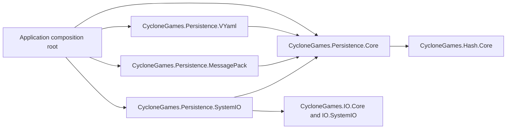
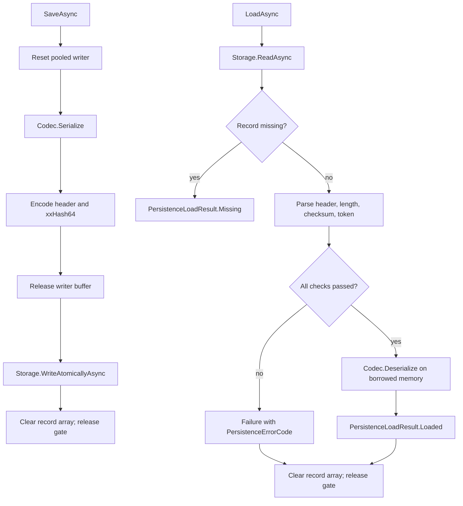
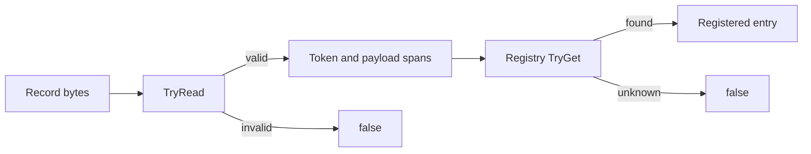

# CycloneGames.Persistence

[English | 简体中文](README.SCH.md)

`CycloneGames.Persistence` reads and writes one bounded record. A codec owns the wire format, a storage adapter owns the bytes, and the store coordinates them. The store wraps every payload in an ASCII header and an xxHash64 checksum, and rejects a record before deserialization when its framing, declared length, checksum, or format identity does not match.

The core assembly references `CycloneGames.Hash.Core` only and declares `noEngineReferences: true`. It runs in Unity, in a plain C# host, and in headless tests.

## Contents

- [Overview](#overview)
- [Package layout](#package-layout)
- [Getting started](#getting-started)
- [Public API](#public-api)
- [Save and load pipeline](#save-and-load-pipeline)
- [Record format](#record-format)
- [Results and error codes](#results-and-error-codes)
- [Cancellation, concurrency, and exceptions](#cancellation-concurrency-and-exceptions)
- [Limits and diagnostics](#limits-and-diagnostics)
- [Format inspection](#format-inspection)
- [Implementing providers](#implementing-providers)
- [Tests](#tests)
- [Troubleshooting](#troubleshooting)

## Overview

| Concern | Owner | Responsibility |
| --- | --- | --- |
| Framing, validation, orchestration | `PersistenceStore<T>` | Encodes and parses one record, classifies failures, enforces one active operation |
| Serialization | `IPersistenceCodec<T>` | Converts one `T` to and from payload bytes |
| Byte storage | `IPersistenceStorage` | Reads, atomically writes, and deletes one record at one location |
| Allocation bounds | `PersistenceLimits` | Caps payload and record size |
| Composition | `PersistenceProfile<T>` | Pairs one codec with one limits instance |

The store holds no application state, no cache, and no path. It creates no worker thread and does not call `Task.Run`. One operation moves a whole record; this is a cold-path API.

A codec declares a `PersistenceCodecId`. This token identifies one wire format and is compared by ordinal equality. The runtime reads only the format bound to the profile. A record written by a different format is rejected. See [Record format](Documentation~/RecordFormat.md).

## Package layout

| Assembly | Package | References |
| --- | --- | --- |
| `CycloneGames.Persistence.Core` | `com.cyclone-games.persistence` | `CycloneGames.Hash.Core` |

`package.json` declares `com.cyclone-games.hash` `1.0.0` and Unity `2022.3`. The assembly sets `autoReferenced: false` and `noEngineReferences: true`.

| Provider package | Assembly | Role |
| --- | --- | --- |
| `com.cyclone-games.persistence.systemio` | `CycloneGames.Persistence.SystemIO`, `CycloneGames.Persistence.Unity` | File storage and persistent-data-path composition |
| `com.cyclone-games.persistence.vyaml` | `CycloneGames.Persistence.VYaml` | UTF-8 YAML codec |
| `com.cyclone-games.persistence.messagepack` | `CycloneGames.Persistence.MessagePack` | Binary codec, gated by a capability symbol |



```text
CycloneGames.Persistence/
  Core/
    Contracts/        format token, contexts, public interfaces
    Internal/         pooled writer, exception policy, record encoder and parser
    PersistenceStore.cs, PersistenceProfile.cs, PersistenceLimits.cs,
    PersistenceResults.cs, PersistenceStoreMemorySnapshot.cs,
    PersistenceRecordHeader.cs, PersistenceFormatRegistry.cs
    Properties/AssemblyInfo.cs
  Tests/Core/         EditMode tests and the golden byte fixture
  Documentation~/     Record byte contract
  package.json, README.md, README.SCH.md
```

## Getting started

### Step 1: install packages

Add `com.cyclone-games.persistence`, one storage provider, and one codec provider. The example below uses `com.cyclone-games.persistence.systemio` and `com.cyclone-games.persistence.vyaml`. Add the corresponding assembly names to the consumer asmdef, because both providers set `autoReferenced: false`.

### Step 2: define the DTO

```csharp
using VYaml.Annotations;

namespace MyGame.Contracts
{
    [YamlObject]
    public sealed partial class AudioSettings
    {
        public float MasterVolume { get; set; } = 1f;
        public bool Muted { get; set; }
    }
}
```

The VYaml source generator emits `MyGame.Contracts.GeneratedResolver`. Rebuild after changing the DTO. Keep DTOs out of a namespace that introduces a local `VYaml` namespace; generated formatter code references `VYaml.*` without a global prefix. See the [VYaml provider README](../CycloneGames.Persistence.VYaml/README.md).

`T` is plain persisted data. It cannot own `IDisposable` resources, unmanaged handles, Unity object lifetimes, or thread-affine state, because failed and cancelled candidates are discarded without disposal.

### Step 3: compose the store

```csharp
using CycloneGames.Persistence;
using CycloneGames.Persistence.Unity;
using CycloneGames.Persistence.VYaml;
using MyGame.Contracts;

IPersistenceStorage storage =
    UnityPersistentStorage.Create("Settings/audio.cgp");

IPersistenceCodec<AudioSettings> codec =
    new VYamlPersistenceCodec<AudioSettings>(GeneratedResolver.Instance);

var profile = new PersistenceProfile<AudioSettings>(
    codec,
    new PersistenceLimits(256 * 1024));

var store = new PersistenceStore<AudioSettings>(storage, profile);
```

The composition root owns all four objects. One store is bound to one location and one codec. Use a separate store and a separate trusted path for each independent record.

### Step 4: save

```csharp
var settings = new AudioSettings { MasterVolume = 0.8f, Muted = false };

PersistenceOperationResult saved = await store.SaveAsync(
    in settings,
    cancellationToken);

if (!saved.IsSuccess)
{
    // Dispatch saved.ErrorCode to the product recovery policy.
    // Sanitize saved.Exception before logging or telemetry.
}
```

### Step 5: load

```csharp
PersistenceLoadResult<AudioSettings> loaded = await store.LoadAsync(cancellationToken);

switch (loaded.Status)
{
    case PersistenceLoadStatus.Loaded:
        ApplySettings(loaded.Value);
        break;
    case PersistenceLoadStatus.Missing:
        ApplyDefaults();
        break;
    case PersistenceLoadStatus.Failed:
        Recover(loaded.ErrorCode, loaded.Exception);
        break;
    default:
        throw new InvalidOperationException("The load result was not initialized.");
}
```

`Missing` means the location has no record. It is not a failure. A record whose format token differs from the bound codec returns `RecordFormatMismatch`.

### Step 6: delete

```csharp
PersistenceOperationResult deleted = await store.DeleteAsync(cancellationToken);
```

The SystemIO provider treats an already absent entry as success.

## Public API

### `PersistenceStore<T>`

| Member | Description |
| --- | --- |
| `PersistenceStore(IPersistenceStorage, PersistenceProfile<T>)` | Binds one location to one profile. Null arguments throw `ArgumentNullException`. |
| `Location` | `IPersistenceStorage.Location`, for diagnostics. |
| `Profile` | The bound `PersistenceProfile<T>`. |
| `SaveAsync(in T value, CancellationToken = default)` | Serializes, encodes, and writes one record. |
| `LoadAsync(CancellationToken = default)` | Reads and validates one record. |
| `DeleteAsync(CancellationToken = default)` | Deletes the bound record. |
| `GetMemorySnapshot()` | Counters and limits as a `PersistenceStoreMemorySnapshot`. |

### `PersistenceCodecId`

| Member | Description |
| --- | --- |
| `PersistenceCodecId(string)` | Validates the format token grammar. |
| `Value` | The token string, empty for `default`. |
| `Equals`, `==`, `!=`, `GetHashCode`, `ToString` | Ordinal value semantics. |

Grammar: 1 to 64 ASCII characters, starting and ending with `[a-z0-9]`, with `[a-z0-9._-]` elsewhere. No slash, no numeric suffix, no ordering. A token names one byte format. Examples: `vyaml-utf8-lf`, `messagepack-nocompress`, `test-yaml`.

### `PersistenceProfile<T>` and `PersistenceLimits`

| Type | Member | Description |
| --- | --- | --- |
| `PersistenceProfile<T>` | `PersistenceProfile(IPersistenceCodec<T>, PersistenceLimits = null)` | Uses a fresh default limits instance when limits are omitted. |
| | `Codec`, `CodecId`, `Limits` | Immutable binding. |
| `PersistenceLimits` | `PersistenceLimits()` | Hard payload ceiling and default initial buffer. |
| | `PersistenceLimits(int maximumPayloadBytes)` | Custom ceiling with the default initial buffer. |
| | `PersistenceLimits(int maximumPayloadBytes, int initialBufferBytes)` | Both values explicit. |
| | `static HardMaximumPayloadBytes` | 1048576, in bytes. |
| | `static DefaultInitialBufferBytes` | 256, in bytes. |
| | `MaximumPayloadBytes`, `InitialBufferBytes` | Configured values. |
| | `MaximumRecordBytes` | Payload limit plus the 256-byte header budget. |

These two static members are stateless computed properties, not shared mutable state. There is no shared default instance.

### Contexts

Both contexts are readonly structs passed by `in`. Each exposes `Limits` and `CancellationToken`. A synchronous codec can inspect the token at bounded work boundaries.

### `IPersistenceCodec<T>`

```csharp
public interface IPersistenceCodec<T>
{
    PersistenceCodecId CodecId { get; }

    void Serialize(
        in T value,
        IBufferWriter<byte> destination,
        in PersistenceWriteContext context);

    T Deserialize(
        ReadOnlyMemory<byte> payload,
        in PersistenceReadContext context);
}
```

Implementations are synchronous and borrow every input. They must not retain the value, destination, payload, or contexts after returning, allocate an exact result array, or write beyond `context.Limits`. `destination` is a budget-capped writer that throws `PersistencePayloadBudgetExceededException` when the payload grows past the limit.

### `IPersistenceStorage`

```csharp
public interface IPersistenceStorage
{
    string Location { get; }

    Task<PersistenceStorageReadResult> ReadAsync(
        int maxByteCount,
        CancellationToken cancellationToken = default);

    Task WriteAtomicallyAsync(
        byte[] content,
        CancellationToken cancellationToken = default);

    Task DeleteAsync(CancellationToken cancellationToken = default);
}
```

`Found` transfers ownership of its `byte[]` to the store. `WriteAtomicallyAsync` borrows `content` until its task completes. `Location` is diagnostic metadata.

### Result types

| Type | Members |
| --- | --- |
| `PersistenceStorageReadResult` | `IsMissing`, `Content`, static `Missing()`, `Found(byte[])` |
| `PersistenceOperationResult` | `Status`, `IsSuccess`, `ErrorCode`, `Exception`, static `Success()`, `Failure(...)` |
| `PersistenceLoadResult<T>` | `Status`, `IsSuccess`, `IsMissing`, `Value`, `ErrorCode`, `Exception`, static `Loaded(T)`, `Missing()`, `Failure(...)` |
| `PersistenceLoadStatus` | `Uninitialized`, `Failed`, `Missing`, `Loaded` |
| `PersistenceOperationStatus` | `Uninitialized`, `Succeeded`, `Failed` |
| `PersistencePayloadBudgetExceededException` | `MaximumPayloadBytes` |

A default result struct is `Uninitialized` with `ErrorCode.None`. Test `IsSuccess` or `Status`; `ErrorCode.None` alone is not success. `Exception` is diagnostic and needs redaction before telemetry.

## Save and load pipeline



The store reuses one pooled writer across saves. `Reset` acquires an array from `ArrayPool<byte>.Shared`; `Release` clears and returns it. Serialization is synchronous on the caller thread, and the record array is the framework's only allocation on the save path.

| Buffer | Producer | Owner after transfer | Cleared by |
| --- | --- | --- | --- |
| Pooled writer buffer | `BoundedByteBufferWriter` | Store | `Release` on every exit path |
| Record array on save | `PersistenceRecord.Encode` | Store | `SaveCoreAsync` finally block |
| Record array on read | `IPersistenceStorage` | Store | `LoadCoreAsync` finally block |
| Payload slice | Store | Store, lent to the codec | Codec must not retain it |

## Record format

This is a complete record with a ten-byte YAML payload. Each header line and the delimiter line ends with one LF byte, 0x0A:

```text
# cgp-record
# codec-id: test-yaml
# payload-bytes: 10
# xxh64: 4708293BF9A62D22
---
value: 42
```

The header is ASCII without a BOM. `payload-bytes` must equal every byte after the delimiter line. The checksum covers the domain separator, a length-prefixed format token, a length-prefixed payload length, and the payload bytes, so the token cannot be substituted without invalidating the digest. The full contract is in [Record format](Documentation~/RecordFormat.md).

xxHash64 detects accidental corruption. It is neither authentication nor encryption; a local record is not a trusted authority for payments, entitlements, or secrets.

## Results and error codes

Runtime failures are returned, not thrown. Invalid arguments and overlapping operations throw immediately.

| `PersistenceErrorCode` | Condition |
| --- | --- |
| `None` | Default value; never a success indicator. |
| `ReadFailed` | Storage read threw, or returned `Found` without a buffer. |
| `PayloadTooLarge` | Codec exceeded the writer budget, or the declared payload exceeds the configured limit. |
| `RecordFormatMismatch` | The magic line does not match, or the format token differs from the profile. |
| `MalformedRecord` | Header syntax, field order, decimal form, token grammar, delimiter, length, or hex form is invalid. |
| `IntegrityCheckFailed` | xxHash64 mismatch; the codec is not called. |
| `DeserializeFailed` | The codec's `Deserialize` threw. |
| `SerializationFailed` | The codec's `Serialize` threw, or encoding failed. |
| `WriteFailed` | `WriteAtomicallyAsync` threw. |
| `DeleteFailed` | `DeleteAsync` threw. |
| `Cancelled` | The caller token was cancelled. |

The parser matches the magic line and the token exactly. Any other bytes are rejected at one of those two checks.

## Cancellation, concurrency, and exceptions

- `CancellationToken` is observed on entry, after serialization, before encoding, after the storage read, after parsing, and after deserialization. Async continuations use `ConfigureAwait(false)`.
- Only an `OperationCanceledException` raised while the caller token is cancelled becomes `Cancelled`. An unsolicited cancellation from a codec or provider is classified as that stage's failure.
- The storage write is the commit boundary. A replacement that completed reports success even if the token is cancelled afterwards.
- One store accepts one operation at a time. Overlap or callback reentrancy throws `InvalidOperationException` synchronously. The gate is scoped to that instance; stores sharing a codec or storage are not serialized automatically.
- Argument errors throw from the public method rather than being wrapped in a result.
- Fatal exceptions propagate after the gate is released: `OutOfMemoryException`, `StackOverflowException`, `AccessViolationException`, `AppDomainUnloadedException`, `CannotUnloadAppDomainException`, `ThreadAbortException`, `BadImageFormatException`, and `InvalidProgramException`.

### Composition-root serialization

The store rejects overlap instead of queueing it. Serialize overlapping saves at the composition root:

```csharp
var saveGate = new SemaphoreSlim(1, 1);

public async Task<PersistenceOperationResult> SaveSerializedAsync(
    AudioSettings value, CancellationToken ct)
{
    await saveGate.WaitAsync(ct).ConfigureAwait(false);
    try
    {
        return await store.SaveAsync(in value, ct).ConfigureAwait(false);
    }
    finally
    {
        saveGate.Release();
    }
}
```

`GetMemorySnapshot().ConcurrentOperationRejectionCount` reports how often the gate rejected overlap. The optional `CycloneGames.Persistence.Resilience` decorator wraps any `IPersistenceStorage`. Its usage is documented in the module README.

## Limits and diagnostics

| Bound | Value |
| --- | --- |
| Payload ceiling | 1048576 bytes |
| Header budget | 256 bytes |
| Maximum record passed to `ReadAsync` | payload limit plus 256 bytes |
| Time complexity | One linear pass over the record; no nested loops over payload bytes |
| Temporary memory | Bounded by the record size |

The 1048576-byte ceiling is a single-record budget enforced by `PersistenceLimits` at construction.

`GetMemorySnapshot()` reads counters without inspecting application values, storage paths, or serialized content. It reports `IsOperationActive`, configured limits, monotonic load/save/delete counts, overlap rejections, and last/peak record bytes.

## Format inspection

`PersistenceRecordHeader` reads record framing without decoding the payload. `PersistenceFormatRegistry<TEntry>` maps a format token to an entry supplied by the caller. Both types work without a `PersistenceStore<T>` instance.

### Read the header

```csharp
byte[] record = await ReadRecordBytesAsync(ct);

if (PersistenceRecordHeader.TryRead(
        record,
        out ReadOnlySpan<byte> token,
        out ReadOnlySpan<byte> payload))
{
    UseToken(token, payload);
}
```

`TryRead` validates the magic line, field order, decimal form, token grammar, delimiter, declared length, and hex form. It does not compute the checksum and does not compare the token against a profile. It allocates nothing and returns spans into the caller's array. `TryReadFormatToken` returns the token only.

### Look up a token

```csharp
var registry = new PersistenceFormatRegistry<string>(
    new PersistenceFormatRegistration<string>(
        new PersistenceCodecId("vyaml-utf8-lf"), "yaml"),
    new PersistenceFormatRegistration<string>(
        new PersistenceCodecId("messagepack-nocompress"), "binary"));

if (registry.TryGet(token, out string entry))
{
    SelectFormat(entry);
}
```

`TryGet` compares bytes over a contiguous array and allocates nothing. Duplicate tokens throw `ArgumentException` at construction. An unknown token returns `false`. The registry reads no files and writes no records.



| Type | Members |
| --- | --- |
| `PersistenceRecordHeader` | `TryRead(...)`, `TryReadFormatToken(...)` |
| `PersistenceFormatRegistration<TEntry>` | `Format`, `Entry` |
| `PersistenceFormatRegistry<TEntry>` | `Count`, `TryGet(ReadOnlySpan<byte>, ...)`, `TryGet(PersistenceCodecId, ...)` |

## Implementing providers

A codec is a synchronous adapter with one format token:

```csharp
public sealed class Int32Codec : IPersistenceCodec<int>
{
    public PersistenceCodecId CodecId { get; } =
        new PersistenceCodecId("binary-int");

    public void Serialize(
        in int value,
        IBufferWriter<byte> destination,
        in PersistenceWriteContext context)
    {
        Span<byte> span = destination.GetSpan(sizeof(int));
        BinaryPrimitives.WriteInt32LittleEndian(span, value);
        destination.Advance(sizeof(int));
    }

    public int Deserialize(
        ReadOnlyMemory<byte> payload,
        in PersistenceReadContext context)
    {
        return BinaryPrimitives.ReadInt32LittleEndian(payload.Span);
    }
}
```

A storage adapter owns one location:

```csharp
public sealed class MemoryStorage : IPersistenceStorage
{
    private byte[] _content;

    public string Location => "memory://record";

    public Task<PersistenceStorageReadResult> ReadAsync(
        int maxByteCount,
        CancellationToken cancellationToken = default)
    {
        cancellationToken.ThrowIfCancellationRequested();
        if (_content == null)
        {
            return Task.FromResult(PersistenceStorageReadResult.Missing());
        }

        if (_content.Length > maxByteCount)
        {
            throw new InvalidOperationException("Record exceeds the read budget.");
        }

        return Task.FromResult(
            PersistenceStorageReadResult.Found((byte[])_content.Clone()));
    }

    public Task WriteAtomicallyAsync(
        byte[] content,
        CancellationToken cancellationToken = default)
    {
        cancellationToken.ThrowIfCancellationRequested();
        _content = (byte[])content.Clone();
        return Task.CompletedTask;
    }

    public Task DeleteAsync(CancellationToken cancellationToken = default)
    {
        cancellationToken.ThrowIfCancellationRequested();
        _content = null;
        return Task.CompletedTask;
    }
}
```

Never retain borrowed inputs, honour `maxByteCount` and `context.Limits`, and let exceptions propagate so the store can classify them.

## Tests

`CycloneGames.Persistence.Tests.Core` is an EditMode assembly gated by `UNITY_INCLUDE_TESTS`. `PersistenceStoreTests.cs` covers round trips, error classification, cancellation, overlap rejection, buffer clearing, and record parsing. `Tests/Core/Fixtures/Record.yaml.bytes` is the golden byte fixture.

## Troubleshooting

| Symptom | Cause | Action |
| --- | --- | --- |
| `RecordFormatMismatch` on load | The magic line does not match, or the token differs from the bound codec | Bind the codec that wrote the record, or write the record again with the current profile. |
| `IntegrityCheckFailed` on load | The file was edited or damaged | Restore from a known-good copy; do not bypass the checksum. |
| `MalformedRecord` on load | Header bytes, line endings, or the declared length are wrong | Inspect the header with a byte viewer; check for CRLF. |
| `PayloadTooLarge` on save | The DTO exceeds `MaximumPayloadBytes` | Raise the profile limit up to 1048576, or split the record. |
| `InvalidOperationException` on concurrent calls | Overlapping Save/Load/Delete on one store | Serialize calls; one store allows one active operation. |
| `OperationCanceledException` reaches the composition root | Only `Exception` is caught, or a fatal exception propagated | Catch it explicitly, or check `result.ErrorCode == PersistenceErrorCode.Cancelled`. |
| `MissingFormatterException` in an IL2CPP Player | Reflection fallback used instead of a generated resolver | Register or generate a formatter for every persisted DTO. |
