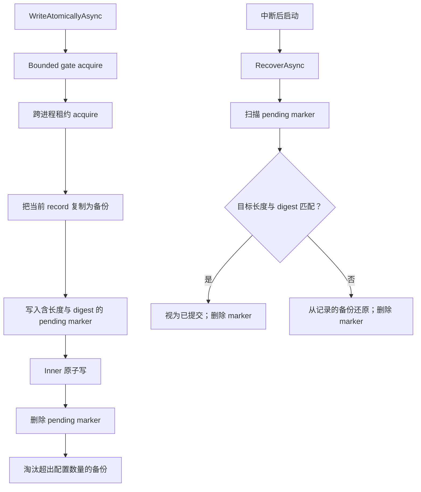

# CycloneGames.Persistence.Resilience

[English](README.md) | 简体中文

`CycloneGames.Persistence.Resilience` 为任意 `IPersistenceStorage` 增加有界准入、跨进程租约、write-ahead marker、备份轮换与确定性恢复。它是 decorator：storage 契约与 record 格式都不变。

## 目录

- [概述](#概述)
- [Assembly](#assembly)
- [快速上手](#快速上手)
- [写入与恢复流程](#写入与恢复流程)
- [公共 API](#公共-api)
- [策略值](#策略值)
- [平台与线程](#平台与线程)
- [诊断](#诊断)
- [测试](#测试)
- [问题排查](#问题排查)

## 概述

| 关注点 | 组件 | 行为 |
| --- | --- | --- |
| 并发写入 | `BoundedWriteGate` | 有界准入，等待时长显式；超时即拒绝，不做无界排队 |
| 多进程 | `FileProcessLease` | lock file 带 owner id 与单调过期；过期记录由有界重试回收 |
| 写入中断 | `PendingMarkerLog` + 备份 | pending marker 在写入前记录目标长度与 digest；恢复时比对并从备份还原 |
| 长时间运行 | `InMemoryEventSink` | 固定容量环形缓冲，事件存储不增长 |

## Assembly

| Assembly | 引用 | `autoReferenced` | `noEngineReferences` |
| --- | --- | --- | --- |
| `CycloneGames.Persistence.Resilience` | `CycloneGames.Persistence.Core`、`CycloneGames.Hash.Core` | `false` | `true` |

在 consumer asmdef 中添加 `CycloneGames.Persistence.Resilience`。该 assembly 属于 `com.cyclone-games.persistence` package，可选引用。

## 快速上手

所有上界与超时都由 composition root 提供，没有隐含默认值。

```csharp
using System;
using System.IO;
using CycloneGames.Persistence;
using CycloneGames.Persistence.Resilience;
using CycloneGames.Persistence.SystemIO;

var events = new InMemoryEventSink(256);
var options = new ResilienceOptions(
    walDirectory: Path.Combine(root, "wal"),
    backupGenerationCount: 3,
    writeGateCapacity: 4,
    writeGateTimeout: TimeSpan.FromSeconds(2),
    leaseExpiry: TimeSpan.FromSeconds(30),
    leaseAcquireAttempts: 3,
    eventBufferCapacity: 256,
    eventSink: events);

IPersistenceStorage inner = new SystemFilePersistenceStorage(
    Path.GetFullPath(Path.Combine(root, "settings.cgp")));
var storage = new ResilientStorage(inner, options);
```

照常组装 store：

```csharp
var codec = new VYamlPersistenceCodec<AudioSettings>(GeneratedResolver.Instance);
var store = new PersistenceStore<AudioSettings>(
    storage,
    new PersistenceProfile<AudioSettings>(codec));
```

启动时在首次加载之前执行一次恢复：

```csharp
RecoveryReport report = await storage.RecoverAsync(ct);

if (report.RestoredCount > 0 || report.CorruptCount > 0)
{
    ReportRecovery(report);
}
```

## 写入与恢复流程



已完成的写入不会被回滚。Digest 校验直接作用于存储字节，因此恢复过程不需要知道 codec，也不需要解析 record。

## 公共 API

| 类型 | 成员 |
| --- | --- |
| `ResilientStorage` | `Location`、`ReadAsync`、`WriteAtomicallyAsync`、`DeleteAsync`、`RecoverAsync`、`GetDiagnostics`、`Dispose` |
| `ResilienceOptions` | `WalDirectory`、`BackupGenerationCount`、`WriteGateCapacity`、`WriteGateTimeout`、`LeaseExpiry`、`LeaseAcquireAttempts`、`EventBufferCapacity`、`EventSink` |
| `BoundedWriteGate` | `Capacity`、`WaitingDepth`、`RejectedCount`、`AcquiredCount`、`AcquireAsync`、`Dispose` |
| `FileProcessLease` | `IsHeld`、`ConflictCount`、`TryAcquire`、`Release`、`Dispose` |
| `InMemoryEventSink` | `Capacity`、`WrittenCount`、`Record`、`TryGet`、`CountByKind` |
| `PersistenceEvent` | `Kind`、`TimestampTicks`、`ErrorCode`、`RecordBytes`、`ElapsedTicks` |
| `RecoveryReport` | `PendingCount`、`CommittedCount`、`RestoredCount`、`CorruptCount`、`UnrecoverableCount` |
| `ResilienceDiagnostics` | `BackupCount`、`PendingCount`、`GateWaitingDepth`、`GateRejectedCount`、`GateAcquiredCount`、`LeaseConflictCount`、`EventsEmitted` |

`RecoveryReport.CorruptCount` 统计无法解析的 pending marker。这些 marker 会保留供检查，不会自动删除。

## 策略值

| 值 | 含义 | 调整方向 |
| --- | --- | --- |
| `WalDirectory` | pending marker、备份与 lock file 所在目录 | 每个 storage location 一个目录 |
| `BackupGenerationCount` | 保留多少代已完成的备份 | 修复周期长则调高，存储预算紧则调低 |
| `WriteGateCapacity` | 同时持有写入许可的最大数量 | 与独立写入路径数量匹配 |
| `WriteGateTimeout` | 调用方等待准入的时长 | 交互式保存取短值，后台 worker 可取长值 |
| `LeaseExpiry` | 其他进程可回收 lock file 的时点 | 长于预期最慢的一次写入 |
| `LeaseAcquireAttempts` | 回收过期记录后的有界重试次数 | 取小值；持续失败说明存在活跃 owner |
| `EventBufferCapacity` | 环形缓冲容量 | 与诊断窗口匹配 |
| `EventSink` | 可选 sink；null 关闭事件记录 | 使用 `InMemoryEventSink` 或产品自实现 |

所有值在构造时校验，非法值立即抛出，不会留到写入阶段才失败。

## 平台与线程

`FileProcessLease` 与 `PendingMarkerLog` 使用 `System.IO` 并配合 `FileShare.None`，面向具备本地文件系统的平台。WebGL 与主机目标需要基于平台 save-data API 实现租约 adapter；其余组件仍可使用。

Gate 是实例。Storage adapter 保留各自的 guard。事件在锁内写入预分配缓冲，不会给 record 编码或解析路径增加分配。

## 诊断

`GetDiagnostics()` 报告备份数、pending marker 数、gate 等待深度、gate 拒绝与获取次数、租约冲突次数以及已发出的事件数。`InMemoryEventSink.CountByKind` 给出缓冲窗口内各事件类型的出现次数。两者都不检查 record 内容或路径。

## 测试

`ResilienceTests` 覆盖 gate 容量与超时、租约所有权与过期回收、备份轮换、pending marker 解析、已完成写入后的恢复、未完成写入后的恢复、损坏 marker 的恢复，以及长时间运行的事件缓冲行为。崩溃注入属于验证套件，不是运行时特性。

## 问题排查

| 现象 | 原因 | 处理 |
| --- | --- | --- |
| 写入抛 `TimeoutException` | `WriteGateTimeout` 内写入者超过 `WriteGateCapacity` | 提高容量，或在 composition root 串行化写入。 |
| 租约相关 `InvalidOperationException` | 另一进程持有有效 lock file | 等待后重试；用 `ConflictCount` 观察过期回收尝试。 |
| `RecoveryReport.UnrecoverableCount` 非零 | 目标损坏且备份缺失 | 从产品级备份恢复；保留 marker 供检查。 |
| `RecoveryReport.CorruptCount` 非零 | pending marker 的 header 非法 | 检查 marker 文件；不要自动删除。 |
| 备份文件累积 | `BackupGenerationCount` 设置过大 | 构造时调低该值。 |
