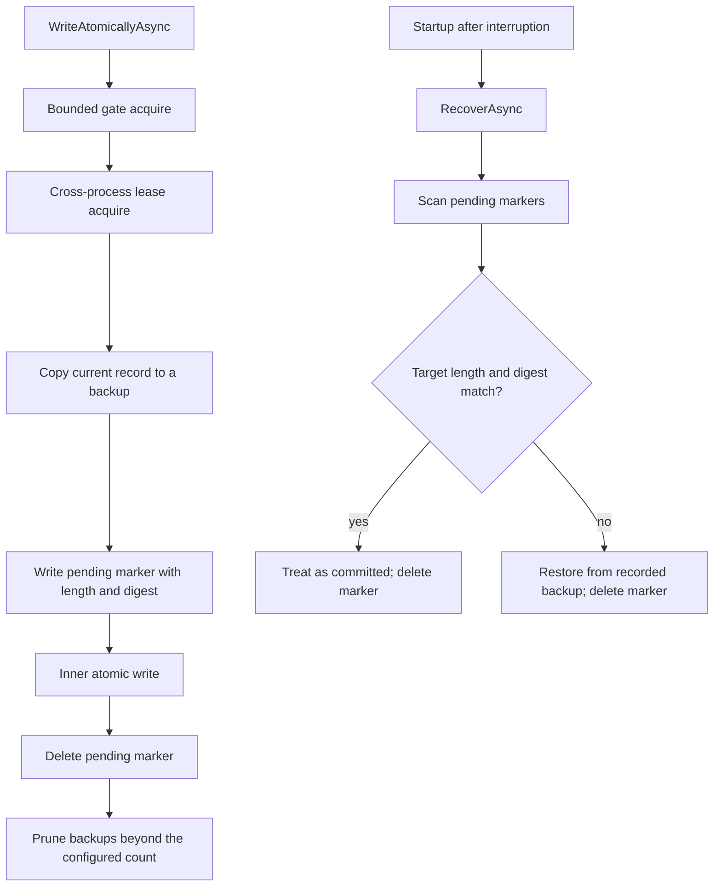

# CycloneGames.Persistence.Resilience

[English | 简体中文](README.SCH.md)

`CycloneGames.Persistence.Resilience` adds bounded admission, a cross-process lease, a write-ahead marker, backup rotation, and deterministic recovery to any `IPersistenceStorage`. It is a decorator: the storage contract and the record format stay unchanged.

## Contents

- [Overview](#overview)
- [Assembly](#assembly)
- [Getting started](#getting-started)
- [Write and recovery flow](#write-and-recovery-flow)
- [Public API](#public-api)
- [Policy values](#policy-values)
- [Platform and threading](#platform-and-threading)
- [Diagnostics](#diagnostics)
- [Testing](#testing)
- [Troubleshooting](#troubleshooting)

## Overview

| Concern | Component | Behavior |
| --- | --- | --- |
| Concurrent writers | `BoundedWriteGate` | Bounded admission with an explicit wait. A timed-out caller is rejected, never queued without limit. |
| Multiple processes | `FileProcessLease` | Lock file with an owner id and a monotonic expiry. Expired records are reclaimed by bounded retries. |
| Interrupted writes | `PendingMarkerLog` + backups | A pending marker records target length and digest before the write. Recovery compares them and restores from a backup when needed. |
| Long-running state | `InMemoryEventSink` | Fixed-capacity ring buffer. Event storage never grows. |

## Assembly

| Assembly | References | `autoReferenced` | `noEngineReferences` |
| --- | --- | --- | --- |
| `CycloneGames.Persistence.Resilience` | `CycloneGames.Persistence.Core`, `CycloneGames.Hash.Core` | `false` | `true` |

Add `CycloneGames.Persistence.Resilience` to the consumer asmdef. The assembly ships in the `com.cyclone-games.persistence` package and is optional.

## Getting started

Every bound and timeout is supplied by the composition root. There are no implicit defaults.

```csharp
using System;
using System.IO;
using CycloneGames.Persistence;
using CycloneGames.Persistence.Resilience;
using CycloneGames.Persistence.SystemIO;

var events = new InMemoryEventSink(256);
var options = new ResilienceOptions(
    walDirectory: Path.Combine(root, "wal"),
    backupGenerationCount: 3,
    writeGateCapacity: 4,
    writeGateTimeout: TimeSpan.FromSeconds(2),
    leaseExpiry: TimeSpan.FromSeconds(30),
    leaseAcquireAttempts: 3,
    eventBufferCapacity: 256,
    eventSink: events);

IPersistenceStorage inner = new SystemFilePersistenceStorage(
    Path.GetFullPath(Path.Combine(root, "settings.cgp")));
var storage = new ResilientStorage(inner, options);
```

Compose the store as usual:

```csharp
var codec = new VYamlPersistenceCodec<AudioSettings>(GeneratedResolver.Instance);
var store = new PersistenceStore<AudioSettings>(
    storage,
    new PersistenceProfile<AudioSettings>(codec));
```

Run recovery once at startup, before the first load:

```csharp
RecoveryReport report = await storage.RecoverAsync(ct);

if (report.RestoredCount > 0 || report.CorruptCount > 0)
{
    ReportRecovery(report);
}
```

## Write and recovery flow



A completed write is never rolled back. The digest check is over the stored bytes, so recovery does not need to know the codec or parse the record.

## Public API

| Type | Members |
| --- | --- |
| `ResilientStorage` | `Location`, `ReadAsync`, `WriteAtomicallyAsync`, `DeleteAsync`, `RecoverAsync`, `GetDiagnostics`, `Dispose` |
| `ResilienceOptions` | `WalDirectory`, `BackupGenerationCount`, `WriteGateCapacity`, `WriteGateTimeout`, `LeaseExpiry`, `LeaseAcquireAttempts`, `EventBufferCapacity`, `EventSink` |
| `BoundedWriteGate` | `Capacity`, `WaitingDepth`, `RejectedCount`, `AcquiredCount`, `AcquireAsync`, `Dispose` |
| `FileProcessLease` | `IsHeld`, `ConflictCount`, `TryAcquire`, `Release`, `Dispose` |
| `InMemoryEventSink` | `Capacity`, `WrittenCount`, `Record`, `TryGet`, `CountByKind` |
| `PersistenceEvent` | `Kind`, `TimestampTicks`, `ErrorCode`, `RecordBytes`, `ElapsedTicks` |
| `RecoveryReport` | `PendingCount`, `CommittedCount`, `RestoredCount`, `CorruptCount`, `UnrecoverableCount` |
| `ResilienceDiagnostics` | `BackupCount`, `PendingCount`, `GateWaitingDepth`, `GateRejectedCount`, `GateAcquiredCount`, `LeaseConflictCount`, `EventsEmitted` |

`RecoveryReport.CorruptCount` counts pending markers that cannot be parsed. Those markers are kept for inspection instead of being deleted.

## Policy values

| Value | Meaning | Tuning |
| --- | --- | --- |
| `WalDirectory` | Directory for pending markers, backups, and the lock file | One directory per storage location |
| `BackupGenerationCount` | How many completed backups survive | Raise for slower repair cycles, lower for tight storage budgets |
| `WriteGateCapacity` | Maximum concurrent write holders | Match the number of independent writer paths |
| `WriteGateTimeout` | How long a caller may wait for admission | Short for interactive saves, longer for background workers |
| `LeaseExpiry` | When another process may reclaim a lock file | Longer than the slowest expected write |
| `LeaseAcquireAttempts` | Bounded retries after reclaiming a stale record | Small; repeated failure means a live owner |
| `EventBufferCapacity` | Ring buffer size | Match the diagnostic window |
| `EventSink` | Optional sink; null disables event recording | Use `InMemoryEventSink` or a product sink |

All values are validated at construction. Invalid values throw immediately instead of failing during a write.

## Platform and threading

`FileProcessLease` and `PendingMarkerLog` use `System.IO` with `FileShare.None`. They target platforms with a local file system. WebGL and console targets need a lease adapter built on the platform save-data API; the other components remain usable.

The gate is an instance. Storage adapters keep their own guards. Events are written under a lock into a preallocated buffer; no allocation is added to the record encoding or parsing path.

## Diagnostics

`GetDiagnostics()` reports backup count, pending marker count, gate waiting depth, gate rejection and acquisition counts, lease conflicts, and emitted event count. `InMemoryEventSink.CountByKind` reports how often each event kind occurred within the buffer window. Neither method inspects record content or paths.

## Testing

`ResilienceTests` covers gate capacity and timeout, lease ownership and stale reclaim, backup rotation, pending-marker parsing, recovery after a completed write, recovery after an incomplete write, recovery from a corrupt marker, and long-running event buffer behavior. Crash injection is part of the validation suite, not a runtime feature.

## Troubleshooting

| Symptom | Cause | Action |
| --- | --- | --- |
| `TimeoutException` on write | More writers than `WriteGateCapacity` within `WriteGateTimeout` | Raise capacity or serialize writes in the composition root. |
| `InvalidOperationException` about the lease | Another process holds a live lock file | Wait and retry; check `ConflictCount` for stale reclaim attempts. |
| `RecoveryReport.UnrecoverableCount` is non-zero | The target was damaged and its backup was missing | Restore from a product-level backup; keep the marker for inspection. |
| `RecoveryReport.CorruptCount` is non-zero | A pending marker has an invalid header | Inspect the marker file; do not delete it automatically. |
| Backup files accumulate | `BackupGenerationCount` is larger than intended | Lower the count at construction. |
