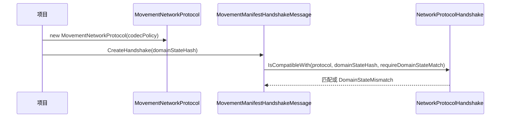

# Movement.Networking

[English](README.md) | 简体中文

权威移动的 wire 契约层。定义 DTO、带指纹的消息清单、按 epoch 的输入准入、每实体历史、reconciliation 与权限桥接。传输、序列化、预测循环与表现平滑由项目自行实现。

## 目录

1. [安装](#安装)
2. [协议身份](#协议身份)
3. [消息](#消息)
4. [握手](#握手)
5. [输入准入](#输入准入)
6. [历史与 reconciliation](#历史与-reconciliation)
7. [组合示例](#组合示例)
8. [线布局规则](#线布局规则)
9. [自定义校验器](#自定义校验器)
10. [运行时约束](#运行时约束)
11. [故障排查](#故障排查)
12. [延伸阅读](#延伸阅读)

## 安装

UPM 标识：`com.cyclone-games.rpg-foundation-movement-networking`。

| 依赖 | 用途 |
| --- | --- |
| `com.cyclone-games.rpg-foundation` | Movement Core 契约 |
| `com.cyclone-games.networking` | `INetConnection`、协议清单、握手协商 |

程序集为 `CycloneGames.RPGFoundation.Movement.Networking.Core`，设置 `noEngineReferences: true`。本包不使用 `com.unity.mathematics`。

## 协议身份

`MovementNetworkProtocol` 是由组合根构造的 sealed 类。每个实例持有一个 `NetworkModuleProtocol`，模块区间为 `16000-16008`。契约身份是签入源码的可打印 ASCII 字符串，例如 `CycloneGames.Movement.InputCommand`，不使用 CLR 类型名，也不在运行时推导。

| 属性 | 含义 |
| --- | --- |
| `ProtocolFingerprint` | 所持有 `NetworkModuleProtocol` 的指纹 |
| `WireLayoutDigest` | DTO 字段顺序布局的摘要 |
| `WireCodecDigest` | 序列化、压缩与量化策略的摘要 |
| `Manifest` | 9 个消息描述符，含通道与载荷上限 |
| `MessageRange` | `16000-16008` |

`CreateProtocolManifest()` 是纯工厂方法，`GetContractId(index)` 返回签入的契约身份。

## 消息

| 消息 | ID | 通道 | 载荷上限 |
| --- | ---: | --- | ---: |
| `MovementManifestHandshakeMessage` | 16000 | Reliable | 128 |
| `MovementInputCommandMessage` | 16001 | Unreliable | 128 |
| `MovementNetworkSnapshotMessage` | 16002 | UnreliableSequenced | 256 |
| `MovementCorrectionMessage` | 16003 | Reliable | 1024 |
| `MovementFullStateRequestMessage` | 16004 | Reliable | 128 |
| `MovementAuthorityTransferMessage` | 16005 | Reliable | 128 |
| `MovementTeleportMessage` | 16006 | Reliable | 256 |
| `MovementInputBatchMessage` | 16007 | Unreliable | 1024 |
| `MovementInputAckMessage` | 16008 | Unreliable | 128 |

`MovementInputBatchMessage` 最多携带 4 条按时间从旧到新排列的命令，下一个数据报即可补回丢失的命令。`MovementInputAckMessage` 驱动 `ApplyAck`，按服务器时间线剪枝预测历史。

`MovementNetworkSnapshotMessage` 是高频紧凑增量。`MovementCorrectionMessage` 携带完整 `MovementFullState`，是校正、生成、迟到加入与重放唯一接受的类型。

## 握手



握手核对三个独立事实：`WireLayoutDigest`、`WireCodecDigest` 与可选的 `DomainStateHash`。`DomainStateHash` 保持 `CycloneGames.Networking` 定义的语义，不承载布局数据。任意一项被篡改都会拒绝会话。

`Negotiate(...)` 转发到 `NetworkProtocolHandshake.Negotiate`，并传递 `requireDomainStateMatch`。

## 输入准入

`MovementNetworkInputAuthority.TryAccept` 依次执行：

1. 项目提供的 `IMovementNetworkInputValidator`。
2. 发送方认证与 epoch 一致性。
3. 通过 `MovementNetworkInputValidationContext` 检查 tick 与序号顺序。
4. `MovementTimeDilationAuditor`，按服务器 tick 推导每条命令的预算。
5. 写入 `MovementNetworkInputHistory`。

首次出现的实体把时间膨胀窗口起点绑定到它的第一个 tick，迟到加入不会因此获得额外命令。每个 DTO 都携带 `Epoch`；权限迁移需更换 epoch 并调用 `Reset()`。

发送前用 `GetEffectiveMaxPayloadSize(messageId, endpoint)` 合并描述符、通道、适配器与后端预算。

## 历史与 reconciliation

`MovementEntityHistory<TSnapshot>` 用开放寻址索引管理每实体连续槽，查找、插入与按 ack 剪枝均为 O(1)。容量在构造时通过 `MovementHistoryCapacity` 固定。

`MovementNetworkReconciliation` 把校正与本地预测快照比较，产出待应用的状态。`MovementRemoteSampleAdapter` 把快照消息转换成 `MovementRemoteSample`，交给表现层抖动缓冲。

`GetTeardownSet()` 返回两个 `INetworkSessionTeardownTarget`。`TeardownSession()` 在断开时清空历史与审计窗口。

## 组合示例

按步骤递进。

### 第 1 步：创建协议

```csharp
using CycloneGames.RPGFoundation.Movement.Networking;

var protocol = new MovementNetworkProtocol(MovementWireCodecPolicy.Unspecified);
MovementManifestHandshakeMessage handshake = protocol.CreateHandshake(0UL);
```

### 第 2 步：构建权限对象

```csharp
using CycloneGames.Networking.Simulation;

var history = new MovementNetworkInputHistory(
    new MovementHistoryCapacity(entityCount: 128, perEntityCount: 128));
var auditor = new MovementTimeDilationAuditor(MovementDilationPolicy.Default);
var authority = new MovementNetworkInputAuthority(history, auditor);
```

### 第 3 步：接收命令

```csharp
using CycloneGames.Networking;

var context = new MovementNetworkInputValidationContext(
    sender: connection,
    epoch: epoch,
    serverTick: new NetworkTickId(serverTick),
    lastAcceptedClientTick: new NetworkTickId(lastTick));

bool accepted = authority.TryAccept(in command, in context,
                                    out NetworkActionResult result);
```

`MovementNetworkInputValidationContext` 还包含允许的按键掩码、自定义标志策略、瞄准方向范围与最大 tick 漂移。

### 第 4 步：应用 ack 并生成校正

```csharp
int pruned = authority.ApplyAck(in ack);

MovementFullState full = movementComponent.CaptureFullState();
// 把 full 填入 MovementCorrectionMessage 后走可靠通道发送
```

### 第 5 步：会话收尾

```csharp
MovementSessionTeardownSet targets = authority.GetTeardownSet();
targets.TeardownSession();
authority.Reset();
```

### 第 6 步：远端表现

```csharp
if (MovementRemoteSampleAdapter.TryConvert(in snapshot, out MovementRemoteSample sample))
    session.TryAccept(in sample);
```

## 线布局规则

- `MovementWireLayout.Digest` 覆盖每个 DTO 的有序字段列表。字段变更需同步描述符。
- `MovementWireCodecPolicy.ComputeDigest()` 固定序列化类型、选项、压缩与量化。策略不同的对端无法通过握手。
- `MovementFullState` 的 4 个 float 与 2 个 int 扩展槽承载确定性模拟标量，不存动画或表现数据。
- 快照标志把 wire 位与本地位分开，保留值用于让接收方拒绝畸形载荷。
- `NetworkTick`（`long`）与 `NetworkTimeSeconds`（`double`）来自适配器，wire 格式不使用 `Time.frameCount` 或浮点墙钟时间。

## 自定义校验器

实现 `IMovementNetworkInputValidator` 并传给 `MovementNetworkInputAuthority`。默认校验器执行内置规则；项目校验器可加入距离、能力或频率检查，无需改动 wire 格式。

`MovementNetworkInputValidationContext.ToActionValidationContext()` 供已使用 `CycloneGames.Networking` 共享动作校验器的代码复用。

## 运行时约束

| 约束 | 数值 |
| --- | --- |
| 引擎引用 | 无，`noEngineReferences: true` |
| LINQ、反射、静态可变容器 | 无 |
| `public const` | 3 个契约文件共 36 个 wire 常量 |
| 契约身份 | 签入的字符串，不使用 CLR 类型名 |
| 可变状态 | 由组合根持有，通过 `GetTeardownSet()` 清理 |
| 线程 | 由项目选择网络线程或主线程调用，包内不加锁 |

## 故障排查

| 现象 | 原因 | 处理 |
| --- | --- | --- |
| 握手返回 `DomainStateMismatch` | 两端产品哈希不同 | 两侧传入同一个 `domainStateHash` |
| 改序列化后握手被拒 | `WireCodecDigest` 不同 | 部署相同的 `MovementWireCodecPolicy` |
| 命令全部被拒 | epoch 不一致或发送方未认证 | 检查每个 DTO 的 `Epoch` 与 `INetConnection.IsAuthenticated` |
| 预测历史持续增长 | 未应用 ack | 对每条 `MovementInputAckMessage` 调用 `ApplyAck` |
| 迟到加入获得额外命令 | 时间膨胀窗口绑定到 tick 0 | 让 auditor 绑定首次出现的 tick |
| 断开后状态未清空 | 没有调用 teardown | 调用 `GetTeardownSet().TeardownSession()` |

## 延伸阅读

- [Movement 主文档](../CycloneGames.RPGFoundation/Movement/README.SCH.md)
