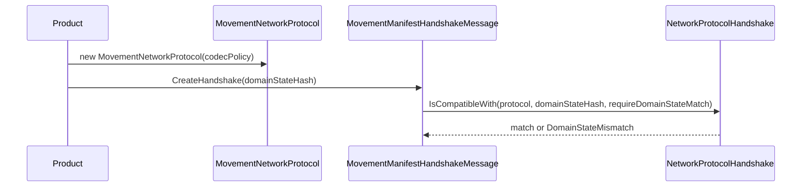

# Movement.Networking

[English | 简体中文](README.SCH.md)

Wire contracts for authoritative movement. The package defines DTOs, a
fingerprinted message manifest, epoch-bound input admission, per-entity
histories, reconciliation and the authority bridge. Transport, serialization,
prediction loops and presentation smoothing belong to the product.

## Contents

1. [Install](#install)
2. [Protocol identity](#protocol-identity)
3. [Messages](#messages)
4. [Handshake](#handshake)
5. [Input admission](#input-admission)
6. [Histories and reconciliation](#histories-and-reconciliation)
7. [Composition](#composition)
8. [Wire layout rules](#wire-layout-rules)
9. [Custom validators](#custom-validators)
10. [Runtime constraints](#runtime-constraints)
11. [Troubleshooting](#troubleshooting)
12. [See also](#see-also)

## Install

UPM identity: `com.cyclone-games.rpg-foundation-movement-networking`.

| Dependency | Purpose |
| --- | --- |
| `com.cyclone-games.rpg-foundation` | Movement Core contracts |
| `com.cyclone-games.networking` | `INetConnection`, protocol manifest, handshake negotiation |

The assembly is `CycloneGames.RPGFoundation.Movement.Networking.Core` with
`noEngineReferences: true`. Add `com.unity.mathematics` only if your own code
needs it; this package does not.

## Protocol identity

`MovementNetworkProtocol` is a sealed class constructed by the composition
root. Each instance owns a `NetworkModuleProtocol` with the module range
`16000-16008`. Contract identities are checked-in printable-ASCII strings such
as `CycloneGames.Movement.InputCommand`; they are not CLR type names and are
not derived at runtime.

| Property | Meaning |
| --- | --- |
| `ProtocolFingerprint` | Fingerprint of the owned `NetworkModuleProtocol` |
| `WireLayoutDigest` | Digest of the ordered DTO field layout |
| `WireCodecDigest` | Digest of the serializer, compression and quantization policy |
| `Manifest` | Nine message descriptors with channel and payload limits |
| `MessageRange` | `16000-16008` |

`CreateProtocolManifest()` is a pure factory. `GetContractId(index)` returns
the checked-in identity for one of the nine messages.

## Messages

| Message | ID | Channel | Payload cap |
| --- | ---: | --- | ---: |
| `MovementManifestHandshakeMessage` | 16000 | Reliable | 128 |
| `MovementInputCommandMessage` | 16001 | Unreliable | 128 |
| `MovementNetworkSnapshotMessage` | 16002 | UnreliableSequenced | 256 |
| `MovementCorrectionMessage` | 16003 | Reliable | 1024 |
| `MovementFullStateRequestMessage` | 16004 | Reliable | 128 |
| `MovementAuthorityTransferMessage` | 16005 | Reliable | 128 |
| `MovementTeleportMessage` | 16006 | Reliable | 256 |
| `MovementInputBatchMessage` | 16007 | Unreliable | 1024 |
| `MovementInputAckMessage` | 16008 | Unreliable | 128 |

`MovementInputBatchMessage` carries up to four oldest-first commands, so the
next datagram recovers a lost one. `MovementInputAckMessage` drives
`ApplyAck`, which prunes prediction history by the server timeline.

`MovementNetworkSnapshotMessage` is a compact high-frequency delta.
`MovementCorrectionMessage` carries a complete `MovementFullState` and is the
only type accepted for correction, spawn, late join and replay.

## Handshake



Three independent facts are checked: `WireLayoutDigest`, `WireCodecDigest` and
the optional product `DomainStateHash`. `DomainStateHash` keeps the meaning
defined by `CycloneGames.Networking` and is never loaded with layout data.
Tampering with any one of them rejects the session.

`Negotiate(...)` forwards to `NetworkProtocolHandshake.Negotiate`, including
`requireDomainStateMatch`.

## Input admission

`MovementNetworkInputAuthority.TryAccept` applies, in order:

1. `IMovementNetworkInputValidator` from the product, when one is supplied.
2. Sender authentication and epoch equality.
3. Tick and sequence ordering through `MovementNetworkInputValidationContext`.
4. `MovementTimeDilationAuditor`, which derives a per-command budget from
   server ticks.
5. Recording into `MovementNetworkInputHistory`.

A first-seen entity binds its dilation window start to its first tick, so a
late join cannot gain extra commands. Every DTO carries an `Epoch`; authority
migration changes the epoch and calls `Reset()`.

Use `GetEffectiveMaxPayloadSize(messageId, endpoint)` to compose descriptor,
channel, adapter and backend budgets before sending.

## Histories and reconciliation

`MovementEntityHistory<TSnapshot>` stores per-entity contiguous slots behind an
open-addressed index. Lookup, insert and ack-driven prune are O(1). Capacity is
fixed at construction through `MovementHistoryCapacity`.

`MovementNetworkReconciliation` compares a correction against locally predicted
snapshots and produces the state to apply. `MovementRemoteSampleAdapter`
converts a snapshot message into a `MovementRemoteSample` for the presentation
jitter buffer.

`GetTeardownSet()` returns two `INetworkSessionTeardownTarget` instances.
`TeardownSession()` clears the history and the dilation windows on disconnect.

## Composition

The steps build on each other.

### Step 1: create the protocol

```csharp
using CycloneGames.RPGFoundation.Movement.Networking;

var protocol = new MovementNetworkProtocol(MovementWireCodecPolicy.Unspecified);
MovementManifestHandshakeMessage handshake = protocol.CreateHandshake(0UL);
```

### Step 2: build the authority

```csharp
using CycloneGames.Networking.Simulation;

var history = new MovementNetworkInputHistory(
    new MovementHistoryCapacity(entityCount: 128, perEntityCount: 128));
var auditor = new MovementTimeDilationAuditor(MovementDilationPolicy.Default);
var authority = new MovementNetworkInputAuthority(history, auditor);
```

### Step 3: accept a command

```csharp
using CycloneGames.Networking;

var context = new MovementNetworkInputValidationContext(
    sender: connection,
    epoch: epoch,
    serverTick: new NetworkTickId(serverTick),
    lastAcceptedClientTick: new NetworkTickId(lastTick));

bool accepted = authority.TryAccept(in command, in context,
                                    out NetworkActionResult result);
```

`MovementNetworkInputValidationContext` also carries the allowed button mask,
custom-flag policy, aim-direction bounds and maximum tick drift.

### Step 4: apply an ack and produce a correction

```csharp
int pruned = authority.ApplyAck(in ack);

MovementFullState full = movementComponent.CaptureFullState();
// Fill MovementCorrectionMessage with 'full' before sending on a reliable channel.
```

### Step 5: tear down the session

```csharp
MovementSessionTeardownSet targets = authority.GetTeardownSet();
targets.TeardownSession();
authority.Reset();
```

### Step 6: feed remote presentation

```csharp
if (MovementRemoteSampleAdapter.TryConvert(in snapshot, out MovementRemoteSample sample))
    session.TryAccept(in sample);
```

## Wire layout rules

- `MovementWireLayout.Digest` covers the ordered field list of every DTO. A
  field change requires a descriptor update.
- `MovementWireCodecPolicy.ComputeDigest()` pins serializer type, options,
  compression and quantization. Peers with different policies fail the
  handshake.
- Four float and two integer extension slots in `MovementFullState` carry
  deterministic simulation scalars. Do not put animation or presentation data
  in them.
- Snapshot flags separate wire bits from local-only bits. Reserved values let
  the receiver reject a malformed payload.
- `NetworkTick` (`long`) and `NetworkTimeSeconds` (`double`) come from the
  adapter. The wire format does not use `Time.frameCount` or float wall clocks.

## Custom validators

Implement `IMovementNetworkInputValidator` and pass it to
`MovementNetworkInputAuthority`. The default validator accepts the built-in
rules; a product validator can add distance, ability or rate checks without
changing the wire format.

`MovementNetworkInputValidationContext` exposes `ToActionValidationContext()`
for code that already uses the shared action validator from
`CycloneGames.Networking`.

## Runtime constraints

| Constraint | Value |
| --- | --- |
| Engine references | none; `noEngineReferences: true` |
| LINQ, reflection, static mutable containers | none |
| `public const` | 36 wire constants in three contract files |
| Contract identity | checked-in strings, no CLR type names |
| Mutable state | owned by the composition root, cleared by `GetTeardownSet()` |
| Threading | call from the network or main thread chosen by the product; no locks inside the package |

## Troubleshooting

| Symptom | Cause | Action |
| --- | --- | --- |
| Handshake returns `DomainStateMismatch` | Product hash differs between peers | Pass the same `domainStateHash` on both sides |
| Handshake rejects a peer after a serializer change | `WireCodecDigest` differs | Deploy the same `MovementWireCodecPolicy` |
| Commands always rejected | Epoch mismatch or unauthenticated sender | Check `Epoch` on every DTO and `INetConnection.IsAuthenticated` |
| Prediction history grows | Acks are not applied | Call `ApplyAck` for every `MovementInputAckMessage` |
| Late join gains extra commands | Dilation window bound to tick zero | Let the auditor bind the first seen tick |
| State not cleared on disconnect | Teardown set not used | Call `GetTeardownSet().TeardownSession()` |

## See also

- [Movement main documentation](../CycloneGames.RPGFoundation/Movement/README.md)
