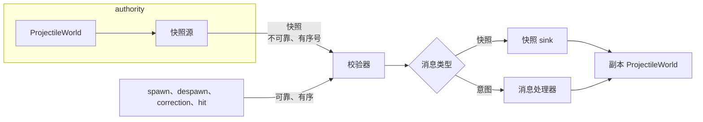
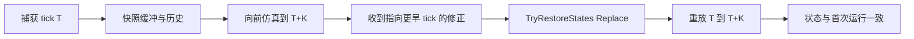

# CycloneGames.RPGFoundation · Projectile.Networking

[English](README.md) | 简体中文

抛射物模块的复制层：消息 schema、校验器、用于回滚与插值的有界历史，以及把收到的消息落成世界状态的处理器。

这个包只产出和消费已校验的消息，不发包。序列化与传输属于你的网络层。

只有抛射物状态需要跨网络边界时才需要它。基础 Projectile 模块不依赖此包。

## 目录

1. [适用范围](#1-适用范围)
2. [安装](#2-安装)
3. [线格式](#3-线格式)
4. [服务端：捕获与发送](#4-服务端捕获与发送)
5. [客户端：落地](#5-客户端落地)
6. [校验](#6-校验)
7. [对账与修正](#7-对账与修正)
8. [回滚](#8-回滚)
9. [开销与规模](#9-开销与规模)
10. [测试](#10-测试)

---

## 1. 适用范围

本包负责抛射物协议：消息 id、DTO、校验、对账、快照历史，以及把上述内容落到 `ProjectileWorld` 的处理器。

`CycloneGames.Networking` 负责共享基础设施：消息区间、清单、通道、目录注册、`NetworkVector3`、
`NetworkActionResult`，以及传输。

抛射物仿真与快照仍然属于 `CycloneGames.RPGFoundation.Projectile.Core`，这里不做重复实现。

不负责：字节布局、可靠性策略的执行、路由、会话、兴趣管理。

## 2. 安装

| 程序集 | 内容 | 依赖 UnityEngine |
| --- | --- | --- |
| `CycloneGames.RPGFoundation.Projectile.Networking.Core` | 消息、校验器、历史、sink、消息处理器 | 否 |
| `CycloneGames.RPGFoundation.Projectile.Networking.Tests.Editor` | EditMode 覆盖 | 否 |

两者都是 `autoReferenced: false`，使用方 asmdef 需显式引用 Core。不需要 PlayerSettings 宏。

依赖：`CycloneGames.RPGFoundation.Projectile.Core` 与 `CycloneGames.Networking.Core`。

包里没有 Unity 引用、后端 SDK、传输层或 DI 容器。项目侧适配器负责注册协议、序列化消息、
校验入站流量，并把通过校验的部分转给玩法系统。

## 3. 线格式

消息 id 为 `17000` 到 `17999`，落在 `NetworkMessageRanges.Module` 拥有的 `1000` 到 `29999` 区间内。

| 消息 | Id | 可靠性 |
| --- | --- | --- |
| `MSG_MANIFEST_HANDSHAKE` | 17000 | 可靠、有序 |
| `MSG_SPAWN` | 17001 | 可靠、有序 |
| `MSG_AUTHORITATIVE_SNAPSHOT` | 17002 | 不可靠、有序号 |
| `MSG_CORRECTION` | 17003 | 可靠、有序 |
| `MSG_HIT` | 17004 | 可靠、有序 |
| `MSG_DESPAWN` | 17005 | 可靠、有序 |
| `MSG_FULL_STATE_REQUEST` | 17006 | 可靠、有序 |

`ProjectileNetworkProtocol.CreateProtocolManifest` 构建完整描述符集合，
`RegisterMessageCatalog` 通过 `TryRegisterProtocolManifest` 提交。注册要么整体提交区间与所有描述符，
要么整体拒绝，因此不会出现部分写入的目录。

协议值是 `public static readonly` 而不是 `const`：契约 id 与版本常量在运行时读取，而不是在跨程序集时
被内联；负载默认值也对使用方可见，不需要重编字面量。改契约仍然需要新的 `:vN` 标识与协同的版本窗口。

schema 指纹覆盖字段名与类型，不覆盖二进制布局，所以序列化器可以调整填充而不破坏握手。
双方在其余流程之前交换指纹。不一致说明两个构建对 schema 的理解不同，应当拒绝连接，
而不是让它跑下去产生不同步。

`ProjectileSnapshotMessage` 为 88 字节：实体 id、owner、target、定义 id、tick、sequence、
prediction key、生命周期 flags、age、radius，以及三个向量（position、previous position、velocity）。
向量占其中 36 字节，是带宽紧张时首先该量化的部分。

## 4. 服务端：捕获与发送

权威侧持有世界，并从中广播。

```csharp
using CycloneGames.RPGFoundation.Projectile.Core;
using CycloneGames.RPGFoundation.Projectile.Networking;

var source = new ProjectileWorldNetworkSnapshotSource(world);
var scratch = new ProjectileSnapshot[world.Capacity];

// 每个复制 tick 一次。单次顺序遍历，不分配。
int count = source.CaptureSnapshots(scratch);

for (int i = 0; i < count; i++)
{
    ProjectileSnapshot snapshot = scratch[i];
    ProjectileSnapshotMessage message = ProjectileSnapshotMessage.FromSnapshot(in snapshot, sequence);
    // 序列化后走不可靠有序通道发送。
}
```

`source.SnapshotCapacity` 的存在是为了让 bridge 只预分配一次转换缓冲区，而不是每次广播都分配。

spawn、hit、despawn、correction 走可靠有序通道。全量状态请求用于客户端漏收 spawn 的情况：
它可以要求重建，而不是等来一堆引用着从未创建过的子弹的修正。

## 5. 客户端：落地

两个入口。传输层已经产出 `ProjectileSnapshot` 时用 sink；直接处理线消息时用消息处理器。

```csharp
using CycloneGames.RPGFoundation.Projectile.Networking;

// 客户端必须为每个复制来的定义 id 持有本地运动学。
var catalog = new MyDefinitionCatalog();
var sink = new ProjectileWorldSnapshotSink(world, catalog);
var handler = new ProjectileWorldMessageHandler(world, catalog, hitReceiver);

// 快照走不可靠通道，由 sink 落地。
sink.TryApplySnapshot(in snapshot);

// 其余消息走处理器。
handler.TryHandleSpawn(in spawnMessage);
handler.TryHandleCorrection(in correctionMessage);
handler.TryHandleDespawn(in despawnMessage);
handler.TryHandleHit(in hitMessage);
```



处理器里有几个策略决定值得了解：

- 实体 id 已存在的 spawn 会被拒绝，不会覆盖。幂等意味着第二次请求不改变任何状态；
  定义变化必须走 correction。
- 已消失实体的 despawn 只递增计数后返回。可靠通道带重试，重复投递是常态。
- 带 `HardSnap` 或 `FullReset` 的 correction 会重建子弹；其余就在地修补，保留句柄、
  反弹与穿透预算。
- hit 消息从不改动世界。客户端已经预测了这次命中，这条消息是给必须由权威决定的表现用的。

每种结果都有独立计数：`AppliedCount`、`SpawnedCount`、`StaleCount`、`InvalidCount`、
`MissingDefinitionCount`、`CapacityRejectedCount`、`DuplicateCount`、`AlreadyGoneCount`。
接到遥测上去。静默丢弃是最耗时间的故障类型。

## 6. 校验

```csharp
var context = new ProjectileNetworkValidationContext(
    sender: connection,
    serverTick: currentTick,
    lastAcceptedServerTick: lastAcceptedTick,
    authorityMode: NetworkActionAuthorityMode.ClientPredictedServerAuthoritative,
    maxInitialVelocity: 512f,
    maxSnapshotVelocity: 512f,
    maxRadius: 16f,
    maxAge: 3600f,
    senderOwnedEntityId: playerEntityId);

NetworkActionResult result = validator.ValidateSpawn(in message, in context);
if (!result.IsAccepted)
{
    // result 带有拒绝码
}
```

拒绝码把客户端 bug 和协议违规分开。`OutOfOrder`、`Duplicate`、`Stale` 在丢包通道上是预期行为，
属于计数器。`Invalid`、`ImpersonatedOwner`、`TickInFuture` 说明客户端在撒谎或严重出错，属于日志。

默认校验器是无状态单例。实现 `IProjectileNetworkMessageValidator` 可以收紧或放宽某条规则。
处理器不关心是谁校验的，只关心消息是否通过。

## 7. 对账与修正

```csharp
if (ProjectileNetworkReconciliation.RequiresCorrection(
        in predicted, in authoritative, policy,
        out ProjectileNetworkCorrectionFlags flags, out float error))
{
    ProjectileNetworkReconciliation.TryCreateCorrection(
        in predicted, in authoritative, policy, out ProjectileCorrectionMessage correction);
}
```

`RequiresCorrection` 按策略阈值比较位置、速度与年龄，并填出一组描述偏差字段的 flags。
达到或超过硬吸附阈值的修正应带 `HardSnap`，客户端据此重建而不是修补。

非有限输入按最大偏差处理。NaN 与任何阈值比较都是 false，没有显式检查时会被判成"无需修正"，
客户端就会保留一个永远无法对齐的状态。

## 8. 回滚

客户端预测需要两半：用历史缓冲区决定还原什么，用世界的还原入口决定怎么还原。

```csharp
// 有界的按实体历史，用于插值与回滚。
var history = new ProjectileNetworkSnapshotHistory(capacity: 8192, depthPerEntity: 8);

history.Record(in snapshotMessage);

if (history.TryGetAtOrBefore(entityId, rewindTick, out ProjectileSnapshotMessage frame))
{
    // 插值远端子弹，或收集完整一帧用于还原
}
```

`depthPerEntity` 是每个实体的环形深度。`TryGetAtOrBefore` 返回不晚于指定 tick 的最新保留帧，
这正是插值需要的。`CopyHistory` 按从旧到新填充调用方数组。`RemoveProjectile` 释放对应桶，
避免池子被死亡实体填满。

还原整个 tick 用 Core 的接口：

```csharp
ProjectileRestoreResult result = world.TryRestoreStates(
    capturedSpan, ProjectileRestoreMode.Replace, catalog);

// result.Applied、result.Spawned、result.Despawned 描述发生了什么变化。
// result.Succeeded == false 表示批次被拒绝，世界未改动。
```



`Replace` 表示这一批就是该 tick 的完整状态：批次未提及的子弹会被删除，`world.LatestTick` 会退到
批次 tick，使重放从正确的起点开始。`Merge` 保留批次未提及的本地子弹，锚点只前进，
适合兴趣管理这类局部视图。

还原是原子的。任一条目格式错误、任一需要的定义缺失、或删除后仍装不下，都不会改动任何状态，
并在结果里说明原因。

## 9. 开销与规模

这里的成本是结构性的。本文不写计时数字，理由与基础模块相同：包里不带基准测试，
写进去的数字会静默过时。

代码固定下来的性质：

- 历史写入与查找对每个实体是常数时间。桶索引是实体 id 上的开放寻址，空闲桶栈让首次插入也是
  常数时间，因此填充 N 个实体的总开销随 N 线性增长，而不是二次。
- Bridge 在密集存储上做单次顺序遍历，没有逐弹查找。
- 消息处理器每条消息做一次索引查找，任何路径都不分配，包括各条拒绝路径。

需要盯的是带宽，而它是算术不是测量。30 Hz 下 10 000 颗子弹，每条 88 字节的快照是
88 x 30 x 10 000，算包头之前约 26 MB/s。三条降法，按投入排序：

1. 降低频率。远处的子弹 10 Hz 复制，观感上没有区别。
2. 减少单条体积。把三个向量量化成 1/128 单位、每轴 16 位的定点，消息可降到约 40 字节。
3. 减少数量。会话层做兴趣管理，玩家自己打出的子弹用客户端预测。

## 10. 测试

```text
Unity Test Runner > EditMode > CycloneGames.RPGFoundation.Projectile.Networking.Tests.Editor
```

套件覆盖校验器拒绝码、历史环形行为与驱逐、对账的 flags 选择（含非有限路径），
以及消息处理器的每一种结果。
