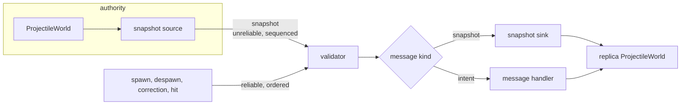
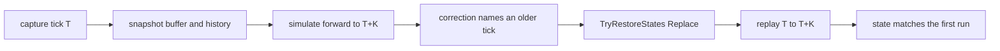

# CycloneGames.RPGFoundation · Projectile.Networking

[English | 简体中文](README.SCH.md)

Replication for the projectile module: a message schema, a validator, a bounded history for
rollback and interpolation, and handlers that turn incoming messages into world state.

The package produces and consumes validated messages. It does not send packets; serialization and
transport belong to your networking layer.

It is only needed when projectile state crosses a network boundary. The base Projectile module
works without it.

## Contents

1. [Scope](#1-scope)
2. [Install](#2-install)
3. [Wire format](#3-wire-format)
4. [Server: capture and send](#4-server-capture-and-send)
5. [Client: apply](#5-client-apply)
6. [Validation](#6-validation)
7. [Reconciliation](#7-reconciliation)
8. [Rollback](#8-rollback)
9. [Budget and scale](#9-budget-and-scale)
10. [Testing](#10-testing)

---

## 1. Scope

This package owns the projectile protocol: message ids, DTOs, validation, reconciliation, snapshot
history, and the handlers that apply all of it to a `ProjectileWorld`.

`CycloneGames.Networking` owns the shared infrastructure: message ranges, manifests, channels,
catalog registration, `NetworkVector3`, `NetworkActionResult`, and transport.

Projectile simulation and snapshots stay in `CycloneGames.RPGFoundation.Projectile.Core`. Nothing
here duplicates them.

Out of scope: byte layout, reliability enforcement, routing, sessions, interest management.

## 2. Install

| Assembly | Contents | UnityEngine |
| --- | --- | --- |
| `CycloneGames.RPGFoundation.Projectile.Networking.Core` | Messages, validator, history, sink, message handler | No |
| `CycloneGames.RPGFoundation.Projectile.Networking.Tests.Editor` | EditMode coverage | No |

Both use `autoReferenced: false`; consumer asmdefs must reference Core explicitly. No PlayerSettings
define is required.

Dependencies: `CycloneGames.RPGFoundation.Projectile.Core` and `CycloneGames.Networking.Core`.

The package holds no Unity references, backend SDKs, transports, or DI container. A project-side
adapter registers the protocol, serializes messages, validates inbound traffic, and forwards what
passes.

## 3. Wire format

Message ids are `17000` to `17999`, inside the shared module range `1000` to `29999` owned by
`NetworkMessageRanges.Module`.

| Message | Id | Reliability |
| --- | --- | --- |
| `MSG_MANIFEST_HANDSHAKE` | 17000 | Reliable, ordered |
| `MSG_SPAWN` | 17001 | Reliable, ordered |
| `MSG_AUTHORITATIVE_SNAPSHOT` | 17002 | Unreliable, sequenced |
| `MSG_CORRECTION` | 17003 | Reliable, ordered |
| `MSG_HIT` | 17004 | Reliable, ordered |
| `MSG_DESPAWN` | 17005 | Reliable, ordered |
| `MSG_FULL_STATE_REQUEST` | 17006 | Reliable, ordered |

`ProjectileNetworkProtocol.CreateProtocolManifest` builds the full descriptor set, and
`RegisterMessageCatalog` submits it through `TryRegisterProtocolManifest`. Registration commits the
range and every descriptor together or rejects the manifest, so a partial catalog cannot appear.

Protocol values are `public static readonly` rather than `const`: contract ids and schema
hashes are read at runtime instead of being inlined across assembly boundaries, and payload
defaults stay visible to consumers without recompiling literals. Changing a contract still needs a
new `:vN` identity and a coordinated protocol fingerprint.

The schema fingerprint covers field names and types, not binary layout, so a serializer may change
padding without breaking the handshake. Both peers exchange fingerprints before anything else. A
mismatch means the two builds disagree about the schema; refuse the connection instead of letting
it desync.

`ProjectileSnapshotMessage` is 88 bytes: entity id, owner, target, definition id, tick, sequence,
prediction key, lifecycle flags, age, radius, and three vectors (position, previous position,
velocity). The vectors are 36 of those bytes, which is the part worth quantizing if bandwidth
becomes a problem.

## 4. Server: capture and send

The authority owns the world and broadcasts from it.

```csharp
using CycloneGames.RPGFoundation.Projectile.Core;
using CycloneGames.RPGFoundation.Projectile.Networking;

var source = new ProjectileWorldNetworkSnapshotSource(world);
var scratch = new ProjectileSnapshot[world.Capacity];

// Once per replication tick. One sequential pass, no allocation.
int count = source.CaptureSnapshots(scratch);

for (int i = 0; i < count; i++)
{
    ProjectileSnapshot snapshot = scratch[i];
    ProjectileSnapshotMessage message = ProjectileSnapshotMessage.FromSnapshot(in snapshot, sequence);
    // Serialize and send on the unreliable sequenced channel.
}
```

`source.SnapshotCapacity` exists so a bridge can preallocate its conversion scratch once instead of
per broadcast.

Spawn, hit, despawn and correction travel on the reliable ordered channel. The full-state request
lets a client that missed spawns ask for a rebuild, rather than waiting for corrections that
reference projectiles it never created.

## 5. Client: apply

Two entry points. Use the sink when your transport already produces `ProjectileSnapshot` values;
use the message handler when you work with wire messages.

```csharp
using CycloneGames.RPGFoundation.Projectile.Networking;

// The client must own local kinematics for every replicated definition id.
var catalog = new MyDefinitionCatalog();
var sink = new ProjectileWorldSnapshotSink(world, catalog);
var handler = new ProjectileWorldMessageHandler(world, catalog, hitReceiver);

// Snapshots arrive on the unreliable channel and go through the sink.
sink.TryApplySnapshot(in snapshot);

// Every other message goes through the handler.
handler.TryHandleSpawn(in spawnMessage);
handler.TryHandleCorrection(in correctionMessage);
handler.TryHandleDespawn(in despawnMessage);
handler.TryHandleHit(in hitMessage);
```



The handler owns a few policy decisions worth knowing:

- A spawn for an entity id that already exists is refused, not applied. Idempotence means the
  second request changes nothing. A definition change has to travel as a correction.
- A despawn for an entity that is already gone increments a counter and returns. Duplicate delivery
  is normal on a reliable channel with retries.
- A correction carrying `HardSnap` or `FullReset` rebuilds the projectile. Anything else patches it
  in place and keeps the handle, bounce and pierce budgets.
- A hit message never mutates the world. The client already predicted the impact; the message
  exists for effects that must be authoritative.

Every outcome has its own counter: `AppliedCount`, `SpawnedCount`, `StaleCount`, `InvalidCount`,
`MissingDefinitionCount`, `CapacityRejectedCount`, `DuplicateCount`, `AlreadyGoneCount`. Wire them
to telemetry. A silent drop is the failure mode that costs days to find.

## 6. Validation

```csharp
var context = new ProjectileNetworkValidationContext(
    sender: connection,
    serverTick: currentTick,
    lastAcceptedServerTick: lastAcceptedTick,
    authorityMode: NetworkActionAuthorityMode.ClientPredictedServerAuthoritative,
    maxInitialVelocity: 512f,
    maxSnapshotVelocity: 512f,
    maxRadius: 16f,
    maxAge: 3600f,
    senderOwnedEntityId: playerEntityId);

NetworkActionResult result = validator.ValidateSpawn(in message, in context);
if (!result.IsAccepted)
{
    // result carries the rejection code
}
```

Rejection codes separate client bugs from protocol violations. `OutOfOrder`, `Duplicate` and
`Stale` are expected on a lossy channel and belong in counters. `Invalid`, `ImpersonatedOwner` and
`TickInFuture` indicate a client that is lying or badly broken and belong in logs.

The default validator is a stateless singleton. Implement `IProjectileNetworkMessageValidator` to
tighten or relax a rule. The handler does not care which validator ran, only that the message
passed.

## 7. Reconciliation

```csharp
if (ProjectileNetworkReconciliation.RequiresCorrection(
        in predicted, in authoritative, policy,
        out ProjectileNetworkCorrectionFlags flags, out float error))
{
    ProjectileNetworkReconciliation.TryCreateCorrection(
        in predicted, in authoritative, policy, out ProjectileCorrectionMessage correction);
}
```

`RequiresCorrection` compares position, velocity and age against policy thresholds and fills a flag
set describing which fields diverged. A correction at or above the hard-snap threshold should carry
`HardSnap`, which makes the client rebuild instead of patch.

Non-finite input is treated as maximum divergence. A NaN prediction compares false against every
threshold, so without an explicit check it reads as "no correction needed" and the client keeps a
state it can never reconcile.

## 8. Rollback

Client-side prediction needs two halves: a history buffer for what to restore, and the world's
restore entry point for how.

```csharp
// Bounded per-entity history for interpolation and rollback.
var history = new ProjectileNetworkSnapshotHistory(capacity: 8192, depthPerEntity: 8);

history.Record(in snapshotMessage);

if (history.TryGetAtOrBefore(entityId, rewindTick, out ProjectileSnapshotMessage frame))
{
    // interpolate a remote projectile, or collect a whole tick to restore
}
```

`depthPerEntity` is the ring size per entity. `TryGetAtOrBefore` returns the newest retained frame
at or before the requested tick, which is what interpolation needs. `CopyHistory` fills a
caller-owned array oldest first. `RemoveProjectile` releases the bucket so the pool does not fill
with dead entities.

Restoring a whole tick uses the Core API:

```csharp
ProjectileRestoreResult result = world.TryRestoreStates(
    capturedSpan, ProjectileRestoreMode.Replace, catalog);

// result.Applied, result.Spawned, result.Despawned describe what changed.
// result.Succeeded == false means the batch was rejected and nothing changed.
```



`Replace` means the batch is the complete state for that tick. Projectiles the batch omits are
removed, and `world.LatestTick` moves back to the batch tick so replay starts from the right
origin. `Merge` keeps local projectiles the batch does not mention and never rewinds the anchor,
which is what a partial view such as interest-managed updates needs.

The restore is atomic. If any entry is malformed, any required definition is missing, or the batch
does not fit after removals, nothing changes and the result says why.

## 9. Budget and scale

Costs here are structural. This document carries no timings for the same reason the base module
does not: the package ships no benchmark, and a number here would rot silently.

What the code fixes:

- History record and lookup are constant time per entity. The bucket index is open addressing over
  the entity id, and the free-bucket stack keeps insertion constant time as well, so filling N
  entities stays linear in N rather than quadratic.
- The bridge captures in one sequential pass over dense storage, with no per-projectile lookup.
- The message handler performs one indexed lookup per message and allocates nothing on any path,
  including the rejections.

Bandwidth is the number to watch, and it is arithmetic rather than measurement. An 88-byte snapshot
at 30 Hz for 10 000 projectiles is 88 x 30 x 10 000, about 26 MB/s before headers. Three ways down,
in order of effort:

1. Send less often. Distant projectiles replicate at 10 Hz without a visible difference.
2. Send less per message. Quantizing the three vectors to 1/128 unit fixed point with 16 bits per
   axis brings the message to about 40 bytes.
3. Send fewer projectiles. Interest management at the session layer, plus client-side prediction for
   anything the player fired.

## 10. Testing

```text
Unity Test Runner > EditMode > CycloneGames.RPGFoundation.Projectile.Networking.Tests.Editor
```

The suite covers validator rejection codes, history ring behaviour and eviction, reconciliation flag
selection including the non-finite path, and every message handler outcome.
