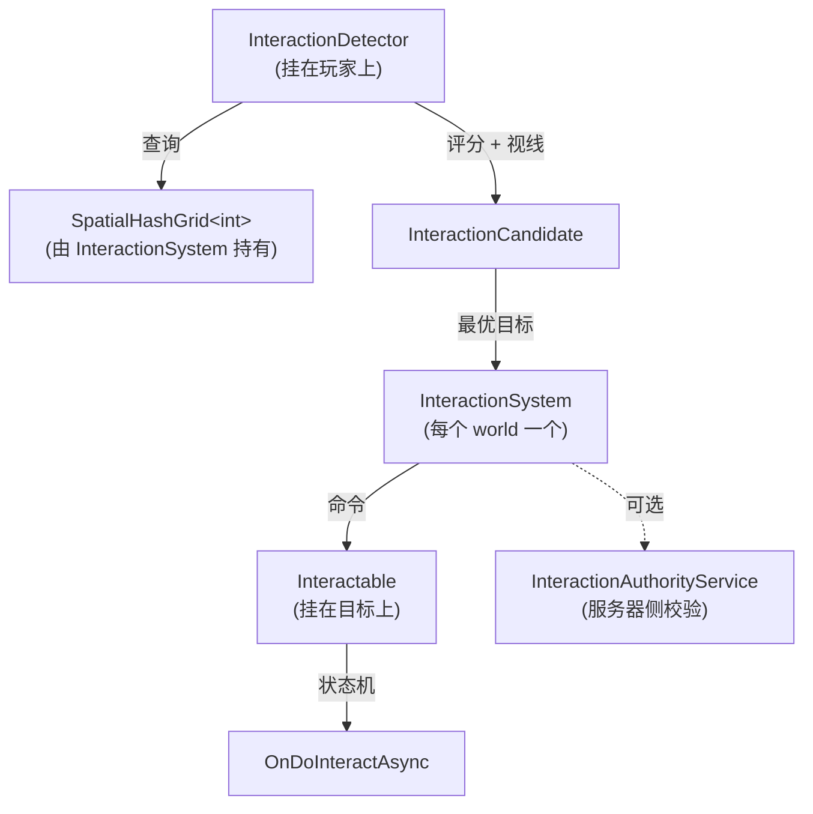
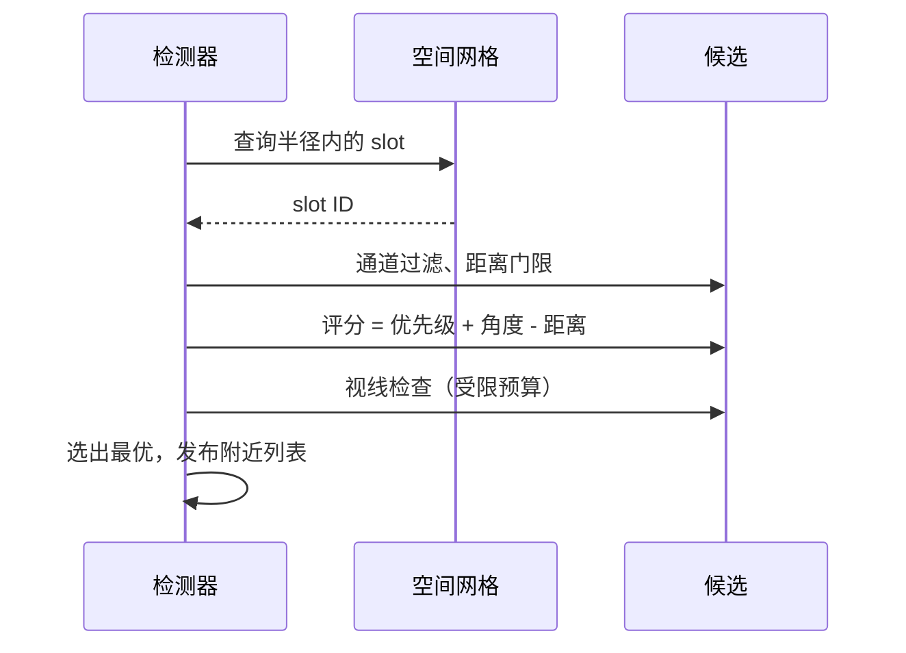

# RPG 交互模块

[English | 简体中文](README.SCH.md)

Unity 的 3D / 2D 交互运行时。它决定玩家能交互附近哪个物体，驱动交互生命周期，并在权威服务器上校验请求。检测可以走物理查询，也可以走空间哈希网格；后者让单场景上万可交互物成为可行的配置。

典型用途：可拾取的世界、带对话与任务的 NPC 层、由手柄或鼠标驱动的交互提示 UI，以及需要拒绝非法交互请求的服务器。

它不负责的部分：播放特效、管理背包或任务状态、处理输入绑定。这些属于产品层。

## 目录

- [1. 概览](#1-概览)
- [2. 安装与依赖](#2-安装与依赖)
- [3. 第一个交互](#3-第一个交互)
- [4. 检测是怎么工作的](#4-检测机制)
- [5. 编写交互逻辑](#5-编写交互逻辑)
- [6. 多个目标之间如何选择](#6-多目标选择)
- [7. 发起者与取消](#7-发起者与取消)
- [8. 权威与网络](#8-权威与网络)
- [9. 性能](#9-性能)
- [10. 组合用法](#10-组合用法)
- [11. 故障排查](#11-故障排查)
- [12. 验证](#12-验证)

## 1. 概览

一次交互由四部分组成，模块把它们拆开，让每一部分可以独立变化：

| 部分 | 归属 | 回答的问题 |
| --- | --- | --- |
| 检测 | `InteractionDetector` | 玩家瞄的是哪个物体？ |
| 目标状态 | `Interactable` | 这个物体现在能用吗？ |
| 编排 | `InteractionSystem` | 属于哪个 world，通知谁？ |
| 权威 | `InteractionAuthorityService` | 这个请求在服务器上合法吗？ |

检测和目标状态挂在场景物体上。编排是每个 world 一个组件。权威是纯 C#、不依赖引擎，所以能跑在 headless 服务器或单元测试里。



虚线是可选的。单人构建完全不会碰到它。

## 2. 安装与依赖

| 包 | 必需 | 用途 |
| --- | --- | --- |
| R3 | 是 | `ReactiveProperty`，用于提示 UI 绑定 |
| VitalRouter | 是 | 命令路由与拦截 |
| UniTask | 是 | 异步执行与取消 |
| CycloneGames.Spatial | 是 | 检测器使用的空间索引 |
| CycloneGames.Hash | 是 | 稳定 ID 哈希 |
| CycloneGames.Logging | 是 | `LogChannel` 诊断 |
| Interaction.Networking | 可选 | 网络交互的 DTO 与权威桥接 |
| Interaction.GameplayFramework | 可选 | `Actor` 位置适配 |
| Interaction.DeterministicMath | 可选 | 定点数权威，用于 lockstep 或回放 |
| Interaction.DeterministicMath.GF | 可选 | `Actor` 到定点数的适配 |

每个可选包都是独立程序集。只引用你用的那些，不涉及任何 scripting define symbol。

```text
CycloneGames.RPGFoundation/Interaction/
  Core/       纯 C#，不含 Unity 类型
  Runtime/    MonoBehaviour、空间网格、检测器
  Editor/     检视面板、校验器、场景调试器
  Tests/      EditMode 测试套件
```

## 3. 第一个交互

做完这一节，你会有一个能走到箱子前按键打开的玩家。五步，不写脚本。

### 步骤 1：添加 InteractionSystem

新建空 GameObject，命名为 `Interaction`，挂上 `InteractionSystem`。

| 字段 | 默认值 | 含义 |
| --- | --- | --- |
| World Id | `0` | 分屏与 additive 场景的作用域。每个 world 一个 system。 |
| Is 2D Mode | `false` | `true` 时按 X/Y 分格，Z 固定为零。 |
| Cell Size | `10` | 网格单元边长（世界单位）。越小查询越精细，需要遍历的 cell 越多。 |
| Initial Capacity | `256` | 预分配槽位。大场景请调高，避免运行期扩容。 |
| Enable Authority Gate | `true` | 对带稳定 ID 的目标做校验。没有稳定 ID 的目标直接放行。 |

一个 world 一个 system。两个 system 使用相同 `World Id` 会记录错误，第二个不再接收路由命令。

### 步骤 2：让物体可交互

给箱子挂 `Interactable`。最先会碰到的字段：

| 字段 | 默认值 | 含义 |
| --- | --- | --- |
| Interaction Prompt | `"Interact"` | 未启用本地化时的提示文本。 |
| Is Interactable | `true` | 物体忙碌或冷却时会被清空。 |
| Priority | `0` | 多个物体在范围内时，数值大的优先。 |
| Interaction Distance | `2` | 发起者需要多近。 |
| Channel | `Channel0` | 过滤掩码。检测器只看到它请求的通道。 |

先不要开 `Auto Interact`，第 6 节会讲。

### 步骤 3：给玩家加检测器

在玩家根节点挂 `InteractionDetector`。

| 字段 | 默认值 | 含义 |
| --- | --- | --- |
| Detection Mode | `Physics3D` | 可扩展的是 `SpatialHash`，见第 4 节。 |
| Detection Radius | `3` | 查询半径（世界单位）。 |
| Interactable Layer | `Nothing` | 物理查询扫描的层。 |
| Max Interactables | `64` | 每个周期的候选预算。 |
| Max LOS Checks Per Frame | `32` | 射线预算。`0` 表示不限，几乎永远不是想要的结果。 |

检测原点优先取 `Detection Origin`，未设置时用自身 transform。

### 步骤 4：触发交互

任何代码都可以发命令。最简单的方式是把按键接上检测器的当前目标：

```csharp
using CycloneGames.RPGFoundation.Interaction.Runtime;
using UnityEngine;

public sealed class InteractInput : MonoBehaviour
{
    [SerializeField] private InteractionDetector detector;

    private void Update()
    {
        if (!Input.GetKeyDown(KeyCode.E)) return;

        IInteractable target = detector.CurrentInteractable.CurrentValue;
        if (target == null) return;

        InteractionSystem system = InteractionSystem.ResolveDefault();
        system?.ProcessInteractionAsync(target).Forget();
    }
}
```

`CurrentInteractable` 是 R3 的 `ReadOnlyReactiveProperty`，UI 可以订阅同一个值。

### 步骤 5：显示提示

把提示文本绑到同一个属性上。目标变化时绑定自动更新，不需要轮询：

```csharp
using R3;
using UnityEngine;
using UnityEngine.UI;

public sealed class PromptLabel : MonoBehaviour
{
    [SerializeField] private InteractionDetector detector;
    [SerializeField] private Text label;

    private void Start()
    {
        detector.CurrentInteractable
            .Subscribe(target => label.text = target?.InteractionPrompt ?? string.Empty)
            .AddTo(this);
    }
}
```

到这里交互已经能用了。第 4、5 节解释检测器实际做了什么，以及如何替换默认行为。

## 4. 检测机制

每个检测周期跑四个阶段。顺序很重要，因为便宜的过滤排在昂贵的操作前面。



### 检测模式

| 模式 | 查询方式 | 成本来源 | 适用 |
| --- | --- | --- | --- |
| `Physics3D` | `Physics.OverlapSphereNonAlloc` | 半径内的 Collider 数量 | 几百个物体，或者本来就需要 Collider |
| `Physics2D` | `Physics2D.OverlapCircle` | 同上，2D | 有 Collider 的 2D 项目 |
| `SpatialHash` | 网格遍历 | 半径内的 cell 数，与总量无关 | 数千物体，或没有 Collider 的物体 |

`SpatialHash` 是唯一按局部密度而非场景规模扩展的模式。它要求每个可交互物都已注册，`Interactable` 在 enable 时自动完成。

### 评分公式

```
score = Priority * priorityWeight
      + Dot(forward, direction) * angleWeight
      - (distance / detectionRadius) * distanceWeight
```

默认 `priorityWeight = 100`、`angleWeight = 2`、`distanceWeight = 1`。优先级项占绝对主导：一级优先级就压过角度与距离的全部范围。这是刻意的，第 6 节会解释为什么模块还要单独做优先级分层。

### LOD

检测器不会在任意距离都逐帧运行。它按当前目标距离拉长间隔，长时间没有目标时进入休眠。

| 状态 | 距离 | 间隔 |
| --- | --- | --- |
| 近 | 小于 `nearDistance`（5） | `nearIntervalMs`（33） |
| 远 | 小于 `farDistance`（15） | `farIntervalMs`（150） |
| 很远 | 小于 `disableDistance`（50） | `veryFarIntervalMs`（300） |
| 休眠 | 无目标持续 `sleepEnterMs`（1000） | `sleepIntervalMs`（500） |

LOD 是上百个检测器仍然可承受的原因。没有它，每个检测器每帧都要跑完整查询。

### 通道

16 个标志位，用一次 AND 过滤。用它区分交互领域，而不必依赖 Layer：

```csharp
public static class GameChannels
{
    public const InteractionChannel Npc = InteractionChannel.Channel0;
    public const InteractionChannel Item = InteractionChannel.Channel1;
    public const InteractionChannel Door = InteractionChannel.Channel2;
}
```

检测器的 `Channel Mask` 设为该玩家应该看到的通道并集。

## 5. 编写交互逻辑

每个小节回答同样三个问题：什么时候用、代码长什么样、通常会在哪里出错。

### 5.1 自定义行为

重写 `OnDoInteractAsync`。基类实现负责状态机与进度上报，所以先调用它。

```csharp
public class Chest : Interactable
{
    [SerializeField] private int gold = 50;

    protected override async UniTask OnDoInteractAsync(CancellationToken ct)
    {
        await base.OnDoInteractAsync(ct);

        PlayerWallet.Add(gold);
        isInteractable = false;
    }
}
```

`isInteractable` 是 `protected`，子类可以直接改，不必绕属性。

### 5.2 条件

条件在交互开始前检查，用来处理任务状态、钥匙、等级门槛。

```csharp
public sealed class HasKeyRequirement : IInteractionRequirement
{
    [SerializeField] private string keyId;

    public bool IsSatisfied(InstigatorHandle instigator) => Inventory.Has(keyId);
    public string FailureMessage => "需要一把钥匙。";
}
```

放进可交互物的 `Requirements` 数组。全部通过才允许交互，第一个失败项提供提示文本。

### 5.3 长按交互

把 `Hold Duration` 设为非零值，状态机会自行上报进度。

```csharp
detector.CurrentInteractable
    .Subscribe(target => progressBar.value = target?.InteractionProgress ?? 0f)
    .AddTo(this);
```

提前松手会以 `InteractionCancelReason.Manual` 取消，走出范围会以 `OutOfRange` 取消。

### 5.4 双态交互

门、拉杆、开关都是同一个模式：一个开状态、一个关状态，共用一个入口。

```csharp
public class Door : TwoStateInteractionBase
{
    [SerializeField] private Transform pivot;

    protected override UniTask OnActivateAsync(CancellationToken ct)
    {
        pivot.localRotation = Quaternion.Euler(0f, 90f, 0f);
        return UniTask.CompletedTask;
    }

    protected override UniTask OnDeactivateAsync(CancellationToken ct)
    {
        pivot.localRotation = Quaternion.identity;
        return UniTask.CompletedTask;
    }
}
```

`TwoStateInteractionBase` 维护布尔状态并路由到对应方法。

### 5.5 可拾取物

`PickableItem` 覆盖常见情况：执行一个钩子，然后销毁。

```csharp
public class GoldCoin : PickableItem
{
    [SerializeField] private int amount = 1;

    protected override void OnPickedUp()
    {
        PlayerWallet.Add(amount);
        // 用项目自己的方式播放特效。模块不负责表现层。
    }
}
```

模块刻意不内置特效池。池化与特效播放在不同项目之间差异太大，不属于这里；需要池化时 `CycloneGames.Factory` 已经覆盖。

### 5.6 多动作

一个可交互物可以暴露多个动作。检测器会报告全部动作，由 UI 决定怎么呈现。

```csharp
[SerializeField] private InteractionAction[] actions =
{
    new InteractionAction("open", "打开"),
    new InteractionAction("break", "砸开")
};
```

在自己的输入代码里按 ID 分发：

```csharp
target.TryInteractAsync("break", cancellationToken).Forget();
```

`CanExecuteAction` 会检查启用标志，被禁用的动作不会到达目标。

## 6. 多目标选择

两个物体重叠时，模块需要一个规则。评分公式处理常见情况，但它有一个硬限制：候选预算。

### 为什么预算重要

检测器每个周期最多收集 `Max Interactables` 个候选。如果某个拥挤的 cell 里的物体超过这个数，必须有东西被丢弃。按遍历顺序丢弃会静默丢掉高优先级目标，所以优先级被单独分层处理。

### 优先级分层

`Priority` 在注册时被投影到网格的 32 个 layer 位上。检测器从高档向低档遍历，只在低档上花剩余的预算。

```
tier 31  最高优先级，最先收集
  ...
tier 0   最低优先级，最后收集
```

需要知道的三个后果：

- 优先级被夹到 `[0, 31]`。负值变 0，大于 31 的变 31。
- 运行期修改 `Priority` 需要调用 `NotifyPositionChanged`（或 `InteractionSystem.UpdatePosition`）才会换档。
- 单档场景只需一次网格遍历。占用 16 档最多 16 次。请控制不同优先级取值的数量。

### 附近候选与循环选择

`NearbyInteractables` 暴露评分后的列表，上限是 `Max Nearby Candidates`（16）。用它做战利品列表或手柄目标轮换。

```csharp
int index = detector.CycleTarget();
IInteractable selected = detector.NearbyInteractables[index].Interactable;
```

循环选择每个周期按当前选中目标的身份重新锚定，增删目标不会让选择静默跳到另一个物体上。

### 自动交互

`Auto Interact` 物体跳过提示，自行触发。它们不会进入候选列表，因为它们是触发器而不是选项。

三条限制：发起者必须在 `InteractionDistance` 内；`autoInteractMinIntervalMs`（250）节流重复触发；每个检测器的时间表上限为 `Max Interactables` 条。超过上限后，新物体触发时不再受节流约束。自动交互物请保持稀少，或调高 `Max Interactables`。

## 7. 发起者与取消

### InstigatorHandle

发起者是触发交互的一方。它是抽象类而不是接口，这样结构体不会被装箱塞进去。

```csharp
public sealed class NetworkPlayerInstigator : InstigatorHandle
{
    private readonly ulong playerId;

    public NetworkPlayerInstigator(ulong playerId) => this.playerId = playerId;

    public override int Id => (int)playerId;
    public override ulong StableId => playerId;
}
```

联机时请重写 `StableId`。默认实现只是把 `Id` 投影过去，跨进程并不稳定。

### 距离自动取消

在可交互物上设置 `Max Interaction Range`，系统会逐帧检查距离。超出后以 `OutOfRange` 取消。

监控表带索引，注册与移除都是 O(1)。几十个并发监控没有可测量的开销。

### 取消原因

| 原因 | 触发条件 |
| --- | --- |
| `Manual` | 调用方取消，或玩家松开长按 |
| `OutOfRange` | 超出 `Max Interaction Range` |
| `Interrupted` | 被另一个交互抢占 |
| `Faulted` | 交互过程抛出异常 |

每次取消都会带原因触发 `OnInteractionCancelled`，这是做退款和 UI 复位的钩子。

## 8. 权威与网络

这一节是可选的。本地单人构建可以完全跳过。

### 权威服务做什么

`InteractionAuthorityService` 在请求执行前校验它。它只回答一个问题：在服务器已知信息下，这个请求合法吗？它不替客户端选目标。

```csharp
var authority = new InteractionAuthorityService(
    new InteractionAuthorityOptions(worldId: 1, requireStableIds: true));

authority.TryRegisterTarget(snapshot);

InteractionValidationResult result = authority.ValidateRequest(request, serverPosition, serverTick);
if (!result.IsAccepted)
{
    // result.Failure 指出是哪一道门拒绝的
}
```

校验顺序：请求形状、world 作用域、tick 漂移、限流、目标查找、可用性、动作、距离，最后才写重放历史。所有可能拒绝的判断都在触碰历史之前完成，所以大量非法请求不会消耗重放预算。

### 容量上限

| 上限 | 数值 | 达到容量时的行为 |
| --- | --- | --- |
| 已注册目标 | 65,536 | `TryRegisterTarget` 返回 `false` |
| 队列持有者 | 65,536 | `TryGetOrCreateQueue` 返回 `false`；`GetOrCreateQueue` 抛异常 |
| 限流窗口 | 65,536 | `TryConsume` 返回 `false`，映射为 `RateLimited` |

达到容量后，已有条目仍可更新、移除和清空。如果单个权威确实需要更多，请按 world 分片，而不是调高常量。

限流窗口使用带索引的过期堆，每次调用最多清理 256 条，所以身份churn 不会永久占用容量，清理也不会变成单帧尖峰。

### 优先级不是访问控制

权威端从不枚举候选。客户端发送它选中的目标，服务器检查这个选择是否合法。优先级决定检测器偏好哪个目标，不限制玩家能请求什么。访问控制是 `IInteractionRequirement` 的职责。

因此网络载荷携带的是 `TargetStableId`，不是优先级。加一个优先级字段只会制造「服务器在做选择」的假象。

### 网络桥接

`InteractionNetworkAuthorityBridge` 用 DTO 转换包住权威服务。存在两组重载，因为发起者位置由客户端上报，属于不可信输入：

| 重载 | 使用的位置 | 适用 |
| --- | --- | --- |
| `Validate(request, tick)` | 客户端上报 | 客户端提供信息、服务器宽松的产品 |
| `Validate(request, serverPosition, tick)` | 服务器解析 | 权威距离校验 |

需要强制距离的服务器必须用第二种。第一种留给刻意信任客户端的产品。

### 确定性权威

`InteractionDeterministicAuthorityService` 是同一套契约，建立在 `FPVector3` 与 `FPInt64` 之上。服务器需要回放请求流并在每台主机上得到相同判决时使用它。

两个独立构造的实例喂同一请求流，判决分歧为零，这正是回放服务器依赖的性质。

### 如果需要强制最优性

客户端用分层查询，服务器校验单个目标，两者对「哪个目标最优」可能有不同看法。这可以接受：服务器校验的是合法性，不是最优性。如果确实需要服务器强制「客户端选了最优目标」，请把它作为产品策略建立在桥接层之上，而不是塞进模块内部。

## 9. 性能

### 分配边界

| 路径 | 分配 |
| --- | --- |
| 空间网格查询 | 一百万次迭代测得 0 字节 |
| 权威校验 | 每请求 0 字节 |
| 检测器每周期 | 预热后 0 字节；唯一例外是 `DEBUG` 宏下的字符串拼装 |
| 可交互物位置更新 | 0 字节，快照数组已缓存 |

检测器在 `Awake` 里预分配候选缓冲。调高 `Max Interactables` 只是把分配挪到场景加载，不会进入游戏循环。

### 空间网格成本

10,000 个物体、cell size 10、查询半径 10 的实测：

| 指标 | 数值 |
| --- | --- |
| 查询 p50 | 3.0 µs |
| 查询 p99 | 8.0 µs |
| 吞吐 | 约 212,000 次/秒 |
| 最差格（cell size 4）p99 | 90 µs |

查询成本跟随局部密度，而不是物体总数。cell size 是主导参数：太小则 cell 范围爆炸，太大则每条 cell 链变长。

### 检测器缓存

检测器背后有三个缓存：Collider 到可交互物、视线结果、自动交互时间戳。三者都有界。

- 组件缓存在 `Max Interactables * 4` 条时清空。
- 视线缓存在 `Max Interactables` 条时拒绝新条目。
- 自动交互时间表见第 6 节。

没有这些边界，玩家在开放世界里持续行进会让缓存在整个会话期间增长。

### 线程

所有内容跑在 Unity 主线程。空间网格是单写者模型，带仅 Debug 生效的线程守卫：开发构建里第二个写者会抛异常，Release 里守卫被编译掉。

权威服务不是线程安全的。每个服务器 world 用一个实例，并由模拟线程驱动。

## 10. 组合用法

### 带任务门槛的拾取

条件负责拦截，拾取负责奖励。

```csharp
public class QuestChest : PickableItem
{
    [SerializeField] private string requiredQuest = "find_the_key";
    [SerializeField] private int gold = 100;

    public override bool CanInteract(InstigatorHandle instigator) =>
        base.CanInteract(instigator) && QuestLog.IsComplete(requiredQuest);

    protected override void OnPickedUp() => PlayerWallet.Add(gold);
}
```

### 分屏两套 world

每个玩家有自己的 system 和 detector，各自使用不同的 `World Id`。命令按 world 路由，玩家一无法触发玩家二的目标。

不要把同一个 detector 共享给两个玩家。附近列表和当前目标都是 detector 私有状态。

### 服务器权威交互

客户端检测并发起请求，服务器校验，客户端播放结果。

```csharp
// 客户端
IInteractable target = detector.CurrentInteractable.CurrentValue;
bridge.Validate(new InteractionNetworkRequest(...), tick);

// 服务器
var result = authority.ValidateRequest(request, serverResolvedPosition, tick);
if (result.IsAccepted) ExecuteInteraction(request);
```

客户端的检测器仍在运行，只是不再决定合法性。这样提示 UI 保持响应，又不必信任客户端。

### 无实体发起者

`InstigatorHandle` 设计成抽象类，正是为了让 ECS 和 headless 环境包裹任意标识符。

```csharp
public sealed class EntityInstigator : InstigatorHandle
{
    private readonly Entity entity;
    public EntityInstigator(Entity entity) => this.entity = entity;

    public override int Id => entity.Index;
    public override ulong StableId => EntityId.ToULong(entity);
}
```

每个实体缓存一个实例；逐帧构造会产生分配。

## 11. 故障排查

| 现象 | 原因 | 处理 |
| --- | --- | --- |
| 检测不到任何东西 | Physics 模式下 `Interactable Layer` 是 `Nothing` | 设置层掩码 |
| `SpatialHash` 模式下检测不到 | 可交互物未注册 | 确认 `InteractionSystem` 存在，且物体在其之后 enable |
| 选错了物体 | 两个目标的 `Priority` 都是 `0` | 设置优先级，评分项占主导 |
| 高优先级目标被忽略 | 优先级超出 `[0, 31]`，或改档后没有通知 | 夹紧数值，再调用 `NotifyPositionChanged` |
| 提示从不更新 | UI 在 system 存在之前就订阅了 | 在 `InteractionSystem.SystemRegistered` 里绑定 |
| 交互立刻被取消 | `Max Interaction Range` 小于实际距离 | 调大，或设为 `0` |
| 服务器拒绝所有请求 | `TargetStableId` 为 `0` 而 `requireStableIds` 开着 | 给目标分配稳定 ID |
| 第二个 world 的命令被忽略 | `World Id` 重复 | 给每个 system 唯一的 ID |

## 12. 验证

模块自带 EditMode 测试套件，同时充当可执行的规格说明。

| 套件 | 覆盖 |
| --- | --- |
| `InteractionGridSpatialTests` | 5 个种子下的 105 个网格场景，与暴力法逐条对照 |
| `InteractionGridSoakFuzzTests` | 60 窗口带成员 churn 的 SOAK，20,000 次操作 FUZZ |
| `InteractionPriorityTests` | 分档隔离、位图记账、夹紧、重复注册幂等 |
| `InteractionSecurityBoundaryTests` | 匿名限流、tick 回滚、重放历史记账、重放窗口 fail-closed |
| `InteractionDetectorCacheBoundTests` | 组件缓存上限、死引用驱逐 |
| `InteractionProductionReadinessTests` | 规模与种子矩阵、单帧脉冲、SOAK、FUZZ、边界容量 |
| `InteractionAssemblyLayoutTests` | 纯 C# 程序集位于 `Core/`、asmdef 名与文件名一致、不依赖对象池 |

在 Test Runner 窗口运行，或走命令行：

```bash
Unity.exe -batchmode -nographics -projectPath <project> \
  -runTests -testPlatform EditMode \
  -testFilter InteractionGridSpatialTests \
  -testResults results.xml
```

第 9 节数字背后的实测证据位于源码仓库的 `deliverables/review/evidence/interaction/`。
