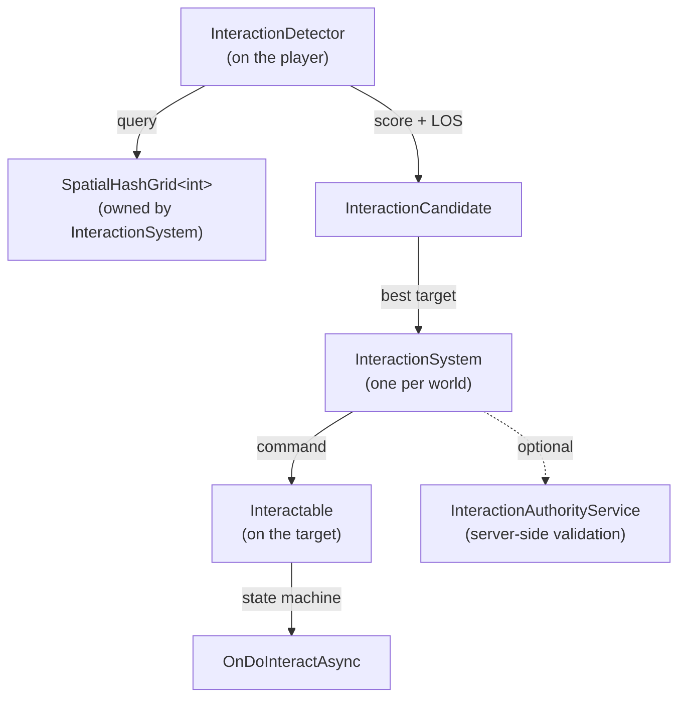
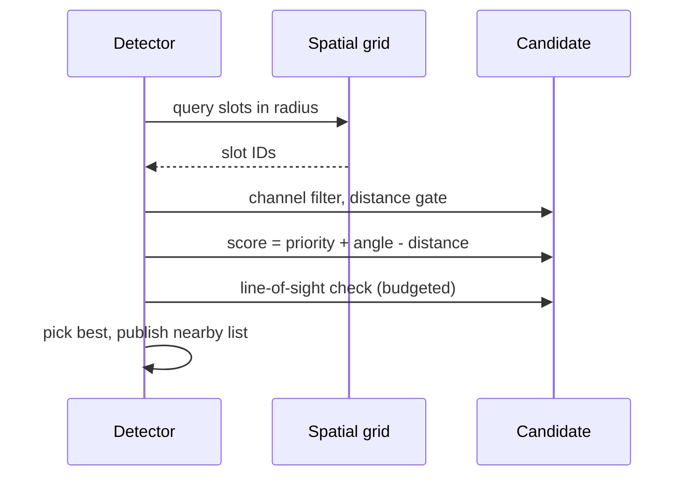

# RPG Interaction Module

[English | 简体中文](README.SCH.md)

A Unity interaction runtime for 3D and 2D worlds. It decides which nearby object the player can interact with, runs the interaction lifecycle, and validates requests on an authoritative server. Detection can run on physics queries or on a spatial hash grid, which is what makes ten thousand interactables per scene practical.

Typical uses: a lootable world, a dialogue-and-quest NPC layer, an interaction prompt UI driven by gamepad or mouse, and a server that has to reject impossible interaction requests.

What it does not do: play VFX, own inventory or quest state, or manage your input bindings. Those belong to the product.

## Table of contents

- [1. Overview](#1-overview)
- [2. Install and dependencies](#2-install-and-dependencies)
- [3. First interaction](#3-first-interaction)
- [4. How detection works](#4-detection)
- [5. Building interaction logic](#5-building-interaction-logic)
- [6. Choosing between several targets](#6-target-selection)
- [7. Instigators and cancellation](#7-instigators-and-cancellation)
- [8. Authority and networking](#8-authority-and-networking)
- [9. Performance](#9-performance)
- [10. Composition recipes](#10-composition-recipes)
- [11. Troubleshooting](#11-troubleshooting)
- [12. Validation](#12-validation)

## 1. Overview

An interaction has four parts, and the module splits them so each can change independently:

| Part | Owner | Question it answers |
| --- | --- | --- |
| Detection | `InteractionDetector` | Which object is the player aiming at? |
| Target state | `Interactable` | Can this object be used right now? |
| Orchestration | `InteractionSystem` | Which world does this belong to, and who is notified? |
| Authority | `InteractionAuthorityService` | Is this request legal on the server? |

Detection and target state live on scene objects. Orchestration is one component per world. Authority is plain C# with no engine dependency, so it runs in a headless server or a unit test.



The dashed edge is optional. Single-player builds never touch it.

## 2. Install and dependencies

| Package | Required | Purpose |
| --- | --- | --- |
| R3 | Yes | `ReactiveProperty` for prompt UI binding |
| VitalRouter | Yes | Command routing and interception |
| UniTask | Yes | Async execution and cancellation |
| CycloneGames.Spatial | Yes | Spatial index used by the detector |
| CycloneGames.Hash | Yes | Stable ID hashing for deterministic identity |
| CycloneGames.Logging | Yes | `LogChannel` diagnostics |
| Interaction.Networking | Optional | DTOs and authority bridge for networked play |
| Interaction.GameplayFramework | Optional | `Actor` position adapter |
| Interaction.DeterministicMath | Optional | Fixed-point authority for lockstep or replay |
| Interaction.DeterministicMath.GF | Optional | `Actor` to fixed-point adapter |

Each optional package is a separate assembly. You reference only the ones you use; no scripting define symbol is involved.

```text
CycloneGames.RPGFoundation/Interaction/
  Core/       pure C#, no Unity types
  Runtime/    MonoBehaviours, spatial grid, detector
  Editor/     inspectors, validator, scene debugger
  Tests/      EditMode suites
```

## 3. First interaction

By the end of this section you will have a player that walks up to a chest and presses a key to open it. Five steps, no scripting.

### Step 1: Add InteractionSystem

Create an empty GameObject named `Interaction`. Add the `InteractionSystem` component.

| Field | Default | Meaning |
| --- | --- | --- |
| World Id | `0` | Scope for split-screen and additive scenes. Each world gets its own system. |
| Is 2D Mode | `false` | `true` hashes X/Y and pins Z to zero. |
| Cell Size | `10` | Grid cell edge in world units. Smaller cells mean finer queries and more cells to walk. |
| Initial Capacity | `256` | Slots reserved up front. Raise it for large scenes to avoid growth during play. |
| Enable Authority Gate | `true` | Validates requests with a stable target ID. Targets without one always pass. |

One system per world. Two systems sharing a `World Id` log an error and the second one stops receiving routed commands.

### Step 2: Make an object interactable

Add `Interactable` to the chest. The fields you will touch first:

| Field | Default | Meaning |
| --- | --- | --- |
| Interaction Prompt | `"Interact"` | Fallback text when localization is off. |
| Is Interactable | `true` | Cleared while the object is busy or on cooldown. |
| Priority | `0` | Higher wins when several objects are in range. |
| Interaction Distance | `2` | How close the instigator must be. |
| Channel | `Channel0` | Filter bitmask. The detector only sees channels it asks for. |

Leave `Auto Interact` off for now. It is covered in section 6.

### Step 3: Add a detector to the player

Add `InteractionDetector` to the player root.

| Field | Default | Meaning |
| --- | --- | --- |
| Detection Mode | `Physics3D` | `SpatialHash` is the scalable option; see section 4. |
| Detection Radius | `3` | Query radius in world units. |
| Interactable Layer | `Nothing` | Layers the physics query scans. |
| Max Interactables | `64` | Candidate budget per cycle. |
| Max LOS Checks Per Frame | `32` | Ray budget. `0` means unlimited, which is almost never what you want. |

The detector reads its origin from `Detection Origin` when set, otherwise from its own transform.

### Step 4: Trigger the interaction

Any code can send a command. The simplest path is a key press wired to the detector's current target:

```csharp
using CycloneGames.RPGFoundation.Interaction.Runtime;
using UnityEngine;

public sealed class InteractInput : MonoBehaviour
{
    [SerializeField] private InteractionDetector detector;

    private void Update()
    {
        if (!Input.GetKeyDown(KeyCode.E)) return;

        IInteractable target = detector.CurrentInteractable.CurrentValue;
        if (target == null) return;

        InteractionSystem system = InteractionSystem.ResolveDefault();
        system?.ProcessInteractionAsync(target).Forget();
    }
}
```

`CurrentInteractable` is an R3 `ReadOnlyReactiveProperty`, so UI can subscribe to the same value.

### Step 5: Show a prompt

Bind the prompt text to the same property. The binding survives target changes without any polling:

```csharp
using R3;
using UnityEngine;
using UnityEngine.UI;

public sealed class PromptLabel : MonoBehaviour
{
    [SerializeField] private InteractionDetector detector;
    [SerializeField] private Text label;

    private void Start()
    {
        detector.CurrentInteractable
            .Subscribe(target => label.text = target?.InteractionPrompt ?? string.Empty)
            .AddTo(this);
    }
}
```

At this point you have a working interaction. Sections 4 and 5 explain what the detector actually did, and how to replace the default behaviour.

## 4. Detection

Each detection cycle runs four stages. The order matters, because the cheap filters run before the expensive ones.



### Detection modes

| Mode | Query | Cost driver | Use when |
| --- | --- | --- | --- |
| `Physics3D` | `Physics.OverlapSphereNonAlloc` | Collider count in radius | Few hundred objects, or you already need colliders |
| `Physics2D` | `Physics2D.OverlapCircle` | Same, in 2D | 2D projects with colliders |
| `SpatialHash` | Grid walk | Cells in radius, not total objects | Thousands of objects, or objects without colliders |

`SpatialHash` is the only mode that scales with local density instead of scene size. It requires every interactable to be registered, which `Interactable` does automatically on enable.

### Score formula

```
score = Priority * priorityWeight
      + Dot(forward, direction) * angleWeight
      - (distance / detectionRadius) * distanceWeight
```

Defaults are `priorityWeight = 100`, `angleWeight = 2`, `distanceWeight = 1`. The priority term dominates: a single priority step outweighs the entire angle and distance range. That is deliberate, and section 6 explains why the module also layers priority separately.

### Level of detail

The detector does not run every frame at every distance. It scales its interval by the current target distance, and sleeps when nothing has been in range for a while.

| State | Distance | Interval |
| --- | --- | --- |
| Near | under `nearDistance` (5) | `nearIntervalMs` (33) |
| Far | under `farDistance` (15) | `farIntervalMs` (150) |
| Very far | under `disableDistance` (50) | `veryFarIntervalMs` (300) |
| Sleep | no target for `sleepEnterMs` (1000) | `sleepIntervalMs` (500) |

LOD is what keeps a hundred detectors affordable. Without it, every detector runs a full query every frame.

### Channels

Sixteen flag bits, filtered with a single AND. Use them to separate interaction domains without layering:

```csharp
public static class GameChannels
{
    public const InteractionChannel Npc = InteractionChannel.Channel0;
    public const InteractionChannel Item = InteractionChannel.Channel1;
    public const InteractionChannel Door = InteractionChannel.Channel2;
}
```

Set the detector's `Channel Mask` to the union of what that player should see.

## 5. Building interaction logic

Every subsection answers the same three questions: when to use it, what the code looks like, and what usually goes wrong.

### 5.1 Custom behaviour

Override `OnDoInteractAsync`. The base implementation drives the state machine and progress reporting, so call it first.

```csharp
public class Chest : Interactable
{
    [SerializeField] private int gold = 50;

    protected override async UniTask OnDoInteractAsync(CancellationToken ct)
    {
        await base.OnDoInteractAsync(ct);

        PlayerWallet.Add(gold);
        isInteractable = false;
    }
}
```

`isInteractable` is `protected`, so subclasses can flip it without a property round-trip.

### 5.2 Requirements

Requirements are checked before the interaction starts. They are the place for quest state, keys, and level gates.

```csharp
public sealed class HasKeyRequirement : IInteractionRequirement
{
    [SerializeField] private string keyId;

    public bool IsSatisfied(InstigatorHandle instigator) => Inventory.Has(keyId);
    public string FailureMessage => "You need a key.";
}
```

Add them to the `Requirements` array on the interactable. All entries must pass; the first failure supplies the message.

### 5.3 Hold to interact

Set `Hold Duration` to a non-zero value and the state machine reports progress on its own.

```csharp
detector.CurrentInteractable
    .Subscribe(target => progressBar.value = target?.InteractionProgress ?? 0f)
    .AddTo(this);
```

Releasing early cancels with `InteractionCancelReason.Manual`. Moving out of range cancels with `OutOfRange`.

### 5.4 Two-state interactions

Doors, levers, and switches share one pattern: an on state and an off state behind a single entry point.

```csharp
public class Door : TwoStateInteractionBase
{
    [SerializeField] private Transform pivot;

    protected override UniTask OnActivateAsync(CancellationToken ct)
    {
        pivot.localRotation = Quaternion.Euler(0f, 90f, 0f);
        return UniTask.CompletedTask;
    }

    protected override UniTask OnDeactivateAsync(CancellationToken ct)
    {
        pivot.localRotation = Quaternion.identity;
        return UniTask.CompletedTask;
    }
}
```

`TwoStateInteractionBase` tracks the boolean and routes to the right method.

### 5.5 Pickable items

`PickableItem` handles the common case: run a hook, then destroy.

```csharp
public class GoldCoin : PickableItem
{
    [SerializeField] private int amount = 1;

    protected override void OnPickedUp()
    {
        PlayerWallet.Add(amount);
        // Spawn VFX with whatever your project uses. The module does not own presentation.
    }
}
```

The module deliberately ships no effect pool. Pooling and VFX playback differ too much between projects to belong here; `CycloneGames.Factory` covers pooling if you want it.

### 5.6 Multiple actions

An interactable can expose several actions. The detector reports all of them; the UI decides how to present them.

```csharp
[SerializeField] private InteractionAction[] actions =
{
    new InteractionAction("open", "Open"),
    new InteractionAction("break", "Break Open")
};
```

Dispatch by ID from your own input code:

```csharp
target.TryInteractAsync("break", cancellationToken).Forget();
```

`CanExecuteAction` checks the enabled flags, so a disabled action never reaches the target.

## 6. Target selection

When two objects overlap, the module needs a rule. The score formula handles the common case, but it has a hard limit: a candidate budget.

### Why the budget matters

The detector collects at most `Max Interactables` candidates per cycle. If a crowded cell holds more than that, something has to be dropped. Dropping by traversal order would silently discard a high-priority target, so priority is layered separately from scoring.

### Priority tiers

`Priority` is projected onto the grid's 32 layer bits at registration. The detector walks tiers from high to low and only spends the remaining budget on lower tiers.

```
tier 31  highest priority, collected first
  ...
tier 0   lowest priority, collected last
```

Consequences worth knowing:

- Priority is clamped into `[0, 31]`. Negative values become 0, values above 31 become 31.
- Changing `Priority` at runtime requires `NotifyPositionChanged` (or `InteractionSystem.UpdatePosition`) to move the object between tiers.
- A single-tier scene costs one grid walk. Sixteen occupied tiers cost up to sixteen. Keep the number of distinct priority values small.

### Nearby candidates and cycling

`NearbyInteractables` exposes the scored list, capped by `Max Nearby Candidates` (16). Use it for a loot list or gamepad target cycling.

```csharp
int index = detector.CycleTarget();
IInteractable selected = detector.NearbyInteractables[index].Interactable;
```

Cycling re-anchors on the currently selected identity each cycle, so adding or removing a target does not silently move the selection to a different object.

### Auto interact

`Auto Interact` objects skip the prompt and trigger on their own. They never enter the candidate list, because they are triggers rather than choices.

Three limits apply: the instigator must be within `InteractionDistance`, `autoInteractMinIntervalMs` (250) throttles repeats, and the per-detector time table is capped at `Max Interactables` entries. Past that cap, new objects trigger without the throttle. Keep auto-interact objects rare, or raise `Max Interactables`.

## 7. Instigators and cancellation

### InstigatorHandle

An instigator is whoever initiated the interaction. It is an abstract class, not an interface, so structs cannot be boxed into it.

```csharp
public sealed class NetworkPlayerInstigator : InstigatorHandle
{
    private readonly ulong playerId;

    public NetworkPlayerInstigator(ulong playerId) => this.playerId = playerId;

    public override int Id => (int)playerId;
    public override ulong StableId => playerId;
}
```

Override `StableId` for networked play. The default projects `Id` and is not stable across processes.

### Distance auto-cancellation

Set `Max Interaction Range` on the interactable and the system watches the distance every frame. Moving beyond it cancels with `OutOfRange`.

The monitor table is indexed, so registration and removal are O(1). A few dozen concurrent monitors cost nothing measurable.

### Cancellation reasons

| Reason | Cause |
| --- | --- |
| `Manual` | Caller cancelled, or the player released a hold |
| `OutOfRange` | Beyond `Max Interaction Range` |
| `Interrupted` | Another interaction took over |
| `Faulted` | The interaction threw |

Every cancellation runs `OnInteractionCancelled` with the reason, which is the hook for refunds and UI resets.

## 8. Authority and networking

This section is optional. Local single-player builds can skip it entirely.

### What the authority service does

`InteractionAuthorityService` validates a request before it runs. It answers one narrow question: is this request legal, given what the server knows? It does not choose targets for the client.

```csharp
var authority = new InteractionAuthorityService(
    new InteractionAuthorityOptions(worldId: 1, requireStableIds: true));

authority.TryRegisterTarget(snapshot);

InteractionValidationResult result = authority.ValidateRequest(request, serverPosition, serverTick);
if (!result.IsAccepted)
{
    // result.Failure names the gate that rejected it
}
```

Validation order: request shape, world scope, tick drift, rate limit, target lookup, availability, action, range, then replay history. Everything that can reject runs before history is touched, so a flood of invalid requests cannot consume the replay budget.

### Capacity ceilings

| Ceiling | Value | Behavior at capacity |
| --- | --- | --- |
| Registered targets | 65,536 | `TryRegisterTarget` returns `false` |
| Queue owners | 65,536 | `TryGetOrCreateQueue` returns `false`; `GetOrCreateQueue` throws |
| Rate-limit windows | 65,536 | `TryConsume` returns `false`, mapped to `RateLimited` |

Existing entries remain updatable, removable, and clearable at capacity. If one authority genuinely needs more, shard by world rather than raising the constant.

Rate windows use an indexed expiry heap with a per-call prune budget of 256, so identity churn cannot permanently consume capacity and cleanup cannot become a single-frame spike.

### Priority is not an access control

The authority never enumerates candidates. A client sends the target it chose, and the server checks whether that choice is legal. Priority decides which target a detector prefers; it does not restrict what a player may request. Access control is `IInteractionRequirement`'s job.

The network payload therefore carries `TargetStableId`, not priority. Adding a priority field would create the appearance of server-side selection without the behavior.

### Networking bridge

`InteractionNetworkAuthorityBridge` wraps the authority with DTO conversions. Two overload families exist because the instigator position is client-reported and therefore untrusted:

| Overload | Position used | Use for |
| --- | --- | --- |
| `Validate(request, tick)` | Client-reported | Client-informative servers |
| `Validate(request, serverPosition, tick)` | Server-resolved | Authoritative range checks |

A server that enforces range must use the second form. The first exists for products that deliberately trust the client.

### Deterministic authority

`InteractionDeterministicAuthorityService` is the same contract over `FPVector3` and `FPInt64`. Use it when the server replays a request stream and must reach identical verdicts on every host.

Two independently constructed instances fed the same stream produce zero verdict divergences, which is the property a replay server depends on.

### If you need optimality enforcement

The client uses tiered queries, the server validates single targets, and the two can disagree about which target was optimal. That is acceptable: the server checks legality, not optimality. If you need the server to enforce "the client picked the best target", implement that as product policy on top of the bridge, not inside the module.

## 9. Performance

### Allocation boundaries

| Path | Allocation |
| --- | --- |
| Spatial grid query | 0 bytes measured over one million iterations |
| Authority validation | 0 bytes per request |
| Detector per cycle | 0 bytes after warm-up; string formatting under the `DEBUG` define is the only exception |
| Interactable position update | 0 bytes, snapshot arrays are cached |

The detector pre-allocates its candidate buffers in `Awake`. Raising `Max Interactables` shifts that allocation to scene load, not gameplay.

### Spatial grid cost

Measured on 10,000 objects, cell size 10, query radius 10:

| Metric | Value |
| --- | --- |
| Query p50 | 3.0 µs |
| Query p99 | 8.0 µs |
| Throughput | about 212,000 queries/s |
| Worst case (cell size 4) p99 | 90 µs |

Query cost follows local density, not total object count. Cell size is the dominant parameter: too small and the cell range explodes, too large and every cell chain grows.

### Detector caches

Three caches back the detector: collider to interactable, line-of-sight results, and auto-interact timestamps. All three are bounded.

- Component cache clears at `Max Interactables * 4` entries.
- LOS cache refuses new entries at `Max Interactables`.
- Auto-interact table is described in section 6.

Without these bounds, a player streaming through an open world would grow the caches for the whole session.

### Threading

Everything runs on the Unity main thread. The spatial grid is single-writer with a debug-only thread guard: it throws on a second writer in development builds and compiles the guard out of release.

The authority service is not thread-safe. Use one instance per server world and drive it from the simulation thread.

## 10. Composition recipes

### Loot with a quest gate

Requirement blocks, pickable rewards.

```csharp
public class QuestChest : PickableItem
{
    [SerializeField] private string requiredQuest = "find_the_key";
    [SerializeField] private int gold = 100;

    public override bool CanInteract(InstigatorHandle instigator) =>
        base.CanInteract(instigator) && QuestLog.IsComplete(requiredQuest);

    protected override void OnPickedUp() => PlayerWallet.Add(gold);
}
```

### Split-screen with two worlds

Each player gets its own system and detector, both with a distinct `World Id`. Commands route by world, so player one cannot trigger player two's targets.

Do not share a detector between players. The nearby list and current target are per-detector state.

### Server-authoritative interaction

The client detects and requests, the server validates, the client plays the result.

```csharp
// client
IInteractable target = detector.CurrentInteractable.CurrentValue;
bridge.Validate(new InteractionNetworkRequest(...), tick);

// server
var result = authority.ValidateRequest(request, serverResolvedPosition, tick);
if (result.IsAccepted) ExecuteInteraction(request);
```

The client detector still runs; it just does not decide legality. That keeps prompt UI responsive without trusting the client.

### Entityless instigators

`InstigatorHandle` is an abstract class precisely so ECS and headless setups can wrap whatever identifier they have.

```csharp
public sealed class EntityInstigator : InstigatorHandle
{
    private readonly Entity entity;
    public EntityInstigator(Entity entity) => this.entity = entity;

    public override int Id => entity.Index;
    public override ulong StableId => EntityId.ToULong(entity);
}
```

Cache one instance per entity; constructing per frame allocates.

## 11. Troubleshooting

| Symptom | Cause | Fix |
| --- | --- | --- |
| Nothing is detected | `Interactable Layer` is `Nothing` in Physics mode | Set the layer mask |
| Nothing is detected in `SpatialHash` mode | Interactable is not registered | Confirm `InteractionSystem` exists and the object was enabled after it |
| Wrong object is selected | Both targets have `Priority = 0` | Set priority; the score term dominates |
| High-priority target is ignored | Priority outside `[0, 31]`, or priority changed without notifying | Clamp the value, then call `NotifyPositionChanged` |
| Prompt never updates | UI subscribes before the system exists | Bind inside `InteractionSystem.SystemRegistered` |
| Interaction cancels immediately | `Max Interaction Range` is smaller than the real distance | Raise it, or leave it at `0` |
| Server rejects everything | `TargetStableId` is `0` while `requireStableIds` is on | Assign a stable ID on the target |
| Second world's commands are ignored | Duplicate `World Id` | Give each system a unique ID |

## 12. Validation

The module ships EditMode suites that double as executable specifications.

| Suite | Covers |
| --- | --- |
| `InteractionGridSpatialTests` | 105 grid scenarios across 5 seeds, oracle-checked against brute force |
| `InteractionGridSoakFuzzTests` | 60-window soak with member churn, 20,000-operation fuzz |
| `InteractionPriorityTests` | Tier isolation, bitmap bookkeeping, clamping, idempotent registration |
| `InteractionSecurityBoundaryTests` | Anonymous rate limiting, tick rollback, replay history accounting, fail-closed replay window |
| `InteractionDetectorCacheBoundTests` | Component cache ceiling, stale entry eviction |
| `InteractionProductionReadinessTests` | Scale and seed matrix, single-frame burst, soak, fuzz, edge capacities |
| `InteractionAssemblyLayoutTests` | Pure C# assemblies live under `Core/`, asmdef names match files, no object-pool dependency |

Run them from the Test Runner window, or headless:

```bash
Unity.exe -batchmode -nographics -projectPath <project> \
  -runTests -testPlatform EditMode \
  -testFilter InteractionGridSpatialTests \
  -testResults results.xml
```