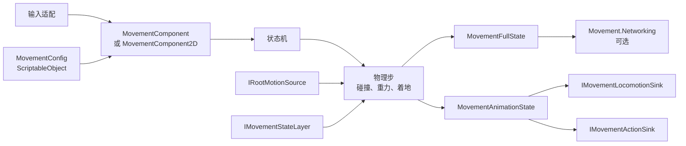
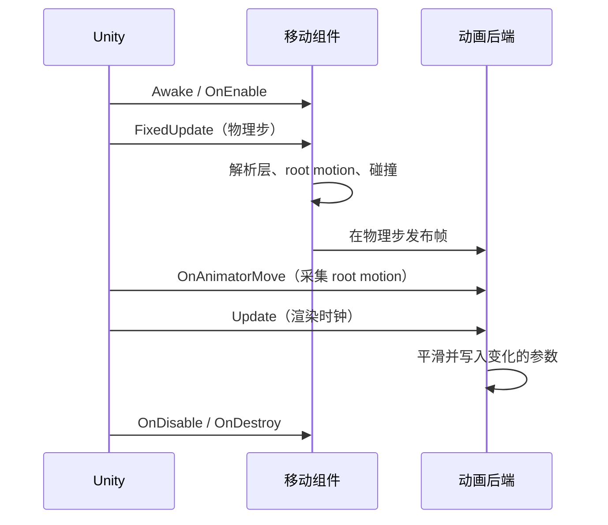
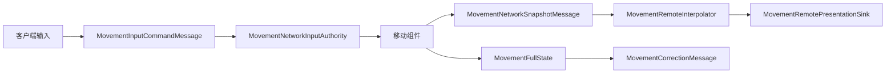

# RPG Foundation Movement

[English](README.md) | 简体中文

Unity 角色移动模块。模块持有权威模拟步，每个步发布一份不可变的动画帧，并把完整状态交给可选的网络扩展包。Core 是纯 C# 程序集，不引用 UnityEngine。

## 目录

1. [安装](#安装)
2. [包结构](#包结构)
3. [架构](#架构)
4. [生命周期](#生命周期)
5. [快速上手](#快速上手)
6. [核心契约](#核心契约)
7. [动画表现](#动画表现)
8. [配置与预设](#配置与预设)
9. [扩展模块](#扩展模块)
10. [联机](#联机)
11. [运行时约束](#运行时约束)
12. [API 速查](#api-速查)
13. [故障排查](#故障排查)
14. [延伸阅读](#延伸阅读)

## 安装

包位于 `Assets/ThirdParty/CycloneGames/CycloneGames.RPGFoundation`，UPM 标识为 `com.cyclone-games.rpg-foundation`。2D 运行时使用 `float2`，因此依赖 `com.unity.mathematics`。

网络扩展是独立包 `com.cyclone-games.rpg-foundation-movement-networking`，只在需要 wire DTO 与输入准入时安装。

| 程序集 | 内容 | 引擎引用 |
| --- | --- | --- |
| `Movement.Core` | 契约、快照、帧值、层仲裁器 | 无 |
| `Movement.Runtime` | 组件、配置、动画后端 | 有 |
| `Movement.Editor` | Inspector 与预设工具 | 有 |
| `Movement.Tests.Editor` | EditMode 测试 | 有 |

## 包结构

```text
Movement/
  Core/                 纯 C# 契约与值类型
  Runtime/
    Config/             配置基类与预设资产
    Animation/          表现后端、root motion 采集、所有权守卫
    Contracts/          状态查询、属性权限、生命周期工具
    Movement2D/         2D 组件、状态、配置
    Movement3D/         3D 组件、状态、配置
    Integrations/       可选寻路与能力适配
    Diagnostics/
  Editor/
  Tests/Editor/
```

`Core` 是一个程序集，`Runtime` 是一个程序集。`Runtime` 下的子目录按功能分组，不会生成额外程序集。

## 架构



组件是模拟状态唯一的写入方。动画后端只读帧，不回写状态。root motion 源提供位移，组件把它转成速度，并与其他输入走同一个碰撞步。

## 生命周期



`BeginReplay()` 与 `EndReplay()` 界定校正窗口。窗口打开期间不发布表现；最外层 `BeginReplay` 保存层状态，配对的 `EndReplay` 恢复层状态。

## 快速上手

### 第 1 步：创建配置资产

菜单 `Create > CycloneGames > RPG Foundation > Movement > Movement Config`（3D）或 `Movement > Movement Config 2D`。Inspector 内可套用预设：3D 为 `Standard`、`Swift`、`Bulky`，2D 为 `Platformer`、`TopDown`。

### 第 2 步：挂组件

`MovementComponent` 需要 `Rigidbody` 与 `CapsuleCollider`，`MovementComponent2D` 需要 `Rigidbody2D`。赋值配置资产。Inspector 会列出与推荐值不一致的物理设置。

### 第 3 步：输入

```csharp
using CycloneGames.RPGFoundation.Movement.Runtime;
using UnityEngine;

public sealed class PlayerInput : MonoBehaviour
{
    private MovementComponent _movement;

    private void Awake() => _movement = GetComponent<MovementComponent>();

    private void Update()
    {
        Vector3 stick = new Vector3(Input.GetAxisRaw("Horizontal"), 0f,
                                    Input.GetAxisRaw("Vertical"));
        _movement.SetInputDirection(stick);
        _movement.SetJumpPressed(Input.GetButtonDown("Jump"));
        _movement.SetSprintHeld(Input.GetButton("Sprint"));
    }
}
```

输入方法只记录意图，模拟在下一个物理步读取。

### 第 4 步：读取状态与事件

```csharp
movement.OnStateChanged += (from, to) => Debug.Log($"{from} -> {to}");
movement.OnLanded += () => Debug.Log("landed");

bool grounded = movement.IsGrounded;
Vector3 velocity = movement.Velocity;
```

`Config` 返回只读视图，调用方无法改动共享资产。

### 第 5 步：快照与校正

```csharp
MovementSnapshot delta = movement.GetSnapshot();
MovementFullState full = movement.CaptureFullState();

movement.BeginReplay();
movement.ApplyFullState(in full);
movement.EndReplay();
```

`MovementSnapshot` 是紧凑增量；`MovementFullState` 包含影响下一次 tick 的全部值，校正、迟到加入与重放都只用它。

## 核心契约

以下类型位于 `CycloneGames.RPGFoundation.Movement.Core`。

| 类型 | 用途 |
| --- | --- |
| `MovementVector3` | 纯 C# 契约使用的引擎无关向量 |
| `MovementStateType` | `Idle`、`Walk`、`Run`、`Sprint`、`Crouch`、`Jump`、`Fall`、`Roll`、`Climb`、`Swim`、`Fly` |
| `MovementAnimationState` | 每个权威步发布一次的不可变帧 |
| `MovementAnimationAction` | 边沿触发、至多投递一次的动作 |
| `MovementSnapshot` / `MovementFullState` | 高频增量 / 完整确定性状态 |
| `IMovementLocomotionSink` / `IMovementActionSink` | 连续帧 / 一次性动作 |
| `IRootMotionSource` | 累积的 root motion 增量 |
| `IMovementStateLayer` / `IMovementLayerReplay` | 层贡献 / 层计时器回滚 |
| `MovementLayerArbiter` | 最多 8 层、按注册顺序解析 |
| `IPathfindingProvider` / `IMovementConfigReadOnly` | 引擎无关寻路契约 / 只读配置 |
| `IMovementPresentationBudget` | 按 LOD 或距离跳过一帧表现 |
| `IMovementDeterministicStep` | 无头或回滚运行的物理驱动 |
| `IMovementSnapshotProvider` | 快照与完整状态的读写接口 |

`MovementSemanticId` 用 FNV-1a 把名字映射为稳定标识，小于 1024 的值保留给内置语义。

## 动画表现

```csharp
movement.BindAnimation(locomotionSink, actionSink);
movement.BindRootMotion(rootMotionSource);
```

| 后端 | 说明 |
| --- | --- |
| `UnityAnimatorMovementPresenter` | 绑定时解析参数名，物理步缓存目标值，渲染帧只写变化参数 |
| `PlayableMovementPresenter` | 手动 `PlayableGraph`，层混合器加动作混合器，渲染时钟调用 `Evaluate(dt)` |
| `AnimatorRootMotionSource` | 在 Animator 所在 GameObject 上采集 `OnAnimatorMove` |

运行时约束：

- 一个 Animator 只由一个后端驱动，`MovementAnimationBackendGuard` 会禁用冲突方。
- 同一 GameObject 只允许一个 `OnAnimatorMove` 采集者。外部采集器需实现 `IMovementRootMotionCapture`，`MovementRootMotionCaptureGuard` 会禁用第二个。
- root motion 转成速度，任何后端都不写 transform。
- 重放期间不发布帧、不派发动作。

`SetPresentationEnabled(false)` 关闭全部表现输出。

## 配置与预设

配置是 ScriptableObject 资产。`MovementConfigRules` 用有限边界校验 54 个数值字段，并把非有限值替换为默认值。`ValidateConfiguration()` 返回只读的问题报告。

| 字段 | 3D 默认值 | 2D 默认值 |
| --- | ---: | ---: |
| `gravity` | `-20f` | `25f` |
| `rollDuration` | `0.5f` | `0.5f` |
| `groundedCheckDistance` / `groundCheckDistance` | `0.025f` | `0.1f` |
| `coyoteTime` | 无 | `0.1f` |
| `jumpBufferTime` | 无 | `0.1f` |
| `maxFallSpeed` | 无 | `20f` |
| `movementType` | 无 | `Platformer` |

重力符号刻意相反：3D 用负值表示沿 Y 向下，2D 用正值表示向下量级。不要把 3D 的重力值填进 2D 配置。

外部项目无需改动本包即可定义预设：创建 `MovementConfigPresetAsset`（`Create > CycloneGames > Movement Config Preset`），Inspector 通过 `AssetDatabase.FindAssets` 发现它。

## 扩展模块

下面按难度递进，均不需要修改本包源码。

### 第 1 层：增加移动层

```csharp
public sealed class AimLayer : IMovementStateLayer
{
    private readonly MovementSemanticId _id = MovementSemanticId.FromName("Game.Aim");
    public MovementSemanticId Id => _id;
    public bool Enabled => true;
    public float Priority => 1f;

    public void Tick(in MovementLayerFrame frame, ref MovementLayerOutput output)
    {
        output.VelocityDelta = new MovementVector3(0f, 0f, 0f);
    }
}

var arbiter = new MovementLayerArbiter();
arbiter.TryAdd(new AimLayer());
movement.BindMovementLayers(arbiter);
```

### 第 2 层：让层参与回滚

```csharp
public sealed class TimedLayer : IMovementStateLayer, IMovementLayerReplay
{
    private float _timer, _saved;
    public MovementSemanticId Id => MovementSemanticId.FromName("Game.Dash");
    public bool Enabled => true;
    public float Priority => 1f;

    public void Tick(in MovementLayerFrame frame, ref MovementLayerOutput output)
        => _timer += frame.DeltaTime;

    public void SaveReplayState() => _saved = _timer;
    public void RestoreReplayState() => _timer = _saved;
}
```

`BeginReplay` / `EndReplay` 会对实现该接口的层调用保存与恢复。计时器留在层内部，不扩宽 wire 格式。

### 第 3 层：接入动画后端

在自己的程序集实现 `IMovementLocomotionSink` 与 `IMovementActionSink`，再调用 `BindAnimation`。`WithSemanticState` 可给帧打上自定义状态 id。

### 第 4 层：无头或回滚运行

实现 `IMovementDeterministicStep.Step(float)` 并调用 `BindDeterministicStep`。返回 `true` 表示由驱动接管该步，组件跳过常规 `FixedUpdate`。

### 第 5 层：语义与预算

```csharp
movement.BindSemantics(new MovementExtensionRegistry());
movement.SetSemanticStateId(MovementSemanticId.FromName("Game.Stagger").Value);
movement.BindPresentationBudget(myBudget);
```

两个组件的 `BuildAnimationFrame` 与 `PublishAnimationFrame` 都是 `protected virtual`。

### 寻路集成

三个可选程序集实现 `IPathfindingProvider`。每个程序集由 asmdef 的 `versionDefines`
派生出 `defineConstraints` 符号，只有对应包被解析时才会编译：

| 包 | 程序集 | 符号 |
| --- | --- | --- |
| `com.unity.ai.navigation` | `Integrations.UnityNavigation` | `CYCLONE_RPGFOUNDATION_HAS_UNITY_AI_NAVIGATION` |
| `com.arongranberg.astar` | `Integrations.AStar` | `CYCLONE_RPGFOUNDATION_HAS_ASTAR_PATHFINDING` |
| `com.projectdawn.navigation` | `Integrations.AgentsNavigation` | `CYCLONE_RPGFOUNDATION_HAS_AGENTS_NAVIGATION` |
| `com.projectdawn.navigation.crowds` | 可选能力 | `CYCLONE_RPGFOUNDATION_HAS_AGENTS_NAVIGATION_CROWDS` |

`MovementConfig` 没有运行时寻路开关。安装对应包、挂上 provider 组件，并在自己的
组合根中绑定即可；项目也可以在自己的程序集里实现 `IPathfindingProvider`。

仓库里的 `ThirdPartyPackages/` 只保存包源码供参考。Unity 只从 `Packages/manifest.json` 或 `Packages/` 目录解析包；未引用任何导航包时，Config Inspector 显示 `none`，三个集成程序集也不会编译。

## 联机

扩展包提供 wire DTO、带指纹的消息清单、按 epoch 的输入准入、每实体有界历史、reconciliation 与权限桥接；传输与序列化由项目自行组合。



消息表、握手规则与组合示例见 [Movement.Networking](../../CycloneGames.RPGFoundation.Movement.Networking/README.SCH.md)。

## 运行时约束

| 约束 | 数值 |
| --- | --- |
| 热路径分配 | 20 万 / 40 万模拟步均为 0 字节 |
| 动作写入 | 固定 12 次写入，无循环，O(1) |
| 层仲裁 | 8 槽，O(8) |
| 输入历史 | 开放寻址索引，查找与剪枝 O(1) |
| 抖动缓冲 | 浅层线性扫描，深层二分 |
| LINQ、反射、静态可变状态、单例、锁 | 运行时路径中均无 |
| `public const` | Movement 5 个，Networking 36 个 wire 常量 |
| 线程 | Unity 主线程；Core 是引擎无关的纯 C# |

值类型尺寸：动画帧 108 B、动作 16 B、root motion 增量 36 B。`MovementFullState` 的扩展槽只承载影响下一次 tick 的标量，不存表现数据。

## API 速查

两个组件形状一致，向量参数在 3D 为 `Vector3`、2D 为 `Vector2`。

| 方法 | 用途 |
| --- | --- |
| `SetInputDirection`、`SetJumpPressed`、`SetSprintHeld`、`SetCrouchHeld`、`SetRollPressed` | 记录意图 |
| `RequestClimb`、`StopClimb` | 攀爬（`ClimbingMode.None`、`Ladder`、`Wall`） |
| `SetLookDirection`、`ClearLookDirection`、`SetRotation` | 旋转与移动分离 |
| `RequestStateChange` | 请求状态切换 |
| `LaunchCharacter`、`AddForce`、`AddExplosionForce` | 外部冲量 |
| `GetSnapshot` / `ApplySnapshot` | 紧凑增量 |
| `CaptureFullState` / `ApplyFullState` / `ResetFromFullState` | 完整状态 |
| `BindAnimation`、`BindRootMotion`、`BindMovementLayers`、`BindSemantics`、`BindPresentationBudget`、`BindDeterministicStep` | 组合 |
| `BeginReplay`、`EndReplay`、`SetPresentationEnabled` | 重放窗口 |
| `SetUseRootMotion` | 开关 root motion 消费 |

## 故障排查

| 现象 | 原因 | 处理 |
| --- | --- | --- |
| 角色不动 | 未赋值配置，或输入适配未调用 `SetInputDirection` | 赋值资产并确认适配器在 `Update` 中运行 |
| 2D 角色向上掉 | 把 3D 重力值填进了 2D 配置 | 2D 使用正值重力 |
| 两个动画后端冲突 | 同一 Animator 挂了两个 presenter | 保留一个，守卫会禁用另一个 |
| root motion 生效两次 | Animator GameObject 上有两个 `OnAnimatorMove` | 只留一个采集者，并实现 `IMovementRootMotionCapture` |
| root motion 穿透几何体 | 后端直接写了 transform | 改用 `IRootMotionSource` 与 `BindRootMotion` |
| 校正时重播跳跃或翻滚 | 没有用重放窗口包住校正 | 应用状态前后调用 `BeginReplay` / `EndReplay` |
| 预设不显示 | 资产不是 `MovementConfigPresetAsset` | 从 CycloneGames 菜单创建 |

## 延伸阅读

- [3D 移动参考](Runtime/Movement3D/README.SCH.md)
- [2D 移动参考](Runtime/Movement2D/README.SCH.md)
- [Movement.Networking](../../CycloneGames.RPGFoundation.Movement.Networking/README.SCH.md)
