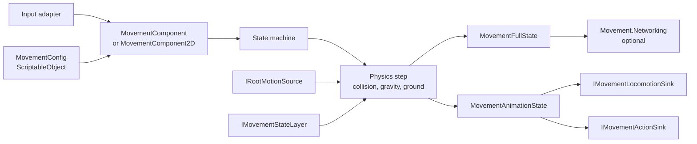
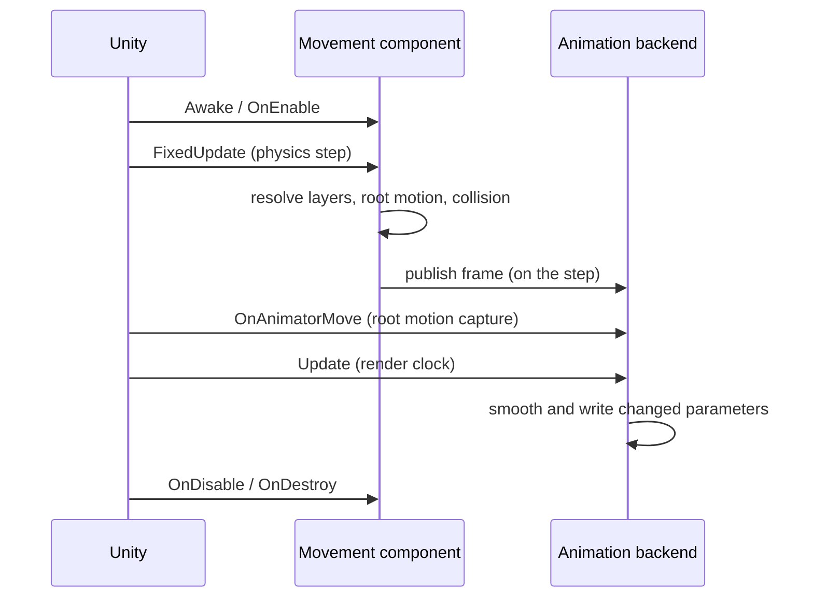
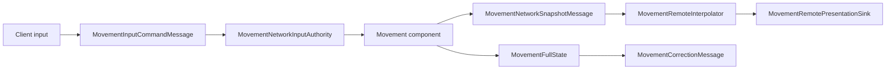

# RPG Foundation Movement

[English | 简体中文](README.SCH.md)

Character movement for Unity. The package owns the authoritative simulation
step, publishes one immutable animation frame per step, and hands complete
state to the optional networking extension. Core contracts are pure C# and
compile without UnityEngine.

## Contents

1. [Install](#install)
2. [Package layout](#package-layout)
3. [Architecture](#architecture)
4. [Lifecycle](#lifecycle)
5. [Quick start](#quick-start)
6. [Core contracts](#core-contracts)
7. [Animation presentation](#animation-presentation)
8. [Configuration and presets](#configuration-and-presets)
9. [Extending the module](#extending-the-module)
10. [Networking](#networking)
11. [Runtime constraints](#runtime-constraints)
12. [API reference](#api-reference)
13. [Troubleshooting](#troubleshooting)
14. [Further reading](#further-reading)

## Install

The package lives at `Assets/ThirdParty/CycloneGames/CycloneGames.RPGFoundation`
and its UPM identity is `com.cyclone-games.rpg-foundation`. It declares
`com.unity.mathematics` as a dependency because the 2D runtime uses `float2`.

The networking extension is a separate package,
`com.cyclone-games.rpg-foundation-movement-networking`. Install it only when
the project needs wire DTOs and input admission.

| Assembly | Contents | Engine references |
| --- | --- | --- |
| `Movement.Core` | Contracts, snapshots, frame values, layer arbiter | No |
| `Movement.Runtime` | Components, configs, animation backends | Yes |
| `Movement.Editor` | Inspectors and preset tooling | Yes |
| `Movement.Tests.Editor` | EditMode tests | Yes |

## Package layout

```text
Movement/
  Core/                 pure C# contracts and value types
  Runtime/
    Config/             MovementConfigBase, MovementConfigPresetAsset
    Animation/          presenter backends, root motion capture, guards
    Contracts/          state queries, attribute authority, lifetime helper
    Movement2D/         2D component, states, config
    Movement3D/         3D component, states, config
    Integrations/       optional navigation and ability adapters
    Diagnostics/
  Editor/
  Tests/Editor/
```

`Core` is one assembly. `Runtime` is one assembly. The subdirectories under
`Runtime` group files by feature; they do not create additional assemblies.

## Architecture



The component is the only writer of simulation state. Animation backends read
frames and never write back. A root motion source supplies displacement; the
component converts it to velocity and resolves it through the same collision
step as every other input.

## Lifecycle



`BeginReplay()` and `EndReplay()` bracket a correction window. Presentation is
suppressed while the window is open, and layer state is saved on the outermost
`BeginReplay` and restored on the matching `EndReplay`.

## Quick start

### Step 1: create a configuration asset

Use `Create > CycloneGames > RPG Foundation > Movement > Movement Config` (3D) or
`Movement > Movement Config 2D`. Presets are available in the Inspector: `Standard`,
`Swift`, `Bulky` for 3D, `Platformer` and `TopDown` for 2D.

### Step 2: add the component

`MovementComponent` requires `Rigidbody` and `CapsuleCollider`.
`MovementComponent2D` requires `Rigidbody2D`. Assign the configuration asset.
The Inspector reports physics settings that differ from the recommended ones.

### Step 3: feed input

```csharp
using CycloneGames.RPGFoundation.Movement.Runtime;
using UnityEngine;

public sealed class PlayerInput : MonoBehaviour
{
    private MovementComponent _movement;

    private void Awake() => _movement = GetComponent<MovementComponent>();

    private void Update()
    {
        Vector3 stick = new Vector3(Input.GetAxisRaw("Horizontal"), 0f,
                                    Input.GetAxisRaw("Vertical"));
        _movement.SetInputDirection(stick);
        _movement.SetJumpPressed(Input.GetButtonDown("Jump"));
        _movement.SetSprintHeld(Input.GetButton("Sprint"));
    }
}
```

Input methods record intent. The simulation reads it on the next physics step.

### Step 4: read state and events

```csharp
movement.OnStateChanged += (from, to) => Debug.Log($"{from} -> {to}");
movement.OnLanded += () => Debug.Log("landed");

bool grounded = movement.IsGrounded;
Vector3 velocity = movement.Velocity;
```

`Config` returns a read-only view, so callers cannot mutate the shared asset.

### Step 5: snapshot and correction

```csharp
MovementSnapshot delta = movement.GetSnapshot();
MovementFullState full = movement.CaptureFullState();

movement.BeginReplay();
movement.ApplyFullState(in full);
movement.EndReplay();
```

`MovementSnapshot` is a compact delta. `MovementFullState` contains every value
that influences the next tick and is the only state used for correction, late
join and replay.

## Core contracts

All types below live in `CycloneGames.RPGFoundation.Movement.Core`.

| Type | Purpose |
| --- | --- |
| `MovementVector3` | Engine-independent vector used by pure C# contracts |
| `MovementStateType` | `Idle`, `Walk`, `Run`, `Sprint`, `Crouch`, `Jump`, `Fall`, `Roll`, `Climb`, `Swim`, `Fly` |
| `MovementAnimationState` | Immutable frame published once per authoritative step |
| `MovementAnimationAction` | Edge-triggered action delivered at most once |
| `MovementSnapshot` | Compact high-frequency delta |
| `MovementFullState` | Complete deterministic state |
| `IMovementLocomotionSink` | Receives continuous frames |
| `IMovementActionSink` | Receives one-shot actions |
| `IRootMotionSource` | Supplies accumulated root motion deltas |
| `IMovementStateLayer` | Adds velocity or position deltas to the physics step |
| `IMovementLayerReplay` | Saves and restores a layer's own timers across replay |
| `MovementLayerArbiter` | Bounded, ordered arbiter for up to eight layers |
| `IPathfindingProvider` | Engine-independent navigation contract |
| `IMovementConfigReadOnly` | Read-only configuration values |
| `IMovementPresentationBudget` | Skips a presentation frame for LOD or distance |
| `IMovementDeterministicStep` | Drives physics for headless or rollback runs |
| `IMovementSnapshotProvider` | `GetSnapshot`, `CaptureFullState`, `ApplySnapshot`, `ApplyFullState`, `ResetFromFullState` |

`MovementSemanticId` maps a name to a stable FNV-1a identifier. Values below
1024 are reserved for built-in semantics.

## Animation presentation

Three contracts separate authority from presentation:

```csharp
movement.BindAnimation(locomotionSink, actionSink);
movement.BindRootMotion(rootMotionSource);
```

| Backend | Notes |
| --- | --- |
| `UnityAnimatorMovementPresenter` | Resolves parameter names once, caches targets on the physics step, writes changed parameters on the render frame |
| `PlayableMovementPresenter` | Manual `PlayableGraph`, layer mixer plus action mixer, `Evaluate(dt)` on the render clock |
| `AnimatorRootMotionSource` | Captures `OnAnimatorMove` on the Animator's GameObject |

Rules that the runtime enforces:

- One Animator is driven by one backend. `MovementAnimationBackendGuard`
  disables the losing backend.
- Exactly one component captures `OnAnimatorMove`. Any external capture must
  implement `IMovementRootMotionCapture`; `MovementRootMotionCaptureGuard`
  disables the second capture.
- Root motion is converted to velocity. No backend writes a transform.
- During replay, frame publication and action dispatch are suppressed.

`SetPresentationEnabled(false)` suppresses all presentation output.

## Configuration and presets

Configurations are ScriptableObject assets. `MovementConfigRules` validates all
54 numeric fields against finite bounds and replaces non-finite values with
defaults. `ValidateConfiguration()` returns a read-only issue report.

| Field | 3D default | 2D default |
| --- | ---: | ---: |
| `gravity` | `-20f` | `25f` |
| `rollDuration` | `0.5f` | `0.5f` |
| `groundedCheckDistance` / `groundCheckDistance` | `0.025f` | `0.1f` |
| `coyoteTime` | n/a | `0.1f` |
| `jumpBufferTime` | n/a | `0.1f` |
| `maxFallSpeed` | n/a | `20f` |
| `movementType` | n/a | `Platformer` |

The gravity signs are deliberately opposite: 3D gravity points down on Y with
a negative value, 2D gravity is a positive downward magnitude. Do not copy a
3D gravity value into a 2D config.

An external project can define presets without editing this package. Create a
`MovementConfigPresetAsset` (`Create > CycloneGames > Movement Config Preset`);
the Inspector discovers it through `AssetDatabase.FindAssets`.

## Extending the module

The examples build on each other. None of them requires a change to this
package.

### Level 1: add a movement layer

```csharp
public sealed class AimLayer : IMovementStateLayer
{
    private readonly MovementSemanticId _id = MovementSemanticId.FromName("Game.Aim");
    public MovementSemanticId Id => _id;
    public bool Enabled => true;
    public float Priority => 1f;

    public void Tick(in MovementLayerFrame frame, ref MovementLayerOutput output)
    {
        output.VelocityDelta = new MovementVector3(0f, 0f, 0f);
    }
}

var arbiter = new MovementLayerArbiter();
arbiter.TryAdd(new AimLayer());
movement.BindMovementLayers(arbiter);
```

The arbiter holds at most eight layers and resolves them in registration order.

### Level 2: make the layer replay-safe

```csharp
public sealed class TimedLayer : IMovementStateLayer, IMovementLayerReplay
{
    private float _timer, _saved;
    public MovementSemanticId Id => MovementSemanticId.FromName("Game.Dash");
    public bool Enabled => true;
    public float Priority => 1f;

    public void Tick(in MovementLayerFrame frame, ref MovementLayerOutput output)
        => _timer += frame.DeltaTime;

    public void SaveReplayState() => _saved = _timer;
    public void RestoreReplayState() => _timer = _saved;
}
```

`BeginReplay` / `EndReplay` call `SaveReplayState` and `RestoreReplayState` on
every layer that implements the interface. Layer timers stay in the layer; they
do not widen the wire format.

### Level 3: add an animation backend

Implement `IMovementLocomotionSink` and `IMovementActionSink` in your own
assembly, then call `BindAnimation`. `MovementAnimationState` carries velocity,
ground state, world up, flags and four scalar extension slots. Use
`WithSemanticState` to tag a frame with a custom state id.

### Level 4: run headless or rollback simulation

Implement `IMovementDeterministicStep.Step(float)` and call
`BindDeterministicStep`. Returning `true` takes ownership of the step and the
component skips its normal `FixedUpdate` body.

### Level 5: bind semantics and budgets

```csharp
movement.BindSemantics(new MovementExtensionRegistry());
movement.SetSemanticStateId(MovementSemanticId.FromName("Game.Stagger").Value);
movement.BindPresentationBudget(myBudget);
```

`BuildAnimationFrame` and `PublishAnimationFrame` are `protected virtual` on
both components for projects that need a richer frame.

### Navigation integrations

Three optional assemblies implement `IPathfindingProvider`. Each assembly is
gated by an asmdef `defineConstraints` symbol derived from a `versionDefines`
entry, so an integration compiles only when its package is resolved:

| Package | Assembly | Symbol |
| --- | --- | --- |
| `com.unity.ai.navigation` | `Integrations.UnityNavigation` | `CYCLONE_RPGFOUNDATION_HAS_UNITY_AI_NAVIGATION` |
| `com.arongranberg.astar` | `Integrations.AStar` | `CYCLONE_RPGFOUNDATION_HAS_ASTAR_PATHFINDING` |
| `com.projectdawn.navigation` | `Integrations.AgentsNavigation` | `CYCLONE_RPGFOUNDATION_HAS_AGENTS_NAVIGATION` |
| `com.projectdawn.navigation.crowds` | optional capability | `CYCLONE_RPGFOUNDATION_HAS_AGENTS_NAVIGATION_CROWDS` |

`MovementConfig` has no runtime pathfinding switch. Install the package, add
the provider component and bind it in your composition root. A project can
also implement `IPathfindingProvider` in its own assembly.

`ThirdPartyPackages/` in this repository stores package sources for reference. Unity resolves packages only from `Packages/manifest.json` or the `Packages/` folder. With no navigation package referenced, the Config Inspector reports `none` and the three integration assemblies stay uncompiled.

## Networking

The extension package provides wire DTOs, a fingerprinted message manifest,
epoch-bound input admission, per-entity histories, reconciliation and the
authority bridge. It does not implement a transport or a serializer.



See [Movement.Networking](../../CycloneGames.RPGFoundation.Movement.Networking/README.md)
for the message table, handshake rules and composition example.

## Runtime constraints

| Constraint | Value |
| --- | --- |
| Hot-path allocation | 0 bytes over 200k and 400k simulated steps |
| Action writer | 12 fixed writes, no loop, O(1) |
| Layer arbiter | 8 slots, O(8) |
| Input history | open-addressed index, O(1) lookup and prune |
| Jitter buffer | linear scan when shallow, binary search when deep |
| LINQ, reflection, static mutable state, singletons, locks | none in runtime paths |
| `public const` | 5 in Movement, 36 wire constants in Networking |
| Threading | Unity main thread; Core is engine-independent pure C# |

Value types are bounded: animation frame 108 B, action 16 B, root motion delta
36 B. Extension slots in `MovementFullState` carry only scalars that influence
the next tick; presentation data must not be stored there.

## API reference

Both components expose the same shape. Vector arguments are `Vector3` in 3D and
`Vector2` in 2D.

| Method | Purpose |
| --- | --- |
| `SetInputDirection`, `SetJumpPressed`, `SetSprintHeld`, `SetCrouchHeld`, `SetRollPressed` | Record intent |
| `RequestClimb`, `StopClimb` | Climbing control (`ClimbingMode.None`, `Ladder`, `Wall`) |
| `SetLookDirection`, `ClearLookDirection`, `SetRotation` | Rotation is separate from movement |
| `RequestStateChange` | Ask the state machine for a transition |
| `LaunchCharacter`, `AddForce`, `AddExplosionForce` | External impulses |
| `PauseGroundConstraint` | Temporarily release the ground constraint |
| `GetSnapshot`, `ApplySnapshot` | Compact delta |
| `CaptureFullState`, `ApplyFullState`, `ResetFromFullState` | Complete state |
| `BindAnimation`, `BindRootMotion`, `BindMovementLayers`, `BindSemantics`, `BindPresentationBudget`, `BindDeterministicStep` | Composition |
| `BeginReplay`, `EndReplay`, `SetPresentationEnabled` | Replay windows |
| `SetUseRootMotion` | Enable or disable root motion consumption |

`TryIgnoreCollision` rejects an admission when the ignored-collider cache is
full. `GetMemorySnapshot()` reports counts and rejection counters in O(1).

## Troubleshooting

| Symptom | Cause | Action |
| --- | --- | --- |
| Character does not move | No configuration assigned, or input adapter is not calling `SetInputDirection` | Assign the asset and verify the adapter runs in `Update` |
| 2D character falls upward | 3D gravity value copied into a 2D config | Use a positive 2D gravity |
| Two animation backends conflicting | Both presenters on one Animator | Keep one; the guard disables the other |
| Root motion applied twice | Two `OnAnimatorMove` handlers on the Animator GameObject | Keep one capture and implement `IMovementRootMotionCapture` |
| Root motion teleports through geometry | A backend writes the transform directly | Use `IRootMotionSource` and `BindRootMotion` |
| Replay replays a jump or roll | Correction window not bracketed | Call `BeginReplay` before and `EndReplay` after applying the state |
| Preset not listed | Asset is not a `MovementConfigPresetAsset` | Create it from the CycloneGames menu |

## Further reading

- [3D movement reference](Runtime/Movement3D/README.md)
- [2D movement reference](Runtime/Movement2D/README.md)
- [Movement.Networking](../../CycloneGames.RPGFoundation.Movement.Networking/README.md)
