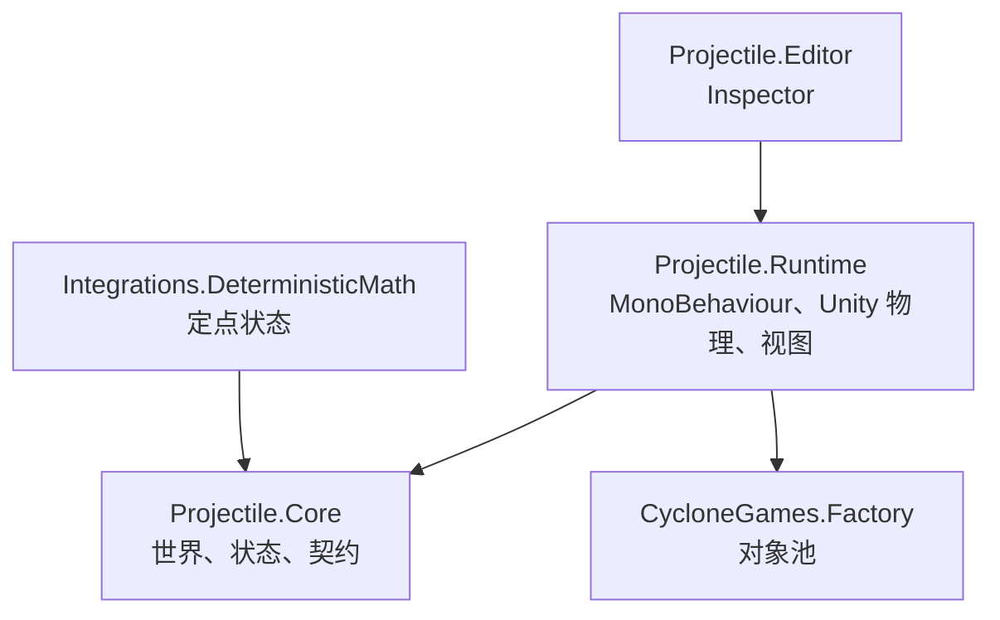
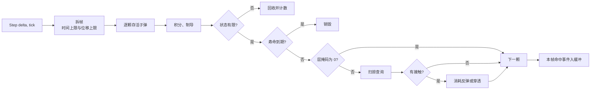
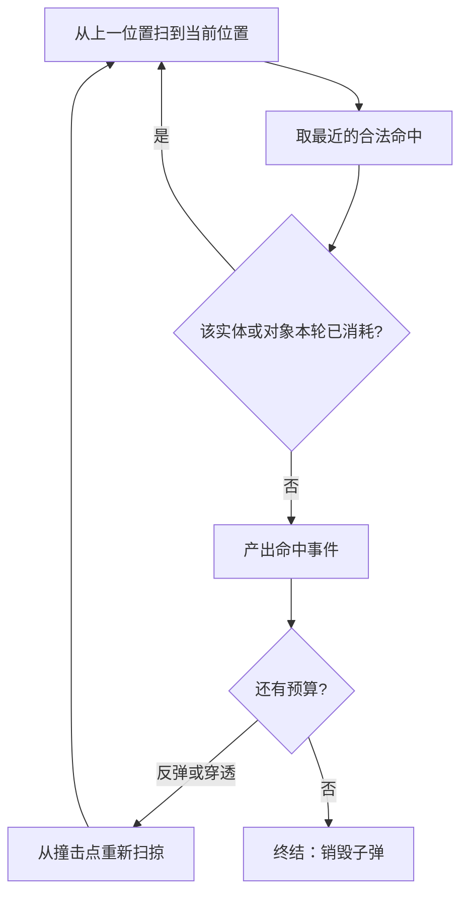

# CycloneGames.RPGFoundation · Projectile

[English](README.md) | 简体中文

面向"子弹数量大、开销必须可预期"的场景的抛射物仿真模块。Core 程序集负责移动、制导、扫掠碰撞、
生命周期和命中上报，不依赖 Unity、渲染或网络。这些东西放在独立程序集里，通过接口接入。

模块是固定容量的存储，不是通用对象池。容量由你声明，构造期分配一次；容量用尽时返回 `false`，
不会自行扩容。

## 目录

1. [适用范围](#1-适用范围)
2. [安装](#2-安装)
3. [第一颗子弹](#3-第一颗子弹)
4. [在 Unity 里做同一件事](#4-在-unity-里做同一件事)
5. [定义](#5-定义)
6. [句柄与状态](#6-句柄与状态)
7. [步进与时间](#7-步进与时间)
8. [碰撞](#8-碰撞)
9. [命中事件](#9-命中事件)
10. [表现层](#10-表现层)
11. [确定性](#11-确定性)
12. [容量与开销](#12-容量与开销)
13. [复制接口](#13-复制接口)
14. [扩展点](#14-扩展点)
15. [与其他包组合](#15-与其他包组合)
16. [测试](#16-测试)
17. [故障排查](#17-故障排查)

---

## 1. 适用范围

模块负责：

- 在可选平面上做速度积分，支持加速度与重力。
- Direction、Homing、LeadHoming 三种制导。
- 通过调用方提供的适配器做扫掠碰撞，带反弹与穿透预算。
- 生命周期、命中上报、单帧工作量有上界。

模块不负责：

- 渲染、音效、伤害结算。模块只上报命中，命中意味着什么由别处决定。
- 空间划分。宽相位属于碰撞适配器。
- GameObject 的通用池化。

## 2. 安装

四个程序集，拆开是为了让仿真能在没有引擎的环境里运行。

| 程序集 | 内容 | 依赖 UnityEngine |
| --- | --- | --- |
| `CycloneGames.RPGFoundation.Projectile.Core` | `ProjectileWorld`、定义、句柄、快照、碰撞契约 | 否 |
| `CycloneGames.RPGFoundation.Projectile.Runtime` | MonoBehaviour、Physics 2D/3D 适配器、视图池 | 是 |
| `CycloneGames.RPGFoundation.Projectile.Integrations.DeterministicMath` | 定点等价实现 | 否 |
| `CycloneGames.RPGFoundation.Projectile.Editor` | Inspector、校验、预设 | 仅编辑器 |

`Projectile.Runtime` 还依赖 `CycloneGames.Factory.Runtime` 与 `CycloneGames.Factory.Unity.Runtime`，
视图池由它们提供。安装时要一并装上 Factory，否则 asmdef 引用无法解析。Core 本身没有包依赖，
服务端或无头构建可以两个都不装。



服务端、无头测试或 ECS Job 可以只引用 Core。需要 Unity 物理或场景对象时再加 Runtime。

## 3. 第一颗子弹

最小的可用例子不使用任何引擎类型：建世界、生成一颗、步进、读结果。

```csharp
using CycloneGames.RPGFoundation.Projectile.Core;

// capacity 是硬上限；eventCapacity 限制单次 Step 的命中事件数。
var space = ProjectileSpaceProfile.Full3D();
var config = new ProjectileWorldConfig(
    capacity: 1024,
    eventCapacity: 256,
    collisionHitCapacity: 8,
    space: in space,
    maxCollisionIterations: 4,
    maxDeltaTime: 1f / 60f,
    maxSubSteps: 4);

var world = new ProjectileWorld(in config);

var definition = new ProjectileDefinition(
    new ProjectileDefinitionId(1),
    ProjectileGuidanceMode.Direction,
    ProjectileLifecycleFlags.DespawnOnHit,
    initialSpeed: 20f,
    maxSpeed: 20f,
    acceleration: 0f,
    gravityScale: 0f,
    radius: 0.2f,
    maxLifetime: 5f,
    turnRateRadiansPerSecond: 0f,
    leadPredictionTime: 0f,
    pierceCount: 0,
    bounceCount: 0,
    collisionLayerMask: ~0,
    effectPayloadId: 0);

var request = new ProjectileSpawnRequest(
    definition,
    ownerEntityId: 100,
    networkEntityId: 5001,      // 必须非 0，且存活期间唯一
    targetEntityId: 0,
    spawnTick: 0,
    predictionKey: 0,
    seed: 0,
    position: ProjectileVector3.Zero,
    direction: new ProjectileVector3(0f, 0f, 1f),
    initialVelocity: ProjectileVector3.Zero);

if (!world.TrySpawn(in request, out ProjectileHandle handle))
{
    return; // 世界已满，或请求非法
}

world.Step(1f / 60f, tick: 1);

if (world.TryGetState(handle, out ProjectileState state))
{
    // state.Position 已前进 initialSpeed * deltaTime
}
```

三个值得注意的点。

`TrySpawn` 返回 `false` 而不是扩容。生成被拒绝是你在设计期就要做的容量决策，不是异常。

`Step` 同时接受 delta 和 tick。tick 会写入状态与快照，delta 驱动积分。两者分开，是为了让按 tick
索引的仿真在帧时变化时仍然保持时间线。

`TryGetState` 会重新校验句柄。已销毁的子弹返回 `false`，而不是指向复用了该槽位的新子弹。

## 4. 在 Unity 里做同一件事

`ProjectileSystemBehaviour` 持有世界、用固定步长累加器推进，并把命中事件转发出来。先用
`Create > CycloneGames > RPGFoundation > Projectile > Definition` 建一个定义资产，再从场景组件生成：

```csharp
using CycloneGames.RPGFoundation.Projectile.Core;
using CycloneGames.RPGFoundation.Projectile.Runtime;
using UnityEngine;

public sealed class WandAttack : MonoBehaviour
{
    [SerializeField] private ProjectileSystemBehaviour projectiles;
    [SerializeField] private ProjectileDefinitionAsset arcaneMissile;

    public bool Fire(ulong ownerId, ulong projectileId, Vector3 muzzle, Vector3 direction)
    {
        return projectiles.TrySpawn(
            arcaneMissile,
            muzzle,
            direction,
            ownerId,
            projectileId,
            out ProjectileHandle handle);
    }

    private void OnEnable()
    {
        projectiles.Hit += OnHit;
    }

    private void OnDisable()
    {
        projectiles.Hit -= OnHit;
    }

    private void OnHit(ProjectileHitEvent hit)
    {
        // 解析 payload id，结算伤害，派发表现。
    }
}
```

如果定义里用了 `Homing` 或 `LeadHoming`，需要给它一个目标来源。默认 tick 路径没有别的地方能查到目标，
没有来源时制导会退化成直飞：

```csharp
projectiles.TargetProvider = myTargetService; // 实现 IProjectileTargetProvider
```

该属性标了 `[NonSerialized]`：在场景里序列化一个寻敌服务引用，会让抛射物系统耦合到那个服务上，
所以由组合根在运行时赋值。

## 5. 定义

`ProjectileDefinition` 是不可变的调参数据。生成时会被复制进世界，之后修改本地副本不会影响已在飞的子弹。

| 字段 | 作用 |
| --- | --- |
| `InitialSpeed`、`MaxSpeed` | 速度钳制。`MaxSpeed == 0` 关闭钳制。 |
| `Acceleration` | 沿当前方向施加。 |
| `GravityScale` | 乘到空间配置的重力上。 |
| `Radius` | 扫掠半径，适配器用它作为 cast 半径。 |
| `MaxLifetime` | 到达该年龄后移除。 |
| `GuidanceMode` | `Direction`、`Homing`、`LeadHoming`。 |
| `TurnRateRadiansPerSecond` | 制导钳制，按每步的弦长预算表达。 |
| `LeadPredictionTime` | `LeadHoming` 对目标速度的外推秒数。 |
| `PierceCount`、`BounceCount` | 剩余预算，每次接触消耗一次。 |
| `CollisionLayerMask` | 传给适配器。掩码为 0 时完全跳过碰撞。 |
| `LifecycleFlags` | `DespawnOnHit`、`IgnoreOwner`。 |
| `EffectPayloadId` | 原样带回命中事件的不透明值。 |

`definition.IsValid` 覆盖校验器和编辑器使用的合法性规则。`MayOverflow` 表示速度、加速度与寿命
是否可能把位置推出 float 范围；世界用它决定是否需要逐步做有限性检查（见第 11 节）。

制导比直飞贵。`Homing` 与 `LeadHoming` 每颗每步要算一次开方和一次旋转，`Direction` 只做积分。
全部子弹都开制导的世界，是值得单独做性能剖析的情形。

## 6. 句柄与状态

`ProjectileHandle` 是槽位索引加 64 位代际。销毁会递增槽位代际，所以旧句柄永远不会解析到复用了
同一槽位的新子弹。`Clear()` 会推进所有已发放的代际，理由相同。

```csharp
if (world.TryGetState(handle, out ProjectileState state))
{
    // state.Position、state.Velocity、state.Age、state.RemainingBounceCount 等
}
```

`ProjectileState` 是存放在世界密集数组里的可变结构体。`TryGetState` 复制一份出来；
写入活跃状态要通过世界，而不是通过这份副本。

要遍历所有存活子弹且不复制，直接取 span：

```csharp
ReadOnlySpan<ProjectileState> active = world.ActiveStates;
for (int i = 0; i < active.Length; i++)
{
    Render(active[i].Position, active[i].DefinitionId);
}
```

这个 span 是密集区间上的视图，生成或销毁会使它失效。不要跨 `Step` 持有。

## 7. 步进与时间

`Step(deltaTime, tick, collisionWorld, targetProvider)` 把每颗存活子弹推进一次。



`maxDeltaTime > 0` 时，一帧会被拆成若干等长子步，每步不超过该值。超过 `maxSubSteps * maxDeltaTime`
的帧会被钳位，而不是用超大步长仿真。这样高速子弹不会穿透，时间线也不会随帧率漂移。
钳位次数记录在 `world.Stats.TotalClampedFrameCount`。

钳位有代价。持续卡顿时仿真会落后于墙钟：`maxDeltaTime = 1/60`、`maxSubSteps = 4` 时，
一帧 100 ms 只仿真 66.7 ms，连续六秒的 100 ms 帧会仿真四秒。这是为了换取稳定的步长。
如果玩法要求时钟对齐，就自己驱动 `Step`，用你自己的追帧策略。

## 8. 碰撞

世界不查物理，它调用适配器：

```csharp
public interface IProjectileCollisionWorld
{
    int Cast(in ProjectileCollisionQuery query, ProjectileCollisionHit[] results, int maxResults);
}
```

查询携带句柄、owner id、network id、层掩码、半径，以及从上一位置到当前位置的线段。适配器做扫掠查询
并写入调用方提供的缓冲区。Core 读缓冲区，不分配。

随包的 Unity 适配器使用 `Physics.SphereCastNonAlloc` 与 `Physics2D.CircleCastNonAlloc`。
要换物理后端，实现这个接口即可，别处不用改。

发生接触时，世界消耗一次反弹或一次穿透，并从撞击点用剩余距离继续扫掠。两者都受
`maxCollisionIterations`（默认 4）限制。



重复接触需要特别处理。从撞击点重新开始的扫掠会落进刚刚撞到的表面内部，于是同一个碰撞体在距离 0 处
被再次上报。世界会抑制当前扫掠中已消耗的对象 id，以及上一轮解析出的实体 id。
适配器把 `TargetObjectId` 留成 0 会关闭对象抑制；把 `TargetEntityId` 留成 0 会关闭实体抑制和
`IgnoreOwner`。两个都要填。

随包的 Unity 适配器做了第一件、没做第二件：它把碰撞体实例报成对象 id，实体 id 留 0，
因为碰撞体属于哪个游戏实体属于项目知识，模块不具备。所以 `IgnoreOwner` 需要自己写适配器补上实体 id，
或者把出生点放到足够远离 owner 的位置，让第一次扫掠扫不到。

过滤策略属于适配器。层掩码、友伤、阵营规则都在那里决定，不放进 Core。

### 单步位移与穿墙

高速子弹和墙之间有两道互不相关的机制，其中只有一道和墙有关。

**扫掠契约。** `Cast` 收到的是从 `PreviousPosition` 到 `Position` 的线段。按线段判定的适配器，
无论子弹移动多远都会报告穿越，速度本身不会造成漏检。只判定终点的适配器会漏，而且速度越高漏得越多。

**位移上限。** `maxTravelPerStep` 把一帧拆到没有任何子弹单步移动超过该距离。它为三种情况存在：
扫掠得不彻底的适配器、自带连续碰撞限制的物理后端，以及让"漏检"有一个可计算的原因而不是谜。

把它设成小于子弹可能打到的最薄碰撞体。单步不超过墙厚时，一定会有某个步进终点落在墙内；
单步大于墙厚时，能否检测到取决于相位。

模块把子步上限定在 16。需要的子步数超过上限时，该帧无法遵守位移上限，
`world.SubStepSaturationCount` 递增。请把它当作自己测试里的失败信号：它意味着子弹移动得比你配置的更远，
只判终点的适配器可能已经放过去一颗。

因此实际拿到的位移是：

```text
perStep <= max(maxTravelPerStep, maxSpeed * deltaTime / maxSubSteps)
```

三个需要提前考虑的结果。

- 500 m/s 配 1/60 s 时，子弹每帧走 8.3 m。要遵守 0.2 m 的上限需要 42 个子步，
  于是上限生效，真实边界是 0.52 m。只有扫掠适配器能让这颗子弹停在 0.2 m 的墙外，加大预算救不了它。
- 这两个值属于对局，不属于客户端。子步数会改变积分，两个 `maxTravelPerStep` 配置不同的节点会分叉。
- 该上限默认关闭（`0`）。有薄几何、或对后端不完全放心时打开；适配器本身就做扫掠、想省回帧时间时关掉。

模块看不见的情形：在几何体内部生成的子弹。第一次扫掠从碰撞体内部开始，物理引擎对初始重叠返回无命中，
子弹就从另一侧穿出去了。要校验出生点，或在生成前做一次重叠检查。

移动目标同样不在模块内。高速子弹和高速目标可能在一帧内互换位置，两端都不重叠。
要解决需要目标随时间的体积，那属于玩法层。

检查适配器时，构造一条已知会穿过你最薄碰撞体的查询，交给一致性检查：

```csharp
var query = new ProjectileCollisionQuery(
    handle: default,
    ownerEntityId: 0UL,
    networkEntityId: 0UL,
    collisionLayerMask: ~0,
    radius: 0.05f,
    from: new ProjectileVector3(0f, 0f, 9.5f),   // 墙的近侧
    to: new ProjectileVector3(0f, 0f, 10.5f));   // 墙的另一侧

bool swept = ProjectileCollisionWorldConformance.VerifySweep(myAdapter, in query, out string failure);
```

把它放进包含该碰撞体的场景里当作测试跑。只判终点的适配器、以及携带不到标识的命中，都会让它失败，
而这两种恰是世界无法替适配器补救的错误。

## 9. 命中事件

命中会累积到世界持有的固定容量缓冲区里，并在每次 `Step` 开头清空。

```csharp
world.Step(delta, tick, collisionWorld, targetProvider);

ProjectileEventBuffer events = world.HitEvents;
for (int i = 0; i < events.Count; i++)
{
    ProjectileHitEvent hit = events[i];
    if (hit.IsTerminal)
    {
        // 子弹已消失，播放命中特效
    }
    else
    {
        // 反弹或穿透，播放较轻的表现
    }
}
```

`IsTerminal` 表示这次接触终结了子弹。只消耗反弹或穿透次数的接触不算终结。

缓冲区是固定的。溢出计入 `world.Stats.TotalHitEventOverflowCount`；`eventCapacity` 应按最密弹幕的
最坏一帧来定，而不是按平均值。

## 10. 表现层

两种做法，取决于数量。

几十颗子弹用场景对象池。Runtime 程序集里的 `ProjectileViewPool` 与 `ProjectileView` 负责启用、
摆位和回收。

上千颗不要一颗一个 GameObject。读 `ActiveStates`，用 `Graphics.DrawMeshInstanced` 或 compute 路径画：

```csharp
ReadOnlySpan<ProjectileState> active = world.ActiveStates;
for (int i = 0; i < active.Length; i++)
{
    matrices[i] = Matrix4x4.TRS(
        ToUnity(active[i].Position),
        Quaternion.LookRotation(ToUnity(active[i].Velocity)),
        Vector3.one);
}
```

需要一份脱离世界的副本时（例如把权威状态交给另一个线程），用 `CaptureSnapshots`。
每颗复制 88 字节，单次顺序遍历。

## 11. 确定性

默认世界用 `float`。同一构建、同一平台、同一输入产生相同结果。跨平台或跨编译器时，
`sqrt` 与浮点累加的最后几位可能不同。

使用浮点时模块保证：

- 运算顺序固定。生成、步进、销毁都按密集数组顺序，不依赖哈希遍历。
- 随机数由调用方提供。模块不持有 RNG；`seed` 字段只是替你带过去。
- 固定子步让时间线与帧率无关。

不保证：

- 跨 CPU 架构逐位相同。
- 跨编译器版本或优化级别逐位相同。

需要这些时使用 `DeterministicMath` 集成，它把 float 状态换成 Q32.32 定点。当
`com.cyclone-games.deterministic-math` 1.x 被解析时，由版本宏启用，其程序集需要显式引用。

浮点溢出是被处理掉的，不是假设不会发生。为速度考虑，积分本身不做检查，所以合法定义仍可能到达
`Infinity`：速度 `3e38` 配上加速度和较长寿命，几步之内就会。能在使用时达到该范围的定义会在生成时
被筛出（`MayOverflow`），只有这些定义才逐步做有限性检查。触发时子弹被移除，
`world.NonFiniteRejectedCount` 递增。没有这道检查，子弹会持续产出 NaN，快照校验静默失败，
并且永远存活。

## 12. 容量与开销

这里的成本模型是结构性的，所以结论不随机器变化，只有常数会。本文不写计时数字：
模块本身不带基准测试，任何一张纳秒表在代码下一次改动后就会过时。

`Step` 是对存活区间的一次遍历：每颗子弹都做积分，可能再做制导，可能再做扫掠。开销随存活数量
线性增长，单颗成本基本持平，因为存储是密集的、没有按 key 查找。生成与销毁是常数时间，
销毁用 swap-remove。

有两件事会打破这个线性图景：

- 制导。`Homing` 与 `LeadHoming` 每颗每步都要算一次开方和一次旋转。全场都开制导的世界，
  比全场都不开要明显更贵。
- 碰撞。每次接触都是对后端的一次查询，在调用线程上执行。模块在接触上的工作量很小，
  物理调用不是。每步都在接触的子弹，比自由飞行的贵好几倍，而这个倍数属于你的物理配置，
  不属于这个模块。

所以决定预算的不是"模块有多快"，而是"这一帧有多少颗子弹在接触"。选容量之前先剖析这一项。

三个参数会移动预算：

- `capacity` 在构造期决定所有存储。按每场战斗或每个房间来定，不要按整个项目来定。
- `enableNetworkEntityIdIndex` 用内存换查询复杂度。索引是两张每项 12 字节的数组，
  容量取到两倍容量向上取整的 2 的幂，因此开销是 `12 * nextPowerOfTwo(2 * capacity)` 字节。
  没有任何地方按 network id 查子弹时关掉它。
- `maxSubSteps` 与 `maxDeltaTime` 在追帧能力和单帧最坏开销之间取平衡。
- `maxTravelPerStep` 限制子弹单步能移动多远。它和 `maxDeltaTime` 是两件事：后者限时间，不限距离。
  见碰撞一节。

## 13. 复制接口

Core 提供复制需要的状态通路。线格式在独立的 `CycloneGames.RPGFoundation.Projectile.Networking` 包里。

```csharp
// 权威侧：一次顺序遍历，不分配。
var buffer = new ProjectileSnapshot[world.Capacity];
int count = world.CaptureSnapshots(buffer);

// 副本侧：修补已有子弹，或创建副本没有的子弹。
ProjectileSnapshotApplyResult result = world.TryApplySnapshot(in snapshot);
if (result == ProjectileSnapshotApplyResult.Missing)
{
    world.TrySpawnFromSnapshot(in snapshot, in definition, out ProjectileHandle handle);
}

// 硬重同步：丢掉本地副本，用权威状态重建。
world.TryResetFromSnapshot(in snapshot, in definition, out handle);

// 回滚：用捕获的某一帧替换整个世界。
ProjectileRestoreResult restored = world.TryRestoreStates(
    capturedSpan, ProjectileRestoreMode.Replace, definitionCatalog);
```

应用快照会覆盖位置、速度、上一位置、年龄和 tick，保留句柄、反弹与穿透预算，所以一次纠正不会
让子弹白得一次反弹次数。比本地 tick 更旧的快照会被判为过期，除非这次调用是 `Replace` 还原，
它的语义本来就是倒回。

`TryRestoreStates` 是原子的：批次先校验、解析定义、确认容量足够，任何状态才被改动。
被拒绝的批次不会留下痕迹。

`LatestTick` 报告世界当前锚定的 tick，由 `Step` 和成功的还原更新。`Merge` 只前进；
`Replace` 跟随批次，可以倒退。

## 14. 扩展点

仿真之外的一切都是接口。按需实现。

| 接口 | 何时实现 |
| --- | --- |
| `IProjectileCollisionWorld` | 换物理后端，或用确定性碰撞地图 |
| `IProjectileTargetProvider` | 制导需要目标位置或速度 |
| `IProjectileDefinitionCatalog` | 副本需要按复制来的定义 id 创建子弹 |

Unity 程序集提供了常见实现：`UnityProjectileCollisionWorld3D`、`UnityProjectileCollisionWorld2D`、
`ProjectileViewPool`。

## 15. 与其他包组合

仓库里有两个包会和抛射物打交道。

**Factory 已经接好了。** `ProjectileViewPool` 包的是 `CycloneGames.Factory.Unity.Runtime` 里的
`MonoFastPool<ProjectileView>`，依赖是真实的，asmdef 里也声明了。池类型是固定的：
`ProjectileViewPool` 是 sealed，且只用 `MonoFastPool`。需要别的策略，就自己对着 `ProjectileView`
写一个视图池，或者把现有的包一层。

**Trajectory 是互补的，但没有接线。** 它一次调用求出整条路径，包含反射、穿透和终点，
适合做瞄准预览或 AI 射击求解；Projectile 是逐帧仿真飞行中的子弹。两者不共享代码，
也没有互相引用。

组合起来只需要一次向量转换；想让它们共用一套物理实现，再加一个适配器：

```csharp
// 先问 Trajectory 这一枪会打到哪。
var query = new TrajectoryQuery(
    traceId: 1,
    ownerEntityId: ownerId,
    collisionLayerMask: layerMask,
    origin: new TrajectoryVector3(origin.X, origin.Y, origin.Z),
    direction: new TrajectoryVector3(direction.X, direction.Y, direction.Z),
    maxDistance: 60f,
    radius: 0.2f,
    maxReflectionCount: 1);

var buffer = new TrajectoryTraceBuffer(segmentCapacity: 8, hitCapacity: 8, castHitCapacity: 8);
TrajectorySolver.Trace(in query, trajectoryCollisionWorld, buffer);

// 再沿第一段方向发射真正的子弹。
TrajectoryVector3 segment = buffer.GetSegment(0).Direction;
var spawnDirection = new ProjectileVector3(segment.X, segment.Y, segment.Z);
```

有一处不对称需要提前考虑。两个模块抑制"刚打中的那个面"的位置不同：

- Projectile 在世界内部过滤实体 id 与对象 id。适配器可以如实上报全部命中，Core 会丢掉
  扫掠起点所在的那个面。
- Trajectory 把 `IgnoredTargetEntityId` 与 `IgnoredTargetObjectId` 放进 cast 查询里，
  期望适配器自己遵守。适配器忽略这两个字段时，轨迹会打中它刚反弹开的那面墙。

所以两个模块共用一个适配器时，必须实现忽略检查。对 Projectile 来说这只是一层冗余过滤，
行为仍然正确。

这层映射在编写本文时验证过：把两个 Core 一起编译，用同一面墙驱动它们，确认向量转换无损、
轨迹与仿真的命中位置在一个仿真步内一致、反弹后方向一致、忽略列表按描述生效。本包内没有测试守着
这份一致性，因为抛射物的测试程序集不引用 Trajectory，也不应该逼你安装它。Trajectory 的契约一旦变化，
这层缝需要手工复核。

不要把求解器当成积分器。每次 trace 都会重建自己的线段与命中记录，而且它不携带任何逐弹状态：
年龄、反弹与穿透预算、句柄、命中事件、快照。所以每颗子弹每步 trace 一次，比 `Step` 更贵，
而且那些状态还得在它外面重新搭起来。

实用的分工是：Trajectory 回答"这一枪还没打出去时会飞到哪"，Projectile 负责打出去之后的每一帧。
沿这两条线各自扩展，互不牵连。给其中一方加路径特性时，要明确决定另一方是否跟随：
预览与仿真不一致，比没有预览更糟，而两套实现会持续漂移，除非有东西强迫它们对齐。

## 16. 测试

```text
Unity Test Runner > EditMode > CycloneGames.RPGFoundation.Projectile.Tests.Editor
Unity Test Runner > EditMode > CycloneGames.RPGFoundation.Projectile.Networking.Tests.Editor
Unity Test Runner > EditMode > CycloneGames.RPGFoundation.Projectile.DeterministicMath.Tests.Editor
```

EditMode 套件覆盖句柄、生成压力、反弹与穿透预算、快照应用与还原、以及网络消息路径。
自己写适配器时，配一个假碰撞世界加一条测试：永远在距离 0 处返回同一个对象 id，
这正是暴露"缺少抑制"的用例。

## 17. 故障排查

| 现象 | 原因 | 处理 |
| --- | --- | --- |
| `TrySpawn` 返回 false | 世界已满或请求非法 | 查 `Stats.TotalSpawnRejectedCapacityCount` 与 `request.IsValid` |
| 制导子弹直飞 | 没有指定 `IProjectileTargetProvider` | 赋值 `ProjectileSystemBehaviour.TargetProvider` |
| 子弹贴着墙抖 | 适配器把 `TargetObjectId` 或 `TargetEntityId` 留成 0 | 两个都填 |
| 一次接触触发两次命中 | 适配器在距离 0 处重复上报且抑制关闭 | 填对象 id |
| 高负载下命中事件缺失 | 事件缓冲区太小 | 查 `Stats.TotalHitEventOverflowCount`，调大 `eventCapacity` |
| 卡顿后仿真落后于墙钟 | 持续长帧下的帧钳位 | 见第 7 节；需要墙钟对齐就自己驱动 `Step` |
| 子弹没有命中就消失 | 定义溢出 float 被回收 | 查 `world.NonFiniteRejectedCount` |
