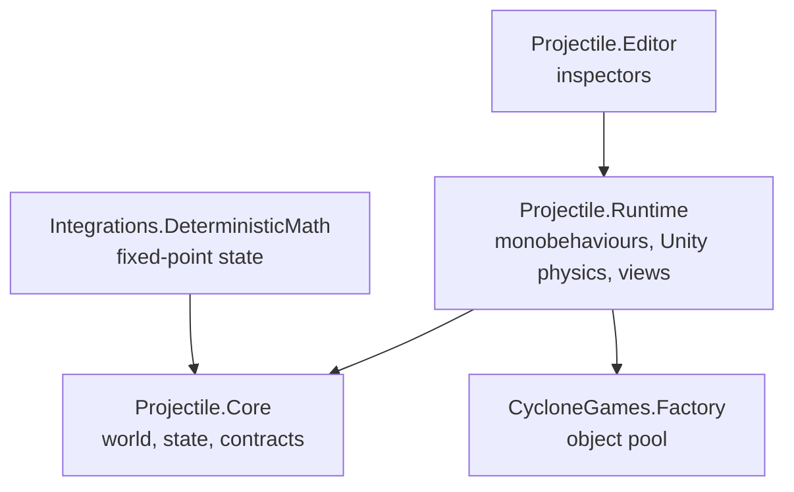
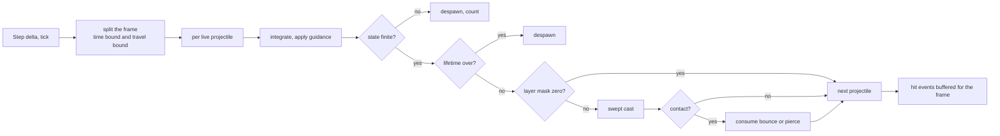
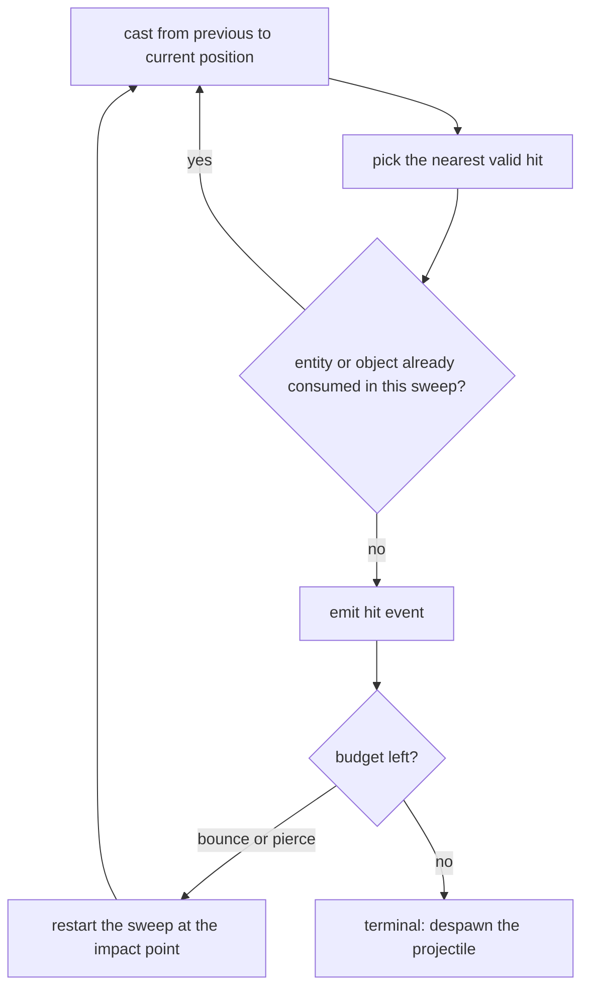

# CycloneGames.RPGFoundation · Projectile

[English | 简体中文](README.SCH.md)

Projectile simulation for games that need many bullets with predictable cost. The Core assembly
owns movement, guidance, swept collision, lifetime and hit reporting; it does not know about
Unity, rendering, or networking. Those sit in separate assemblies behind interfaces.

The module is a fixed-capacity store, not a general-purpose pool. You declare a capacity, it
allocates once, and it returns `false` instead of growing when the capacity is reached.

## Contents

1. [Scope](#1-scope)
2. [Install](#2-install)
3. [First projectile](#3-first-projectile)
4. [The same thing in Unity](#4-the-same-thing-in-unity)
5. [Definitions](#5-definitions)
6. [Handles and state](#6-handles-and-state)
7. [Stepping and time](#7-stepping-and-time)
8. [Collision](#8-collision)
9. [Hit events](#9-hit-events)
10. [Presentation](#10-presentation)
11. [Determinism](#11-determinism)
12. [Capacity and cost](#12-capacity-and-cost)
13. [Replication hooks](#13-replication-hooks)
14. [Extension points](#14-extension-points)
15. [Composing with other packages](#15-composing-with-other-packages)
16. [Testing](#16-testing)
17. [Troubleshooting](#17-troubleshooting)

---

## 1. Scope

In scope:

- Velocity integration with acceleration and gravity on a selectable plane.
- Direction, homing and lead-homing guidance.
- Swept collision through a caller-supplied adapter, with bounce and pierce budgets.
- Lifetime, hit reporting, and bounded per-frame work.

Out of scope:

- Rendering, audio, damage. The module reports hits; something else decides what a hit means.
- Spatial partitioning. Collision adapters own broadphase.
- General-purpose pooling of GameObjects.

## 2. Install

Four assemblies, split so the simulation can run without an engine.

| Assembly | Contents | UnityEngine |
| --- | --- | --- |
| `CycloneGames.RPGFoundation.Projectile.Core` | `ProjectileWorld`, definitions, handles, snapshots, collision contracts | No |
| `CycloneGames.RPGFoundation.Projectile.Runtime` | MonoBehaviours, Physics 2D/3D adapters, view pooling | Yes |
| `CycloneGames.RPGFoundation.Projectile.Integrations.DeterministicMath` | Fixed-point equivalents | No |
| `CycloneGames.RPGFoundation.Projectile.Editor` | Inspectors, validation, presets | Editor only |

`Projectile.Runtime` also depends on `CycloneGames.Factory.Runtime` and
`CycloneGames.Factory.Unity.Runtime`, which supply the view pool. Install Factory alongside it or
the asmdef reference will not resolve. Core itself has no package dependencies, so a server or
headless build can ignore both.



A server, a headless test, or an ECS job can use Core alone. Only add Runtime when you need Unity
physics or scene objects.

## 3. First projectile

The smallest working example uses no engine types. Create a world, spawn one projectile, step it,
read the result.

```csharp
using CycloneGames.RPGFoundation.Projectile.Core;

// Capacity is the hard limit. eventCapacity bounds hit events per Step call.
var space = ProjectileSpaceProfile.Full3D();
var config = new ProjectileWorldConfig(
    capacity: 1024,
    eventCapacity: 256,
    collisionHitCapacity: 8,
    space: in space,
    maxCollisionIterations: 4,
    maxDeltaTime: 1f / 60f,
    maxSubSteps: 4);

var world = new ProjectileWorld(in config);

var definition = new ProjectileDefinition(
    new ProjectileDefinitionId(1),
    ProjectileGuidanceMode.Direction,
    ProjectileLifecycleFlags.DespawnOnHit,
    initialSpeed: 20f,
    maxSpeed: 20f,
    acceleration: 0f,
    gravityScale: 0f,
    radius: 0.2f,
    maxLifetime: 5f,
    turnRateRadiansPerSecond: 0f,
    leadPredictionTime: 0f,
    pierceCount: 0,
    bounceCount: 0,
    collisionLayerMask: ~0,
    effectPayloadId: 0);

var request = new ProjectileSpawnRequest(
    definition,
    ownerEntityId: 100,
    networkEntityId: 5001,      // must be non-zero and unique while alive
    targetEntityId: 0,
    spawnTick: 0,
    predictionKey: 0,
    seed: 0,
    position: ProjectileVector3.Zero,
    direction: new ProjectileVector3(0f, 0f, 1f),
    initialVelocity: ProjectileVector3.Zero);

if (!world.TrySpawn(in request, out ProjectileHandle handle))
{
    return; // world was full or the request was invalid
}

world.Step(1f / 60f, tick: 1);

if (world.TryGetState(handle, out ProjectileState state))
{
    // state.Position advanced by initialSpeed * deltaTime
}
```

Three things to notice.

`TrySpawn` returns `false` rather than resizing. A rejected spawn is a capacity decision you make
in advance, not an exception.

`Step` takes both a delta and a tick. The tick is stamped into state and snapshots; the delta
drives integration. They are separate so a tick-indexed simulation can vary frame time without
losing its timeline.

`TryGetState` revalidates the handle. A handle from a despawned projectile returns `false`
instead of pointing at whatever reused that slot.

## 4. The same thing in Unity

`ProjectileSystemBehaviour` owns a world, steps it with a fixed-step accumulator, and forwards
hit events. Create a definition asset with `Create > CycloneGames > RPGFoundation > Projectile >
Definition`, then spawn from a scene component:

```csharp
using CycloneGames.RPGFoundation.Projectile.Core;
using CycloneGames.RPGFoundation.Projectile.Runtime;
using UnityEngine;

public sealed class WandAttack : MonoBehaviour
{
    [SerializeField] private ProjectileSystemBehaviour projectiles;
    [SerializeField] private ProjectileDefinitionAsset arcaneMissile;

    public bool Fire(ulong ownerId, ulong projectileId, Vector3 muzzle, Vector3 direction)
    {
        return projectiles.TrySpawn(
            arcaneMissile,
            muzzle,
            direction,
            ownerId,
            projectileId,
            out ProjectileHandle handle);
    }

    private void OnEnable()
    {
        projectiles.Hit += OnHit;
    }

    private void OnDisable()
    {
        projectiles.Hit -= OnHit;
    }

    private void OnHit(ProjectileHitEvent hit)
    {
        // Resolve the payload id, apply damage, dispatch a cue.
    }
}
```

If your definitions use `Homing` or `LeadHoming`, assign a target source. The default tick path
has nowhere else to look for targets, and guided definitions fly straight without one:

```csharp
projectiles.TargetProvider = myTargetService; // implements IProjectileTargetProvider
```

The property is `[NonSerialized]`: a scene reference to a targeting service couples the projectile
system to that service, so it is assigned by the composition root at runtime.

## 5. Definitions

A `ProjectileDefinition` is immutable tuning data. It is copied into the world at spawn, so
mutating your local copy afterwards has no effect on live projectiles.

| Field | Effect |
| --- | --- |
| `InitialSpeed`, `MaxSpeed` | Speed clamp. `MaxSpeed == 0` disables the clamp. |
| `Acceleration` | Applied along the current direction. |
| `GravityScale` | Multiplies the space profile's gravity. |
| `Radius` | Sweep radius. The adapter uses it as the cast radius. |
| `MaxLifetime` | Age at which the projectile is removed. |
| `GuidanceMode` | `Direction`, `Homing`, `LeadHoming`. |
| `TurnRateRadiansPerSecond` | Guidance clamp, expressed as a chord-length budget per step. |
| `LeadPredictionTime` | Seconds of target velocity extrapolation for `LeadHoming`. |
| `PierceCount`, `BounceCount` | Remaining budgets. Each contact consumes one. |
| `CollisionLayerMask` | Passed to the adapter. A zero mask skips collision entirely. |
| `LifecycleFlags` | `DespawnOnHit`, `IgnoreOwner`. |
| `EffectPayloadId` | Opaque value echoed in hit events. |

`definition.IsValid` checks the sanity rules the validator and the Editor use. `MayOverflow`
reports whether speed, acceleration and lifetime could push position past the float range; the
world uses it to decide whether a per-step finiteness check is needed (see section 11).

Guidance costs more than straight flight. `Homing` and `LeadHoming` evaluate a square root and a
rotation per projectile per step, while `Direction` only integrates. A world where every projectile
homes is the case worth profiling.

## 6. Handles and state

`ProjectileHandle` is a slot index plus a 64-bit generation. Despawn increments the slot
generation, so an old handle can never resolve to a new projectile that reused the same slot.
`Clear()` advances every issued generation for the same reason.

```csharp
if (world.TryGetState(handle, out ProjectileState state))
{
    // state.Position, state.Velocity, state.Age, state.RemainingBounceCount, ...
}
```

`ProjectileState` is a mutable struct held in the world's dense array. `TryGetState` copies it
out; write access to live state goes through the world, not through the copy.

To read every live projectile without copying, take the span:

```csharp
ReadOnlySpan<ProjectileState> active = world.ActiveStates;
for (int i = 0; i < active.Length; i++)
{
    Render(active[i].Position, active[i].DefinitionId);
}
```

The span is a view over the dense range and is invalidated by spawn or despawn. Do not hold it
across a `Step`.

## 7. Stepping and time

`Step(deltaTime, tick, collisionWorld, targetProvider)` advances every live projectile once.



When `maxDeltaTime > 0`, the frame is split into equal sub-steps no larger than that value. A
frame longer than `maxSubSteps * maxDeltaTime` is clamped instead of simulated with an oversized
step, which keeps fast projectiles from tunnelling and keeps the timeline identical across frame
rates. The clamp is counted in `world.Stats.TotalClampedFrameCount`.

The clamp has a cost worth knowing: during sustained hitches the simulation falls behind wall
clock. A 100 ms frame with `maxDeltaTime = 1/60` and `maxSubSteps = 4` simulates 66.7 ms, so six
seconds of 100 ms frames simulate four seconds. That is a deliberate trade for a predictable step
size. If your gameplay needs the clock to stay aligned instead, drive `Step` yourself with your
own catch-up policy.

## 8. Collision

The world does not query physics. It calls an adapter:

```csharp
public interface IProjectileCollisionWorld
{
    int Cast(in ProjectileCollisionQuery query, ProjectileCollisionHit[] results, int maxResults);
}
```

A query carries the projectile handle, owner id, network id, layer mask, radius, and the segment
from the previous position to the current one. An adapter performs a swept query and writes hits
into the caller's buffer. Core reads the buffer and never allocates.

The shipped Unity adapters use `Physics.SphereCastNonAlloc` and `Physics2D.CircleCastNonAlloc`.
To target a different physics backend, implement the interface; nothing else changes.

On a contact, the world spends one bounce or one pierce charge and continues the sweep from the
impact point with the remaining distance. Both are bounded by `maxCollisionIterations`, default 4.



Repeated contacts deserve attention. A sweep restarted at an impact point starts inside the surface
it just hit, so the same collider is reported again at distance zero. The world suppresses the
object ids already consumed in the current sweep, and the entity id resolved on the previous
iteration. An adapter that leaves `TargetObjectId` at zero disables object suppression; one that
leaves `TargetEntityId` at zero disables entity suppression and `IgnoreOwner`. Populate both.

The shipped Unity adapters do the first and not the second. They report the collider instance as
the object id and leave the entity id at zero, because mapping a collider to a gameplay entity is
project knowledge the module does not have. `IgnoreOwner` therefore needs a custom adapter that
fills entity ids, or a spawn point far enough from the owner that the first sweep misses it.

Filtering policy is the adapter's job. Layer masks, friendly fire, and team rules belong there,
not in Core.

### Step bounds and tunnelling

Two independent mechanisms stand between a fast projectile and a wall, and only one of them is
about the wall.

The swept contract. `Cast` receives the segment from `PreviousPosition` to `Position`. An adapter
that tests that segment reports a crossing however far the projectile moved, so speed by itself
never causes a miss. An adapter that tests only the end point does miss, and misses more often as
speed rises.

The displacement bound. `maxTravelPerStep` splits the frame until no projectile moves further than
that distance in one step. It exists for adapters that sweep imperfectly, for backends with their
own continuous-collision limits, and so that a miss has a computable cause rather than a mystery.

Set it below the thinnest collider a projectile can hit. A step no larger than a wall thickness
guarantees a step end point lands inside the wall; a larger step makes detection a matter of phase.

The module caps sub-steps at 16. When the required count exceeds the cap the bound cannot be
honoured, and `world.SubStepSaturationCount` increments. Treat that counter as a failure signal in
your own tests. It means projectiles travelled further than configured, and an adapter that only
tests end points may have let one through.

The displacement you actually get is therefore:

```text
perStep <= max(maxTravelPerStep, maxSpeed * deltaTime / maxSubSteps)
```

Three consequences worth planning around.

- At 500 m/s with 1/60 s frames a projectile moves 8.3 m per frame. Honouring a 0.2 m bound would
  take 42 sub-steps, so the cap wins and the real bound is 0.52 m. Only a sweeping adapter keeps
  that projectile out of a 0.2 m wall. A larger budget does not rescue it.
- Both values belong to the match, not to the client. Sub-step count changes integration, so two
  peers configured with different `maxTravelPerStep` diverge.
- The bound is off by default (`0`). Enable it when you have thin geometry or a backend you do not
  fully trust; leave it off when your adapter sweeps and you want the frame time back.

What the module cannot see: a projectile that spawns inside geometry. The first sweep starts inside
the collider, and physics engines report no hit for that case, so the projectile leaves through the
far side. Validate spawn points, or test for overlap before spawning.

Moving targets are also outside the module. A fast projectile and a fast target can swap sides
within one frame with neither end point overlapping. Resolving that needs target volumes over time,
which belongs to the gameplay layer.

To check an adapter, build a query whose segment is known to cross your thinnest collider and run
it through the conformance helper:

```csharp
var query = new ProjectileCollisionQuery(
    handle: default,
    ownerEntityId: 0UL,
    networkEntityId: 0UL,
    collisionLayerMask: ~0,
    radius: 0.05f,
    from: new ProjectileVector3(0f, 0f, 9.5f),   // near side of the wall
    to: new ProjectileVector3(0f, 0f, 10.5f));   // beyond it

bool swept = ProjectileCollisionWorldConformance.VerifySweep(myAdapter, in query, out string failure);
```

Run it as a test in a scene that contains that collider. It fails for end-point-only adapters and for
hits that carry no identifiers, which are the two adapter mistakes the world cannot compensate for.

## 9. Hit events

Hits accumulate into a fixed-capacity buffer owned by the world and are cleared at the start of
each `Step` call.

```csharp
world.Step(delta, tick, collisionWorld, targetProvider);

ProjectileEventBuffer events = world.HitEvents;
for (int i = 0; i < events.Count; i++)
{
    ProjectileHitEvent hit = events[i];
    if (hit.IsTerminal)
    {
        // the projectile is gone; play the impact effect
    }
    else
    {
        // bounce or pierce; play a lighter cue
    }
}
```

`IsTerminal` means this contact ended the projectile. A hit that only consumed a bounce or pierce
charge is not terminal.

The buffer is fixed. Overflow is counted in `world.Stats.TotalHitEventOverflowCount`; size
`eventCapacity` for the worst frame of your densest pattern rather than the average.

## 10. Presentation

Two approaches, and the right one depends on count.

For dozens of projectiles, pool scene objects. `ProjectileViewPool` and `ProjectileView` in the
Runtime assembly handle enable, placement and return to pool.

For thousands, do not use one GameObject per projectile. Read `ActiveStates` and draw with
`Graphics.DrawMeshInstanced` or a compute path:

```csharp
ReadOnlySpan<ProjectileState> active = world.ActiveStates;
for (int i = 0; i < active.Length; i++)
{
    matrices[i] = Matrix4x4.TRS(
        ToUnity(active[i].Position),
        Quaternion.LookRotation(ToUnity(active[i].Velocity)),
        Vector3.one);
}
```

`CaptureSnapshots` remains available when you need a detached copy, for example to hand authority
state to another thread. It copies 88 bytes per projectile in one sequential pass.

## 11. Determinism

The default world uses `float`. Same build, same platform, same inputs produce the same result.
Across platforms or compilers, the last bits of a `sqrt` or an accumulation can differ.

What the module guarantees with floats:

- The order of operations is fixed. Spawn, step and despawn follow dense-array order and do not
  depend on hash iteration.
- Randomness is caller-supplied. The module holds no RNG; a `seed` field is carried for your use.
- Fixed-step sub-stepping makes the timeline independent of frame rate.

What it does not guarantee:

- Bit-identical results across CPU architectures.
- Bit-identical results across compiler versions or optimisation levels.

For those, use the `DeterministicMath` integration, which replaces float state with Q32.32 fixed
point. It is enabled by a version define when `com.cyclone-games.deterministic-math` 1.x is
resolved, and its assembly must be referenced explicitly.

Float overflow is handled rather than assumed away. Integration is unguarded for speed, so a
legal definition can still reach `Infinity`: a speed of `3e38` with acceleration and a long
lifetime will do it within a few steps. Definitions that can reach that range are screened at
spawn (`MayOverflow`), and only those pay for a finiteness check per step. When it trips, the
projectile is removed and `world.NonFiniteRejectedCount` increments. Without the check the
projectile would keep producing NaN, fail snapshot validation silently, and stay alive forever.

## 12. Capacity and cost

The cost model here is structural, so it holds regardless of machine even though the constants do
not. This document carries no timings: the module ships no benchmark, and a table of
nanoseconds would be stale the next time the code changed.

`Step` is one pass over the live range. Every projectile is integrated, optionally guided, and
optionally swept. Cost is linear in active count and flat per projectile, because storage is dense
and nothing is looked up by key. Spawn and despawn are constant time, with despawn using
swap-remove.

Two things break the linear picture:

- Guidance. `Homing` and `LeadHoming` evaluate a square root and a rotation per projectile per
  step. A world where everything homes costs materially more than one where nothing does.
- Collision. Every contact is a query into your backend, on the calling thread. The module's work
  per contact is small; the physics call is not. A projectile touching something every step costs
  several times one flying free, and that multiplier belongs to your physics setup rather than to
  this module.

The number that decides the budget is therefore not "how fast is the module" but "how many
projectiles are in contact this frame". Profile that before choosing capacity.

Three knobs move the budget:

- `capacity` sizes all storage at construction. Size it per encounter or per room, not per project.
- `enableNetworkEntityIdIndex` trades memory for lookup complexity. The index is two arrays of
  twelve bytes per entry, sized to the next power of two above twice the capacity, so it costs
  `12 * nextPowerOfTwo(2 * capacity)` bytes. Turn it off when nothing resolves projectiles by
  network id.
- `maxSubSteps` and `maxDeltaTime` trade catch-up against per-frame worst case.
- `maxTravelPerStep` bounds how far a projectile may move in one step. It is separate from
  `maxDeltaTime`, which bounds time rather than distance. See the collision section.

## 13. Replication hooks

Core exposes the state plumbing that replication needs. The wire format lives in the separate
`CycloneGames.RPGFoundation.Projectile.Networking` package.

```csharp
// Authority: one sequential pass, no allocation.
var buffer = new ProjectileSnapshot[world.Capacity];
int count = world.CaptureSnapshots(buffer);

// Replica: patch a live projectile, or create one that the replica does not have.
ProjectileSnapshotApplyResult result = world.TryApplySnapshot(in snapshot);
if (result == ProjectileSnapshotApplyResult.Missing)
{
    world.TrySpawnFromSnapshot(in snapshot, in definition, out ProjectileHandle handle);
}

// Hard resync: drop the local copy and rebuild it from authority.
world.TryResetFromSnapshot(in snapshot, in definition, out handle);

// Rollback: replace the whole world with a captured tick.
ProjectileRestoreResult restored = world.TryRestoreStates(
    capturedSpan, ProjectileRestoreMode.Replace, definitionCatalog);
```

Applying a snapshot patches position, velocity, previous position, age and tick. It keeps the
handle, bounce and pierce budgets, so a correction does not hand the projectile a fresh budget.
A snapshot older than the local tick is rejected as stale unless the call is a `Replace` restore,
which is by definition a rewind.

`TryRestoreStates` is atomic: the batch is validated, its definitions resolved, and the capacity
proven sufficient before any state changes. A rejected batch leaves the world untouched.

`LatestTick` reports the tick the world is anchored to, updated by `Step` and by a successful
restore. For `Merge` it only advances; for `Replace` it follows the batch and may go back.

## 14. Extension points

Everything outside the simulation is an interface. Implement only what you need.

| Interface | When to implement |
| --- | --- |
| `IProjectileCollisionWorld` | Different physics backend, or a deterministic collision map |
| `IProjectileTargetProvider` | Homing needs a target position or velocity |
| `IProjectileDefinitionCatalog` | A replica must create projectiles from replicated definition ids |

The Unity assemblies provide the common cases: `UnityProjectileCollisionWorld3D`,
`UnityProjectileCollisionWorld2D`, `ProjectileViewPool`.

## 15. Composing with other packages

Two CycloneGames packages touch projectile work.

**Factory** is already wired. `ProjectileViewPool` wraps `MonoFastPool<ProjectileView>` from
`CycloneGames.Factory.Unity.Runtime`, so the dependency is real and the asmdef declares it. The
pool type is fixed: `ProjectileViewPool` is sealed and always uses `MonoFastPool`. If you need a
different policy, write a view pool against `ProjectileView` yourself or wrap the existing one.

**Trajectory** is complementary but not wired. It evaluates a whole path in one call, including
reflections, pierces and the end point, which is what an aim preview or an AI shot solver needs.
Projectile simulates live bullets frame by frame. The two share no code and neither references the
other.

Composing them takes a vector conversion, and one adapter if you want a single physics
implementation:

```csharp
// Ask Trajectory where the shot would go.
var query = new TrajectoryQuery(
    traceId: 1,
    ownerEntityId: ownerId,
    collisionLayerMask: layerMask,
    origin: new TrajectoryVector3(origin.X, origin.Y, origin.Z),
    direction: new TrajectoryVector3(direction.X, direction.Y, direction.Z),
    maxDistance: 60f,
    radius: 0.2f,
    maxReflectionCount: 1);

var buffer = new TrajectoryTraceBuffer(segmentCapacity: 8, hitCapacity: 8, castHitCapacity: 8);
TrajectorySolver.Trace(in query, trajectoryCollisionWorld, buffer);

// Then fire the real projectile along the first segment.
TrajectoryVector3 segment = buffer.GetSegment(0).Direction;
var spawnDirection = new ProjectileVector3(segment.X, segment.Y, segment.Z);
```

One asymmetry to plan for. The modules suppress the surface just hit in different places:

- Projectile filters entity and object ids inside the world. An adapter can report everything and
  Core drops the surface the sweep restarted inside.
- Trajectory carries `IgnoredTargetEntityId` and `IgnoredTargetObjectId` in the cast query and
  expects the adapter to honor them. An adapter that ignores those fields lets a trace hit the wall
  it just bounced off.

An adapter shared by both modules therefore has to implement the ignore check. Projectile treats it
as redundant filtering and still behaves correctly.

The mapping was checked during development by driving both Core assemblies over the same wall: the
conversion is lossless, the trace and the simulation agree on the hit position to within one step,
they agree on the post-bounce direction, and the ignore list suppresses as described. No test in
this package guards that agreement, because the projectile test assembly does not reference
Trajectory and should not force you to install it. If Trajectory's contract changes, re-check the
seam by hand.

Do not use the solver as the integrator. A trace rebuilds its segment and hit records on every
call, and it carries none of the per-projectile state: age, bounce and pierce budgets, handles, hit
events, snapshots. Running one trace per projectile per step therefore costs more than `Step` and
still leaves that state to be rebuilt outside it.

The practical split is that Trajectory answers questions before a shot exists, and Projectile owns
the shot afterwards. Separate extensions along those lines stay independent. If you add a path
feature to one, decide explicitly whether the other should match it: a preview that disagrees with
the simulation is worse than no preview, and the two implementations will drift unless something
forces them together.

## 16. Testing

```text
Unity Test Runner > EditMode > CycloneGames.RPGFoundation.Projectile.Tests.Editor
Unity Test Runner > EditMode > CycloneGames.RPGFoundation.Projectile.Networking.Tests.Editor
Unity Test Runner > EditMode > CycloneGames.RPGFoundation.Projectile.DeterministicMath.Tests.Editor
```

The EditMode suite covers handles, spawn pressure, bounce and pierce budgets, snapshot apply and
restore, and the networking message paths. When you write an adapter, add a test with a fake
collision world: returning a hit at distance zero from the same object id forever is the case that
exposes missing suppression.

## 17. Troubleshooting

| Symptom | Cause | Fix |
| --- | --- | --- |
| `TrySpawn` returns false | World full or request invalid | Check `Stats.TotalSpawnRejectedCapacityCount` and `request.IsValid` |
| Guided projectile flies straight | No `IProjectileTargetProvider` was assigned | Assign `ProjectileSystemBehaviour.TargetProvider` |
| Projectile sticks to a wall | Adapter leaves `TargetObjectId` or `TargetEntityId` at zero | Populate both in the adapter |
| Hit event fires twice per contact | Adapter reports the same object at distance zero and suppression is off | Populate object ids |
| Hit events missing under load | Event buffer too small | Check `Stats.TotalHitEventOverflowCount`, raise `eventCapacity` |
| Simulation drifts behind after a hitch | Frame clamping under sustained long frames | Section 7 explains the trade; drive `Step` yourself if you need wall-clock alignment |
| Projectile disappears without a hit | Definition overflowed float and was reaped | Check `world.NonFiniteRejectedCount` |
