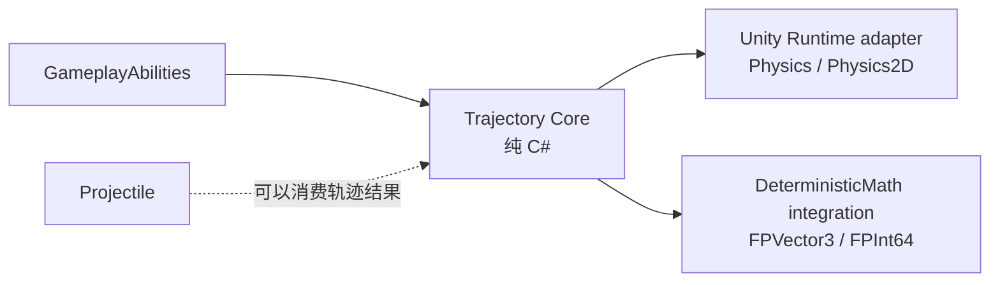

# CycloneGames RPGFoundation Trajectory

[English](README.md) | 简体中文

`Trajectory` 负责求解即时路径：射线、球形/圆形 sweep、穿透链和反射段。它是一个无状态路径求解器，不是 projectile 生命周期系统。飞行物用 `Projectile`；hitscan 武器、光束预览、反射激光、瞄准预测和服务端命中校验用 `Trajectory`。

## 目录

- [概述](#概述)
- [架构](#架构)
- [快速上手](#快速上手)
- [核心概念](#核心概念)
- [使用指南](#使用指南)
- [进阶主题](#进阶主题)
- [常见场景](#常见场景)
- [性能与内存](#性能与内存)
- [故障排查](#故障排查)

## 概述

`TrajectorySolver.Trace` 接收 `TrajectoryQuery`，查询 `ITrajectoryCollisionWorld`，将 segment 和 hit 记录写入由调用方持有的 `TrajectoryTraceBuffer`。求解器始终使用 swept segment cast，而非仅检查终点。Core 不依赖 Unity，Unity Physics adapter 将 sweep 请求转换为 3D 的 `RaycastNonAlloc`、`SphereCastNonAlloc`、`CapsuleCastNonAlloc`、`BoxCastNonAlloc`，以及 2D 的 `Physics2D.Raycast`、`CircleCast`、`CapsuleCast`、`BoxCast`。

### 为什么需要它

物理引擎回答的是"这条射线打到了什么"。武器、光束或 AI 视线检查要的往往不止于此：子弹反弹之后的完整路径、穿透弹依次穿过的每一层，或者在一台没有渲染器的服务端上重新算出同一个答案。

手写这段循环，等于每个功能都要面对同样的三个问题：每次查询分配一个命中数组，把忽略状态从一段传到下一段，让 2D、3D 与服务端三条路径各自演化到对不上。

本模块把这段循环收成一次调用。`TrajectorySolver.Trace` 把完整的 segment 与 hit 链写入调用方持有的 buffer，在其中应用反射与穿透上限，并让忽略状态跨段传递。Core 不含 Unity 类型，因此同一份代码在客户端、无头服务端与定点回放中给出同一个答案。

### 适用情景

- Hitscan 武器与激光指示，需要立刻得到结果，而不是跨若干帧推进。
- 会反射、会穿透，或两者兼有的光束，重点是整条链而非第一次接触。
- 瞄准线、技能范围、炮塔覆盖这类编辑期预览。
- 服务端命中校验，包括从记录的 query 回放。
- 批量视线检查，一次评估散射或多目标而不产生逐条分配。

以下情况应交给别的模块：

- 随时间飞行、追踪目标或受力影响的抛射物。那是 `Projectile`。Trajectory 没有速度，也没有生命周期。
- 需要物理引擎解算碰撞响应、而不仅是报告接触的场景。
- 每帧重新求值的连续曲线。采样一次，把点列交给 `TrajectoryPolylineSolver`，飞行本身在 `Projectile` 中模拟。

### 主要特性

- **射线、球形、胶囊与盒形 sweep** — 2D 和 3D，支持 swept from-to cast（防穿墙）
- **批量追踪** — `TrajectoryBatchTracer` 为散弹与 AI 视线批检复用预分配的逐 query buffer，构造后 0 分配
- **反射与穿透** — 可配置 continuation，固定迭代预算
- **调用方持有缓冲区** — 复用 buffer 时不产生 per-trace 托管分配
- **Unity-free Core** — `noEngineReferences: true`，可在 headless/server context 中使用
- **DeterministicMath 集成** — 用于 lockstep、rollback、replay 的定点 solver
- **折线路径** — `TrajectoryPolylineSolver.Trace` 沿调用方给定的点列求解碰撞，曲线、路点与传送门路径由此进入求解器
- **曲线采样** — Bezier、正弦、衰减正弦与抛物线采样，位于独立的不依赖 Unity 的程序集
- **Editor preset** — `TrajectoryQueryPresetAsset` 提供 Hitscan、Ricochet Beam、Piercing Beam、Capsule、Box preset
- **Debug probe 与 Workbench** — Scene View 中预览 segment、hit point、normal 与扫掠体积线框；场景级 Workbench 列出所有 probe、展示 segment 与 hit 表、计时全量重 trace 并套用预设

## 架构



### 模块布局

| 区域 | 用途 |
| --- | --- |
| `Core/` | Unity-free 数据结构、`TrajectorySolver`、固定容量 buffer、collision-world 契约。 |
| `Runtime/` | Unity Physics 的 3D 与 2D collision adapter。 |
| `Runtime/Integrations/DeterministicMath/` | 用于 lockstep、rollback、server replay 或确定性校验的 fixed-point solver。 |
| `Tests/Editor/` | Nearest-hit selection、reflection continuation、pierce ignore state、确定性重复运行。 |

## 快速上手

构建 query，调用 `Trace`，读取结果：

```csharp
var buffer = new TrajectoryTraceBuffer(segmentCapacity: 8, hitCapacity: 8, castHitCapacity: 16);
var query = TrajectoryQuery.CreateRay(
    traceId: abilityExecutionId,
    ownerEntityId: casterEntityId,
    collisionLayerMask: hitMask,
    origin: muzzlePosition,
    direction: aimDirection,
    maxDistance: 40f,
    maxReflectionCount: 2);

TrajectoryTraceResult result = TrajectorySolver.Trace(in query, collisionWorld, buffer);
for (int i = 0; i < buffer.HitCount; i++)
{
    TrajectoryHit hit = buffer.GetHit(i);
    // 将 hit.TargetEntityId 或 hit.TargetObjectId 转换为 ability 目标数据。
}
```

## 核心概念

### 数据模型

| 类型 | 用途 |
| --- | --- |
| `TrajectoryQuery` | 不可变输入：起点、方向、最大距离、半径、collision mask、反射次数、穿透次数、命中上限、迭代上限、初始忽略目标。 |
| `ITrajectoryCollisionWorld` | 碰撞 adapter 边界。Core 不知道 Unity collider、scene、transform 或 physics scene。 |
| `TrajectoryTraceBuffer` | 调用方持有的预分配 segment、hit 和 cast scratch 数组。复用无分配。 |
| `TrajectorySolver.Trace` | 将 `TrajectorySegment` 和 `TrajectoryHit` 写入 buffer，返回 `TrajectoryTraceResult`。 |
| `TrajectoryQueryValidator` | 将 query 校验结果写入调用方提供的 issue 数组 — 可在 Inspector、CI、server config 中复用。 |

### Projectile 与 Trajectory

`Projectile` 表示随时间存在的实体。按 tick 更新，拥有速度、生命周期、制导、反弹/穿透计数、命中事件、表现视图和可选网络消息。

`Trajectory` 表示当下求出的路径。不生成对象，不更新生命周期，不拥有表现状态。

| 场景 | 模块 |
| --- | --- |
| 火球术、奥术飞弹、跟踪导弹 | `Projectile` |
| 激光指示、轨道炮、霰弹 pellet 轨迹、反射光束 | `Trajectory` |
| 技能瞄准预览 | `Trajectory` |
| 服务端权威 hitscan 校验 | `Trajectory` |

### 碰撞响应类型

碰撞世界返回 `TrajectoryHitResponse`：

- `Stop` — 记录命中并结束轨迹。
- `Reflect` — 记录命中，按命中法线反射方向，离开表面一个 offset，用剩余距离继续。
- `Pierce` — 记录命中，沿当前方向前移，忽略刚命中的目标，用剩余距离继续。

每次 non-alloc cast 返回多个结果时，solver 选择最近的有效命中。等距离命中优先使用稳定目标身份做 tie-break。

Pierce 连续段不会重复命中本次 trace 已经穿过的目标：solver 自行抑制这类重复，扫描最近 8 条 pierce 命中。Reflect 刻意豁免，因为反射回同一面墙是合法用法。adapter 若也实现了 `IgnoredTargetEntityId` / `IgnoredTargetObjectId` 过滤，属冗余但正确 —— 正确性不再依赖 adapter 配合。

adapter 契约是可执行的：`TrajectoryCollisionWorldConformance.VerifySweep` 用一条已知会穿过最薄碰撞体的线段扫掠一次，校验上报的距离、载荷与响应值。每个 adapter 跑一次即可；它与 `ProjectileCollisionWorldConformance` 在抛射物模块中承担的角色一致。

## 使用指南

### 创建 Ray Trace

```csharp
var query = TrajectoryQuery.CreateRay(
    traceId: 1,
    ownerEntityId: 0,
    collisionLayerMask: ~0,
    origin: transform.position,
    direction: transform.forward,
    maxDistance: 100f,
    maxReflectionCount: 0);
```

### 选择形状

| 形状 | 工厂 | Adapter 调用（3D / 2D） |
| --- | --- | --- |
| Ray | `CreateRay` | `RaycastNonAlloc` / `Physics2D.Raycast` |
| Sphere | `CreateSweep` | `SphereCastNonAlloc` / `CircleCast` |
| Capsule | `CreateCapsule` | `CapsuleCastNonAlloc` / `Physics2D.CapsuleCast` |
| Box | `CreateBox` | `BoxCastNonAlloc` / `Physics2D.BoxCast` |

Capsule 对齐世界 up 轴，`Height` 为含两端半球的全高（要求 `Height >= 2 * Radius`）。Box 为轴对齐。这两个选择让结果与扫掠方向无关，从而保证 replay 与服务端校验可复现。

Core 从不用形状计算几何：只把 `Shape` / `Height` / `HalfExtents` 转发给 adapter，solver 因此保持零引擎依赖。

### 创建 Sweep Trace

```csharp
var query = TrajectoryQuery.CreateSweep(
    radius: 0.5f,
    traceId: 1,
    ownerEntityId: 0,
    collisionLayerMask: ~0,
    origin: transform.position,
    direction: transform.forward,
    maxDistance: 50f,
    maxReflectionCount: 2,
    maxPierceCount: 3);
```

### 复用 Buffer

```csharp
// 每个 owner（actor、ability、worker）创建一个
private TrajectoryTraceBuffer _buffer = new(segmentCapacity: 8, hitCapacity: 8, castHitCapacity: 16);

void Update()
{
    _buffer.Clear();
    var result = TrajectorySolver.Trace(in _query, collisionWorld, _buffer);
    // 处理 hits...
}
```

### Unity Physics Adapter

| Adapter | 3D 查询 | 2D 查询 |
| --- | --- | --- |
| Ray | `Physics.RaycastNonAlloc` | `Physics2D.Raycast` |
| Sphere | `Physics.SphereCastNonAlloc` | `Physics2D.CircleCast` |
| Capsule | `Physics.CapsuleCastNonAlloc` | `Physics2D.CapsuleCast` |
| Box | `Physics.BoxCastNonAlloc` | `Physics2D.BoxCast` |

### 来自曲线或路点的路径

`TrajectoryPolylineSolver.Trace` 沿调用方给定的折线求解碰撞。路径固定：命中会被记录，但不会改变路径，反射与穿透预算被忽略。若需要在反射面之后继续，构造反射后的路径并再次 trace。

```csharp
var path = new TrajectoryVector3[33];
TrajectoryCurveSampler.SampleBezier3(p0, p1, p2, p3, path);

var query = TrajectoryQuery.CreateSweep(
    traceId: 1, ownerEntityId: 0UL, collisionLayerMask: ~0,
    origin: path[0], direction: TrajectoryVector3.Forward, maxDistance: 200f, radius: 0.2f);

TrajectoryTraceResult result = TrajectoryPolylineSolver.Trace(path, in query, world, buffer);
```

`TrajectoryCurveSampler` 位于 `CycloneGames.RPGFoundation.Trajectory.Curves` 程序集，为二次/三次 Bezier、正弦、衰减正弦与抛物线生成点列。采样在曲线参数域内均匀，而非弧长均匀。

`SampleParabolic(origin, initialVelocity, gravity, duration, ...)` 用于弹道预判。曲线层不模拟飞行，飞行本身由 `Projectile` 负责。

## 进阶主题

### 多人一致性

Core 使用 `float` — 适合 server-authoritative 或 client-predicted 玩法，最终命中校验由服务器负责。

Lockstep 或 rollback 玩法使用 `DeterministicMath` integration（`FPVector3` 和 `FPInt64`）。确定性仍取决于碰撞世界；Unity Physics 不是跨平台确定性的。

**推荐模式：**

- **Server authoritative**：客户端本地 trace 保证响应，服务端用权威状态校验，发送确认命中数据。
- **Rollback**：确定性模拟同时拥有移动和轨迹碰撞数据。
- **Lockstep**：使用 fixed-point 查询数据、稳定目标 ID、稳定命中排序和确定性空间查询。

### DeterministicMath 集成

仅当 UPM 解析到 `com.cyclone-games.deterministic-math` `1.x` 时启用。Integration asmdef 生成并消费 `CYCLONE_RPGFOUNDATION_HAS_DETERMINISTIC_MATH`，使用 `autoReferenced: false`，且必须由 consumer 显式引用。不要在 PlayerSettings 中添加 capability symbol。没有受支持 package 时，只排除该 integration 及其 test assembly。该 integration 用 `FPVector3` 和 `FPInt64` 镜像 query、buffer、hit、segment 和 solver 模型。

### Editor 工具

`TrajectoryQueryPresetAsset` 保存可复用 authoring data，提供 Hitscan、Ricochet Beam、Piercing Beam、Capsule、Box preset。`TrajectoryDebugProbe` 在 Scene View 中预览 segment、hit point 和 normal，并提供可拖拽的 origin / aim / radius 句柄与 Undo 支持。两者均可被继承；自定义 Inspector 先绘制已知字段，再绘制未处理的业务子类字段。

`Tools/CycloneGames/Trajectory/Workbench` 打开场景级窗口：列出所有 probe、以表格展示已记录的 segment 与 hit、解释 trace flags、对所有 probe 全量重 trace 并计时、一键套用形状预设。扫描由手动触发，不会每帧运行。

场景显示开关（segments / hits / normals / labels / handles / idle indicator）位于 `TrajectoryGizmoSettings`，属于视图偏好而非模块配置。未选中的 probe 只画一条低成本指示线；完整路径仅在选中时追踪。

## 常见场景

### Hitscan 武器

创建 `TrajectoryQuery.CreateRay`，从枪口位置沿瞄准方向，`maxReflectionCount = 0`。处理第一个命中作为目标。

### 反射光束

设置 `maxReflectionCount = 2` 或更高。每次反射记录一个命中，反射方向后继续 — 可视化效果为弹跳激光。

### 穿透射击

设置 `maxPierceCount = 3`。轨迹记录每个命中，忽略命中目标后继续走完剩余距离。

### 服务端命中校验

服务端根据客户端上报的瞄准数据构建相同的 `TrajectoryQuery`，校验权威 trace 与客户端上报的命中在容差范围内是否匹配。

## 性能与内存

- 调用方复用 `TrajectoryTraceBuffer` 时不产生 per-trace 托管分配。
- Core 无状态；`TrajectorySolver` 不持有共享可变状态，只要每个线程持有自己的 buffer 即可并发调用。`TrajectoryTraceBuffer` 自身可变，非线程安全。
- Buffer 是可变且由调用方持有的对象 — 每个 worker、actor 或 ability execution 使用自己的 buffer。
- Buffer 不变式：`HitCount <= SegmentCount`；每条已记录命中的 `SegmentIndex` 都能解析到存在的段；每个段的 `HitIndex` 为 `-1` 或有效命中索引。solver 在提交命中与其段之前会同时检查两个容量。
- `ITrajectoryCollisionWorld.Cast` 接收 `Span<TrajectoryHit>` 借用，其长度就是硬性写入上限。`ref struct` 不能被存字段或捕获，因此 adapter 无法在调用结束后继续持有它。
- 命中按**路径顺序**存储，不是距离顺序。`TrajectoryTraceResult.NearestHitIndex` 给出沿路径最近的命中（无命中为 -1），调用方无需自行扫描。
- `TrajectoryBatchTracer` 每个槽位持有一个 buffer。构造期分配，`TraceAll` 不再分配。tracer 非线程安全 —— 每个 worker 使用自己的实例。
- Unity adapter 封装 Unity Physics，必须在 Unity 支持的线程/上下文调用。
- DeterministicMath integration 不依赖 Unity，可在 headless/server 代码中运行。该程序集仅在通过 UPM 解析到 `com.cyclone-games.deterministic-math` 1.x 时才参与编译 —— 这是给「在其他项目以 UPM 引用本包」的消费者准备的预期形态。

### 持久化

本模块运行时不写入文件、资产、偏好、存档或缓存。Buffer 与 adapter 都是调用方显式持有的 runtime object。

## 故障排查

| 现象                 | 原因                                   | 解决方法                                                   |
| -------------------- | -------------------------------------- | ---------------------------------------------------------- |
| 未检测到命中         | Collision mask 或 layer 设置错误       | 验证 `collisionLayerMask`，确保对应 layer 上存在 collider  |
| 命中丢失（穿墙）     | 使用 teleport 式终点检测而非 sweep     | 使用 sweep adapter（`SphereCastNonAlloc` / `Physics2D.CircleCast`） |
| 反射未生效           | 缺少 `maxReflectionCount` 或反射 mask  | 设置 `maxReflectionCount > 0`，配置反射 layer mask        |
| 确定性不匹配         | Unity Physics 非确定性                 | 切换到 `DeterministicMath` integration，使用确定性碰撞世界 |
| GC 分配              | 每次 trace 重新创建 buffer             | 预分配并复用 `TrajectoryTraceBuffer`                       |

## 验证

运行 EditMode 测试：`CycloneGames.RPGFoundation.Trajectory.Tests.Editor`。启用 `CYCLONE_RPGFOUNDATION_HAS_DETERMINISTIC_MATH` 时，同时运行 `CycloneGames.RPGFoundation.Trajectory.DeterministicMath.Tests.Editor`。多人场景需用相同 query 输入同时验证客户端预测路径与权威服务端/回放路径。
