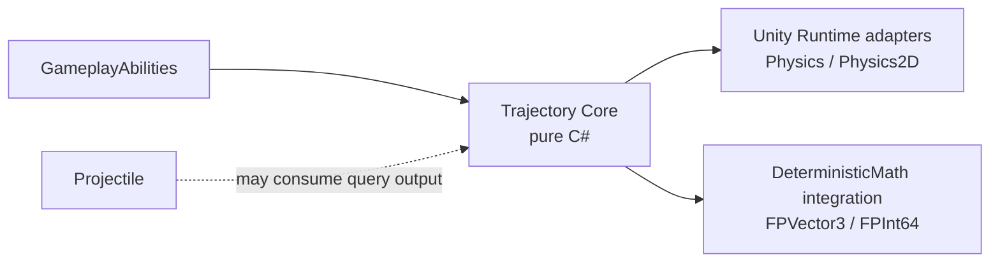

# CycloneGames RPGFoundation Trajectory

[English | 简体中文](README.SCH.md)

`Trajectory` solves immediate travel paths: rays, sphere/circle sweeps, pierce chains, and reflection segments. It is a stateless path solver, not a projectile lifecycle system. Use `Projectile` for spawned flying entities; use `Trajectory` for hitscan weapons, beam previews, ricochet lasers, targeting prediction, and server hit validation.

## Table of Contents

- [Overview](#overview)
- [Architecture](#architecture)
- [Quick Start](#quick-start)
- [Core Concepts](#core-concepts)
- [Usage Guide](#usage-guide)
- [Advanced Topics](#advanced-topics)
- [Common Scenarios](#common-scenarios)
- [Performance and Memory](#performance-and-memory)
- [Troubleshooting](#troubleshooting)

## Overview

`TrajectorySolver.Trace` takes a `TrajectoryQuery`, queries an `ITrajectoryCollisionWorld`, and writes segment and hit records into a caller-owned `TrajectoryTraceBuffer`. The solver always uses swept segment casts rather than endpoint-only checks. Core has no Unity dependency; Unity Physics adapters convert the sweep requests to `RaycastNonAlloc`, `SphereCastNonAlloc`, `CapsuleCastNonAlloc` and `BoxCastNonAlloc` in 3D, and to `Physics2D.Raycast`, `CircleCast`, `CapsuleCast` and `BoxCast` in 2D.

### Why this module exists

A physics engine answers "what did this ray hit". A weapon, a beam or an AI sight check usually needs more: the full path after a ricochet, every layer a piercing shot crossed, or the same answer recomputed on a server with no renderer.

Hand-rolling that loop means meeting the same three problems in every feature. A hit array gets allocated per query. Ignore state has to be threaded from one segment to the next. The 2D, 3D and server paths drift apart because each is written separately.

This module turns that loop into one call. `TrajectorySolver.Trace` writes the whole chain of segments and hits into a buffer the caller owns, applies the reflection and pierce limits, and carries ignore state between segments. Core has no Unity types, so the same code answers the same question on a client, on a headless server, and in a fixed-point replay.

### When to use it

- Hitscan weapons and laser sights, where the result is needed now rather than over several frames.
- Beams that bounce, pierce, or both, where the whole chain matters and the first contact does not.
- Aim indicators, ability ranges, turret coverage: anything authored in the editor and useful as a preview.
- Server-side hit validation, including replay from a recorded query.
- Batch sight checks, where a spread or a crowd is evaluated without allocating per query.

Cases that belong elsewhere:

- Projectiles that travel over time, track a target, or react to forces. That is `Projectile`. A trajectory has no velocity and no lifetime.
- Anything that needs the physics engine to resolve a collision response, not just report a contact.
- Continuous curves re-evaluated every frame. Sample once, hand the points to `TrajectoryPolylineSolver`, and simulate flight in `Projectile`.

### Key Features

- **Ray, sphere, capsule and box sweeps** — 2D and 3D, with swept from-to casts (no tunneling)
- **Batch tracing** — `TrajectoryBatchTracer` reuses pre-allocated per-query buffers for shotgun spreads and AI sight checks, allocation-free after construction
- **Reflection and pierce** — Configurable continuation with fixed iteration budget
- **Caller-owned buffers** — No per-trace managed allocation when buffers are reused
- **Unity-free Core** — `noEngineReferences: true`, usable in headless/server contexts
- **DeterministicMath integration** — Fixed-point solver for lockstep, rollback, replay
- **Polyline paths** — `TrajectoryPolylineSolver.Trace` solves collision along a caller-supplied point list, which is how curves, waypoints and portal paths enter the solver
- **Curve sampling** — Bezier, sine, damped sine and parabolic sampling in a separate Unity-free assembly
- **Editor presets** — `TrajectoryQueryPresetAsset` with Hitscan, Ricochet Beam, Piercing Beam, Capsule and Box presets
- **Debug probe and workbench** — Scene view preview with segments, hit points, normals and the swept volume wireframe; a scene-wide workbench lists every probe, shows segment and hit tables, times a full re-trace and applies presets

## Architecture



### Module Layout

| Area | Purpose |
| --- | --- |
| `Core/` | Unity-free data structures, `TrajectorySolver`, fixed-capacity buffers, collision-world contracts. |
| `Curves/` | Unity-free curve sampling (Bezier, sine, damped sine, parabolic). Produces point lists for `TrajectoryPolylineSolver`. |
| `Runtime/` | Unity Physics adapters for 3D and 2D collision queries. |
| `Runtime/Integrations/DeterministicMath/` | Fixed-point solver for lockstep, rollback, server replay, or deterministic validation. |
| `Tests/Editor/` | Nearest-hit selection, reflection continuation, pierce ignore state, capacity invariants, adapter conformance, polyline and curve sampling. |

## Quick Start

Build a query, call `Trace`, read results:

```csharp
var buffer = new TrajectoryTraceBuffer(segmentCapacity: 8, hitCapacity: 8, castHitCapacity: 16);
var query = TrajectoryQuery.CreateRay(
    traceId: abilityExecutionId,
    ownerEntityId: casterEntityId,
    collisionLayerMask: hitMask,
    origin: muzzlePosition,
    direction: aimDirection,
    maxDistance: 40f,
    maxReflectionCount: 2);

TrajectoryTraceResult result = TrajectorySolver.Trace(in query, collisionWorld, buffer);
for (int i = 0; i < buffer.HitCount; i++)
{
    TrajectoryHit hit = buffer.GetHit(i);
    // Convert hit.TargetEntityId or hit.TargetObjectId into ability target data.
}
```

## Core Concepts

### Data Model

| Type | Purpose |
| --- | --- |
| `TrajectoryQuery` | Immutable input: origin, direction, max distance, radius, collision mask, reflection count, pierce count, hit cap, iteration cap, initial ignored target. |
| `ITrajectoryCollisionWorld` | Narrow collision adapter boundary. Core never knows about Unity colliders, scenes, transforms, or physics scenes. |
| `TrajectoryTraceBuffer` | Caller-owned preallocated arrays for segments, hits, and cast scratch. Reuse avoids allocation. |
| `TrajectorySolver.Trace` | Writes `TrajectorySegment` and `TrajectoryHit` records into the buffer; returns `TrajectoryTraceResult`. |
| `TrajectoryQueryValidator` | Validates queries into caller-owned issue arrays — reusable from Inspectors, CI, server config. |

### Projectile vs Trajectory

`Projectile` represents an entity over time. It updates every tick, owns velocity, lifetime, guidance, bounce/pierce counters, hit events, visual views, and optional networking messages.

`Trajectory` represents a solved path now. It does not spawn objects, tick lifetime, or own visual state.

| Use case | Module |
| --- | --- |
| Fireball, arcane missile, homing missile | `Projectile` |
| Laser pointer, railgun, shotgun pellet trace, ricochet beam | `Trajectory` |
| Ability targeting preview | `Trajectory` |
| Server-authoritative hitscan validation | `Trajectory` |

### Collision Response Types

Collision worlds return `TrajectoryHitResponse`:

- `Stop` — Record the hit and end the trace.
- `Reflect` — Record the hit, reflect direction around the hit normal, offset from surface, continue with remaining distance.
- `Pierce` — Record the hit, move forward, ignore the just-hit target, continue with remaining distance.

The solver selects the nearest valid hit from each non-alloc cast result. Equal-distance ties resolve by stable target identity where available.

Pierce continuations never re-hit a target the same trace already pierced: the solver suppresses those repeats itself, scanning the eight most recent pierce hits. Reflection is deliberately exempt, because bouncing back onto the same surface is a legitimate pattern. An adapter that also honors `IgnoredTargetEntityId` / `IgnoredTargetObjectId` is redundant but harmless — correctness does not depend on adapter cooperation.

The adapter contract is executable: `TrajectoryCollisionWorldConformance.VerifySweep` sweeps a segment you know crosses your thinnest collider and checks the reported distance, payload and response values. Run it once per adapter; it mirrors the role `ProjectileCollisionWorldConformance` plays for the projectile module.

## Usage Guide

### Creating a Ray Trace

```csharp
var query = TrajectoryQuery.CreateRay(
    traceId: 1,
    ownerEntityId: 0,
    collisionLayerMask: ~0,
    origin: transform.position,
    direction: transform.forward,
    maxDistance: 100f,
    maxReflectionCount: 0);
```

### Choosing a shape

| Shape | Factory | Adapter call (3D / 2D) |
| --- | --- | --- |
| Ray | `CreateRay` | `RaycastNonAlloc` / `Physics2D.Raycast` |
| Sphere | `CreateSweep` | `SphereCastNonAlloc` / `CircleCast` |
| Capsule | `CreateCapsule` | `CapsuleCastNonAlloc` / `Physics2D.CapsuleCast` |
| Box | `CreateBox` | `BoxCastNonAlloc` / `Physics2D.BoxCast` |

Capsule is aligned to the world up axis with `Height` as the total height including both hemispherical caps (`Height >= 2 * Radius`). Box is axis-aligned. Both choices keep the result independent of travel direction so replays and server validation stay reproducible.

Core never computes geometry from the shape: it only forwards `Shape` / `Height` / `HalfExtents` to the adapter, which keeps the solver engine-free.

### Creating a Sweep Trace

```csharp
var query = TrajectoryQuery.CreateSweep(
    radius: 0.5f,
    traceId: 1,
    ownerEntityId: 0,
    collisionLayerMask: ~0,
    origin: transform.position,
    direction: transform.forward,
    maxDistance: 50f,
    maxReflectionCount: 2,
    maxPierceCount: 3);
```

### Reusing Buffers

```csharp
// Create once per owner (actor, ability, worker)
private TrajectoryTraceBuffer _buffer = new(segmentCapacity: 8, hitCapacity: 8, castHitCapacity: 16);

void Update()
{
    _buffer.Clear();
    var result = TrajectorySolver.Trace(in _query, collisionWorld, _buffer);
    // Process hits...
}
```

### Unity Physics Adapters

| Shape | 3D query | 2D query |
| --- | --- | --- |
| Ray | `Physics.RaycastNonAlloc` | `Physics2D.Raycast` |
| Sphere | `Physics.SphereCastNonAlloc` | `Physics2D.CircleCast` |
| Capsule | `Physics.CapsuleCastNonAlloc` | `Physics2D.CapsuleCast` |
| Box | `Physics.BoxCastNonAlloc` | `Physics2D.BoxCast` |

### Paths from curves or waypoints

`TrajectoryPolylineSolver.Trace` solves collision along a caller-supplied polyline. The path is fixed: hits are recorded but do not bend it, and the reflection and pierce budgets are ignored. To continue after a reflective surface, build the reflected path and trace it again.

```csharp
var path = new TrajectoryVector3[33];
TrajectoryCurveSampler.SampleBezier3(p0, p1, p2, p3, path);

var query = TrajectoryQuery.CreateSweep(
    traceId: 1, ownerEntityId: 0UL, collisionLayerMask: ~0,
    origin: path[0], direction: TrajectoryVector3.Forward, maxDistance: 200f, radius: 0.2f);

TrajectoryTraceResult result = TrajectoryPolylineSolver.Trace(path, in query, world, buffer);
```

`TrajectoryCurveSampler` lives in the `CycloneGames.RPGFoundation.Trajectory.Curves` assembly and produces point lists for quadratic and cubic Bezier, sine, damped sine and parabolic arcs. Sampling is uniform in the curve parameter, not in arc length.

`SampleParabolic(origin, initialVelocity, gravity, duration, ...)` covers ballistic prediction. The curve layer never simulates flight; use `Projectile` for that.

## Advanced Topics

### Multiplayer Consistency

Core uses `float` — suitable for server-authoritative or client-predicted gameplay where the server owns final hit validation.

For lockstep or rollback, use the `DeterministicMath` integration with `FPVector3` and `FPInt64`. Determinism still depends on the collision world; Unity Physics is not deterministic across all platforms.

**Recommended patterns:**

- **Server authoritative**: clients trace for responsiveness, server validates with authoritative state, sends confirmed hit data.
- **Rollback**: deterministic simulation owns both movement and trajectory collision data.
- **Lockstep**: use fixed-point query data, stable target IDs, stable hit ordering, and deterministic spatial queries.

### DeterministicMath Integration

Enabled only when UPM resolves `com.cyclone-games.deterministic-math` `1.x`. The integration asmdef generates and consumes `CYCLONE_RPGFOUNDATION_HAS_DETERMINISTIC_MATH`, uses `autoReferenced: false`, and must be referenced explicitly by the consumer. Do not add the capability symbol to PlayerSettings. Without a supported package, only this integration and its test assembly are excluded. It mirrors the query, buffer, hit, segment, and solver model with `FPVector3` and `FPInt64`.

The fixed-point solver matches the float Core's solver semantics: nearest-hit tie-break, pierce repeat suppression, cast-scratch clearing, atomic hit/segment commit, untrusted-position fallback and `NearestHitIndex`. All four sweep volumes are available through `DeterministicTrajectoryQuery.CreateRay`, `DeterministicTrajectoryQuery.CreateSweep`, `DeterministicTrajectoryQuery.CreateCapsule` and `DeterministicTrajectoryQuery.CreateBox`; `DeterministicTrajectoryCastQuery` forwards `Shape` / `Height` / `HalfExtents` to the fixed-point collision world.

### Editor Tooling

`TrajectoryQueryPresetAsset` stores reusable authoring data with presets (Hitscan, Ricochet Beam, Piercing Beam, Capsule, Box). `TrajectoryDebugProbe` previews segments, hit points, and normals in the Scene View, with draggable origin / aim / radius handles and Undo support. Both are inheritable; custom inspectors draw known fields first, then unhandled derived fields.

`Tools/CycloneGames/Trajectory/Workbench` opens a scene-wide window: it lists every probe, shows the recorded segments and hits as tables, explains trace flags, times a full re-trace across all probes, and applies preset shapes. The scan is manual, so nothing runs per editor frame.

Scene display toggles (segments / hits / normals / labels / handles / idle indicator) live in `TrajectoryGizmoSettings`. They are view preferences, not module configuration. The source of truth is the explicit, reviewable file `ProjectSettings/CycloneGames.TrajectoryGizmoSettings.json` (see `TrajectoryGizmoSettings.SettingsFileRelativePath`); the Workbench shows the path, surfaces file errors, and offers Reload / Reset / Reveal. Nothing is written to EditorPrefs, PlayerPrefs or SessionState. Unselected probes draw a cheap indicator line only; the full path is traced while the probe is selected.

## Common Scenarios

### Hitscan weapon

Create a `TrajectoryQuery.CreateRay` from muzzle position in aim direction with `maxReflectionCount = 0`. Process first hit as the target.

### Ricochet beam

Set `maxReflectionCount = 2` or higher. Each reflection records a hit, reflects direction, and continues — visualized as a bouncing laser.

### Piercing shot

Set `maxPierceCount = 3`. The trace records each hit, ignores the hit target for subsequent casts, and continues through the remaining distance.

### Server hit validation

Server builds an identical `TrajectoryQuery` from the client's reported aim data and validates that the authoritative trace matches the client-reported hit within tolerance.

## Performance and Memory

- No per-trace managed allocation when the caller reuses `TrajectoryTraceBuffer`.
- Core is stateless; `TrajectorySolver` holds no shared mutable state and is safe to call concurrently as long as each thread owns its buffer. `TrajectoryTraceBuffer` itself is mutable and not thread-safe.
- Buffers are mutable and caller-owned — use one buffer per worker, actor, or ability execution.
- Buffer invariants: `HitCount <= SegmentCount`, every recorded hit's `SegmentIndex` resolves to an existing segment, and every segment's `HitIndex` is `-1` or a valid hit index. The solver checks both capacities before committing a hit and its segment together.
- `ITrajectoryCollisionWorld.Cast` takes a `Span<TrajectoryHit>` loan whose length is the hard write limit. A `ref struct` cannot be stored or captured, so an adapter cannot retain it past the call.
- Hits are stored in path order, not distance order. `TrajectoryTraceResult.NearestHitIndex` gives the closest hit along the travelled path (-1 when nothing was hit), so callers do not need to scan.
- `TrajectoryBatchTracer` owns one buffer per slot. Construction allocates; `TraceAll` does not. A tracer is not thread-safe — give each worker its own.
- Unity adapters wrap Unity Physics and must be called on Unity's supported thread/context.
- DeterministicMath integration is Unity-free and can run in headless/server code. The assembly is compiled only when `com.cyclone-games.deterministic-math` 1.x is resolved through UPM — that is the intended shipping shape for consumers that reference this package from another project.

### Persistence

This module writes no files, assets, preferences, save data, or caches at runtime. Buffers and adapters are explicit runtime objects owned by the caller.

## Troubleshooting

| Symptom | Cause | Resolution |
| --- | --- | --- |
| No hits detected | Wrong collision mask or layer setup | Verify `collisionLayerMask` and ensure colliders exist on the configured layer |
| Missed hits (tunneling) | Teleport-style endpoint check instead of sweep | Use sweep-based adapters (`SphereCastNonAlloc` / `Physics2D.CircleCast`) |
| Reflection not working | Missing `maxReflectionCount` or reflection collision mask | Set `maxReflectionCount > 0` and configure reflection layer mask |
| Deterministic mismatch | Unity Physics non-determinism | Switch to `DeterministicMath` integration with a deterministic collision world |
| GC allocations | Buffer recreated per trace | Preallocate and reuse `TrajectoryTraceBuffer` across calls |

## Validation

Run EditMode tests: `CycloneGames.RPGFoundation.Trajectory.Tests.Editor`. When `CYCLONE_RPGFOUNDATION_HAS_DETERMINISTIC_MATH` is enabled, also run `CycloneGames.RPGFoundation.Trajectory.DeterministicMath.Tests.Editor`. For multiplayer, test both client prediction and authoritative server/replay paths with identical query inputs.
