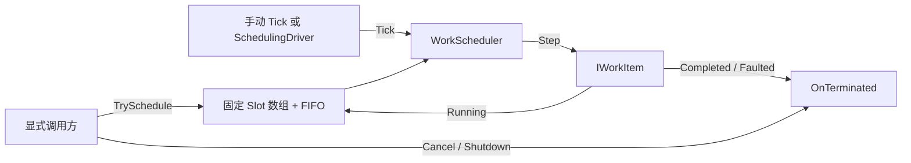

# CycloneGames.Scheduling

[English | 简体中文](README.md)

CycloneGames.Scheduling 是一个面向有限协作任务的有界、单属主线程调度器。它通过 FIFO 公平轮转、Step 数量上限和软时间预算，把工作分散到多个 Tick。模块适用于允许延迟的维护和批处理，不适用于确定性模拟或对帧内顺序有关键要求的玩法逻辑。

## 目录

- [适用场景](#适用场景)
- [架构](#架构)
- [核心概念](#核心概念)
- [快速开始](#快速开始)
- [Unity Host](#unity-host)
- [Factory 集成](#factory-集成)
- [生命周期与失败语义](#生命周期与失败语义)
- [预算、容量与背压](#预算容量与背压)
- [性能与平台说明](#性能与平台说明)
- [验证](#验证)

## 适用场景

适合接入的工作项应满足以下条件：

- 能通过短小、有界的 `Step` 调用持续推进；
- 允许在后续帧完成，不会因延迟完成而改变正确性；
- 自己持有进度与部分结果，并定义取消行为；
- 队列和资源驻留可以设置上限；
- 不要求所有工作项在同一帧内原子提交。

调度器不会减少总工作量。它以完成延迟换取帧时间分布和明确的过载行为。已经开始运行的 `Step` 不可抢占。

不要用本模块替代输入采样、物理、确定性模拟、网络 lockstep、音频 DSP 或领域专用 Job 依赖图。

## 架构

| 程序集 | 路径 | 职责 |
| --- | --- | --- |
| `CycloneGames.Scheduling.Core` | `Core/` | 固定容量 FIFO、句柄、取消、关闭、预算和诊断，不引用 `UnityEngine`。 |
| `CycloneGames.Scheduling.Runtime` | `Runtime/` | 显式挂载的 `MonoBehaviour` Update Host。 |
| `CycloneGames.Scheduling.Integrations.Factory` | `Integrations/Factory/` | 对接 Factory 现有 pool 维护 Step API 的可选适配器。 |
| `CycloneGames.Scheduling.Tests.Editor` | `Tests/Editor/` | Core 契约、失败路径、Factory 适配器和 Unity Host 生命周期测试。 |



`Scheduling.Core` 只依赖 BCL。`Factory.Runtime` 与 `Scheduling.Core` 不互相引用；可选 integration 同时引用双方。

## 核心概念

### 工作项

```csharp
public interface IWorkItem
{
    WorkStepResult Step();
    void OnTerminated(WorkTerminationReason reason);
}
```

- `Running` 表示允许在后续 Tick 再次调用。
- `Completed` 表示正常完成。
- 工作项自己拥有游标、部分结果和领域清理逻辑。
- 工作项实现使用 class，避免进度和身份被复制或装箱。
- 同一个工作项实例不得在一个 scheduler 中同时持有多个未结束注册。

### 句柄

`WorkItemHandle` 包含 32 位槽位索引和 32 位 generation，只能用于创建它的 scheduler。取消会拒绝 default、失效和已释放句柄。generation 0 保留给 default handle；完整回绕后，极早期句柄可能重新匹配，因此不得无限期保存句柄。

### 存储

所有队列槽位和空闲索引都在构造时分配。入队、取消和重新排队均为 O(1) 数组索引操作。scheduler 不保存已终止工作项、异常历史或无界诊断记录。

## 快速开始

在同一个 owner 线程中直接构造并驱动 Core：

```csharp
using CycloneGames.Scheduling.Core;

var scheduler = new WorkScheduler(capacity: 128);
if (scheduler.TrySchedule(workItem, out WorkItemHandle handle))
{
    // scheduler 已接受该注册，并保证恰好一次终止回调。
}

// 通常在每帧由同一 owner 线程调用一次。
scheduler.Tick(maxSteps: 8, softBudgetMs: 2.0);

// 可选：在完成前取消。
scheduler.Cancel(handle);

// 停止接收并取消所有剩余注册。
scheduler.Shutdown();
```

被拒绝的注册返回 `false` 和 default handle，不调用 `OnTerminated`；工作项仍由调用方拥有。

## Unity Host

由用户把 `SchedulingDriver` 显式添加到 GameObject。包不会自动创建运行时对象。

| 设置 | 含义 |
| --- | --- |
| `Capacity` | 未结束注册的固定容量，修改后需要重建 Host。 |
| `Max Steps Per Frame` | 每次 Update 的最大 `Step` 调用数，0 表示暂停。 |
| `Soft Budget Milliseconds` | 决定是否允许启动后续 Step 的软时间预算，0 表示暂停。 |

在 `Awake` 后通过 `driver.Scheduler` 注册工作。禁用组件会停止 Update 并保留队列。`OnApplicationQuit` 和 `OnDestroy` 会调用 `Shutdown` 并取消所有剩余注册。也可以直接调用 `driver.Shutdown()` 显式关闭；该操作幂等。fake-null、已关闭或已销毁的 driver 会被 `driver.Scheduler` 拒绝，不会静默重建 scheduler。

Host 只拥有自己的 scheduler，不拥有工作项引用的 pool 或其他资源。组合销毁顺序时，必须保证这些 owner 在 scheduler Shutdown 期间仍然有效。

## Factory 集成

可选 Factory integration 提供：

- `PoolWarmupWorkItem`：按有界批次创建请求的额外项数量。
- `PoolTrimInactiveWorkItem`：把 inactive 数量修剪到绝对目标值。
- `PoolDespawnWorkItem`：按有界批次把 active 项归还 pool。

```csharp
using CycloneGames.Scheduling.Integrations.Factory;

var warmup = new PoolWarmupWorkItem(pool, count: 100, batchSize: 4);
scheduler.TrySchedule(warmup, out _);
```

Scheduler 的 Step 预算限制的是适配器调用次数，不是创建或归还的 pool 项数量。`TargetReached` 用于区分“目标达成”和“底层无进展而结束”。取消会停止后续 pool 操作，不回滚已发生的操作，也不会 Dispose pool。

## 生命周期与失败语义

| 路径 | 行为 |
| --- | --- |
| 已接受 | 每个注册保证恰好一次 `OnTerminated`。 |
| 已拒绝 | 不调用回调，所有权仍属于调用方。 |
| 完成 | 先释放句柄与内部引用，再调用 `OnTerminated(Completed)`。 |
| 取消 | 不再执行 `Step`，调用 `OnTerminated(Cancelled)`。 |
| Step 异常 | 调用 `OnTerminated(Faulted)` 并传播异常，其他项保留排队。 |
| 关闭 | 不再执行 `Step`，所有剩余项收到 `OnTerminated(Shutdown)`。 |
| 终止回调异常 | 内部状态保持已释放，传播异常但不重复回调。 |

`Shutdown` 会尝试所有剩余回调后再抛出聚合异常，并且幂等。不得在 `Step` 或 `OnTerminated` 内重入 scheduler 公共操作。

已接受工作项满足：

```text
AcceptedCount == CompletedCount + FaultedCount + CancelledCount + OutstandingCount
```

`RejectedCount` 单独统计，因为被拒绝的工作从未被接受。

## 预算、容量与背压

每次 Tick 开始都会固定本轮 eligible 数量。每个 eligible 项最多执行一次，返回 `Running` 的项重新进入队尾。回调内不能重入提交新工作。

时间预算是软预算：

- 每次启动后续 Step 前检查单调时钟；
- 已运行的 Step 可以超过预算；
- `OverBudgetTickCount`、`LastTickMilliseconds` 和 `MaxTickMilliseconds` 暴露观测到的超支；
- `double.PositiveInfinity` 可关闭时间准入，同时保留 Step 数量限制。

容量固定。队列满时拒绝新注册，不丢弃已接受工作，也不扩容内存。生产者必须处理 `false`：稍后重试、降低生产速度，或执行自己的领域策略。

## 性能与平台说明

- 正常入队、取消和重新排队在构造后没有显式托管分配；异常路径允许分配聚合诊断。
- 热路径不使用 LINQ、捕获 Lambda、动态扩容、临时集合或逐项字符串。
- Slot 使用连续数组；没有实测前，不默认采用 cache-line padding、SoA、unsafe 或 lock-free。
- Core 仅支持 owner-thread confinement，不是通用跨线程调度器，也不会让 Unity API 获得工作线程调用能力。
- 磁盘 IO、异步加载和大文件处理需要有界领域 adapter；Step 不得隐藏无界同步 IO。
- Unity 对象可能在适配器 Step 请求销毁后才完成实际清理。`Object.Destroy` 的时序、fake-null 检查、场景退出和主线程所有权必须在 Unity integration 中保持显式。
- 绝对吞吐和耗时取决于目标设备、backend、构建类型、workload 和 stripping 配置。

| 能力 | 状态 |
| --- | --- |
| 纯 C# owner-thread Core | 在目标宿主验证矩阵完成前为 Experimental |
| Unity Update Host | 已覆盖 EditMode/PlayMode 生命周期测试；目标 Player 仍未验证 |
| Factory 维护适配器 | 已覆盖 EditMode/PlayMode 契约与 fake-null 清理；目标 Player 仍未验证 |
| MPSC、PlayerLoop 注入、Jobs、UniTask adapter | 当前版本不提供 |
| WebGL 等受限线程平台 | Core 不依赖线程，平台行为仍需验证 |

## 验证

使用当前 Unity 可执行文件运行聚焦 EditMode 套件：

```bash
<unity-exe> -batchmode -nographics -projectPath <repo-root>/UnityStarter -runTests -testPlatform EditMode -testFilter CycloneGames.Scheduling -testResults <output.xml> -logFile <output.log>
```

单独运行 PlayMode 生命周期套件：

```bash
<unity-exe> -batchmode -nographics -projectPath <repo-root>/UnityStarter -runTests -testPlatform PlayMode -testFilter CycloneGames.Scheduling.Tests.PlayMode -testResults <output.xml> -logFile <output.log>
```

套件覆盖 FIFO 公平性、数量与时间预算、容量拒绝、取消、终止回调、异常、重入、Shutdown、句柄复用、Factory 维护、真实 Update 驱动、disable/enable、Host 销毁、fake-null 拒绝和外部销毁的 Unity pool 项。

性能与分配结论需要单独的 Editor 外或目标 Player 证据。Editor 编译和测试不能证明 IL2CPP、AOT、stripping、目标设备性能或 Unity 对象销毁行为。
