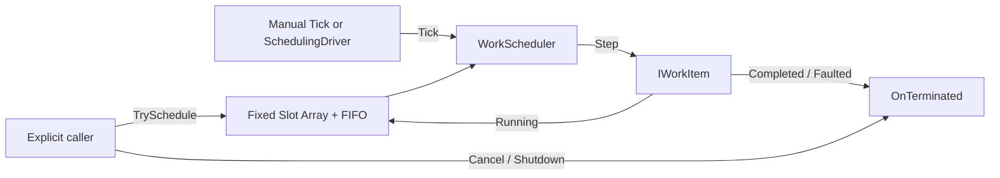

# CycloneGames.Scheduling

[English | 简体中文](README.SCH.md)

CycloneGames.Scheduling is a bounded, owner-thread scheduler for finite cooperative work. It spreads work across multiple ticks with FIFO fairness, a Step-count limit, and a soft time budget. It is intended for deferrable maintenance and batch processing, not for deterministic simulation or frame-critical gameplay ordering.

## Table of Contents

- [When to Use It](#when-to-use-it)
- [Architecture](#architecture)
- [Core Concepts](#core-concepts)
- [Quick Start](#quick-start)
- [Unity Host](#unity-host)
- [Factory Integration](#factory-integration)
- [Lifecycle and Failure Semantics](#lifecycle-and-failure-semantics)
- [Budgets, Capacity, and Backpressure](#budgets-capacity-and-backpressure)
- [Performance and Platform Notes](#performance-and-platform-notes)
- [Validation](#validation)

## When to Use It

A work item is suitable when it:

- can make progress through short, bounded `Step` calls;
- may finish in a later frame without changing correctness;
- owns its partial progress and defines cancellation behavior;
- has bounded queueing and resource-retention requirements;
- does not require every item to commit in the same frame.

The scheduler does not reduce the total cost of work. It trades completion latency for frame-time distribution and explicit overload behavior. A running `Step` cannot be preempted.

Do not use this module as a replacement for input sampling, physics, deterministic simulation, network lockstep, audio DSP, or a domain-specific Job dependency graph.

## Architecture

| Assembly | Path | Responsibility |
| --- | --- | --- |
| `CycloneGames.Scheduling.Core` | `Core/` | Fixed-capacity FIFO scheduler, handles, cancellation, shutdown, budgets, and diagnostics. No `UnityEngine` reference. |
| `CycloneGames.Scheduling.Runtime` | `Runtime/` | Explicit `MonoBehaviour` Update host. |
| `CycloneGames.Scheduling.Integrations.Factory` | `Integrations/Factory/` | Optional adapters for existing Factory pool-maintenance Step APIs. |
| `CycloneGames.Scheduling.Tests.Editor` | `Tests/Editor/` | Core contracts, failure paths, Factory adapters, and Unity host lifecycle tests. |



`Scheduling.Core` depends only on the BCL. `Factory.Runtime` and `Scheduling.Core` do not reference each other; the optional integration references both.

## Core Concepts

### Work items

```csharp
public interface IWorkItem
{
    WorkStepResult Step();
    void OnTerminated(WorkTerminationReason reason);
}
```

- `Running` means the item may be called again in a later Tick.
- `Completed` means normal completion.
- The work item owns its cursor, partial results, and domain-specific cleanup.
- Work item implementations are classes so progress and identity are not copied or boxed.
- A work item instance must not have more than one outstanding registration in a scheduler.

### Handles

`WorkItemHandle` contains a 32-bit slot index and a 32-bit generation. It identifies one registration only in the scheduler that created it. Cancellation rejects default, stale, and already released handles. Generation zero is reserved for the default handle; after a full generation wrap, ancient handles can alias and must not be retained indefinitely.

### Storage

All queue slots and free-slot indices are allocated when the scheduler is constructed. Scheduling, cancellation, and requeueing use O(1) array/index operations. The scheduler does not store terminal work items, exception history, or unbounded diagnostic records.

## Quick Start

Construct and drive the Core directly from one owner thread:

```csharp
using CycloneGames.Scheduling.Core;

var scheduler = new WorkScheduler(capacity: 128);
if (scheduler.TrySchedule(workItem, out WorkItemHandle handle))
{
    // The scheduler accepted responsibility for exactly one terminal callback.
}

// Call from the same owner thread, normally once per frame.
scheduler.Tick(maxSteps: 8, softBudgetMs: 2.0);

// Optional: cancel before completion.
scheduler.Cancel(handle);

// Stop admission and cancel every remaining registration.
scheduler.Shutdown();
```

A rejected registration returns `false`, produces a default handle, and does not call `OnTerminated`; the caller still owns the work item.

## Unity Host

Add `SchedulingDriver` to a GameObject explicitly. The package does not create runtime objects automatically.

| Setting | Meaning |
| --- | --- |
| `Capacity` | Fixed number of outstanding registrations. Changes require recreating the host. |
| `Max Steps Per Frame` | Maximum `Step` calls per Update. Zero pauses execution. |
| `Soft Budget Milliseconds` | Time used to decide whether another Step may start. Zero pauses execution. |

Access `driver.Scheduler` after `Awake` to register work. Disabling the component stops Update and preserves queued work. `OnApplicationQuit` and `OnDestroy` call `Shutdown` and cancel all remaining registrations. Call `driver.Shutdown()` directly for explicit teardown; it is idempotent. A fake-null, shut down, or destroyed driver is rejected by `driver.Scheduler` and cannot silently recreate a scheduler.

The host owns only its scheduler. It does not own pools or other resources referenced by work items. Compose destruction so those owners remain valid throughout scheduler Shutdown.

## Factory Integration

The optional Factory integration provides:

- `PoolWarmupWorkItem`: creates a requested number of additional entries in bounded batches.
- `PoolTrimInactiveWorkItem`: trims inactive entries to an absolute target.
- `PoolDespawnWorkItem`: returns active entries to the pool in bounded batches.

```csharp
using CycloneGames.Scheduling.Integrations.Factory;

var warmup = new PoolWarmupWorkItem(pool, count: 100, batchSize: 4);
scheduler.TrySchedule(warmup, out _);
```

A scheduler Step budget limits adapter calls, not the number of pool entries created or returned. `TargetReached` distinguishes completion of the requested target from completion caused by zero underlying progress. Cancellation stops future pool operations without rolling back earlier operations and without disposing the pool.

## Lifecycle and Failure Semantics

| Path | Behavior |
| --- | --- |
| Accepted | Exactly one `OnTerminated` callback is guaranteed for the registration. |
| Rejected | No callback; ownership remains with the caller. |
| Completed | The handle and internal reference are released before `OnTerminated(Completed)`. |
| Cancel | No further `Step` occurs; the item receives `OnTerminated(Cancelled)`. |
| Step exception | The item receives `OnTerminated(Faulted)` and the exception is propagated. Other items remain queued. |
| Shutdown | No further `Step` occurs; all remaining items receive `OnTerminated(Shutdown)`. |
| Termination callback exception | Internal state remains released; the exception is propagated without a duplicate callback. |

`Shutdown` attempts every remaining callback before throwing an aggregate failure and is idempotent. Public scheduler operations are not reentrant from `Step` or `OnTerminated`.

The accepted-work invariant is:

```text
AcceptedCount == CompletedCount + FaultedCount + CancelledCount + OutstandingCount
```

`RejectedCount` is tracked separately because rejected work was never accepted.

## Budgets, Capacity, and Backpressure

Each Tick begins with a fixed eligible count. Every eligible item runs at most once, and `Running` items return to the tail. New work cannot be submitted reentrantly from a callback.

The time budget is soft:

- the clock is checked before starting each subsequent Step;
- an already running Step may exceed the budget;
- `OverBudgetTickCount`, `LastTickMilliseconds`, and `MaxTickMilliseconds` expose observed overruns;
- `double.PositiveInfinity` disables time-based admission while retaining the Step limit.

Capacity is fixed. A full scheduler rejects new registrations instead of dropping accepted work or growing memory. Producers must handle `false` by retrying later, reducing production, or applying their own domain policy.

## Performance and Platform Notes

- Normal scheduling, cancellation, and requeueing contain no explicit managed allocations after construction. Exception paths may allocate aggregate diagnostics.
- The hot path uses no LINQ, capturing lambdas, dynamic queue resizing, temporary collections, or per-item strings.
- Slots use continuous arrays. No cache-line padding, SoA split, unsafe code, or lock-free algorithm is assumed to be beneficial without measurement.
- Core is owner-thread confined. It is not a general cross-thread scheduler and does not make Unity APIs callable from worker threads.
- Disk I/O, asynchronous loading, and large-file processing require bounded domain adapters; a Step must not hide unbounded synchronous I/O.
- Unity object destruction can complete after the adapter Step that requested it. `Object.Destroy` timing, fake-null checks, scene teardown, and main-thread ownership must remain explicit in Unity integrations.
- Absolute throughput and timing results depend on the target device, backend, build type, workload, and stripping configuration.

| Capability | Status |
| --- | --- |
| Pure C# owner-thread Core | Experimental until the target-host validation matrix is complete |
| Unity Update host | Covered by EditMode/PlayMode lifecycle tests; target Player remains unverified |
| Factory maintenance adapters | Covered by EditMode/PlayMode contracts, including fake-null cleanup; target Player remains unverified |
| MPSC, PlayerLoop injection, Jobs, UniTask adapters | Not provided by this version |
| WebGL and other restricted-thread platforms | Core requires no threads; platform behavior remains subject to validation |

## Validation

Run the focused EditMode suite with your Unity executable:

```bash
<unity-exe> -batchmode -nographics -projectPath <repo-root>/UnityStarter -runTests -testPlatform EditMode -testFilter CycloneGames.Scheduling -testResults <output.xml> -logFile <output.log>
```

Run the PlayMode lifecycle suite separately:

```bash
<unity-exe> -batchmode -nographics -projectPath <repo-root>/UnityStarter -runTests -testPlatform PlayMode -testFilter CycloneGames.Scheduling.Tests.PlayMode -testResults <output.xml> -logFile <output.log>
```

The suites cover FIFO fairness, Step and time budgets, capacity rejection, cancellation, terminal callbacks, exceptions, reentrancy, Shutdown, handle reuse, Factory maintenance, real Update driving, disable/enable, host destruction, fake-null rejection, and externally destroyed Unity pool entries.

Performance and allocation claims require separate non-Editor or target Player evidence. Editor compilation and tests do not prove IL2CPP, AOT, stripping, target-device performance, or Unity-object destruction behavior.
