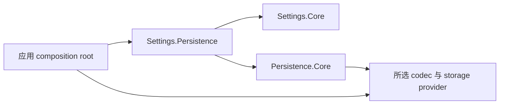
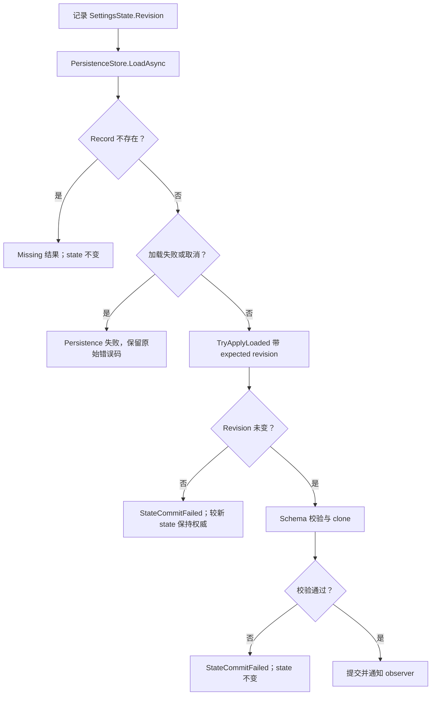

# CycloneGames.Settings.Persistence

[English](README.md) | 简体中文

`CycloneGames.Settings.Persistence` 把经过校验的 settings state 与一个持久化 store 连接起来。`PersistentSettings<T>` 加载 record、校验解码后的值，并通过 revision 检查提交；保存时写入隔离的 state 快照。Integration 不持有任何一个依赖的所有权。

## 目录

- [概述](#概述)
- [Assembly](#assembly)
- [快速上手](#快速上手)
- [Load 流程](#load-流程)
- [公共 API](#公共-api)
- [并发与取消](#并发与取消)
- [诊断](#诊断)
- [测试](#测试)
- [问题排查](#问题排查)

## 概述

`PersistentSettings<T>` 接收两个依赖：

- `SettingsState<T>` 持有内存中的权威值。
- `PersistenceStore<T>` 读写一条有上界的 record。

调用方构造并持有全部三个对象。由其他格式 token 写出的 record 会被 store 以 `RecordFormatMismatch` 拒绝。

## Assembly

| Assembly | 引用 | `autoReferenced` | `noEngineReferences` |
| --- | --- | --- | --- |
| `CycloneGames.Settings.Persistence` | `CycloneGames.Settings.Core`、`CycloneGames.Persistence.Core` | `false` | `true` |
| `CycloneGames.Settings.Persistence.Tests.Core` | integration、Settings.Core、Persistence.Core | `false` | `true` |

Settings Core 不引用 Persistence，Persistence Core 也不引用 Settings。Codec 与 storage provider 类型不出现在这个 integration 的 public API 中。



## 快速上手

### 第 1 步：组装依赖

```csharp
var schema = new GameSettingsSchema();
var state = new SettingsState<GameSettings>(schema);

IPersistenceCodec<GameSettings> codec =
    new VYamlPersistenceCodec<GameSettings>(GeneratedResolver.Instance);

IPersistenceStorage storage =
    UnityPersistentStorage.Create("Settings/game-settings.cgp");

var store = new PersistenceStore<GameSettings>(
    storage,
    new PersistenceProfile<GameSettings>(codec));

var settings = new PersistentSettings<GameSettings>(state, store);
```

保留 `state` 用于更新与快照，保留 `settings` 用于存储操作。VYaml resolver 必须显式支持该设置模型以用于 IL2CPP；本 integration 不做 resolver 发现。

### 第 2 步：启动时加载

```csharp
PersistentSettingsLoadResult load = await settings.LoadAsync(ct);

if (load.IsMissing)
{
    // State already holds validated defaults. Write them explicitly.
    await settings.SaveAsync(ct);
}
else if (!load.Completed)
{
    ReportLoadFailure(
        load.Error,
        load.PersistenceError,
        load.StateError,
        load.Message,
        load.Exception);
}
```

### 第 3 步：用户触发变更后保存

```csharp
SettingsUpdateResult update = state.Update(
    (ref GameSettings candidate) => candidate.Language = selectedLanguage);

if (update.Succeeded)
{
    PersistenceOperationResult saved = await settings.SaveAsync(ct);
}
```

## Load 流程



| 状态 | 对 state 的影响 | 说明 |
| --- | --- | --- |
| `Missing` | 不修改 | State 保留经过校验的默认值 |
| `Loaded` | 提交经过校验的 clone | Observer 在提交后执行 |
| Persistence 失败或取消 | 不修改 | 保留原始 `PersistenceErrorCode` |
| 校验失败 | 不修改 | `StateError` 报告 `ValidationFailed` |
| 加载期间 state 已变更 | 不修改 | `StateCommitFailed` 且为 `RevisionConflict` |

Observer 失败会作为成功加载结果上的 `ObserverFailureCount` 与 `FirstObserverException` 返回，不会变成 persistence 失败，也不回滚提交。

## 公共 API

| 成员 | 说明 |
| --- | --- |
| `PersistentSettings(SettingsState<T>, PersistenceStore<T>)` | null 参数抛 `ArgumentNullException`。 |
| `LoadAsync(CancellationToken = default)` | 读取、校验，并通过 revision 检查提交。 |
| `SaveAsync(CancellationToken = default)` | 捕获隔离快照并写入一条 record。 |
| `DeleteStoredValueAsync(CancellationToken = default)` | 只删除存储 record；内存 state 不变。 |
| `GetMemorySnapshot()` | owner-local operation 计数与底层 store 的 limits。 |

| 结果成员 | 含义 |
| --- | --- |
| `Status` | `Uninitialized`、`Failed`、`Missing`、`Loaded` |
| `Completed` | `Missing` 与 `Loaded` 时为 true |
| `IsLoaded`、`IsMissing` | 状态快捷判断 |
| `Error` | `None`、`PersistenceFailed`、`StateCommitFailed` |
| `PersistenceError` | Store 返回的原始 `PersistenceErrorCode` |
| `StateError` | State commit 返回的原始 `SettingsUpdateError` |
| `Message`、`Exception` | 失败阶段的诊断信息 |
| `ObserverFailureCount`、`FirstObserverException`、`HasObserverWarnings` | 提交后的 observer 诊断 |

默认构造的结果 struct 是 `Uninitialized`，`Message` 为空字符串。

## 并发与取消

一个 `PersistentSettings<T>` 实例同时只允许一个 load、save 或 delete。Overlap 会同步抛 `InvalidOperationException`，操作不会排队。`SettingsState<T>` 与 `PersistenceStore<T>` 各自保留 guard，因此共享实例仍受自身的重叠策略保护。

取消在加载前、state compare-and-commit 前，以及 save 快照 state 前检查。Commit 前取消不修改 state；已经完成的 state commit 不会重新归类为取消。

Integration 使用 `Task` 与 `CancellationToken`，内部 await 使用 `ConfigureAwait(false)`。State commit 与加载后的通知可能运行在 worker continuation 上。需要访问 Unity API 的 observer 必须把快照送入主线程 dispatcher。

## 诊断

`GetMemorySnapshot()` 返回 `PersistentSettingsMemorySnapshot`，包含 `IsOperationActive`、`StateRevision`、`PersistenceOperationActive`、配置的 payload 与 record 上限、单调递增的 load/save/delete 计数、overlap 拒绝次数，以及最近与峰值 record bytes。快照只读取计数器，不 clone 也不检查设置值，不暴露存储内容。

## 测试

`CycloneGames.Settings.Persistence.Tests.Core` 是由 `UNITY_INCLUDE_TESTS` 门控的 EditMode assembly。`PersistentSettingsTests.cs` 使用内存 storage 与测试 codec，覆盖 missing 与 loaded 结果、损坏与未知格式的 record、校验失败、revision 冲突、observer warning、显式 save 与 delete、预取消操作、overlap 拒绝以及内存快照。

## 问题排查

| 现象 | 原因 | 处理 |
| --- | --- | --- |
| Load 返回 `Missing` | 该 location 下没有 record | State 已持有经过校验的默认值；需要时显式保存。 |
| Load 返回 `RecordFormatMismatch` | Record 由其他格式 token 写入 | 绑定写入它的 codec，或用当前 profile 重新写入。 |
| Load 返回 `IntegrityCheckFailed` | Record 被修改或损坏 | 从已知良好的副本恢复；不要绕过 checksum。 |
| Load 返回 `StateCommitFailed` 且为 `ValidationFailed` | 解码值违反 schema | 检查 record 与 schema；state 保持不变。 |
| Load 返回 `RevisionConflict` | 异步读取期间另一次提交胜出 | 保留较新的 state。 |
| Overlap 抛异常 | 同一 integration 实例上两个生命周期操作 | 在 composition owner 中串行化调用。 |
| Observer warning | 已注册的 observer 抛了可恢复异常 | 单独修正 observer；提交已经是权威结果。 |
