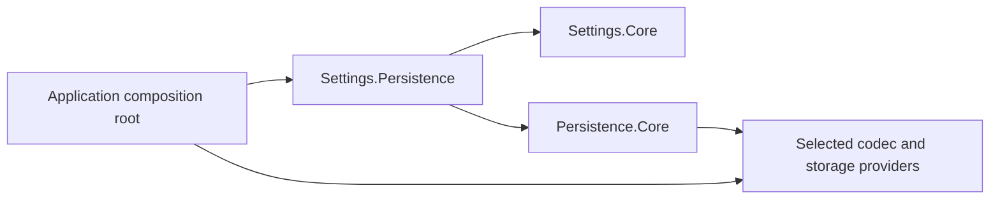
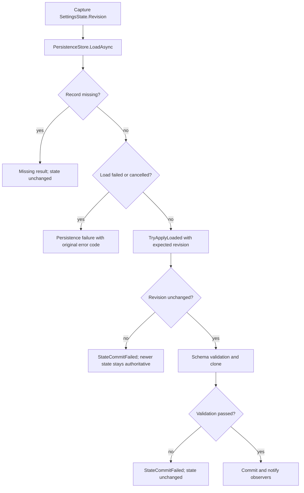

# CycloneGames.Settings.Persistence

[English | 简体中文](README.SCH.md)

`CycloneGames.Settings.Persistence` connects validated settings state to one persistence store. `PersistentSettings<T>` loads a record, validates the decoded value, and commits it through a revision check. Saving writes an isolated state snapshot. The integration owns neither dependency.

## Contents

- [Overview](#overview)
- [Assembly](#assembly)
- [Getting started](#getting-started)
- [Load workflow](#load-workflow)
- [Public API](#public-api)
- [Concurrency and cancellation](#concurrency-and-cancellation)
- [Diagnostics](#diagnostics)
- [Tests](#tests)
- [Troubleshooting](#troubleshooting)

## Overview

`PersistentSettings<T>` takes two dependencies:

- `SettingsState<T>` holds the authoritative in-memory value.
- `PersistenceStore<T>` reads and writes one bounded record.

The caller constructs and retains all three objects. A record written by another format token is rejected by the store with `RecordFormatMismatch`.

## Assembly

| Assembly | References | `autoReferenced` | `noEngineReferences` |
| --- | --- | --- | --- |
| `CycloneGames.Settings.Persistence` | `CycloneGames.Settings.Core`, `CycloneGames.Persistence.Core` | `false` | `true` |
| `CycloneGames.Settings.Persistence.Tests.Core` | integration, Settings.Core, Persistence.Core | `false` | `true` |

Settings Core never references Persistence, and Persistence Core never references Settings. Codec and storage provider types do not appear in this integration's public API.



## Getting started

### Step 1: compose the dependencies

```csharp
var schema = new GameSettingsSchema();
var state = new SettingsState<GameSettings>(schema);

IPersistenceCodec<GameSettings> codec =
    new VYamlPersistenceCodec<GameSettings>(GeneratedResolver.Instance);

IPersistenceStorage storage =
    UnityPersistentStorage.Create("Settings/game-settings.cgp");

var store = new PersistenceStore<GameSettings>(
    storage,
    new PersistenceProfile<GameSettings>(codec));

var settings = new PersistentSettings<GameSettings>(state, store);
```

Retain `state` for updates and snapshots, and `settings` for storage operations. The VYaml resolver must explicitly support the settings model for IL2CPP; this integration performs no resolver discovery.

### Step 2: load at startup

```csharp
PersistentSettingsLoadResult load = await settings.LoadAsync(ct);

if (load.IsMissing)
{
    // State already holds validated defaults. Write them explicitly.
    await settings.SaveAsync(ct);
}
else if (!load.Completed)
{
    ReportLoadFailure(
        load.Error,
        load.PersistenceError,
        load.StateError,
        load.Message,
        load.Exception);
}
```

### Step 3: save after a user-triggered change

```csharp
SettingsUpdateResult update = state.Update(
    (ref GameSettings candidate) => candidate.Language = selectedLanguage);

if (update.Succeeded)
{
    PersistenceOperationResult saved = await settings.SaveAsync(ct);
}
```

## Load workflow



| Status | State effect | Notes |
| --- | --- | --- |
| `Missing` | No change | Validated defaults remain in state |
| `Loaded` | Validated clone committed | Observers run after commit |
| Persistence failure or cancellation | No change | Original `PersistenceErrorCode` is preserved |
| Validation failure | No change | `StateError` reports `ValidationFailed` |
| State changed while load was pending | No change | `StateCommitFailed` with `RevisionConflict` |

Observer failures are returned as `ObserverFailureCount` and `FirstObserverException` on a successful loaded result. They do not become persistence failures and do not roll back the commit.

## Public API

| Member | Description |
| --- | --- |
| `PersistentSettings(SettingsState<T>, PersistenceStore<T>)` | Null arguments throw `ArgumentNullException`. |
| `LoadAsync(CancellationToken = default)` | Reads, validates, and commits through a revision check. |
| `SaveAsync(CancellationToken = default)` | Captures an isolated snapshot and writes one record. |
| `DeleteStoredValueAsync(CancellationToken = default)` | Deletes the stored record only; in-memory state is unchanged. |
| `GetMemorySnapshot()` | Owner-local operation counters and the underlying store's limits. |

| Result member | Meaning |
| --- | --- |
| `Status` | `Uninitialized`, `Failed`, `Missing`, `Loaded` |
| `Completed` | True for `Missing` and `Loaded` |
| `IsLoaded`, `IsMissing` | Status shortcuts |
| `Error` | `None`, `PersistenceFailed`, `StateCommitFailed` |
| `PersistenceError` | Original `PersistenceErrorCode` from the store |
| `StateError` | Original `SettingsUpdateError` from the state commit |
| `Message`, `Exception` | Diagnostics from the failing stage |
| `ObserverFailureCount`, `FirstObserverException`, `HasObserverWarnings` | Post-commit observer diagnostics |

A default result struct is `Uninitialized` with an empty `Message`.

## Concurrency and cancellation

One `PersistentSettings<T>` instance permits one active load, save, or delete. Overlap throws `InvalidOperationException` synchronously; operations are not queued. `SettingsState<T>` and `PersistenceStore<T>` keep their own guards, so a shared instance is still protected by its own overlap policy.

Cancellation is checked before the load, before the state compare-and-commit, and before a save snapshots the state. Cancellation before commit leaves state unchanged. A completed state commit is never reclassified as cancelled.

The integration uses `Task` and `CancellationToken`; internal awaits use `ConfigureAwait(false)`. State commit and loaded-state notification may run on a worker continuation. An observer that touches Unity APIs must enqueue its snapshot to a main-thread dispatcher.

## Diagnostics

`GetMemorySnapshot()` returns a `PersistentSettingsMemorySnapshot` with `IsOperationActive`, `StateRevision`, `PersistenceOperationActive`, configured payload and record limits, monotonic load/save/delete counts, overlap rejections, and last/peak record bytes. The snapshot reads counters only; it does not clone or inspect the settings value and does not expose storage content.

## Tests

`CycloneGames.Settings.Persistence.Tests.Core` is an EditMode assembly gated by `UNITY_INCLUDE_TESTS`. `PersistentSettingsTests.cs` uses an in-memory storage and a test codec. It covers missing and loaded results, corrupted and unknown-format records, validation failure, revision conflicts, observer warnings, explicit save and delete, pre-cancelled operations, overlap rejection, and memory snapshots.

## Troubleshooting

| Symptom | Cause | Action |
| --- | --- | --- |
| Load returns `Missing` | The location has no record | State already holds validated defaults; save explicitly if needed. |
| Load returns `RecordFormatMismatch` | The record was written by another format token | Bind the codec that wrote it, or write the record again with the current profile. |
| Load returns `IntegrityCheckFailed` | The record was edited or damaged | Restore from a known-good copy; do not bypass the checksum. |
| Load returns `StateCommitFailed` with `ValidationFailed` | The decoded value violates the schema | Inspect the record and the schema; state remains unchanged. |
| Load returns `RevisionConflict` | Another commit won during the async read | Keep the newer state. |
| Overlap throws | Two lifecycle operations on one integration instance | Serialize calls in the composition owner. |
| Observer warning appears | A registered observer threw a recoverable exception | Fix the observer independently; the commit is already authoritative. |
