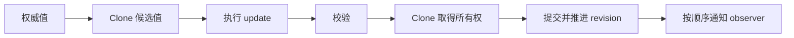

# CycloneGames.Settings

[English](README.md) | 简体中文

`CycloneGames.Settings` 持有一个经过校验的内存设置值。每次修改都在隔离的 clone 上进行，提交前校验，提交后把隔离快照发布给观察者。Assembly 是纯 C#，不引用 `UnityEngine`。

## 目录

- [概述](#概述)
- [Assembly](#assembly)
- [快速上手](#快速上手)
- [核心概念](#核心概念)
- [公共 API](#公共-api)
- [失败策略](#失败策略)
- [内存与线程](#内存与线程)
- [测试](#测试)
- [问题排查](#问题排查)

## 概述

| 关注点 | 所有者 |
| --- | --- |
| 权威值 | `SettingsState<T>` |
| 默认值、clone、校验 | `ISettingsSchema<T>` |
| 更新、重置、加载结果 | `SettingsUpdateResult`、`SettingsValidationResult` |
| 变更通知 | `SettingsChangedHandler<T>` |

设置模型由 `ISettingsSchema<T>` 定义。`SettingsState<T>` 持有该类型的一个值，并且只通过 clone 暴露。

## Assembly

| Assembly | Package | 引用 | `autoReferenced` | `noEngineReferences` |
| --- | --- | --- | --- | --- |
| `CycloneGames.Settings.Core` | `com.cyclone-games.settings` | 无 | `false` | `true` |
| `CycloneGames.Settings.Tests.Core` | 同一 package | `CycloneGames.Settings.Core` | `false` | `true` |

在 consumer asmdef 中添加 `CycloneGames.Settings.Core`。测试 assembly 由 `UNITY_INCLUDE_TESTS` 门控。

## 快速上手

### 第 1 步：定义模型与 schema

```csharp
using CycloneGames.Settings;

public sealed class AudioSettings
{
    public float MasterVolume;
    public bool Muted;
}

public sealed class AudioSettingsSchema : ISettingsSchema<AudioSettings>
{
    public AudioSettings CreateDefault()
    {
        return new AudioSettings { MasterVolume = 0.8f, Muted = false };
    }

    public AudioSettings Clone(in AudioSettings value)
    {
        return new AudioSettings
        {
            MasterVolume = value.MasterVolume,
            Muted = value.Muted
        };
    }

    public SettingsValidationResult Validate(in AudioSettings value)
    {
        if (value == null)
        {
            return SettingsValidationResult.Invalid("Audio settings are required.");
        }

        return value.MasterVolume >= 0f && value.MasterVolume <= 1f
            ? SettingsValidationResult.Valid()
            : SettingsValidationResult.Invalid("Master volume must be between zero and one.");
    }
}
```

`CreateDefault` 返回完整模型，`Clone` 产生深拷贝，`Validate` 是确定性的且不修改输入。默认值非法时，`SettingsState<T>` 构造会失败。

### 第 2 步：创建 state 并订阅

```csharp
var state = new SettingsState<AudioSettings>(new AudioSettingsSchema());

state.Changed +=
    (in AudioSettings snapshot, SettingsChangeReason reason) =>
    {
        audioMixer.SetFloat("MasterVolume", snapshot.MasterVolume);
    };
```

### 第 3 步：更新与读取

```csharp
SettingsUpdateResult result = state.Update(
    (ref AudioSettings candidate) => candidate.MasterVolume = 0.6f);

if (!result.Succeeded)
{
    ReportSettingsFailure(result.Error, result.Message, result.Exception);
}

AudioSettings isolatedSnapshot = state.Snapshot();
```



## 核心概念

`SettingsState<T>` 从不直接返回权威对象。`Snapshot()` 调用 schema 的 clone，每个 observer 拿到各自的 clone，因此一个 observer 无法修改 state 或其他 observer 的输入。不含引用对象的 struct 可以按值 clone；包含数组、list 或可变引用的 struct 需要显式深拷贝。

设置模型是纯数据，不能持有 `IDisposable` 资源、unmanaged handle、Unity object 生命周期或线程亲和状态；clone、校验和替换都会丢弃候选值，不执行 disposal。

| 操作 | 行为 |
| --- | --- |
| `Update` | Clone 当前值、执行 callback、校验、再次 clone、提交。失败时旧值仍是权威值。 |
| `ResetToDefaults` | 创建 schema 默认值，走同一条校验路径提交。 |
| `TryApplyLoaded` | 校验并提交由外部持久化边界解码的值，用 expected revision 做保护。 |
| `Snapshot` | 返回隔离 clone。 |

通知在完成操作的线程上同步执行。模块不向 Unity 主线程 marshal。可恢复的 observer 异常不会回滚提交、不会阻断后续 observer，并通过 `ObserverFailureCount` 与 `FirstObserverException` 报告。Observer 不得在同一个 state 上重入调用 `Snapshot`、`Update`、`ResetToDefaults` 或增删 `Changed` 订阅，这些会抛 `InvalidOperationException`；重入的 `TryApplyLoaded` 返回 `RevisionConflict`。

## 公共 API

### `ISettingsSchema<T>`

| 成员 | 说明 |
| --- | --- |
| `CreateDefault()` | 完整的默认模型。 |
| `Clone(in T value)` | 深拷贝；不得与输入共享可变状态。 |
| `Validate(in T value)` | 确定性校验，返回 `SettingsValidationResult`。 |

### `SettingsState<T>`

| 成员 | 说明 |
| --- | --- |
| `SettingsState(ISettingsSchema<T>)` | 校验默认值并提交初始值。 |
| `Schema` | 绑定的 schema。 |
| `Revision` | 单调递增的提交计数，用于拒绝过期的异步候选值。 |
| `Snapshot()` | 当前值的隔离 clone。 |
| `Update(SettingsRefAction<T>)` | 带校验的修改。 |
| `ResetToDefaults()` | 带校验的重置。 |
| `TryApplyLoaded(in T value, long expectedRevision)` | 供持久化集成使用的 compare-and-commit。 |
| `Changed` | 接收隔离快照与 `SettingsChangeReason` 的事件。 |

### 结果类型

| 类型 | 成员 |
| --- | --- |
| `SettingsValidationResult` | `IsInitialized`、`IsValid`、`Message`、静态 `Valid()`、`Invalid(string)` |
| `SettingsUpdateResult` | `Succeeded`、`Committed`、`Error`、`IsInitialized`、`Message`、`Exception`、`ObserverFailureCount`、`FirstObserverException`、`HasObserverWarnings` |
| `SettingsUpdateError` | `Uninitialized`、`None`、`DefaultCreationFailed`、`CandidateCloneFailed`、`UpdateCallbackFailed`、`ValidationFailed`、`CommitCloneFailed`、`RevisionConflict` |
| `SettingsChangeReason` | `Updated`、`ResetToDefaults`、`Loaded` |

默认构造的结果 struct 是 `Uninitialized`。Schema 或 callback 返回 `default` 会被当作契约违规拒绝。

## 失败策略

| 情况 | 行为 |
| --- | --- |
| 默认值非法 | 构造函数抛 `InvalidOperationException` |
| Candidate callback 抛异常 | Update 失败；旧 state 保持权威 |
| 校验失败 | 返回带类型的失败；不提交 |
| Observer 抛可恢复异常 | 提交成功并附带 warning；后续 observer 继续执行 |
| Observer 抛致命异常 | 提交后传播；后续 observer 不保证执行 |
| 异步加载的候选值过期 | `RevisionConflict`；较新的 state 保持权威 |
| 重叠或重入操作 | `InvalidOperationException` |

致命异常包括 `OutOfMemoryException`、`StackOverflowException`、`AccessViolationException`、`AppDomainUnloadedException`、`CannotUnloadAppDomainException`、`ThreadAbortException`、`BadImageFormatException`、`InvalidProgramException`。State 用一个原子 guard 拒绝重叠；它不是并发容器，也不排队。Composition owner 负责串行化操作。

## 内存与线程

`Snapshot`、update 候选值、已提交的 class 值以及 observer 快照的分配量取决于 schema 的 clone 实现。不含引用对象的 struct 可以按值 clone 而不产生托管分配。订阅与取消订阅会分配替换用 handler array；通知遍历稳定的数组。通知复杂度与 observer 数量线性相关，并为每个 observer clone 一次。

模块不使用 reflection、运行时代码生成、LINQ、service location、worker thread 或 Unity object 查找。需要内存上限的产品通过 schema 在提交候选值之前执行模型相关的约束。

## 测试

`CycloneGames.Settings.Tests.Core` 覆盖默认值非法、class 与 struct 的 clone 隔离、callback 与校验回滚、提交后的 observer warning、reset、带 revision 检查的加载提交、过期候选值拒绝、重入拒绝以及 revision 推进。

## 问题排查

| 现象 | 原因 | 处理 |
| --- | --- | --- |
| 构造函数抛异常 | Schema 的默认值非法 | 修正 `CreateDefault` 或 `Validate`。 |
| Update 返回失败 | Callback 抛异常、校验拒绝或 clone 失败 | 检查 `result.Error`、`result.Message`、`result.Exception`。 |
| Load 出现 `RevisionConflict` | 异步加载期间另一次提交推进了 `Revision` | 保留较新的 state；仅在产品策略要求时重试。 |
| Observer warning | 已注册的 observer 抛了可恢复异常 | 修正 observer；state 已经提交。 |
| 重入操作抛异常 | Observer 在通知期间修改了 state | 改为非重入的 dispatch 路径。 |
