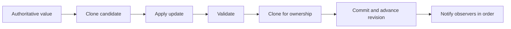

# CycloneGames.Settings

[English | 简体中文](README.SCH.md)

`CycloneGames.Settings` owns one validated in-memory settings value. Every mutation works on an isolated clone, is validated before it is committed, and publishes an isolated snapshot to observers after the commit. The assembly is pure C# with no `UnityEngine` reference.

## Contents

- [Overview](#overview)
- [Assembly](#assembly)
- [Getting started](#getting-started)
- [Core concepts](#core-concepts)
- [Public API](#public-api)
- [Failure policy](#failure-policy)
- [Memory and threading](#memory-and-threading)
- [Tests](#tests)
- [Troubleshooting](#troubleshooting)

## Overview

| Concern | Owner |
| --- | --- |
| Authoritative value | `SettingsState<T>` |
| Defaults, clone, validation | `ISettingsSchema<T>` |
| Update, reset, load results | `SettingsUpdateResult`, `SettingsValidationResult` |
| Change notification | `SettingsChangedHandler<T>` |

A settings model is defined by `ISettingsSchema<T>`. `SettingsState<T>` holds one value of that type and exposes it only through clones.

## Assembly

| Assembly | Package | References | `autoReferenced` | `noEngineReferences` |
| --- | --- | --- | --- | --- |
| `CycloneGames.Settings.Core` | `com.cyclone-games.settings` | none | `false` | `true` |
| `CycloneGames.Settings.Tests.Core` | same package | `CycloneGames.Settings.Core` | `false` | `true` |

Add `CycloneGames.Settings.Core` to the consumer asmdef. The test assembly is gated by `UNITY_INCLUDE_TESTS`.

## Getting started

### Step 1: define the model and schema

```csharp
using CycloneGames.Settings;

public sealed class AudioSettings
{
    public float MasterVolume;
    public bool Muted;
}

public sealed class AudioSettingsSchema : ISettingsSchema<AudioSettings>
{
    public AudioSettings CreateDefault()
    {
        return new AudioSettings { MasterVolume = 0.8f, Muted = false };
    }

    public AudioSettings Clone(in AudioSettings value)
    {
        return new AudioSettings
        {
            MasterVolume = value.MasterVolume,
            Muted = value.Muted
        };
    }

    public SettingsValidationResult Validate(in AudioSettings value)
    {
        if (value == null)
        {
            return SettingsValidationResult.Invalid("Audio settings are required.");
        }

        return value.MasterVolume >= 0f && value.MasterVolume <= 1f
            ? SettingsValidationResult.Valid()
            : SettingsValidationResult.Invalid("Master volume must be between zero and one.");
    }
}
```

`CreateDefault` returns a complete model, `Clone` produces a deep copy, and `Validate` is deterministic and does not mutate its input. Invalid defaults fail during `SettingsState<T>` construction.

### Step 2: create the state and subscribe

```csharp
var state = new SettingsState<AudioSettings>(new AudioSettingsSchema());

state.Changed +=
    (in AudioSettings snapshot, SettingsChangeReason reason) =>
    {
        audioMixer.SetFloat("MasterVolume", snapshot.MasterVolume);
    };
```

### Step 3: update and read

```csharp
SettingsUpdateResult result = state.Update(
    (ref AudioSettings candidate) => candidate.MasterVolume = 0.6f);

if (!result.Succeeded)
{
    ReportSettingsFailure(result.Error, result.Message, result.Exception);
}

AudioSettings isolatedSnapshot = state.Snapshot();
```



## Core concepts

`SettingsState<T>` never returns its authoritative object. `Snapshot()` calls the schema clone, and each observer receives its own clone, so one observer cannot mutate the state or another observer's input. A struct without referenced objects can clone by value. A struct containing arrays, lists, or mutable references needs an explicit deep clone.

The settings model is pure data. It must not own `IDisposable` resources, unmanaged handles, Unity object lifetimes, or thread-affine state, because clone, validation, and replacement discard candidates without disposal.

| Operation | Behavior |
| --- | --- |
| `Update` | Clones the current value, applies the callback, validates, clones again, commits. A failure leaves the old value authoritative. |
| `ResetToDefaults` | Creates schema defaults and commits through the same validation path. |
| `TryApplyLoaded` | Validates and commits a value decoded by an external persistence boundary, guarded by an expected revision. |
| `Snapshot` | Returns an isolated clone. |

Notifications run synchronously after commit on the thread that completed the operation. The module does not marshal to Unity's main thread. A recoverable observer exception does not roll back the commit, does not stop later observers, and is reported through `ObserverFailureCount` and `FirstObserverException`. Observers must not call `Snapshot`, `Update`, `ResetToDefaults`, or change `Changed` subscriptions reentrantly on the same state; those throw `InvalidOperationException`. A reentrant `TryApplyLoaded` returns `RevisionConflict`.

## Public API

### `ISettingsSchema<T>`

| Member | Description |
| --- | --- |
| `CreateDefault()` | Complete default model. |
| `Clone(in T value)` | Deep copy; must not alias mutable state from the input. |
| `Validate(in T value)` | Deterministic validation returning `SettingsValidationResult`. |

### `SettingsState<T>`

| Member | Description |
| --- | --- |
| `SettingsState(ISettingsSchema<T>)` | Validates defaults and commits the initial value. |
| `Schema` | The bound schema. |
| `Revision` | Monotonic commit counter used to reject stale asynchronous candidates. |
| `Snapshot()` | Isolated clone of the current value. |
| `Update(SettingsRefAction<T>)` | Validated mutation. |
| `ResetToDefaults()` | Validated reset. |
| `TryApplyLoaded(in T value, long expectedRevision)` | Compare-and-commit for persistence integrations. |
| `Changed` | Event receiving an isolated snapshot and a `SettingsChangeReason`. |

### Result types

| Type | Members |
| --- | --- |
| `SettingsValidationResult` | `IsInitialized`, `IsValid`, `Message`, static `Valid()`, `Invalid(string)` |
| `SettingsUpdateResult` | `Succeeded`, `Committed`, `Error`, `IsInitialized`, `Message`, `Exception`, `ObserverFailureCount`, `FirstObserverException`, `HasObserverWarnings` |
| `SettingsUpdateError` | `Uninitialized`, `None`, `DefaultCreationFailed`, `CandidateCloneFailed`, `UpdateCallbackFailed`, `ValidationFailed`, `CommitCloneFailed`, `RevisionConflict` |
| `SettingsChangeReason` | `Updated`, `ResetToDefaults`, `Loaded` |

A default result struct is `Uninitialized`. A schema or callback returning `default` is rejected as a contract failure.

## Failure policy

| Situation | Behavior |
| --- | --- |
| Invalid defaults | Constructor throws `InvalidOperationException` |
| Candidate callback throws | Update fails; old state stays authoritative |
| Validation fails | Typed failure returned; no commit |
| Recoverable observer exception | Commit succeeds with a warning; later observers still run |
| Fatal observer exception | Propagates after commit; later observers are not guaranteed |
| Stale async loaded candidate | `RevisionConflict`; newer state stays authoritative |
| Overlapping or reentrant operation | `InvalidOperationException` |

Fatal exceptions are `OutOfMemoryException`, `StackOverflowException`, `AccessViolationException`, `AppDomainUnloadedException`, `CannotUnloadAppDomainException`, `ThreadAbortException`, `BadImageFormatException`, and `InvalidProgramException`. The state uses one atomic guard to reject overlap; it is not a concurrent collection and does not queue work. The composition owner serializes operations.

## Memory and threading

`Snapshot`, update candidates, committed class values, and observer snapshots allocate according to the schema's clone implementation. Struct-only models without referenced objects can clone by value without managed allocation. Subscription and removal allocate a replacement handler array; notification iterates the stable array. Notification is linear in observer count and clones once per observer.

The module uses no reflection, runtime code generation, LINQ, service location, worker thread, or Unity object lookup. Products that need memory limits enforce model-specific bounds through their schema before committing a candidate.

## Tests

`CycloneGames.Settings.Tests.Core` covers invalid defaults, class and struct clone isolation, callback and validation rollback, post-commit observer warnings, reset, revision-checked loaded commits, stale-candidate rejection, reentrancy rejection, and revision advancement.

## Troubleshooting

| Symptom | Cause | Action |
| --- | --- | --- |
| Constructor throws | Invalid defaults from the schema | Fix `CreateDefault` or `Validate`. |
| Update returns failure | Callback threw, validation rejected, or clone failed | Check `result.Error`, `result.Message`, `result.Exception`. |
| `RevisionConflict` on load | Another commit advanced `Revision` during the async load | Keep the newer state. |
| Observer warning | A registered observer threw a recoverable exception | Fix the observer; the state is already committed. |
| Reentrant operation throws | An observer mutated state during notification | Dispatch to a non-reentrant path. |
